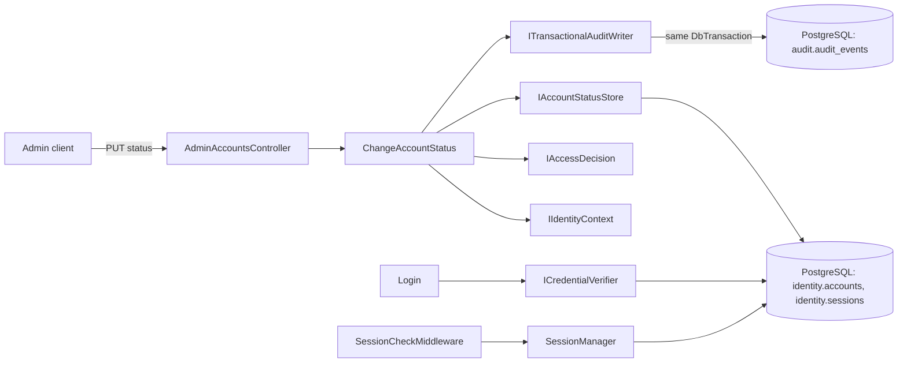
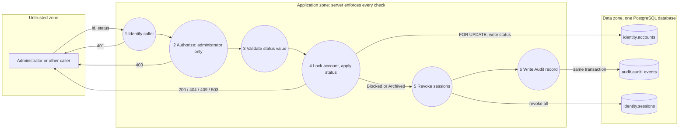

# Project component: IDN-03, Account status management

**Team:** 2

**Student:** Igor Cvijić / PR 21/2023

**Specification requirements:** IDN-03 (primary), ADM-01, AUD-01, AUD-03, ACC-05, SEC-01, SEC-03, UC-05. Depends on IDN-02 (sessions), ADM-02 (database) and the Audit module (`ITransactionalAuditWriter`).

**User story:** As an administrator, I want blocked and archived accounts to be unable to sign in, so that unauthorized access is prevented.

An administrator sets the status of another account to `ACTIVE`, `BLOCKED` or `ARCHIVED`
(`PUT /api/admin/accounts/{id}/status`). The status is written to `identity.accounts`, the same table login reads,
so the next login and the next request of an existing session see it.

## Responsibilities and boundaries

* Owned by Team 2: the use-case `ChangeAccountStatus`, the store `EfAccountStatusStore`, the session check. Team 12 (Audit) owns the Audit contract; we only call it. Team 4 (IDN-05 administrator unlock) uses the same store and transaction through `ClearLockoutAsync`; a lockout is separate from the status, so unlocking a `BLOCKED` or `ARCHIVED` account leaves it blocked or archived.
* One successful change is **one database transaction**: new status, revocation of all sessions (for `BLOCKED` and `ARCHIVED`) and the Audit record. If any step fails, nothing is stored.
* Refusals (unauthenticated, not an administrator, invalid status, self-change, unknown account, same status) change nothing and are recorded in Audit in their own short transaction. A failed Audit write does not change the answer to a refusal.
* If the Audit record of a successful change cannot be written, the change is rolled back and the endpoint returns `503 unavailable`.

|Contract|Implementation|
|-|-|
|`IIdentityContext`|`SessionIdentityContext` (server-side session, IDN-02)|
|`IAccessDecision`|`AdminOnlyAccessDecision`, administrator only, deny by default. `CanChangeAccountStatus` is the check of this component; `CanUnlockAccount` is the second-line check of the [IDN-05 administrator unlock](components/identity/IDN-05-admin-unlock.md), with the same administrator source|
|`IAccountStatusStore`|`EfAccountStatusStore` over `PlatformIdentityDbContext` (`identity.accounts`, `identity.sessions`)|
|`IAccountStatusUnitOfWork`|One transaction opened by `IAccountStatusStore.BeginAsync`; disposing without `CommitAsync` rolls it back. `FindForUpdateAsync` reads and locks the account row, `ApplyAsync` stores the status and, for `BLOCKED` and `ARCHIVED`, revokes the sessions. `ClearLockoutAsync` is used only by the IDN-05 administrator unlock: it sets `failed_login_count` to 0 and `lockout_end` to null and returns the lockout end it cleared, or changes nothing and returns null when the account is not locked. It never touches the status or the sessions|
|`ISessionManager`|`SessionManager` (single registration; revocation runs inside the status transaction)|
|`ITransactionalAuditWriter`|Audit module, receives the open `DbTransaction`; event type `account.status.changed`|

## Component architecture

`identity` and `audit` schemas must be in the same database, otherwise the Audit record cannot join the
identity transaction. In local development both live in the `securitylab` database (see `docker-compose.yml`);
`Program.cs` migrates the audit schema into the identity database at startup in Development.

## Data flow diagram

Order of checks: CSRF token (US-15, only for a valid session), then authenticated, then administrator, then status value valid, then not self-change, then account exists, then not the same status.
Authorization comes before the account lookup on purpose, so a non-administrator cannot learn which accounts exist.
The CSRF check comes first of all, before the session check and Access (see [`IDN-02_CSRF.md`](components/identity/IDN-02_CSRF.md)). A request with a valid session but without a valid `X-CSRF-TOKEN` gets `403` with the body `{ "code": "csrf_invalid" }`, not Access's `403` `ProblemDetails`, for every account id, so it reveals nothing about accounts either. A request with a revoked, expired or unknown session is not refused by the CSRF check and still gets `401`. A refused CSRF request is written to the application log with its correlation ID, not to Audit.

## Security requirements

* Server-side access checks: `IAccessDecision` runs inside the use-case, not only in the controller (ACC-05, SEC-01).
* Session check on every request (SEC-03): `SessionManager.ValidateAsync` refuses a revoked or expired session and also a session whose account is not `ACTIVE`. This is defense in depth only: it is not enough alone, because a session stored behind the revocation would work again after reactivation.
* Session issuing (SEC-03): `ISessionStore.CreateForActiveAccountAsync` locks the account row with `SELECT ... FOR SHARE` in the same transaction that stores the session. A login that passed its status check before a block either waits for the block and stores nothing (`AccountNotActiveException`, login answers like any refused login), or commits first and is then revoked by the block. No token can outlive a block, so reactivation never revives one.
* The status is accepted only by name (`ACTIVE`, `BLOCKED`, `ARCHIVED`, any letter case). Numbers such as `1` or `99` are rejected.
* Audit record (AUD-01, AUD-03): actor, event type, resource, time, outcome and correlation ID, details only `oldStatus`/`newStatus` or a `reasonCode`. No free text, tokens, cookies or session ids. The `reason` field of the request body is accepted for compatibility but **not stored**, because the Audit contract allows no free text.
* An administrator cannot change their own status, to avoid locking out the last administrator.
* Concurrent changes of the same account are serialized with `SELECT ... FOR UPDATE`.

|Misuse|Control|Test|
|-|-|-|
|Forged request (no valid CSRF token) with an administrator's session|`403 csrf_invalid` before every other check, nothing changes, the session is not extended|`AdminStatusChange_WithoutToken_IsRefused_AndChangesNoStatusOrSession`, `RefusedRequest_DoesNotExtendTheSession` (`CsrfProtectionIntegrationTests`)|
|Forged request with a non-administrator's session|`403 csrf_invalid`, the same answer for an existing and an unknown account|`NonAdminStatusChange_WithoutToken_GetsTheSameAnswerForAnExistingAndAnUnknownAccount`|
|Student or non-admin blocks an account|403, nothing changes, denial audited|`Student_IsForbidden_NothingChanges_DenialIsAudited`, `Student_CannotChangeStatus_NothingChanges_DenialIsAudited` (integration)|
|Request without a caller|401, nothing changes|`Anonymous_IsUnauthenticated_NothingChanges_DenialIsAuditedWithoutActor`|
|Invalid or numeric status|strict parsing, 400|`InvalidStatusValue_IsRejected_NothingChanges` (7 cases)|
|Unknown account|404, failure audited|`UnknownAccount_ReturnsNotFound_AndIsAudited`, `UnknownAccount_ReturnsNotFound_AndLeavesNoOtherRows`|
|Administrator blocks themselves|409, audited|`Admin_CannotChangeOwnStatus`|
|Same status again|409, sessions stay|`SameStatus_IsInvalidTransition_SessionsStay`|
|Blocked account keeps a session|sessions revoked in the same transaction|`Block_RevokesActiveSession_RefusesNextRequestAndLogin_AndRecordsAudit`, `Archive_RevokesAllSessionsOfTheAccount`|
|Blocked account signs in|login reads `identity.accounts`|same integration test (login returns 401)|
|Session created behind the revocation|refused at issue (row lock), and status checked on every request|`LoginThatStartedBeforeTheBlock_IsRefusedAtIssue_SoReactivationCannotRevive_ItsToken`, `LoginsRacingWithABlock_NeverLeaveATokenThatWorksAfterReactivation`, `SessionOfAccountBlockedBehindTheRevocation_IsStillRefused`, `AccountBlockedAfterTheStatusCheck_IsRefused_LikeAnyBlockedLogin_AndNoSuccessIsAudited`|
|Audit unavailable|whole change rolled back, 503|`AuditNotRecorded_RollsBackStatusAndSessions`, `AuditFailure_RollsBackStatusSessionRevocationAndAuditRow`|
|Database failure|nothing stored, 503|`DatabaseFailure_ReturnsUnavailable_AndStoresNothing`|
|Excessive requests (SEC-04)|controlled 429 with `Retry-After`, nothing changes|`ExcessiveStatusChanges_AreRefusedWith429_AndChangeNothing`|
|Secrets or session ids in the Audit record|details limited to status names|`AuditRecord_HasNoFreeTextOrIdentifiersOfSessions`|
|Reactivation wrongly revokes sessions|revoke only for Blocked and Archived|`Admin_ActivatesBlockedAccount_DoesNotTouchSessions`|

## Evidence of work

* Branch: `fix/idn-03-persistent-status-change`.
* Changed: `Services/Identity/ChangeAccountStatus.cs`, `EfAccountStatusStore.cs`, `SessionManager.cs`; `Interfaces/Identity/IAccountStatusStore.cs`; `Controllers/Identity/AdminAccountsController.cs`; `Program.cs`. Removed: `IAccountRepository`, `InMemoryAccountRepository`, the duplicate `ISessionManager` registration.
* Tests: `Platform.Identity.Tests/Services/ChangeAccountStatusTests.cs` (unit, 25 cases) and `Platform.Identity.Tests/Integration/AccountStatusChangeIntegrationTests.cs` (real PostgreSQL, 12 cases).
* Run (PowerShell, repository root): `dotnet test backend\Platform.Identity.Tests --filter "Category=IDN-03"`.
* Full run on 2026-11-24, after merging `main` (`dotnet test backend/SecurityLab.slnx -c Release`, .NET SDK 10.0.404, Docker available): 0 failed in every project; `Platform.Identity.Tests` 485 passed, 0 skipped. Skips elsewhere in that run are PostgreSQL fixtures that need an environment variable and are not part of IDN-03: `Platform.Audit.Tests` 36 and `Platform.Competencies.Tests` 8 (`AUDIT_TEST_*` / `PRG04_TEST_ADMIN_CONNECTION_STRING`, set by `scripts/audit/test-postgres.ps1` and `scripts/test-competencies-postgres.ps1`); with those scripts the same fixtures run and pass (Audit 328/328, Competencies 83/83). Frontend: `tsc --noEmit` clean, `vitest run` 195 passed (Node 22).

## Implementation status

|Acceptance criterion|Status|
|-|-|
|Administrator can set `ACTIVE`, `BLOCKED` or `ARCHIVED`|Done|
|`BLOCKED` and `ARCHIVED` accounts cannot log in|Done, status stored where login reads it (integration test)|
|System stores the new status in the database|Done, `identity.accounts`|
|Only an authorized administrator can change status|Done, negative tests|
|The change is recorded|Done, persistent Audit record in the same transaction|
|Blocking revokes all sessions at once|Done, in the same transaction; next request with an old session returns 401|

## Known limitations and residual risk

* Deployment must create the `audit` schema in the identity database (`AuditPersistenceExtensions.MigrateAuditDatabaseAsync`); the web host migrates it only in Development. If the database user used by the identity module cannot write to `audit`, every status change returns `503`.
* `identity` and `audit` must stay in one database. Moving Audit to a separate database requires an outbox or a different integration.
* The `reason` text is not stored (see above). If a reason is required, ask Team 12 for an allowed structured field.
* Any status can change to any other different status, including `ARCHIVED` back to `ACTIVE`. This is a conscious simplification.
* Rate limiting (SEC-04) is per client IP: `identity-account-status-change`, default 20 requests per 60 s (`RateLimiting__AccountStatusChange__*`, see `Modules/Identity/RateLimiting/README.md`). It runs after the Access middleware, so only requests of an authorized administrator are counted; a refused request gets `429` with `Retry-After` and reaches neither the handler nor Audit.
* Selective revocation and listing of own sessions (IDN-07) is the next task; it reuses `SessionManager.RevokeSession` and `ListForUser`.
