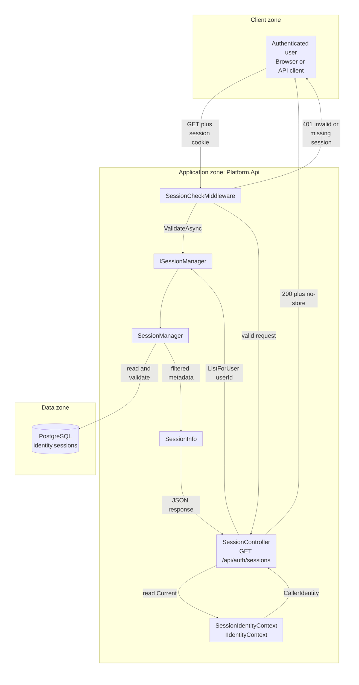
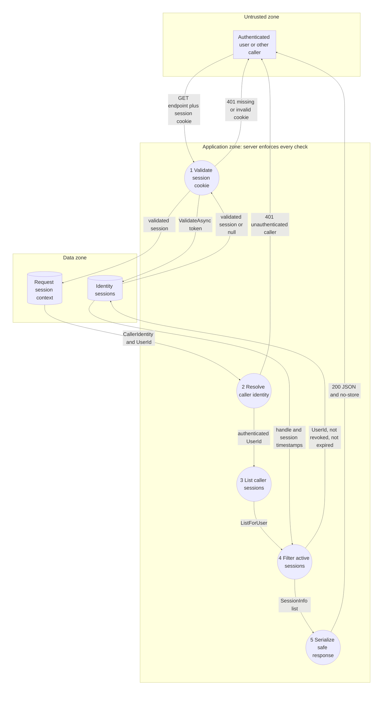

# Project component: IDN-07, Session review and revocation

**Team:** 2

**Specification requirements:** IDN-07 (primary), IDN-02 (session validation and storage)

**User story:** As an authenticated user, I want to review my active sessions and revoke any of them one by one, so that I know from which sessions I currently have access to the system and can end the ones I do not recognize.

## Responsibilities and boundaries

- Processes and user scenarios:

  - An authenticated user requests their sessions with `GET /api/auth/sessions`.
  - `SessionCheckMiddleware` validates the session cookie before the controller is executed.
  - `SessionController` obtains the caller identity from `IIdentityContext` and requests sessions for that identity only.
  - `SessionManager` excludes revoked and expired sessions and filters by the authenticated user's identifier.
  - The response contains the session handle, creation time, last-activity time, and expiration time.
  - Missing, invalid, or unauthenticated sessions are rejected with `401 Unauthorized`.
  - An authenticated user revokes one of their own sessions with `DELETE /api/auth/sessions/{handle}`, using a handle from the list response. The caller is always taken from the validated session, never from client input.
  - A handle that belongs to another user and a handle that does not exist both return `404 session_not_found` with the same body, so the response does not reveal that another user's session exists.
  - The next request that carries a revoked or expired session is rejected by `SessionCheckMiddleware` with `401` and the stable code `session_invalid`. The rejected cookie is cleared and the response is `no-store`. This holds for the revoked session itself too, so revoking the current session ends it immediately.
  - Revoking one session leaves the user's other sessions valid.
  - 401 and 403 stay separate: no valid session is `401`, a valid session without permission is `403`. A session that was revoked gets `401` on the next request, not `403`, even on a permission-checked route.

- Contracts with other modules:

  | Contract | Direction | State |
  |---|---|---|
  | `IIdentityContext` | provides the caller identity derived from the validated session | implemented by `SessionIdentityContext` |
  | `ISessionManager` | validates sessions, lists sessions for a user and revokes one session of its owner | implemented by `SessionManager` |
  | `PlatformIdentityDbContext` | persists and queries identity sessions | implemented with EF Core and PostgreSQL at runtime |
  | `SessionInfo` | transfers safe session metadata to the API response | implemented; excludes token and hash data |
  | `SessionCheckMiddleware` | validates the session cookie before controller execution | implemented in the API pipeline |

- Implementation status:

  - `SessionController`, `GET /api/auth/sessions` and `DELETE /api/auth/sessions/{handle}` are implemented. Both actions are marked `[DelegatedAuthorization]` and are listed in the ACC-05 endpoint inventory, because they authenticate the caller themselves.
  - `SessionManager.ListForUser` filters by user ownership, revocation, and expiration.
  - `SessionManager.RevokeSession` revokes one session only when it belongs to the given owner. `Session.IsActiveAt` is the single definition of "not revoked and not expired"; there is no schema change and no migration.
  - `SessionManager` takes an optional `TimeProvider` so expiry can be tested.
  - `SessionControllerTests` cover controller behavior with a mocked `ISessionManager`.
  - `SessionManagerTests` and `SessionManagerValidationTests` cover the real query implementation with an EF Core InMemory context.
  - `SessionCheckMiddlewareTests` cover the middleware branches with a mocked `ISessionManager`.
  - `SessionReviewRevokeIntegrationTests` cover the real HTTP pipeline end to end (routing, `SessionCheckMiddleware`, the real `SessionManager`, PostgreSQL in a Testcontainers container), in the `Development` and `Production` environments for the revoke scenario.

## Component architecture



The controller does not accept a `userId` from a route, query string, or request body. It reads the caller identity through `IIdentityContext` and passes that identity's `UserId` to `ISessionManager`. `SessionIdentityContext` is a service used when the controller accesses `IIdentityContext.Current`; it is not a separate middleware stage.

## Data flow diagram



Trust boundary: cookie and HTTP request data comes from the untrusted client zone. Session validation, caller identity, ownership filtering, and response construction are enforced in the application zone. The identity database is a separate data zone. The raw token is not stored; only its hash is persisted for validation.

Data-isolation rule: `SessionManager.ListForUser` applies `session.UserId == userId`, `RevokedAt == null`, and `ExpiresAt > now`. The endpoint has no client-controlled user identifier, so a caller cannot select another user's sessions by changing a request parameter.

## Security requirements

- Server-side access checks:

  - `SessionCheckMiddleware` rejects requests without a session cookie or with an invalid, revoked, or expired session.
  - `SessionIdentityContext` derives the caller identity from the validated session stored in `HttpContext.Items`.
  - `SessionController` rejects a missing, unauthenticated, or user-less caller before calling the session manager.

- Input validation and sensitive data:

  - `SessionManager.ListForUser` rejects `Guid.Empty` with an `ArgumentException`.
  - `SessionInfo` exposes only the session handle and timestamps.
  - Raw session tokens and token hashes are not included in the response.
  - Successful responses use `Cache-Control: no-store`.

- Negative scenarios:

  | Misuse or scenario | Control | Test |
  |---|---|---|
  | Request without a caller | `401`; session manager is not called | `NoCaller_Returns401` |
  | Caller is not authenticated | `401`; session manager is not called | `UnauthenticatedCaller_Returns401` |
  | Caller has no user identifier | `401`; session manager is not called | `CallerWithoutUserId_Returns401` |
  | User has no sessions | `200` with an empty list | `ActiveCaller_WithNoSessions_ReturnsEmptyList` |
  | User requests their sessions | manager receives the caller's `UserId` and cancellation token | `ActiveCaller_ReturnsOwnSessions` |
  | Revoked session belongs to the user | `RevokedAt == null` filter | `ListForUser_ReturnsOnlyUnrevokedUnexpiredSessionsForRequestedUser` |
  | Expired session belongs to the user | `ExpiresAt > now` filter | `ListForUser_ReturnsOnlyUnrevokedUnexpiredSessionsForRequestedUser` |
  | Active session belongs to another user | `UserId == userId` filter | `ListForUser_ReturnsOnlyUnrevokedUnexpiredSessionsForRequestedUser` |
  | Response contains credential material | `SessionInfo` has no token, hash, or cookie property | `SessionInfo_ExposesNoTokenOrHash`, `ListSessions_ReturnsOnlyTheCallersActiveSessions_WithoutCredentialMaterial` |
  | Request without a session cookie | `401 session_invalid`, no cookie to clear | `ProtectedRoute_WithoutCookie_Returns401SessionInvalid_AndHasNoCookieToClear` |
  | Request with an unknown token | `401 session_invalid`, cookie cleared | `ProtectedRoute_WithUnknownToken_Returns401SessionInvalid_AndClearsTheCookie` |
  | Valid session without permission | `403`, nothing changed, session stays valid | `ProtectedRoute_ValidSessionWithoutPermission_Returns403_AndChangesNothing` |
  | Revoked session is used again | `401 session_invalid` on the next request (not `403`), cookie cleared | `RevokedSession_Gets401OnTheNextRequest_WhilePermissionDenialStays403` |
  | User revokes another of their sessions | `204`; the revoked one is refused at once, the caller's session stays valid | `RevokeOtherSession_RejectsItImmediately_AndKeepsTheCallersSessionValid` |
  | User revokes the session they are using | `204`; the same cookie is refused on the next request | `RevokeCurrentSession_RejectsTheSameCookieOnTheNextRequest` |
  | Revoke with another user's handle (IDOR, SEC-01) | `404 session_not_found`, same body as an unknown handle, nothing revoked | `RevokeSessionOfAnotherUser_Returns404_IndistinguishableFromUnknown_AndRevokesNothing` |

## Evidence of work

- Changed files / commit / pull request:

  - `backend/Platform.Api/Controllers/Identity/SessionController.cs`
  - `backend/Platform.Api/Middleware/SessionCheckMiddleware.cs`
  - `backend/Platform.Api/Services/Identity/SessionManager.cs`
  - `backend/Platform.Identity/Entities/Session.cs`
  - `backend/Platform.Access.Tests/ApiEndpointCoverageTests.cs` (the two session routes in the ACC-05 inventory)
  - `backend/Platform.Identity.Tests/Controllers/SessionControllerTests.cs`
  - `backend/Platform.Identity.Tests/Middleware/SessionCheckMiddlewareTests.cs`
  - `backend/Platform.Identity.Tests/Services/SessionManagerTests.cs`
  - `backend/Platform.Identity.Tests/Services/SessionManagerValidationTests.cs`
  - `backend/Platform.Identity.Tests/Services/ChangeAccountStatusTests.cs`
  - `backend/Platform.Identity.Tests/Integration/SessionReviewRevokeIntegrationTests.cs`
  - `docs/IDN-07-SESSION-REVIEW-REVOKE.md`
  - Pull request: [#129](https://github.com/owlCoder/security-lab/pull/129).

- Run instructions (the integration tests start PostgreSQL with Testcontainers, so Docker must be running):

  ```bash
  dotnet test backend/Platform.Identity.Tests/Platform.Identity.Tests.csproj \
    --filter "FullyQualifiedName~SessionControllerTests|FullyQualifiedName~SessionCheckMiddlewareTests|FullyQualifiedName~SessionManagerTests|FullyQualifiedName~SessionManagerValidationTests|FullyQualifiedName~SessionReviewRevokeIntegrationTests"
  ```

- Tests and results:

  - `SessionControllerTests` use a mocked `ISessionManager` to test controller behavior and authorization branches.
  - `SessionManagerTests` and `SessionManagerValidationTests` use the real `SessionManager` with an isolated EF Core InMemory context to test ownership, revocation, expiration, account status, and projection behavior.
  - `SessionCheckMiddlewareTests` test the middleware branches with a mocked `ISessionManager`.
  - `SessionReviewRevokeIntegrationTests` send real HTTP requests through the whole pipeline to the real `SessionManager` and PostgreSQL. They confirm that no session is `401 session_invalid`, a valid session without permission is `403`, a revoked session is `401` on its next request (also in the `Production` environment) while the caller's other sessions stay valid, and another user's handle is `404`. The `403` route is the IDN-03 admin endpoint `PUT /api/admin/accounts/{id}/status`.
  - To check that these tests can fail, `Session.IsActiveAt` was temporarily changed to ignore revocation; four of the nine tests failed, and the change was reverted.
  - Full backend run (`dotnet test backend/SecurityLab.slnx -c Release`): 0 failed in all test projects; `Platform.Identity.Tests` 345 passed.
  - The runtime application uses PostgreSQL; InMemory is used only for deterministic service tests.

- Scope of the end-to-end evidence:

  - The integration tests cover the routes of this component (`/api/auth/*`) and the IDN-03 admin route. Routes guarded by the ACC-05 `[RequireAccess]` middleware (for example REV-05 revision approval) resolve the caller through `RevisionSessionSubjectProvider`, which calls the same `ISessionManager.ValidateAsync`. Their 401 and 403 behavior is covered by `ReviewAuthorizationTests` (REV-05), which uses a test session manager, so it was run but not changed here.

- Next steps:

  - Confirm with the IDN-02 team whether `MfaPending` sessions should be included in the session list. The current query filters revocation and expiration but not `AuthLevel` (TODO in `SessionManager.ListForUser`, depends on IDN-06 / TYP-05).
  - Remove the old `StoreSessionManager` registration when `SessionManager` becomes the sole official implementation.
