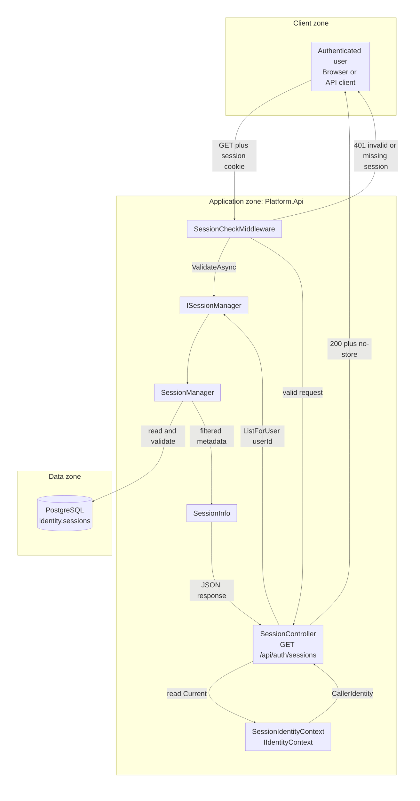
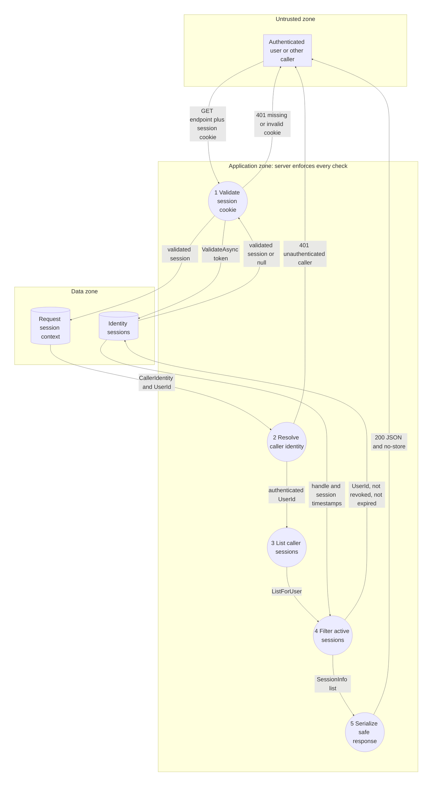

# Project component: IDN-07, Session review and revocation

**Team:** 2

**Specification requirements:** IDN-07 (primary), IDN-02 (session validation and storage)

**User story:** As an authenticated user, I want to review my active sessions, so that I know from which sessions I currently have access to the system.

## Responsibilities and boundaries

- Processes and user scenarios:

  - An authenticated user requests their sessions with `GET /api/auth/sessions`.
  - `SessionCheckMiddleware` validates the session cookie before the controller is executed.
  - `SessionController` obtains the caller identity from `IIdentityContext` and requests sessions for that identity only.
  - `SessionManager` excludes revoked and expired sessions and filters by the authenticated user's identifier.
  - The response contains the session handle, creation time, last-activity time, and expiration time.
  - Missing, invalid, or unauthenticated sessions are rejected with `401 Unauthorized`.

- Contracts with other modules:

  | Contract | Direction | State |
  |---|---|---|
  | `IIdentityContext` | provides the caller identity derived from the validated session | implemented by `SessionIdentityContext` |
  | `ISessionManager` | validates sessions and lists sessions for a user | implemented by `SessionManager` |
  | `PlatformIdentityDbContext` | persists and queries identity sessions | implemented with EF Core and PostgreSQL at runtime |
  | `SessionInfo` | transfers safe session metadata to the API response | implemented; excludes token and hash data |
  | `SessionCheckMiddleware` | validates the session cookie before controller execution | implemented in the API pipeline |

- Implementation status:

  - `SessionController` and `GET /api/auth/sessions` are implemented.
  - `SessionManager.ListForUser` filters by user ownership, revocation, and expiration.
  - `SessionControllerTests` cover controller behavior with a mocked `ISessionManager`.
  - `SessionManagerTests` cover the real query implementation with an EF Core InMemory context.
  - A PostgreSQL end-to-end HTTP test remains a recommended follow-up.

## Component architecture



The controller does not accept a `userId` from a route, query string, or request body. It reads the caller identity through `IIdentityContext` and passes that identity's `UserId` to `ISessionManager`. `SessionIdentityContext` is a service used when the controller accesses `IIdentityContext.Current`; it is not a separate middleware stage.

## Data flow diagram



Trust boundary: cookie and HTTP request data comes from the untrusted client zone. Session validation, caller identity, ownership filtering, and response construction are enforced in the application zone. The identity database is a separate data zone. The raw token is not stored; only its hash is persisted for validation.

Data-isolation rule: `SessionManager.ListForUser` applies `session.UserId == userId`, `RevokedAt == null`, and `ExpiresAt > now`. The endpoint has no client-controlled user identifier, so a caller cannot select another user's sessions by changing a request parameter.

## Security requirements

- Server-side access checks:

  - `SessionCheckMiddleware` rejects requests without a session cookie or with an invalid, revoked, or expired session.
  - `SessionIdentityContext` derives the caller identity from the validated session stored in `HttpContext.Items`.
  - `SessionController` rejects a missing, unauthenticated, or user-less caller before calling the session manager.

- Input validation and sensitive data:

  - `SessionManager.ListForUser` rejects `Guid.Empty` with an `ArgumentException`.
  - `SessionInfo` exposes only the session handle and timestamps.
  - Raw session tokens and token hashes are not included in the response.
  - Successful responses use `Cache-Control: no-store`.

- Negative scenarios:

  | Misuse or scenario | Control | Test |
  |---|---|---|
  | Request without a caller | `401`; session manager is not called | `NoCaller_Returns401` |
  | Caller is not authenticated | `401`; session manager is not called | `UnauthenticatedCaller_Returns401` |
  | Caller has no user identifier | `401`; session manager is not called | `CallerWithoutUserId_Returns401` |
  | User has no sessions | `200` with an empty list | `ActiveCaller_WithNoSessions_ReturnsEmptyList` |
  | User requests their sessions | manager receives the caller's `UserId` and cancellation token | `ActiveCaller_ReturnsOwnSessions` |
  | Revoked session belongs to the user | `RevokedAt == null` filter | `ListForUser_ReturnsOnlyUnrevokedUnexpiredSessionsForRequestedUser` |
  | Expired session belongs to the user | `ExpiresAt > now` filter | `ListForUser_ReturnsOnlyUnrevokedUnexpiredSessionsForRequestedUser` |
  | Active session belongs to another user | `UserId == userId` filter | `ListForUser_ReturnsOnlyUnrevokedUnexpiredSessionsForRequestedUser` |
  | Response contains credential material | `SessionInfo` has no token, hash, or cookie property | `SessionInfo_ExposesNoTokenOrHash` |

## Evidence of work

- Changed files / commit / pull request:

  - `backend/Platform.Api/Controllers/Identity/SessionController.cs`
  - `backend/Platform.Api/Services/Identity/SessionManager.cs`
  - `backend/Platform.Identity.Tests/Controllers/SessionControllerTests.cs`
  - `backend/Platform.Identity.Tests/Services/SessionManagerTests.cs`
  - `docs/IDN-07-SESSION-REVIEW-REVOKE.md`
  - Commit and pull request: to be added when created.

- Run instructions:

  ```bash
  dotnet test backend/Platform.Identity.Tests/Platform.Identity.Tests.csproj \
    --filter "FullyQualifiedName~SessionControllerTests|FullyQualifiedName~SessionManagerTests"
  ```

- Tests and results:

  - `SessionControllerTests` use a mocked `ISessionManager` to test controller behavior and authorization branches.
  - `SessionManagerTests` use the real `SessionManager` with an isolated EF Core InMemory context to test ownership, revocation, expiration, and projection behavior.
  - The runtime application uses PostgreSQL; InMemory is used only for deterministic service tests.

- Next steps:

  - Confirm with the IDN-02 team whether `MfaPending` sessions should be included in the session list. The current query filters revocation and expiration but not `AuthLevel`.
  - Remove the old `StoreSessionManager` registration when `SessionManager` becomes the sole official implementation.
  - Add a `WebApplicationFactory` or `TestServer` test for middleware execution, DI registration, routing, and valid/invalid session cookies.
