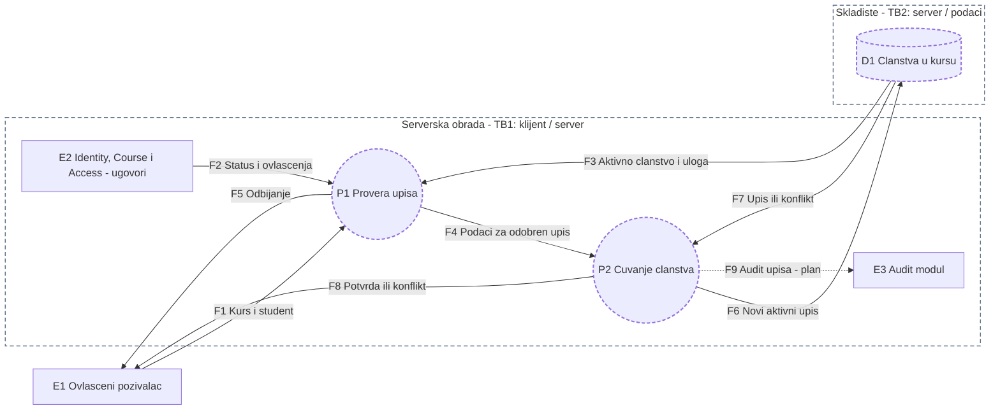
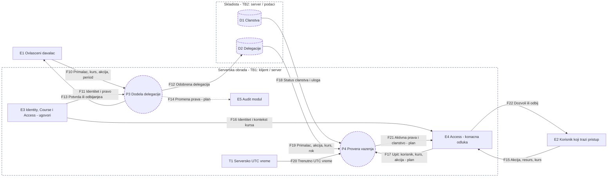

# Dijagrami toka podataka (DFD) — ACC-02 i ACC-07

**Tim:** 10  
**Projektne celine:** ACC-02 (J), ACC-07 (P)  
**Kontrolna tačka:** KT1  
**Status:** Projektovani tokovi podataka  
**Referentno stanje:** grana `main` pregledana 06.11.2026; stanje timske grane navedeno prema uputstvu ACC-02 v2 od 05.11.2026.

## 1. Opseg

Dokument prikazuje tokove podataka za dve funkcionalnosti platforme Security Lab:

- **ACC-02 — Dodela studenta kursu:** ovlašćeni nastavnik kursa upisuje studenta; mogućnost administratorskog upisa zavisi od dogovorene politike. Server proverava pozivaoca, nalog, kurs i postojeće članstvo. Isti korisnik ne sme imati dva aktivna upisa u isti kurs.
- **ACC-07 — Privremena delegirana dozvola:** ovlašćeni korisnik dodeljuje pravo za određenu radnju, primaoca, kurs i vremenski interval. Pri zahtevu za pristup server proverava da li delegacija još važi. Promena prava treba da bude evidentirana u audit zapisu.

Funkcionalnosti koriste zajednički kontekst identiteta, kursa i prava, ali imaju različite tokove. Zato su prikazane kroz **dva DFD-a u jednom dokumentu**. Čvorovi predstavljaju logičke procese i izvore podataka, a ne nužno zasebne C# klase ili fizičke servise.

## 2. ACC-02 — Upis studenta na kurs

| Tok | Podaci i značenje |
|---|---|
| F1 | Pozivalac šalje `CourseId` i `AccountId` studenta. Identitet **pozivaoca** utvrđuje server, a ne polje iz zahteva. |
| F2 | Podaci iz ugovora drugih modula: status naloga, postojanje i stanje kursa, identitet i pravo pozivaoca. |
| F3 | Podaci o postojećem aktivnom članstvu studenta i ulozi nastavnika u kursu. |
| F4 | Samo nakon uspešnih provera, podaci potrebni da se evidentira upis. |
| F5 | Odbijanje neispravnog ili neovlašćenog zahteva, bez promene članstva. |
| F6–F7 | Upis aktivnog članstva i ishod čuvanja. Baza odbija dupli aktivni upis istog korisnika u isti kurs, uključujući konkurentne zahteve. |
| F8 | Potvrda uspešnog upisa ili bezbedno prijavljen konflikt. |
| F9 | Planirani audit zapis o upisu. Uputstvo ACC-02 v2 predviđa događaj `course.member.role.changed` (bez uloge → student), ali njegovo slanje iz Membership modula nije deo završenog ACC-02 toka za KT1. |

**Pravilo jedinstvenosti:** serverska provera u P1 pomaže da odgovor bude razumljiv, ali nije dovoljna kod istovremenih zahteva. Planirano je jedinstveno ograničenje nad parom `(CourseId, AccountId)` **samo za aktivna članstva**. Neaktivno članstvo samo po sebi ne sprečava ponovni dozvoljeni upis.

**Korišćenje podataka o članstvu:** zadatak ACC-02-5 predviđa čitanje aktivnog članstva preko ugovora drugih modula: LabVisibility dobija ulogu, Assignments proverava aktivan upis studenta, a provera pristupa pokušajima dobija podatke o članstvu. Oni ne menjaju internu tabelu članstava; njihove unutrašnje obrade nisu deo ovde prikazanog toka upisa.

## 3. ACC-07 — Privremena delegirana dozvola

| Tok | Podaci i značenje |
|---|---|
| F10 | Davalac navodi primaoca, `CourseId`, dozvoljenu radnju i period `ValidFrom`–`ValidUntil`. Identitet davaoca utvrđuje server. |
| F11 | Server proverava identitet davaoca, kurs i njegovo pravo da delegira traženu radnju. |
| F12–F13 | Samo dozvoljena delegacija se čuva sa davaocem, primaocem, akcijom, kursom i rokom; korisniku se vraća ishod. |
| F14 | Planirani audit događaj o dodeli ili promeni prava; ne sadrži lozinke, tokene ili druge tajne. |
| F15–F16 | Zahtev primaoca i pouzdani serverski podaci o njegovom identitetu, resursu i kursu. |
| F17 | Planirano povezivanje Access-a sa proverom aktuelnog članstva i delegiranih prava. |
| F18–F20 | Status i uloga članstva, podaci o delegaciji i trenutno **serversko UTC vreme**, potrebni za proveru važenja. |
| F21 | P4 vraća podatke o članstvu i **samo trenutno važećim delegiranim akcijama** za traženog korisnika i kurs. |
| F22 | Access donosi konačnu odluku uz ostala pravila pristupa, a ne samo na osnovu postojanja delegacije. |

**Pravilo isteka:** delegacija daje pravo samo odgovarajućem primaocu, za navedenu radnju i kurs, u važećem vremenskom intervalu. Delegacija koja još nije počela ili je istekla ne sme biti osnov za dozvolu. Zapis nije potrebno automatski brisati u trenutku isteka. Ako korisnik ima drugo nezavisno pravo, Access ga proverava zasebno.

**Audit:** specifikacija zahteva zapis o promeni prava. Katalog audit događaja već predviđa `course.delegation.granted`, `course.delegation.revoked` i `course.delegation.expired`, ali emitovanje tih događaja iz Membership modula nije potvrđeno. Isprekidana strelica F14 označava planiranu integraciju; način beleženja isteka treba usaglasiti tokom implementacije.

## 4. Granice poverenja i oznake

- **TB1 — klijent / server:** klijentski zahtevi su nepouzdani. Server sam utvrđuje identitet pozivaoca i proverava pravo za konkretnu radnju, kurs i resurs.
- **TB2 — serverska obrada / skladište:** pristup podacima ide kroz odgovarajuće serverske procese. Ograničenja baze dodatno štite integritet podataka. TB2 označava logičku granicu pristupa, ne tvrdnju da su baze fizički odvojene.
- **Međumodulski ugovori:** Identity, Course, Access i Audit pružaju podatke i odluke preko ugovora; Membership ne menja njihove interne podatke direktno. Nedostatak validnog prava ne sme dovesti do automatske dozvole (*fail-closed*).

**Legenda:** `E` — akter ili drugi modul u odnosu na Membership; `P` — logički proces; `D` — logičko skladište; `T` — serverski izvor vremena; `F` — usmereni tok podataka. **Isprekidane granice zona** označavaju prelaze poverenja; **isprekidane ivice procesa/skladišta** označavaju planirane elemente; **isprekidane strelice** označavaju planirane audit veze. Oznaka „plan“ na strelici takođe označava nezavršenu integraciju.

## 5. Negativni scenariji

| Funkcionalnost | Scenario | Očekivani ishod |
|---|---|---|
| ACC-02 | Neprijavljen korisnik ili student pokušava upis | Odbijanje, bez novog članstva. |
| ACC-02 | Nastavnik drugog kursa ili podmetnut identitet pozivaoca | Odbijanje; identitet i pravo utvrđuje server. |
| ACC-02 | Nepostojeći/arhiviran kurs ili nepostojeći/blokiran nalog | Odbijanje, bez upisa i bez otkrivanja internih detalja. |
| ACC-02 | Ponovni ili istovremeni aktivni upis istog studenta na isti kurs | Najviše jedan aktivan upis; drugi pokušaj se odbija kao konflikt. |
| ACC-07 | Davalac nema pravo delegiranja tražene radnje | Delegacija se ne čuva. |
| ACC-07 | Pogrešan primalac, kurs ili radnja | Ta delegacija ne daje pristup. |
| ACC-07 | Period važenja još nije počeo ili je istekao | Delegacija ne daje pravo pri serverskoj proveri. |

## 6. Stanje realizacije za KT1

Ovo su **projektovani tokovi**, a ne potvrda da su sve veze implementirane.

- Prema uputstvu **ACC-02 v2 (05.11.2026)**, početni zadatak **ACC-02-1 je urađen na grani `feature/ACC-02-membership`**: osnovni `Platform.Membership` modul je postavljen. Zadaci ACC-02-2 do ACC-02-5 u tom uputstvu slede redom; njihovo izvršenje nije potvrđeno samim uputstvom.
- U pregledanoj grani `main` od **06.11.2026** `Platform.Membership` još nije bio spojen. Zato su poslovni procesi upisa P1 i P2 i skladište D1 predstavljeni kao projektovani, a ne kao potvrđeno završena funkcionalnost.
- Pregledana verzija `Platform.Access` sadrži ugovor `IMembershipReader` i model sa `DelegatedActions`, ali provera vremena isteka delegacije nije deo postojeće politike. ACC-07 procesi P3 i P4, skladište D2 i njihovo povezivanje sa Access-om ostaju planirani.
- Audit upisa i delegacija prikazan je kao planiran. Uputstvo ACC-02 v2 odnosi se samo na ACC-02, pa na osnovu njega nije moguće potvrditi stanje implementacije ACC-07.

**Osnova:** projektna specifikacija OIB, user story-ji Tima 10, uputstvo ACC-02 v2 i pregled grane `main` (06.11.2026).
