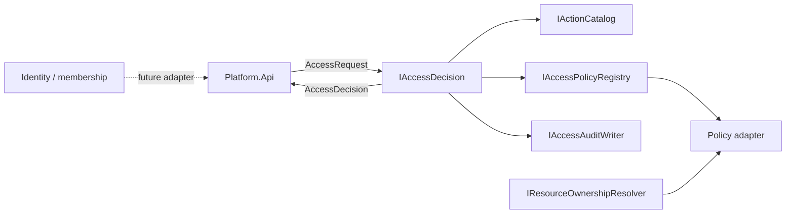
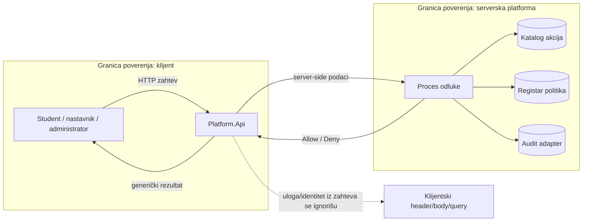

# ACC-05 i ACC-08 — komponenta autorizacije

| Stavka | Vrednost |
|---|---|
| Tim | Tim 3 |
| Zahtevi | ACC-05, ACC-08 |
| Status | ACC-05 jezgro implementirano|
| Projekat | `backend/Platform.Access` |
| Studenti | PR 1/2023 Živanović Jovana<br>PR 16/2023 Musli Danijel<br>PR 18/2023 Spasić Veljko<br>PR 30/2023 Pavlović Sara<br>PR 32/2023 Stanković Pavle<br>PR 53/2023 Matić Željana<br>PR 60/2023 Todorović Nikolina |

## Ugovor za druge module

Drugi moduli pozivaju samo javni ugovor:

```csharp
ValueTask<AccessDecision> DecideAsync(
    AccessRequest request,
    CancellationToken cancellationToken = default);
```

`Allow` je dozvoljen samo kada registrovana politika eksplicitno vrati uspeh. Svaki drugi ishod je `Deny`. Pozivalac ne sme grešku, nedostajući podatak ili nepoznatu akciju tretirati kao dozvolu.

Ugovor trenutno obuhvata:

- `SubjectRef` — identitet i stanje naloga;
- `ResourceRef` — tip i identifikator resursa;
- `AccessRequest` — subjekt, akcija, resurs i korelacioni ID;
- `AccessDecision` — ishod, razlog, politika, verzija i korelacioni ID;
- `IActionCatalog`, `IAccessPolicyRegistry` i `IAccessAuditWriter` — granice za buduće adaptere.
- `IResourceOwnershipResolver` — server-side granica za potvrdu vlasništva resursa.

`IActionCatalog` izlaže tipizovane `ActionDefinition` zapise.

### Trenutni katalog akcija

| Akcija | Scope | Tip resursa | Privilegovana |
|---|---|---|---|
| `public.info.read` | `Public` | — | Ne |
| `public.catalog.read` | `Public` | — | Ne |
| `lab.read` | `Course` | `laboratory` | Ne |
| `lab.draft.manage` | `Course` | `laboratory` | Ne |
| `lab.revision.publish` | `Course` | `laboratory` | Da |
| `lab.criteria.hidden.read` | `Course` | `laboratory` | Ne |
| `assignment.manage` | `Course` | `assignment` | Ne |
| `assignment.read.own` | `Course` | `assignment` | Ne |
| `course.read` | `Authenticated` | — | Ne |
| `course.create` | `Authenticated` | — | Da |
| `course.archive` | `Authenticated` | — | Da |
| `group.read` | `Authenticated` | — | Ne |
| `group.create` | `Authenticated` | — | Da |
| `group.member.add` | `Authenticated` | — | Da |
| `group.member.remove` | `Authenticated` | — | Da |
| `material.read` | `Authenticated` | — | Ne |
| `attempt.create` | `Course` | `assignment` | Ne |
| `attempt.read` | `Course` | `attempt` | Ne |
| `attempt.submit` | `Course` | `attempt` | Ne |
| `attempt.read.course` | `Course` | `attempt` | Ne |
| `attempt.review` | `Course` | `attempt` | Da |
| `account.status.change` | `System` | — | Da |
| `system.config.manage` | `System` | — | Da |
| `results.sensitive.read` | `Course` | `attempt` | Da |
| `evaluation.task.process` | `System` | — | Ne |
| `audit.events.read` | `Course` | `course` | Ne |

## Pravilo registracije akcija

`Platform.Access` poseduje centralni, verzionisani katalog dozvoljenih akcija.
Osnovne akcije se definišu u `AccessActions`. Dodatna akcija i njena politika
mogu se registrovati samo kroz javni composition API, pre `Build()`:

```csharp
services.AddAccessAction<MyPolicy>(
    new ActionDefinition("module.record.read", ActionScope.Course, "record", false));
```

Za politiku koja implementira već poznatu centralnu akciju koristi se
`AddAccessPolicy<TPolicy>(actionId)`, npr.
`services.AddAccessPolicy<CourseAuditReadPolicy>("audit.events.read")`.
Poziv se radi u composition fazi, pre `Build()`. Hook odbija duplikate,
nepoznate akcije i nesingleton registraciju politike. Nove akcije se dodaju uz
eksplicitnu `ActionDefinition` kroz `AddAccessAction<TPolicy>(definition)`;
njihovo uvođenje zahteva code review centralnog ugovora. Nepoznata akcija daje
`UnknownAction`, a akcija bez politike `NoPolicy`.

Postojeći moduli još imaju privremeni composition adapter koji registruje
akcije/politike nakon `Build()`, ali pre `app.Run()`. To je migraciona
kompatibilnost, ne obrazac za nove integracije. `AccessConfigurationStartupCheck`
zamrzava katalog i registar pri pokretanju hosta; posle toga registracije
bacaju grešku. Konkretni registry/catalog adapteri dostupni su postojećim
modulima samo radi tog privremenog composition koraka; ne smeju se koristiti
za autorizacione izmene tokom obrade zahteva.

Politike su singleton-i jer su i decision engine i registry singleton-i.
Zato politika, kao i svi servisi koje ona koristi, mora biti thread-safe i ne
sme zavisiti od scoped servisa (`DbContext`, request context i slično). API host
uključuje `ValidateScopes` i `ValidateOnBuild`, tako da captive scoped
zavisnost sprečava host da se pokrene. Hostovi koji ugrađuju `Platform.Access`
moraju uključiti iste DI validacije. Access ne kreira poseban scope po odluci:
caller, subject, resource i svi podaci specifični za zahtev moraju biti
izračunati server-side i prosleđeni kroz `AccessRequest`. Politika ne sme
očekivati da ima pristup HTTP request scope-u. Ako je potrebna scoped
zavisnost, to je blokada za integraciju: ne sme se registrovati politika dok
se lifetime ugovor centralnog Access engine-a ne promeni kroz odobrenu izmenu.

Dodavanje akcije obuhvata:

1. definiciju ID-a u `AccessActions` za centralne akcije, ili composition
   registraciju za dodatnu akciju;
2. deklaraciju scope-a, tipa resursa i privilegovanosti;
3. proveru kompletnosti, validnosti i jedinstvenosti kataloga;
4. pripadajuću politiku i testove u modulu koji akciju koristi.

Centralni katalog je nameran izbor za početnu verziju: omogućava pregled cele
authorization površine kroz code review i sprečava da pojedinačni moduli
samostalno uvedu preširoku ili nekonzistentnu dozvolu.

Podaci o identitetu, ulozi, članstvu i vlasništvu moraju doći sa servera, ne iz headera, tela ili query stringa klijentskog zahteva.

### Audit događaji

`audit.events.read` je centralna akcija sa `Course` scope-om i resource type-om
`course`. Resurs za odluku je tačno jedan kurs, oblika `Course/{courseId}`:

- resource type je malo-slovni, case-sensitive `"course"`;
- resource ID je ID kursa u kanonskom `Guid` `D` formatu, npr.
  `ResourceRef("course", courseId.ToString("D"))`;
- `courseId` mora biti utvrđen i validiran server-side iz kursa koji se čita;
  klijentski header/body/query ne predstavljaju izvor identiteta, članstva ili
  vlasništva;
- `attempt`, `account` ili drugi tip resursa ne važe za ovu akciju, niti se
  sme koristiti globalni resurs bez ID-ja kursa.

Ne postoji implicitni globalni ni administratorski pristup. Audit modul
registruje konkretnu politiku kroz `AddAccessPolicy<TPolicy>("audit.events.read")`.
Dok politika nije registrovana, zahtev se odbija sa `NoPolicy`;
`Platform.Access` ne implementira niti referencira Audit politiku.
Membership/delegation status, uključujući istek i opoziv, ostaje garancija
vlasnika stvarnog `IMembershipReader` adaptera.

## Implementacija 

Registracija zavisnosti je deo `Platform.Access/Composition`. `Program.cs`
poziva `AddAccessControl()`; moduli dodaju svoje akcije/politike kroz javni
composition API pre `Build()`. Trenutni API još ne registruje konkretnu Audit
politiku niti menja fail-closed membership/resource fallback-e.

Fail-closed tok:

1. nema subjekta → `Unauthenticated`;
2. nalog nije aktivan → `AccountNotActive`;
3. akcija nije validna ili registrovana → `UnknownAction`;
4. politika ne postoji → `NoPolicy`;
5. politika odbije zahtev → `PolicyDenied`;
6. greška, izuzetak ili timeout u politici → `PolicyError`;
7. neusklađen scope ili tip resursa → `PolicyError`;
8. samo uspešna politika može vratiti `Allow`.

Audit se izvršava kroz lanac `ResilientAccessAuditWriter` →
`FilteringAccessAuditWriter` → `AggregatingAccessAuditSink` →
`LoggerAccessAuditSink`. Odbijanja se agregiraju po akteru, akciji, ciljnom resursu
i razlogu odbijanja; prvi događaj se emituje odmah, a ponovljena odbijanja se
objavljuju kao ograničeni summary zapisi nakon isteka aggregation prozora.
`AccessAuditFlushService` periodično i pri gašenju aplikacije flush-uje otvorene
summary zapise. Pipeline ima ograničene aggregation ključeve i pending retry
zapise, tako da rast broja događaja ne postane neograničen.

`ResilientAccessAuditWriter` izoluje audit od odluke: audit ima timeout,
prosleđuje cancellation token i greške audit adaptera ne menjaju već izračunati
`Allow` ili `Deny` ishod. Neuspeh i timeout se prijavljuju kao zasebni alarmi.
Audit record factory i sanitizer dozvoljavaju samo definisana polja, ograničavaju
dužinu vrednosti i odbacuju kontrolne/hostile vrednosti; tajne, telo zahteva i
studentski odgovori se ne upisuju.

`LoggerAccessAuditSink` je lokalni adapter preko host `ILogger` ugovora. Centralni
`Platform.Audit` ugovor još nije direktno integrisan; integracija se radi nakon
stabilizacije Audit modula. Testovi koriste eksplicitne recording/throwing
audit fake-ove. `EmptyMembershipReader`
i `EmptyResourceDescriptorResolver` ostaju namerni fail-closed fallback-i za slučaj
da domenski adapteri nisu registrovani; ne predstavljaju placeholder poslovnu
logiku i ne mogu odobriti zahtev.

`AddAccessControl()` registruje katalog, policy registry, decision engine, audit
pipeline i flush servis kao singleton komponente. Politike i membership/resource
readeri moraju biti singleton-safe. U composition fazi katalog i registar mogu
se koristiti kroz postojeće adapterske API-je; host startup ih zamrzava pre
prvog zahteva, pa naknadna izmena nije moguća. Moduli koji se integrišu treba da
koriste javni `AddAccessAction`/`AddAccessPolicy` hook pre `Build()`.
Audit loggers koriste host
logger kada je dostupan, a `NullLogger` fallback u minimalnim kontejnerima; modul
ne konfiguriše globalni logging hosta.

Za `attempt.read` i `attempt.submit` politika zahteva server-side potvrdu vlasništva.
Ako resolver vlasništva nije dostupan ili ne potvrdi vlasnika, pristup se odbija.
Ownership adapter je pripremljen kroz `IResourceOwnershipResolver`; konkretni domenski
moduli treba da ga obezbede kroz dogovorenu integraciju.

## Dijagram arhitekture



**Veza sa platformom:** `Platform.Api` je kompozicioni sloj; moduli registruju odobrene akcije/politike pre izgradnje hosta i koriste server-side resolvere preko javnih ugovora.

## Dijagram toka podataka




## Demonstracija

Iz korena repozitorijuma:

```bash
dotnet build backend/Platform.Api/Platform.Api.csproj --configuration Release
ASPNETCORE_ENVIRONMENT=Development dotnet run \
  --project backend/Platform.Api/Platform.Api.csproj \
  --urls http://localhost:5080
```

U drugom terminalu:

```bash
curl http://localhost:5080/api/health
curl http://localhost:5080/api/access/demo-deny
```

Očekivano:

- `/api/health` vraća `status: "ok"`;
- `/api/access/demo-deny` vraća `Deny` sa razlogom `UnknownAction`.

Važno: razvojni demo endpoint je registrovan samo kada je okruženje `Development`:

```csharp
if (app.Environment.IsDevelopment())
{
    app.MapGet("/api/access/demo-deny", ...);
}
```

Ako se API pokrene bez `ASPNETCORE_ENVIRONMENT=Development`, `/api/health` će raditi, ali će `/api/access/demo-deny` vratiti `404 Not Found`. To znači da ruta nije registrovana, a ne da je autorizacija odbila zahtev.

Ovim se proveravaju pokretanje API-ja i početni ACC-05 tok. Demo ruta je samo razvojna i namerno nije dostupna u produkciji.


## Planirani tok razvoja

1. Dogovor sa Identity, Laboratories, Attempts i Audit timovima.
2. Registrovane akcije i konkretne politike.
3. Endpoint metadata i fallback-deny.
4. Integracija sa centralnim `Platform.Audit` modulom nakon stabilizacije njegovog composition ugovora.
5. Domenski ownership adapteri i preostala ACC-08 pravila.
6. Jedinični, integracioni i negativni testovi u CI-ju.
## Integracija razvojne KT1 demonstracije (ACC-04/ADM-08)

KT1 endpoint-i su dostupni isključivo u Development okruženju uz eksplicitno
`Kt1Demo:Enabled`. KT1 koristi **izolovan** `DefaultDenyAccessDecision` sa sopstvenim
katalogom i registracijom svojih `AttemptPolicy` i `AdministrationPolicy` pravila.
KT1 servisi dobijaju taj imenovani decision engine kroz DI fabrike, dok ostatak
API-ja nastavlja da koristi globalni `IAccessDecision` iz ACC-05.

Razlog je što KT1 simulacija i produkciona matrica imaju isto ime akcije
`attempt.read`, ali različite izvore članstva i provere vlasništva. Ne sme se
preskočiti konflikt registracije tako da jedan modul neprimetno nasledi politiku
drugog. Oba engine-a zadržavaju fail-closed proveru opsega, resursa,
identiteta i konkretne politike; KT1 ne postaje alternativna dozvola na
produkcijskim endpoint-ima.

Za konačnu integraciju svih timova ostaje obavezno da rute eksplicitno
deklariraju `RequireAccess` ili odobreni `AllowPublic`; test endpoint
coverage-a se ne isključuje radi zelenog CI-a.

Integraciona provera 2026-11-05: resursne akcije Authoring i LabVisibility sada se registruju sa eksplicitnim tipom resursa i opsegom u kompoziciji pripadajućih modula; provera scope-a i dalje ostaje fail-closed.

## Migracija postojećih rutera bez promene njihovih autorizacionih pravila

`DelegatedAuthorizationAttribute` i `DelegateAuthorization()` su privremeni
migracioni most za proverene postojeće endpoint-e. Ne predstavljaju `Allow`,
ne kreiraju Access politiku i ne zamenjuju `RequireAccess`; endpoint owner je
odgovoran za nezavisno testirani guard, a delegacija zahteva eksplicitnu
reviziju. Novi endpoint-i ne smeju koristiti adapter. ACC-05 coverage test
proverava odobreni inventar ruta i odbija nepoznate/neodobrene delegacije.

Audit probni `/__test/audit-events` postoji isključivo u `Testing` hostu
i oslanja se na testovima definisan sintetički kontekst. Ne postoji u
produkcijskom registru endpoint-a.
