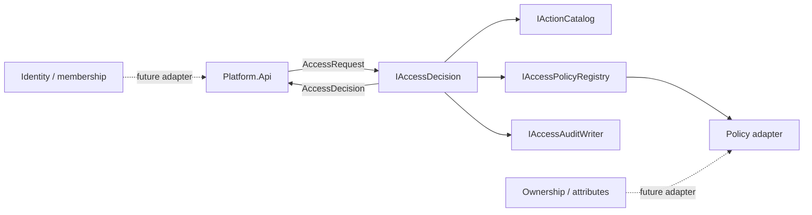
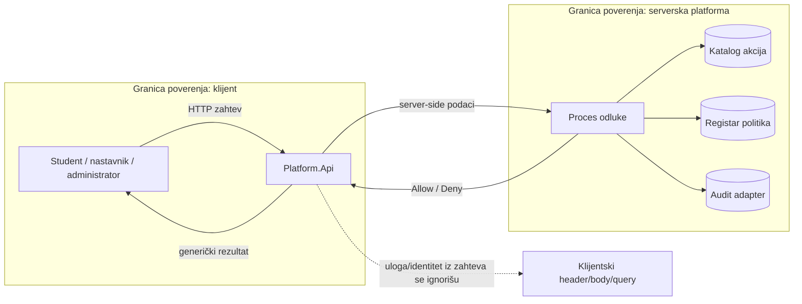

# ACC-05 i ACC-08 — komponenta autorizacije

| Stavka | Vrednost |
|---|---|
| Tim | Tim 3 |
| Zahtevi | ACC-05, ACC-08 |
| Status | Početna implementacija |
| Projekat | `backend/Platform.Access` |
| Studenti | PR 1/2023 Živanović Jovana<br>PR 16/2023 Musli Danijel<br>PR 18/2023 Spasić Veljko<br>PR 30/2023 Pavlović Sara<br>PR 32/2023 Stanković Pavle<br>PR 53/2023 Matić Željana<br>PR 60/2023 Todorović Nikolina |

## Ugovor za druge module

Drugi moduli pozivaju samo javni ugovor:

```csharp
ValueTask<AccessDecision> DecideAsync(
    AccessRequest request,
    CancellationToken cancellationToken = default);
```

`Allow` je dozvoljen samo kada registrovana politika eksplicitno vrati uspeh. Svaki drugi ishod je `Deny`. Pozivalac ne sme grešku, nedostajući podatak ili nepoznatu akciju tretirati kao dozvolu.

Ugovor trenutno obuhvata:

- `SubjectRef` — identitet i stanje naloga;
- `ResourceRef` — tip i identifikator resursa;
- `AccessRequest` — subjekt, akcija, resurs i korelacioni ID;
- `AccessDecision` — ishod, razlog, politika, verzija i korelacioni ID;
- `IActionCatalog`, `IAccessPolicyRegistry` i `IAccessAuditWriter` — granice za buduće adaptere.

Podaci o identitetu, ulozi, članstvu i vlasništvu moraju doći sa servera, ne iz headera, tela ili query stringa klijentskog zahteva.

## Implementacija 

Registracija zavisnosti je deo `Platform.Access/Composition`, dok `Program.cs` samo poziva `AddAccessControl()`. Ostali moduli mogu primeniti isti obrazac.

Fail-closed tok:

1. nema subjekta → `Unauthenticated`;
2. nalog nije aktivan → `AccountNotActive`;
3. akcija nije validna ili registrovana → `UnknownAction`;
4. politika ne postoji → `NoPolicy`;
5. greška u politici → `PolicyError`;
6. samo uspešna politika može vratiti `Allow`.

Razvojni `NullAccessAuditWriter` je privremeni adapter bez skladištenja. On postoji da ugovor bude definisan, a trajni audit se dodaje kasnije tokom razvoja.

## Dijagram arhitekture



**Veza sa platformom:** `Platform.Api` je kompozicioni sloj; ostali moduli kasnije registruju svoje akcije, politike i server-side resolvere preko javnih ugovora.

## Dijagram toka podataka

