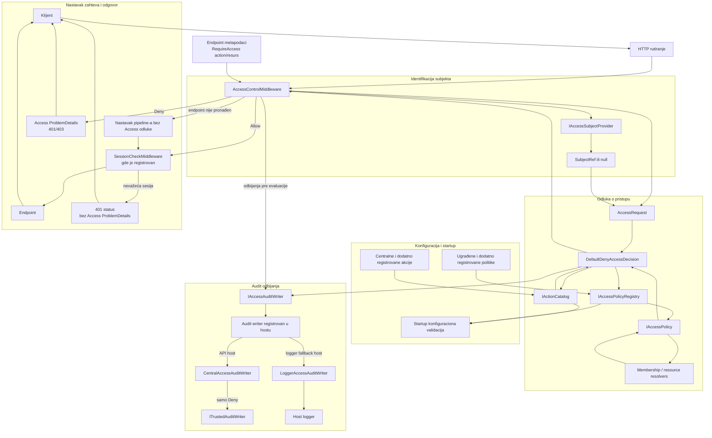
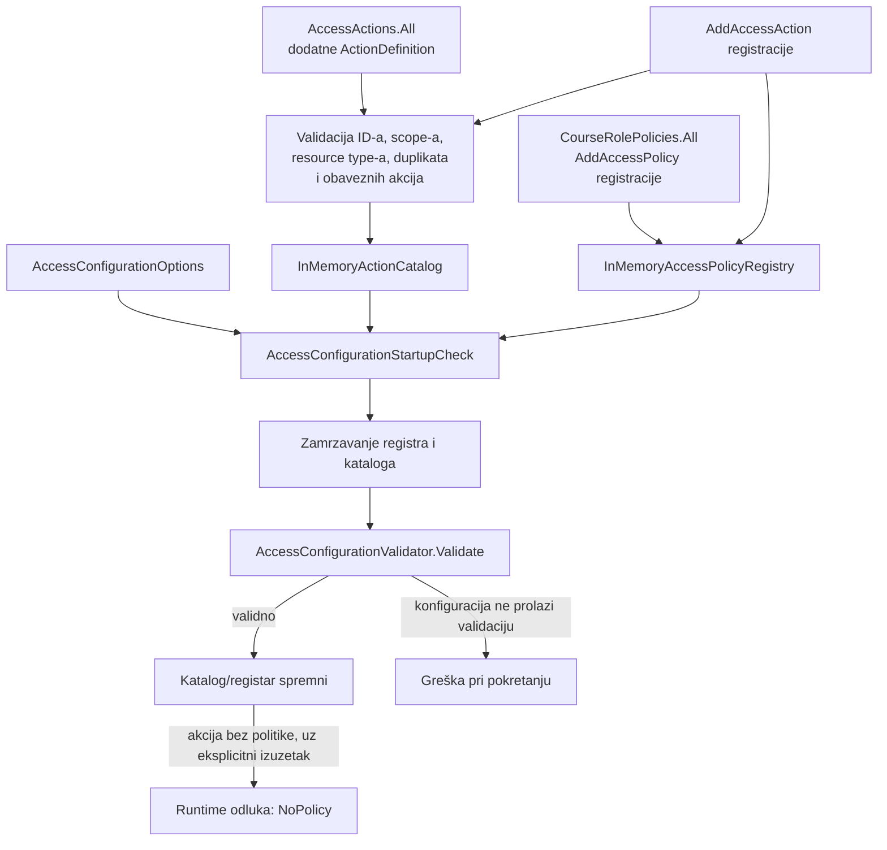
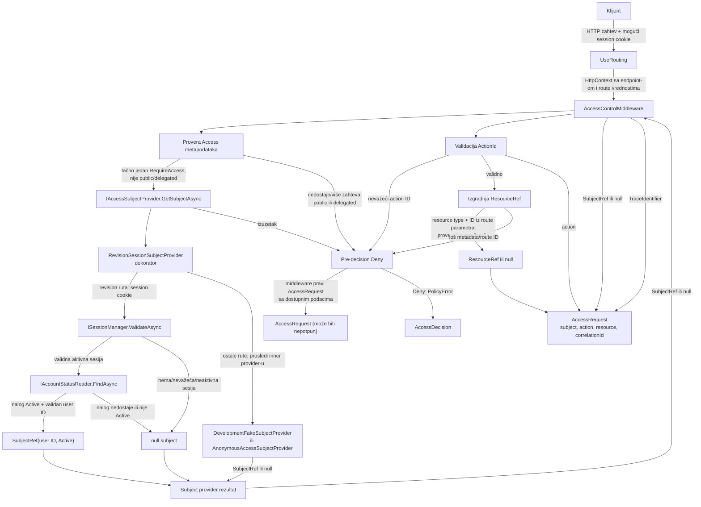
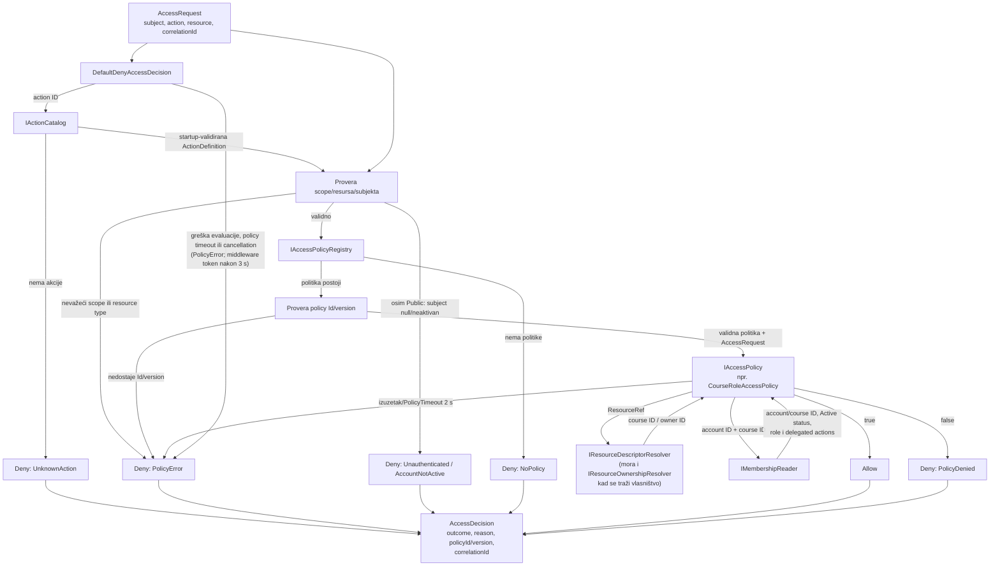
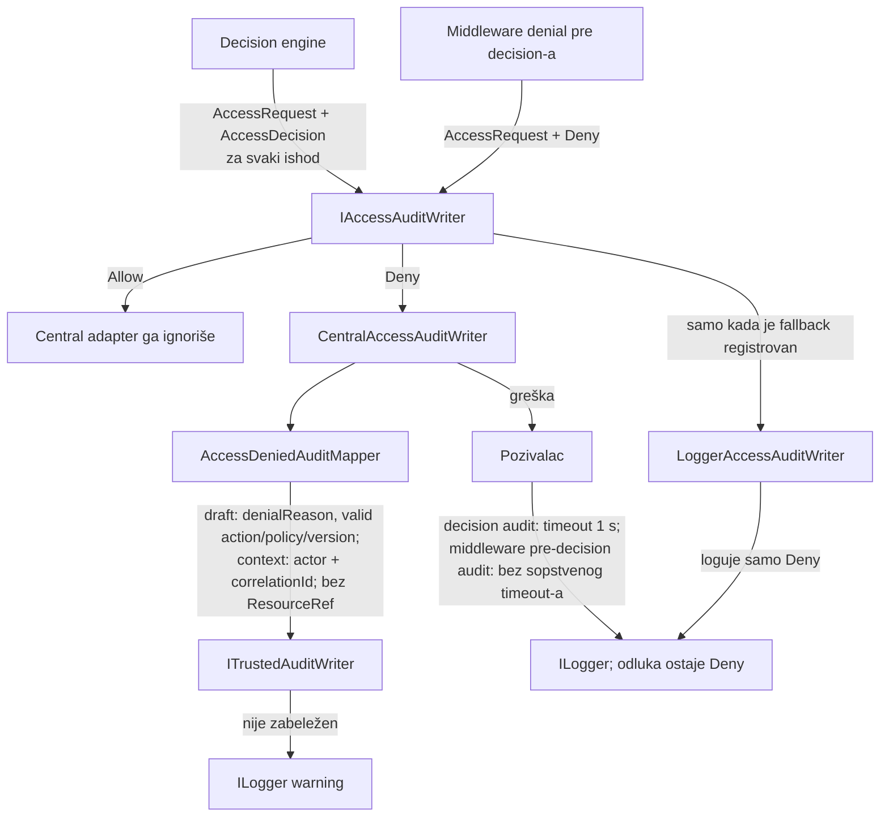
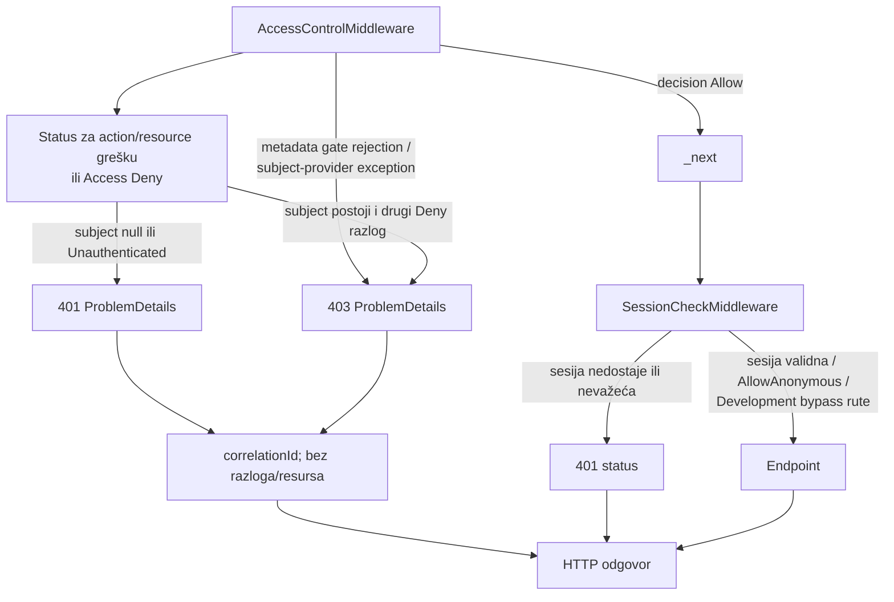

# ACC-05 i ACC-08 — komponenta autorizacije

| Stavka | Vrednost |
|---|---|
| Tim | Tim 3 |
| Zahtevi | ACC-05, ACC-08 |
| Status | ACC-05 jezgro implementirano; vlasničke integracije članstva i resursa su fail-closed dok ih timovi ne isporuče |
| Projekat | `backend/Platform.Access` |
| Studenti | PR 1/2023 Živanović Jovana<br>PR 16/2023 Musli Danijel<br>PR 18/2023 Spasić Veljko<br>PR 30/2023 Pavlović Sara<br>PR 32/2023 Stanković Pavle<br>PR 53/2023 Matić Željana<br>PR 60/2023 Todorović Nikolina |

## Ugovor za druge module

Drugi moduli pozivaju samo javni ugovor:

```csharp
ValueTask<AccessDecision> DecideAsync(
    AccessRequest request,
    CancellationToken cancellationToken = default);
```

`Allow` je dozvoljen samo kada registrovana politika eksplicitno vrati uspeh. Svaki drugi ishod je `Deny`. Pozivalac ne sme grešku, nedostajući podatak ili nepoznatu akciju tretirati kao dozvolu.

Ugovor trenutno obuhvata:

- `SubjectRef` — identitet i stanje naloga;
- `ResourceRef` — tip i identifikator resursa;
- `AccessRequest` — subjekt, akcija, resurs i korelacioni ID;
- `AccessDecision` — ishod, razlog, politika, verzija i korelacioni ID;
- `IActionCatalog` i `IAccessPolicyRegistry` — granice katalog/registar;
  `IAccessAuditWriter` — ugovor za Access audit adapter.
- `IResourceOwnershipResolver` — server-side granica za potvrdu vlasništva resursa.
- `IAccessSubjectProvider` — server-side izvor subjekta za ASP.NET middleware.

`IActionCatalog` izlaže tipizovane `ActionDefinition` zapise.

### Trenutni katalog akcija

| Akcija | Scope | Tip resursa | Privilegovana |
|---|---|---|---|
| `public.info.read` | `Public` | — | Ne |
| `public.catalog.read` | `Public` | — | Ne |
| `lab.read` | `Course` | `laboratory` | Ne |
| `lab.draft.manage` | `Course` | `laboratory` | Ne |
| `lab.revision.publish` | `Course` | `laboratory` | Da |
| `lab.criteria.hidden.read` | `Course` | `laboratory` | Ne |
| `assignment.manage` | `Course` | `assignment` | Ne |
| `assignment.read.own` | `Course` | `assignment` | Ne |
| `course.read` | `Authenticated` | — | Ne |
| `course.create` | `Authenticated` | — | Da |
| `course.archive` | `Authenticated` | — | Da |
| `group.read` | `Authenticated` | — | Ne |
| `group.create` | `Authenticated` | — | Da |
| `group.member.add` | `Authenticated` | — | Da |
| `group.member.remove` | `Authenticated` | — | Da |
| `material.read` | `Authenticated` | — | Ne |
| `attempt.create` | `Course` | `assignment` | Ne |
| `attempt.read` | `Course` | `attempt` | Ne |
| `attempt.submit` | `Course` | `attempt` | Ne |
| `attempt.read.course` | `Course` | `attempt` | Ne |
| `attempt.review` | `Course` | `attempt` | Da |
| `account.status.change` | `System` | — | Da |
| `system.config.manage` | `System` | — | Da |
| `results.sensitive.read` | `Course` | `attempt` | Da |
| `evaluation.task.process` | `System` | — | Ne |
| `audit.events.read` | `Course` | `course` | Ne |

## Pravilo registracije akcija

`Platform.Access` poseduje centralni, verzionisani katalog dozvoljenih akcija.
Osnovne akcije se definišu u `AccessActions`. Dodatna akcija i njena politika
mogu se registrovati samo kroz javni composition API, pre `Build()`:

```csharp
services.AddAccessAction<MyPolicy>(
    new ActionDefinition("module.record.read", ActionScope.Course, "record", false));
```

Za politiku koja implementira već poznatu centralnu akciju koristi se
`AddAccessPolicy<TPolicy>(actionId)`, npr.
`services.AddAccessPolicy<CourseAuditReadPolicy>("audit.events.read")`.
Poziv se radi u composition fazi, pre `Build()`. Hook odbija duplikate,
nepoznate akcije i nesingleton registraciju politike. Nove akcije se dodaju uz
eksplicitnu `ActionDefinition` kroz `AddAccessAction<TPolicy>(definition)`;
njihovo uvođenje zahteva code review centralnog ugovora. Nepoznata akcija daje
`UnknownAction`, a akcija bez politike `NoPolicy`.

API dodaje identitetske, Authoring i Revision akcije/politike kroz ovaj ugovor
pre `Build()`. DI kreirani katalog i registar se zamrzavaju pri sastavljanju
kompozicije, pre nego što se mogu koristiti nakon izgradnje hosta. Registracija
akcija ili politika preko konkretnih runtime registry-ja nije podržana.
Preostale `RegisterIdentityAccess`, `RegisterAuthoringAccess` i
`RegisterLabVisibilityAccess` metode u vlasničkim projektima nisu više deo
API host kompozicije i moraju biti migrirane/uklonjene od strane tih timova;
poziv na zamrznutom Access katalogu/registu namerno baca grešku.

API host zahteva potpunu pokrivenost politika za sve akcije koje se mogu
koristiti. Jedine izuzetke eksplicitno navodi `ActionsWithoutPolicy`; oni ostaju
bez politike i zato se i dalje odbijaju (`NoPolicy`). Trenutni izuzeci su
`public.catalog.read`, `account.status.change`, `system.config.manage`,
`results.sensitive.read` i `evaluation.task.process`. Izuzetak nije dozvola;
`public.info.read` nije izuzetak i ima registrovanu politiku.
`ActionScope.Unknown` i nevažeći resource type odbacuju se prilikom validacije.
Resource type je case-sensitive ASCII obrazac `[a-z][a-z0-9-]{0,63}`; isti
validator koriste katalog i ASP.NET endpoint metadata.

Politike su singleton-i jer su i decision engine i registry singleton-i.
Zato politika, kao i svi servisi koje ona koristi, mora biti thread-safe i ne
sme zavisiti od scoped servisa (`DbContext`, request context i slično). API host
uključuje `ValidateScopes` i `ValidateOnBuild`, tako da captive scoped
zavisnost sprečava host da se pokrene. Hostovi koji ugrađuju `Platform.Access`
moraju uključiti iste DI validacije. Access ne kreira poseban scope po odluci:
caller, subject, resource i svi podaci specifični za zahtev moraju biti
izračunati server-side i prosleđeni kroz `AccessRequest`. Politika ne sme
očekivati da ima pristup HTTP request scope-u. Ako je potrebna scoped
zavisnost, to je blokada za integraciju: ne sme se registrovati politika dok
se lifetime ugovor centralnog Access engine-a ne promeni kroz odobrenu izmenu.

Dodavanje akcije obuhvata:

1. definiciju ID-a u `AccessActions` za centralne akcije, ili composition
   registraciju za dodatnu akciju;
2. deklaraciju scope-a, tipa resursa i privilegovanosti;
3. proveru kompletnosti, validnosti i jedinstvenosti kataloga;
4. pripadajuću politiku i testove u modulu koji akciju koristi.

Centralni katalog je nameran izbor za početnu verziju: omogućava pregled cele
authorization površine kroz code review i sprečava da pojedinačni moduli
samostalno uvedu preširoku ili nekonzistentnu dozvolu.

Podaci o identitetu, ulozi, članstvu i vlasništvu moraju doći sa servera, ne iz headera, tela ili query stringa klijentskog zahteva.

### Audit događaji

`audit.events.read` je centralna akcija sa `Course` scope-om i resource type-om
`course`. Resurs za odluku je tačno jedan kurs, oblika `Course/{courseId}`:

- resource type je malo-slovni, case-sensitive `"course"`;
- resource ID je ID kursa u kanonskom `Guid` `D` formatu, npr.
  `ResourceRef("course", courseId.ToString("D"))`;
- `courseId` mora biti utvrđen i validiran server-side iz kursa koji se čita;
  klijentski header/body/query ne predstavljaju izvor identiteta, članstva ili
  vlasništva;
- `attempt`, `account` ili drugi tip resursa ne važe za ovu akciju, niti se
  sme koristiti globalni resurs bez ID-ja kursa.

Ne postoji implicitni globalni ni administratorski pristup. Audit modul
registruje konkretnu politiku kroz `AddAccessPolicy<TPolicy>("audit.events.read")`.
Dok politika nije registrovana, zahtev se odbija sa `NoPolicy`;
`Platform.Access` ne implementira niti referencira Audit politiku.
Membership/delegation status, uključujući istek i opoziv, ostaje garancija
vlasnika stvarnog `IMembershipReader` adaptera.

## Implementacija

Registracija zavisnosti je deo `Platform.Access/Composition`. `Program.cs`
poziva `AddAccessControl()`; identitetske, Authoring i Revision akcije/politike
registruje kroz javni composition API pre `Build()`. `AccessControlMiddleware`
se izvršava pre `SessionCheckMiddleware`. Access subject provider je
`DevelopmentFakeSubjectProvider` u Development okruženju ili podrazumevani
`AnonymousAccessSubjectProvider`; `RevisionSessionSubjectProvider` za revision
rute dodatno validira server-side sesiju i status naloga. `SessionCheckMiddleware`
kasnije proverava sesiju pre endpoint-a gde se primenjuje. Razvojni header nije
izvor Access identiteta.

Auth login/logout i health su eksplicitno javne rute. `/api/auth/me` je javna
samo za centralni Access sloj, ali i dalje zahteva validnu sesiju kroz
`SessionCheckMiddleware`. Administratorske, kreiranje naloga, Authoring i
Revision rute koriste `RequireAccess`. Legacy delegation marker nikada ne
dozvoljava prolaz; rute sa markerom, bez zahteva ili sa više/konfliktnim
zahtevima se odbijaju. Odbijanja pre evaluacije politike se takođe šalju na
audit.

Fail-closed tok:

1. nema subjekta → `Unauthenticated`;
2. nalog nije aktivan → `AccountNotActive`;
3. akcija nije validna ili registrovana → `UnknownAction`;
4. politika ne postoji → `NoPolicy`;
5. politika odbije zahtev → `PolicyDenied`;
6. greška, izuzetak ili timeout u politici → `PolicyError`;
7. neusklađen scope ili tip resursa → `PolicyError`;
8. samo uspešna politika može vratiti `Allow`.

API šalje Access odbijanja kroz `CentralAccessAuditWriter` do
`ITrustedAuditWriter`. Ako Audit odbije zapis ili ne uspe, Access odluka ostaje
deny, a greška se beleži. `AccessDeniedAuditMapper` prosleđuje samo validne
`action`, `policyId` i `policyVersion` vrednosti koje prihvata Audit šema.

Uspešne Access odluke se trenutno ne upisuju kao Access audit događaj: Audit
katalog prihvata `AccessDenied`, ali nema odgovarajući događaj za odluku
`Allow`. Do izmene vlasničkog ugovora `Platform.Audit`, dozvole se ne smeju
mapirati na događaj odbijanja.

`LoggerAccessAuditWriter` je lokalni fallback preko host `ILogger` ugovora. Centralni
`Platform.Audit` ugovor je integrisan za odbijanja kroz `CentralAccessAuditWriter`;
za uspešne odluke još nije definisan odgovarajući Audit event. Testovi koriste eksplicitne recording/throwing
audit fake-ove. `EmptyMembershipReader`
i `EmptyResourceDescriptorResolver` ostaju namerni fail-closed fallback-i za slučaj
da domenski adapteri nisu registrovani; ne predstavljaju placeholder poslovnu
logiku i ne mogu odobriti zahtev.

`AddAccessControl()` registruje katalog, policy registry, decision engine i
audit adapter kao singleton komponente. Politike i membership/resource readere
moraju biti singleton-safe. DI kreirani katalog/registar se zamrzavaju pre
prvog zahteva; moduli koriste isključivo `AddAccessAction`/`AddAccessPolicy`
pre `Build()`.
Audit loggers koriste host
logger kada je dostupan, a `NullLogger` fallback u minimalnim kontejnerima; modul
ne konfiguriše globalni logging hosta.

Za `attempt.read` i `attempt.submit` politika zahteva server-side potvrdu vlasništva.
Ako resolver vlasništva nije dostupan ili ne potvrdi vlasnika, pristup se odbija.
Ownership adapter je pripremljen kroz `IResourceOwnershipResolver`; konkretni domenski
moduli treba da ga obezbede kroz dogovorenu integraciju.

## Dijagram arhitekture



Definicije kataloga se validiraju pri njegovoj izgradnji. Pri pokretanju se
katalog i registar zamrzavaju, a zatim se proveravaju pokrivenost politika i
izuzeci; konfiguraciona greška prekida pokretanje. U API hostu audit adapter je
centralni; drugi hostovi mogu koristiti logger fallback. Session middleware je
posle Access middleware-a u API pipeline-u.

## Dijagrami toka podataka

### 1. Konfiguracioni podaci



### 2. HTTP zahtev i AccessRequest



### 3. Podaci odluke i politike



### 4. Audit podaci



### 5. Rezultat HTTP obrade



`AccessProblemDetailsWriter` vraća 401 za neautentifikovanog subjekta, a inače
403, sa `correlationId` bez detalja odluke. `SessionCheckMiddleware` može
postaviti 401 nakon dozvoljene Access odluke; taj odgovor nije ProblemDetails
koji formira Access middleware.


## Demonstracija

Iz korena repozitorijuma:

```bash
dotnet build backend/Platform.Api/Platform.Api.csproj --configuration Release
ASPNETCORE_ENVIRONMENT=Development dotnet run \
  --project backend/Platform.Api/Platform.Api.csproj \
  --urls http://localhost:5080
```

U drugom terminalu:

```bash
curl http://localhost:5080/api/health
curl http://localhost:5080/api/access/demo-deny
```

Očekivano:

- `/api/health` vraća `status: "ok"`;
- `/api/access/demo-deny` vraća `Deny` sa razlogom `UnknownAction`.

Važno: razvojni demo endpoint je registrovan samo kada je okruženje `Development`:

```csharp
if (app.Environment.IsDevelopment())
{
    app.MapGet("/api/access/demo-deny", ...);
}
```

Ako se API pokrene bez `ASPNETCORE_ENVIRONMENT=Development`, `/api/health` će raditi, ali će `/api/access/demo-deny` vratiti `404 Not Found`. To znači da ruta nije registrovana, a ne da je autorizacija odbila zahtev.

Ovim se proveravaju pokretanje API-ja i početni ACC-05 tok. Demo ruta je samo razvojna i namerno nije dostupna u produkciji.