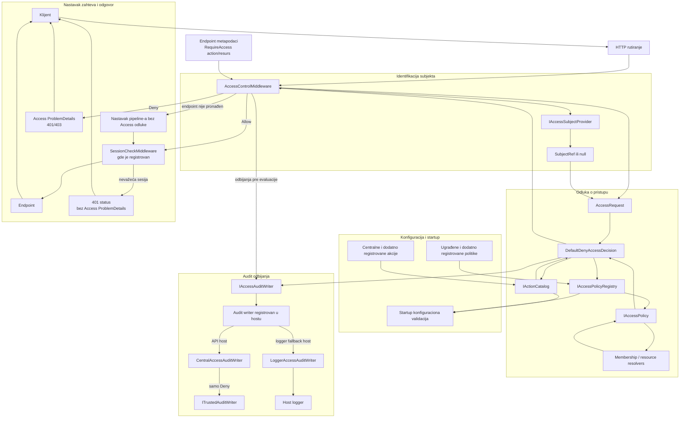
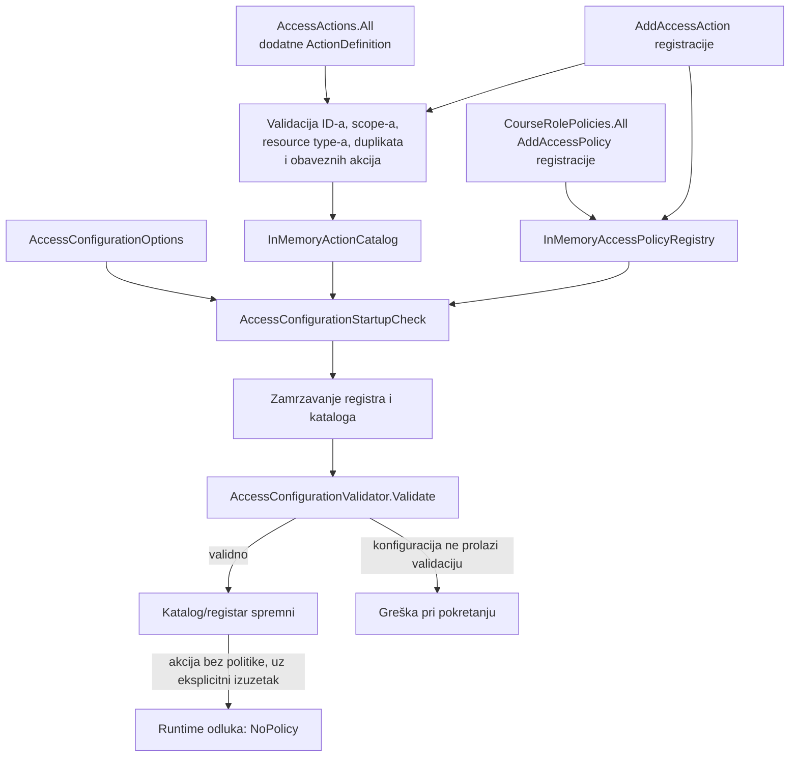
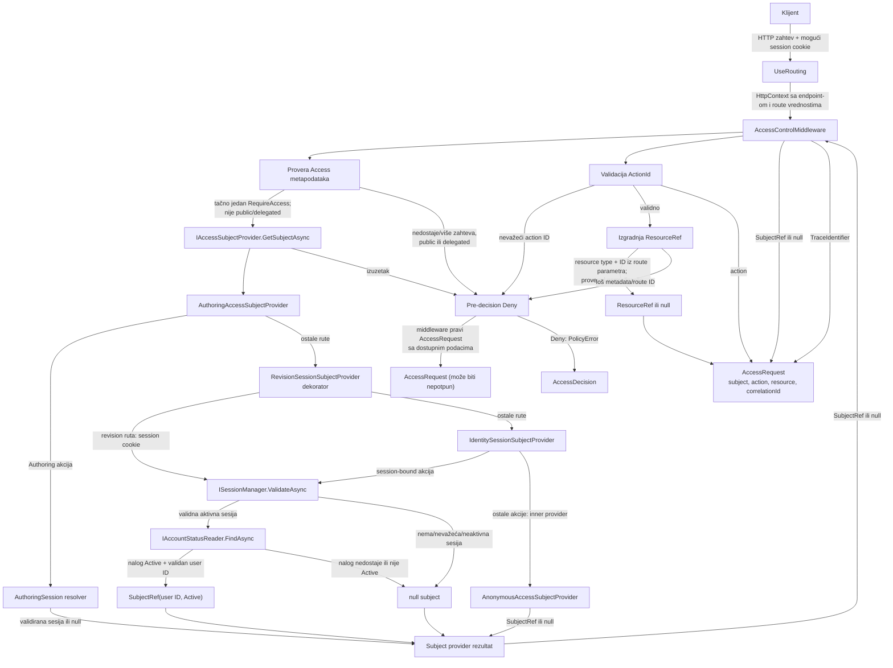
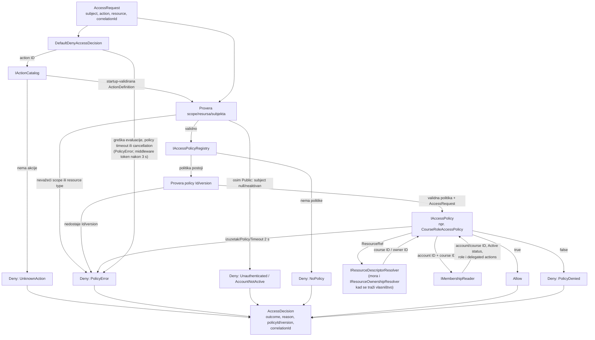
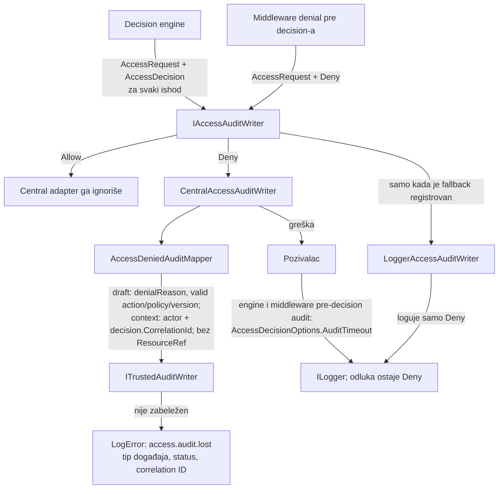
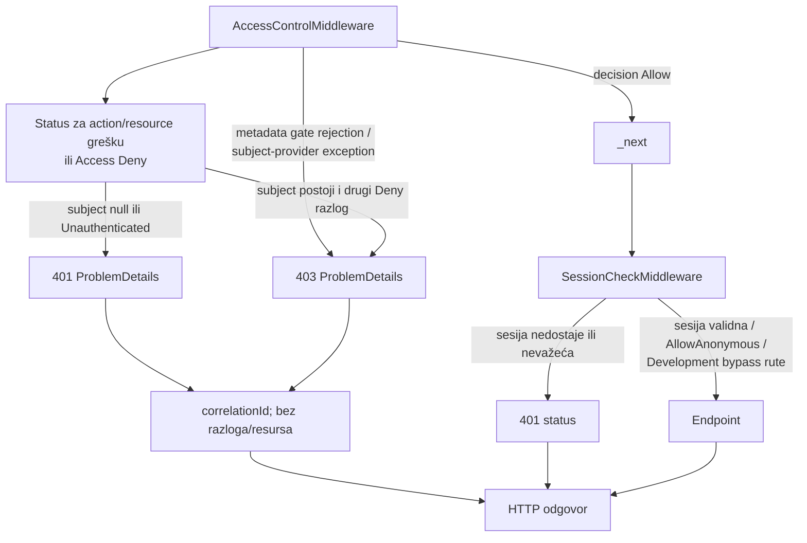

# ACC-05 i ACC-08 — komponenta autorizacije

| Stavka | Vrednost |
|---|---|
| Tim | Tim 3 |
| Zahtevi | ACC-05, ACC-08 |
| Status | ACC-05 implementirano; nedostupni ili nevažeći audit zapisi ostaju fail-closed i aktiviraju bezbedan alarm |
| Projekat | `backend/Platform.Access` |
| Studenti | PR 1/2023 Živanović Jovana<br>PR 16/2023 Musli Danijel<br>PR 18/2023 Spasić Veljko<br>PR 30/2023 Pavlović Sara<br>PR 32/2023 Stanković Pavle<br>PR 53/2023 Matić Željana<br>PR 60/2023 Todorović Nikolina |

## Ugovor za druge module

Drugi moduli pozivaju samo javni ugovor:

```csharp
ValueTask<AccessDecision> DecideAsync(
    AccessRequest request,
    CancellationToken cancellationToken = default);
```

`Allow` je dozvoljen samo kada registrovana politika eksplicitno vrati uspeh. Svaki drugi ishod je `Deny`. Pozivalac ne sme grešku, nedostajući podatak ili nepoznatu akciju tretirati kao dozvolu.

Ugovor trenutno obuhvata:

- `SubjectRef` — identitet i stanje naloga;
- `ResourceRef` — tip i identifikator resursa;
- `AccessRequest` — subjekt, akcija, resurs i korelacioni ID;
- `AccessDecision` — ishod, razlog, politika, verzija i korelacioni ID;
- `IActionCatalog` i `IAccessPolicyRegistry` — granice katalog/registar;
  `IAccessAuditWriter` — ugovor za Access audit adapter.
- `IResourceOwnershipResolver` — server-side granica za potvrdu vlasništva resursa.
- `IAccessSubjectProvider` — server-side izvor subjekta za ASP.NET middleware.

`IActionCatalog` izlaže tipizovane `ActionDefinition` zapise.

### Trenutni katalog akcija

| Akcija | Scope | Tip resursa | Privilegovana |
|---|---|---|---|
| `public.info.read` | `Public` | — | Ne |
| `public.catalog.read` | `Public` | — | Ne |
| `lab.read` | `Course` | `laboratory` | Ne |
| `lab.draft.manage` | `Course` | `laboratory` | Ne |
| `lab.revision.publish` | `Course` | `laboratory` | Da |
| `lab.criteria.hidden.read` | `Course` | `laboratory` | Ne |
| `assignment.manage` | `Course` | `assignment` | Ne |
| `assignment.read.own` | `Course` | `assignment` | Ne |
| `course.read` | `Authenticated` | — | Ne |
| `course.create` | `Authenticated` | — | Da |
| `course.archive` | `Authenticated` | — | Da |
| `group.read` | `Authenticated` | — | Ne |
| `group.create` | `Authenticated` | — | Da |
| `group.member.add` | `Authenticated` | — | Da |
| `group.member.remove` | `Authenticated` | — | Da |
| `material.read` | `Authenticated` | — | Ne |
| `attempt.create` | `Course` | `assignment` | Ne |
| `attempt.read` | `Course` | `attempt` | Ne |
| `attempt.submit` | `Course` | `attempt` | Ne |
| `attempt.read.course` | `Course` | `attempt` | Ne |
| `attempt.review` | `Course` | `attempt` | Da |
| `account.status.change` | `System` | — | Da |
| `system.config.manage` | `System` | — | Da |
| `results.sensitive.read` | `Course` | `attempt` | Da |
| `evaluation.task.process` | `System` | — | Ne |
| `audit.events.read` | `Course` | `course` | Ne |

## Pravilo registracije akcija

`Platform.Access` poseduje centralni, verzionisani katalog dozvoljenih akcija.
Osnovne akcije se definišu u `AccessActions`. Dodatna akcija i njena politika
mogu se registrovati samo kroz javni composition API, pre `Build()`:

```csharp
services.AddAccessAction<MyPolicy>(
    new ActionDefinition("module.record.read", ActionScope.Course, "record", false));
```

Za politiku koja implementira već poznatu centralnu akciju koristi se
`AddAccessPolicy<TPolicy>(actionId)`, npr.
`services.AddAccessPolicy<CourseAuditReadPolicy>("audit.events.read")`.
Poziv se radi u composition fazi, pre `Build()`. Hook odbija duplikate,
nepoznate akcije i nesingleton registraciju politike. Nove akcije se dodaju uz
eksplicitnu `ActionDefinition` kroz `AddAccessAction<TPolicy>(definition)`;
njihovo uvođenje zahteva code review centralnog ugovora. Nepoznata akcija daje
`UnknownAction`, a akcija bez politike `NoPolicy`.

API dodaje identitetske, Authoring i Revision akcije/politike kroz ovaj ugovor
pre `Build()`. DI kreirani katalog i registar se zamrzavaju pri sastavljanju
kompozicije, pre nego što se mogu koristiti nakon izgradnje hosta. Registracija
akcija ili politika preko konkretnih runtime registry-ja nije podržana.

API host zahteva potpunu pokrivenost politika za sve akcije koje se mogu
koristiti. Jedine izuzetke eksplicitno navodi `ActionsWithoutPolicy`; oni ostaju
bez politike i zato se i dalje odbijaju (`NoPolicy`). Trenutni izuzeci su
`public.catalog.read`, `account.status.change`, `system.config.manage`,
`results.sensitive.read` i `evaluation.task.process`. Izuzetak nije dozvola;
`public.info.read` nije izuzetak i ima registrovanu politiku.
`ActionScope.Unknown` i nevažeći resource type odbacuju se prilikom validacije.
Resource type je case-sensitive ASCII obrazac `[a-z][a-z0-9-]{0,63}`; isti
validator koriste katalog i ASP.NET endpoint metadata.

Politike su singleton-i jer su i decision engine i registry singleton-i.
Zato politika, kao i svi servisi koje ona koristi, mora biti thread-safe i ne
sme zavisiti od scoped servisa (`DbContext`, request context i slično). API host
uključuje `ValidateScopes` i `ValidateOnBuild`, tako da captive scoped
zavisnost sprečava host da se pokrene. Hostovi koji ugrađuju `Platform.Access`
moraju uključiti iste DI validacije. Access ne kreira poseban scope po odluci:
caller, subject, resource i svi podaci specifični za zahtev moraju biti
izračunati server-side i prosleđeni kroz `AccessRequest`. Politika ne sme
očekivati da ima pristup HTTP request scope-u. Ako je potrebna scoped
zavisnost, to je blokada za integraciju: ne sme se registrovati politika dok
se lifetime ugovor centralnog Access engine-a ne promeni kroz odobrenu izmenu.

Dodavanje akcije obuhvata:

1. definiciju ID-a u `AccessActions` za centralne akcije, ili composition
   registraciju za dodatnu akciju;
2. deklaraciju scope-a, tipa resursa i privilegovanosti;
3. proveru kompletnosti, validnosti i jedinstvenosti kataloga;
4. pripadajuću politiku i testove u modulu koji akciju koristi.

Centralni katalog je nameran izbor za početnu verziju: omogućava pregled cele
authorization površine kroz code review i sprečava da pojedinačni moduli
samostalno uvedu preširoku ili nekonzistentnu dozvolu.

Podaci o identitetu, ulozi, članstvu i vlasništvu moraju doći sa servera, ne iz headera, tela ili query stringa klijentskog zahteva.

### Audit događaji

`audit.events.read` je centralna akcija sa `Course` scope-om i resource type-om
`course`. Resurs za odluku je tačno jedan kurs, oblika `Course/{courseId}`:

- resource type je malo-slovni, case-sensitive `"course"`;
- resource ID je ID kursa u kanonskom `Guid` `D` formatu, npr.
  `ResourceRef("course", courseId.ToString("D"))`;
- `courseId` mora biti utvrđen i validiran server-side iz kursa koji se čita;
  klijentski header/body/query ne predstavljaju izvor identiteta, članstva ili
  vlasništva;
- `attempt`, `account` ili drugi tip resursa ne važe za ovu akciju, niti se
  sme koristiti globalni resurs bez ID-ja kursa.

Ne postoji implicitni globalni ni administratorski pristup. Audit modul
registruje konkretnu politiku kroz `AddAccessPolicy<TPolicy>("audit.events.read")`.
Dok politika nije registrovana, zahtev se odbija sa `NoPolicy`;
`Platform.Access` ne implementira niti referencira Audit politiku.
Membership/delegation status, uključujući istek i opoziv, ostaje garancija
vlasnika stvarnog `IMembershipReader` adaptera.

## Implementacija

Registracija zavisnosti je deo `Platform.Access/Composition`. `Program.cs`
poziva `AddAccessControl()`; identitetske, Authoring i Revision akcije/politike
registruje kroz javni composition API pre `Build()`. `AccessControlMiddleware`
se izvršava pre `SessionCheckMiddleware`. Access subject provider je
`IdentitySessionSubjectProvider` za session-bound akcije, dok
`RevisionSessionSubjectProvider` dodatno validira sesiju i status naloga na
revision rutama. Ostale akcije koriste unutrašnji provider, podrazumevano
`AnonymousAccessSubjectProvider`; Authoring rute koriste
`AuthoringAccessSubjectProvider` i validiranu sesiju. `SessionCheckMiddleware`
ponovo proverava sesiju pre endpoint-a gde se primenjuje. Razvojni header nije
izvor Access identiteta.

Auth login/logout i health su eksplicitno javne rute. `/api/auth/me` je javna
samo za centralni Access sloj, ali i dalje zahteva validnu sesiju kroz
`SessionCheckMiddleware`. Administratorske, kreiranje naloga, Authoring i
Revision rute koriste `RequireAccess`. Legacy delegation marker nikada ne
dozvoljava prolaz; rute sa markerom, bez zahteva ili sa više/konfliktnim
zahtevima se odbijaju. Odbijanja pre evaluacije politike se takođe šalju na
audit.

Fail-closed tok:

1. nema subjekta → `Unauthenticated`;
2. nalog nije aktivan → `AccountNotActive`;
3. akcija nije validna ili registrovana → `UnknownAction`;
4. politika ne postoji → `NoPolicy`;
5. politika odbije zahtev → `PolicyDenied`;
6. greška, izuzetak ili timeout u politici → `PolicyError`;
7. neusklađen scope ili tip resursa → `PolicyError`;
8. samo uspešna politika može vratiti `Allow`.

API šalje Access odbijanja kroz `CentralAccessAuditWriter` do
`ITrustedAuditWriter`. Audit koristi `AccessDecision.CorrelationId`, uključujući
vrednost koju je engine normalizovao ili generisao. Samo odsutan subjekt se
mapira na `Anonymous`; subjekt sa ID-em koji nije neprazan GUID se ne upisuje i
aktivira alarm `access.audit.lost`. Nevalidna opcionalna `action`, `policyId` i
`policyVersion` vrednost se izostavlja iz audit detalja.

Audit u engine-u i pre-decision middleware denial-u koristi nezavisan
`CancellationTokenSource` sa istim `AccessDecisionOptions.AuditTimeout`; token
nije povezan sa `HttpContext.RequestAborted`. Timeout token se prosleđuje kroz
Access adapter, `ITrustedAuditWriter`, `AuditWriter` i PostgreSQL store, koji ga
prosleđuje EF Core komandi. Timeout ili neuspešan/nepotpun zapis ne menja
HTTP denial: odbijeni zahtev ostaje 403. Jedan neuspešan zapis emituje tačno
jedan `LogError` sa stabilnim EventId `access.audit.lost`; sadržaj obuhvata
samo tip događaja, status i correlation ID, nikada exception, identitet
subjekta, akciju ili rejection detalje. Kada je klijent prekinuo zahtev,
Audit operacija se i dalje može izvršavati do nezavisnog timeout-a.

Prema D6, svaki obavezni `access.denied` događaj se šalje pojedinačno; nema
agregacije ni uzorkovanja. Kapacitet baze i održiva stopa upisa nisu potvrđeni
ovom izmenom: produkciono opterećenje nije testirano i nema tvrdnje o
performansama. Potrebna je koordinacija Tima 3 i Tima 12 (Audit/skladište) za
reprezentativnu proveru opterećenja i kapaciteta pre takve tvrdnje. Eventualna
promena koja odbacuje ili agregira obavezne događaje zahteva zasebnu odluku
vlasnika D6.

Uspešne Access odluke se trenutno ne upisuju kao Access audit događaj: Audit
katalog prihvata `AccessDenied`, ali nema odgovarajući događaj za odluku
`Allow`. Do izmene vlasničkog ugovora `Platform.Audit`, dozvole se ne smeju
mapirati na događaj odbijanja.

`LoggerAccessAuditWriter` je lokalni fallback preko host `ILogger` ugovora. Centralni
`Platform.Audit` ugovor je integrisan za odbijanja kroz `CentralAccessAuditWriter`;
za uspešne odluke još nije definisan odgovarajući Audit event. Testovi koriste eksplicitne recording/throwing
audit fake-ove. `EmptyMembershipReader`
i `EmptyResourceDescriptorResolver` ostaju namerni fail-closed fallback-i za slučaj
da domenski adapteri nisu registrovani; ne predstavljaju placeholder poslovnu
logiku i ne mogu odobriti zahtev.

`AddAccessControl()` registruje katalog, policy registry i decision engine kao
singleton komponente. API host registruje `CentralAccessAuditWriter` kao
`IAccessAuditWriter`; minimalni hostovi zadržavaju logger fallback. Politike i membership/resource readere
moraju biti singleton-safe. DI kreirani katalog/registar se zamrzavaju pre
prvog zahteva; moduli koriste isključivo `AddAccessAction`/`AddAccessPolicy`
pre `Build()`.
Audit loggers koriste host
logger kada je dostupan, a `NullLogger` fallback u minimalnim kontejnerima; modul
ne konfiguriše globalni logging hosta.

Za `attempt.read` i `attempt.submit` politika zahteva server-side potvrdu vlasništva.
Ako resolver vlasništva nije dostupan ili ne potvrdi vlasnika, pristup se odbija.
Ownership adapter je pripremljen kroz `IResourceOwnershipResolver`; konkretni domenski
moduli treba da ga obezbede kroz dogovorenu integraciju.

## Dijagram arhitekture



Definicije kataloga se validiraju pri njegovoj izgradnji. Pri pokretanju se
katalog i registar zamrzavaju, a zatim se proveravaju pokrivenost politika i
izuzeci; konfiguraciona greška prekida pokretanje. U API hostu audit adapter je
centralni; drugi hostovi mogu koristiti logger fallback. Session middleware je
posle Access middleware-a u API pipeline-u.

## Dijagrami toka podataka

### 1. Konfiguracioni podaci



### 2. HTTP zahtev i AccessRequest



### 3. Podaci odluke i politike



### 4. Audit podaci



### 5. Rezultat HTTP obrade



`AccessProblemDetailsWriter` vraća 401 za neautentifikovanog subjekta, a inače
403, sa `correlationId` bez detalja odluke. `SessionCheckMiddleware` može
postaviti 401 nakon dozvoljene Access odluke; taj odgovor nije ProblemDetails
koji formira Access middleware.


## Bezbednosna analiza i negativni testovi

Pregled pokriva garancije ACC-05 i ACC-08 iz specifikacije i scenarije iz plana Faze 2. Zasnovan je na kodu na reviziji `227cfaf` sa grane `feature/ACC-08-access-context-policy`. Testovi nisu pokretani. **Nema odgovarajućeg testa** označava da u `Platform.Access.Tests` nije pronađen direktan negativni test na nivou navedenom u redu.

### ACC-05 — podrazumevano odbijanje i HTTP granica

| Garancija ili scenario provere | Implementacija | Negativni test u Platform.Access.Tests |
|---|---|---|
| Nepoznata, prazna ili nevažeća akcija daje `UnknownAction`. Provera koristi tačan ID iz kataloga. | [`DefaultDenyAccessDecision`](../../backend/Platform.Access/Application/Services/DefaultDenyAccessDecision.cs), [`ActionId`](../../backend/Platform.Access/Domain/ValueObjects/ActionId.cs) | [`ACC05_InvalidOrUnknownAction_DeniedAsUnknownAction`](../../backend/Platform.Access.Tests/DefaultDenyEngineTests.cs#L77), [`ACC05_NullAction_DeniedAsUnknownAction`](../../backend/Platform.Access.Tests/DefaultDenyEngineTests.cs#L89), [`ACC05_RandomActionStrings_NeverAllowedUnlessExactlyRegistered`](../../backend/Platform.Access.Tests/ActionIdFuzzTests.cs#L38) |
| Poznata akcija bez politike daje `NoPolicy` za sve testirane tipove subjekta, uključujući javnu akciju. Isto važi kad registar prijavi politiku, a vrati null. | [`DefaultDenyAccessDecision`](../../backend/Platform.Access/Application/Services/DefaultDenyAccessDecision.cs) | [`ACC05_NoActionInCatalogWithoutPolicyIsEverAllowed_AllSubjectStates`](../../backend/Platform.Access.Tests/DefaultDenyEngineTests.cs#L169), [`ACC05_PublicActionWithoutPolicy_StillDenied`](../../backend/Platform.Access.Tests/DefaultDenyEngineTests.cs#L259), [`ACC05_RegistryReportsFoundButReturnsNull_DeniedAsNoPolicy`](../../backend/Platform.Access.Tests/DefaultDenyEngineTests.cs#L196) |
| Samo eksplicitni permit daje pristup. Odbijanje politike, neodređen, null, nepoznat ili kontradiktoran rezultat daju Deny. Politika ne može da predstavi svoj razlog kao razlog rezervisan za engine. | [`DefaultDenyAccessDecision`](../../backend/Platform.Access/Application/Services/DefaultDenyAccessDecision.cs) | [`ACC05_PolicyRefuses_Denied`](../../backend/Platform.Access.Tests/DefaultDenyEngineTests.cs#L286), [`ACC08_Outcome_Exhaustive_AllowOnlyForPermitWithoutReason_AndDenyNeverCarriesEngineReasons`](../../backend/Platform.Access.Tests/OutcomePolicyEngineTests.cs#L144), [`ACC08_Outcome_NullResult_DeniedAsPolicyError`](../../backend/Platform.Access.Tests/OutcomePolicyEngineTests.cs#L133) |
| Anonimni subjekt i neaktivan nalog na zaštićenoj akciji se odbijaju pre politike. | [`DefaultDenyAccessDecision`](../../backend/Platform.Access/Application/Services/DefaultDenyAccessDecision.cs) | [`ACC08_Outcome_AnonymousOnProtectedAction_PolicyIsNeverCalled`](../../backend/Platform.Access.Tests/OutcomePolicyEngineTests.cs#L255), [`ACC08_Outcome_NonActiveAccount_PolicyIsNeverCalled`](../../backend/Platform.Access.Tests/OutcomePolicyEngineTests.cs#L244) |
| Neusklađen scope ili tip resursa i neispravan identitet politike sprečavaju dozvolu. | [`DefaultDenyAccessDecision`](../../backend/Platform.Access/Application/Services/DefaultDenyAccessDecision.cs) | [`ACC05_CourseActionWithoutResource_DeniedAsPolicyError`](../../backend/Platform.Access.Tests/DefaultDenyEngineTests.cs#L112), [`ACC05_NonCourseActionWithResource_DeniedAsPolicyError`](../../backend/Platform.Access.Tests/DefaultDenyEngineTests.cs#L122), [`ACC05_UndefinedActionScope_DeniedAsPolicyError`](../../backend/Platform.Access.Tests/DefaultDenyEngineTests.cs#L132), [`ACC08_Outcome_BlankPolicyIdOrVersion_DeniedAndNotCalled`](../../backend/Platform.Access.Tests/OutcomePolicyEngineTests.cs#L268), [`ACC05_Composition_AuditActionWithoutPolicyOrCorrectResource_IsDenied`](../../backend/Platform.Access.Tests/ConfigurationValidationTests.cs#L471) |
| Greška kataloga, registra ili politike, otkazivanje i istek evaluacije daju Deny, uključujući asinhroni kvar i politiku koja ignoriše token. | [`DefaultDenyAccessDecision`](../../backend/Platform.Access/Application/Services/DefaultDenyAccessDecision.cs) | [`ACC05_CatalogThrows_DeniedAsPolicyError`](../../backend/Platform.Access.Tests/DefaultDenyEngineTests.cs#L409), [`ACC05_RegistryThrows_DeniedAsPolicyError`](../../backend/Platform.Access.Tests/DefaultDenyEngineTests.cs#L420), [`ACC05_PolicyFaultsAsynchronously_DeniedAsPolicyError`](../../backend/Platform.Access.Tests/DefaultDenyEngineTests.cs#L337), [`ACC05_CallerCancellation_DeniedNotThrown`](../../backend/Platform.Access.Tests/DefaultDenyEngineTests.cs#L359), [`ACC05_PolicyIgnoringCancellation_StillReturnsDenyWithinTimeout`](../../backend/Platform.Access.Tests/DefaultDenyEngineTests.cs#L396) |
| Nevažeće ili duple deklaracije se odbijaju. Strogi režim odbija nedostajuću politiku bez izuzetka i izuzetak koji ima politiku. | [`ActionCatalogValidator`](../../backend/Platform.Access/Infrastructure/Catalog/ActionCatalogValidator.cs), [`AccessConfigurationValidator`](../../backend/Platform.Access/Application/Services/AccessConfigurationValidator.cs), [`AccessServiceCollectionExtensions`](../../backend/Platform.Access/Composition/AccessServiceCollectionExtensions.cs) | [`ACC05_Composition_RejectsDuplicateActionAndPolicyRegistrations`](../../backend/Platform.Access.Tests/ConfigurationValidationTests.cs#L134), [`ACC05_Catalog_RejectsInvalidResourceTypeUsingMetadataRules`](../../backend/Platform.Access.Tests/ConfigurationValidationTests.cs#L259), [`ACC05_Catalog_RejectsUnknownScope`](../../backend/Platform.Access.Tests/ConfigurationValidationTests.cs#L249), [`ACC05_Startup_StrictCoverageWithMissingPolicies_PreventsStart`](../../backend/Platform.Access.Tests/ConfigurationValidationTests.cs#L425), [`ACC05_Validator_ExemptActionThatAlsoHasPolicy_Rejected`](../../backend/Platform.Access.Tests/ConfigurationValidationTests.cs#L343), [`ACC05_Validator_ExemptionForUnknownAction_Rejected`](../../backend/Platform.Access.Tests/ConfigurationValidationTests.cs#L333), [`ACC05_Startup_PolicyForUnknownAction_PreventsStart`](../../backend/Platform.Access.Tests/ConfigurationValidationTests.cs#L416) |
| Katalog i registar se zamrzavaju. Uz uključene host DI provere, singleton politika sa scoped zavisnošću sprečava start. | [`AccessConfigurationStartupCheck`](../../backend/Platform.Access/Composition/AccessConfigurationStartupCheck.cs), [`AccessServiceCollectionExtensions`](../../backend/Platform.Access/Composition/AccessServiceCollectionExtensions.cs), [`Program`](../../backend/Platform.Api/Program.cs) | [`ACC05_Startup_FreezesActionAndPolicyRegistration`](../../backend/Platform.Access.Tests/ConfigurationValidationTests.cs#L399), [`ACC05_Composition_ScopeValidationRejectsScopedPolicyDependency`](../../backend/Platform.Access.Tests/ConfigurationValidationTests.cs#L164) |
| Ruta bez zahteva za pristup ili sa više zahteva se odbija. Grupni zahtev se primenjuje i stvarne API rute podležu proveri metadata. | [`AccessControlMiddleware`](../../backend/Platform.Access/AspNet/AccessControlMiddleware.cs) | [`ACC05_Route_without_metadata_is_fallback_denied`](../../backend/Platform.Access.Tests/AccessControlMiddlewareTests.cs#L254), [`ACC05_Multiple_requirements_are_denied_and_audited`](../../backend/Platform.Access.Tests/AccessControlMiddlewareTests.cs#L322), [`ACC05_Group_level_RequireAccess_is_enforced`](../../backend/Platform.Access.Tests/AccessControlMiddlewareTests.cs#L202), [`ACC05_Every_real_route_has_exactly_one_access_requirement`](../../backend/Platform.Access.Tests/ApiEndpointCoverageTests.cs#L16) |
| Legacy javni ili delegirani marker izaziva odbijanje čak i uz prisutan `RequireAccess`. | [`AccessControlMiddleware`](../../backend/Platform.Access/AspNet/AccessControlMiddleware.cs) | **Nema odgovarajućeg testa** |
| Nevažeći ili predugačak ID iz route se odbija pre engine-a. Tip resursa je deklarisan u endpoint metadata. | [`AccessControlMiddleware`](../../backend/Platform.Access/AspNet/AccessControlMiddleware.cs), [`AccessMetadataRules`](../../backend/Platform.Access/AspNet/AccessMetadataRules.cs) | [`ACC05_Invalid_resource_id_is_denied_before_engine`](../../backend/Platform.Access.Tests/AccessControlMiddlewareTests.cs#L356), [`ACC05_Overlong_resource_id_is_denied_before_engine`](../../backend/Platform.Access.Tests/AccessControlMiddlewareTests.cs#L366), [`ACC05_RequireAccess_rejects_invalid_registrations`](../../backend/Platform.Access.Tests/AccessControlMiddlewareTests.cs#L447) |
| Kvar subject providera ili engine-a i null ili nepoznat ishod ne propuštaju zahtev do handlera. | [`AccessControlMiddleware`](../../backend/Platform.Access/AspNet/AccessControlMiddleware.cs) | [`ACC05_Subject_provider_failure_is_denied`](../../backend/Platform.Access.Tests/AccessControlMiddlewareTests.cs#L402), [`ACC05_Engine_exception_is_denied`](../../backend/Platform.Access.Tests/AccessControlMiddlewareTests.cs#L384), [`ACC05_Engine_timeout_is_denied_not_propagated`](../../backend/Platform.Access.Tests/AccessControlMiddlewareTests.cs#L393), [`ACC05_Null_decision_is_denied`](../../backend/Platform.Access.Tests/AccessControlMiddlewareTests.cs#L335), [`ACC05_Unknown_outcome_value_is_denied`](../../backend/Platform.Access.Tests/AccessControlMiddlewareTests.cs#L344) |
| HTTP odbijanje ne pokreće handler. Anonimno odbijanje dobija 401. Proveren 403 je generički i ima `no-store`. | [`AccessControlMiddleware`](../../backend/Platform.Access/AspNet/AccessControlMiddleware.cs), [`AccessProblemDetailsWriter`](../../backend/Platform.Access/AspNet/AccessProblemDetailsWriter.cs) | [`ACC05_Deny_does_not_call_handler_and_returns_generic_403`](../../backend/Platform.Access.Tests/AccessControlMiddlewareTests.cs#L211), [`ACC05_Anonymous_subject_gets_401`](../../backend/Platform.Access.Tests/AccessControlMiddlewareTests.cs#L237) |
| Ekvivalentan javni odgovor za postojeći tuđi i nepostojeći resurs, uz izuzimanje dinamičkog correlation ID-ja. | [`AccessProblemDetailsWriter`](../../backend/Platform.Access/AspNet/AccessProblemDetailsWriter.cs) | **Nema odgovarajućeg testa** |

### ACC-08 — poreklo konteksta, vlasništvo i pravila

| Garancija ili scenario provere | Implementacija | Negativni test u Platform.Access.Tests |
|---|---|---|
| Identitet dolazi od server-side subject providera. Klijentski headeri i query parametri u testiranom zahtevu ne menjaju subjekt ili korelaciju. Sistemska uloga dolazi sa servera i greška direktorijuma ne daje admin ulogu. | [`AccessControlMiddleware`](../../backend/Platform.Access/AspNet/AccessControlMiddleware.cs), [`SystemRoleSubjectProvider`](../../backend/Platform.Api/Security/IdentityAccess/SystemRoleSubjectProvider.cs) | [`ACC05_Client_supplied_identity_role_course_and_correlation_are_ignored`](../../backend/Platform.Access.Tests/AccessControlMiddlewareTests.cs#L421), [`ACC08_RequestHeaderRole_IsIgnoredAndStatePreserved`](../../backend/Platform.Access.Tests/SystemRoleSubjectProviderTests.cs#L43), [`ACC08_AdminDirectoryException_FailsClosedAndLogsOnlyExceptionType`](../../backend/Platform.Access.Tests/SystemRoleSubjectProviderTests.cs#L70), [`ACC08_InvalidSubjectId_AdminRoleRemainsNone`](../../backend/Platform.Access.Tests/SystemRoleSubjectProviderTests.cs#L32) |
| Kombinovana HTTP provera lažnih atributa vlasništva, kursa, statusa i vremena kroz telo zahteva i stvarnu kontekstualnu politiku. | [`AccessControlMiddleware`](../../backend/Platform.Access/AspNet/AccessControlMiddleware.cs), [`EvaluationSnapshotLoader`](../../backend/Platform.Access/Application/Snapshots/EvaluationSnapshotLoader.cs) | **Nema odgovarajućeg testa** |
| Razvojni izvori se aktiviraju samo u Development uz eksplicitni flag. Podrazumevani izvori nemaju članstvo ili opis resursa koji bi dali pristup. | [`AccessDevelopmentServiceCollectionExtensions`](../../backend/Platform.Access/Composition/AccessDevelopmentServiceCollectionExtensions.cs), [`AccessServiceCollectionExtensions`](../../backend/Platform.Access/Composition/AccessServiceCollectionExtensions.cs) | [`ACC08_FlagOutsideDevelopment_RegistersNothing`](../../backend/Platform.Access.Tests/DevelopmentSourcesTests.cs#L26), [`ACC08_DevelopmentWithoutExplicitTrue_RegistersNothing`](../../backend/Platform.Access.Tests/DevelopmentSourcesTests.cs#L39), [`ACC08_ProductionHost_UsesEmptySourcesEvenWithFlag`](../../backend/Platform.Access.Tests/DevelopmentSourcesTests.cs#L84), [`AddAccessControl_DefaultContextReaders_DenyCourseActions`](../../backend/Platform.Access.Tests/CourseRoleAccessPolicyTests.cs#L218) |
| Uloga se vezuje za aktivno članstvo konkretnog korisnika i kurs konkretnog resursa. Tuđe ili ukinuto članstvo ne daje dozvolu. | [`CourseRoleAccessPolicy`](../../backend/Platform.Access/Infrastructure/Policies/CourseRoleAccessPolicy.cs), [`OwnershipScopeGuard`](../../backend/Platform.Access/Infrastructure/Guards/OwnershipScopeGuard.cs) | [`NonActiveMembership_IsDenied`](../../backend/Platform.Access.Tests/CourseRoleAccessPolicyTests.cs#L122), [`MissingMembership_IsDenied`](../../backend/Platform.Access.Tests/CourseRoleAccessPolicyTests.cs#L114), [`ACC08_MembershipAccountDifferentFromSubject_Denies`](../../backend/Platform.Access.Tests/OwnershipScopeGuardTests.cs#L162), [`ACC08_RoleFromDifferentCourse_DeniesContextMismatch`](../../backend/Platform.Access.Tests/OwnershipScopeGuardTests.cs#L171), [`ACC08_GuardPipeline_MembershipRevokedBetweenDecisions_DenyNext`](../../backend/Platform.Access.Tests/Snapshots/GuardPipelineTests.cs#L98) |
| Vlasništvo i dozvoljena relacija se proveravaju tamo gde ih akcija zahteva. Student ne dobija pristup tuđem pokušaju ni unutar istog kursa. Vlasništvo samo ne zamenjuje ulogu. | [`OwnershipScopeGuard`](../../backend/Platform.Access/Infrastructure/Guards/OwnershipScopeGuard.cs), [`CourseRoleAccessPolicy`](../../backend/Platform.Access/Infrastructure/Policies/CourseRoleAccessPolicy.cs) | [`ACC08_CourseRoleWithoutOwner_DoesNotPermitOwnershipAction`](../../backend/Platform.Access.Tests/OwnershipScopeGuardTests.cs#L133), [`ACC08_OwnerWithoutCourseRole_DoesNotPermit`](../../backend/Platform.Access.Tests/OwnershipScopeGuardTests.cs#L125), [`ACC08_StudentReadsAttemptOfClassmateInSameCourse_Deny`](../../backend/Platform.Access.Tests/DevelopmentSourcesTests.cs#L237), [`ACC08_StudentSubmitsAttemptOfClassmateInSameCourse_Deny`](../../backend/Platform.Access.Tests/DevelopmentSourcesTests.cs#L249), [`ACC08_ActionRelationMatrix_MatchesPolicyDefinition`](../../backend/Platform.Access.Tests/OwnershipScopeGuardTests.cs#L25) |
| Asistent mora imati eksplicitnu delegaciju za konkretnu delegabilnu akciju. | [`CourseRoleAccessPolicy`](../../backend/Platform.Access/Infrastructure/Policies/CourseRoleAccessPolicy.cs), [`OwnershipScopeGuard`](../../backend/Platform.Access/Infrastructure/Guards/OwnershipScopeGuard.cs) | [`Assistant_IsDeniedWhenActionWasNotDelegated`](../../backend/Platform.Access.Tests/CourseRoleAccessPolicyTests.cs#L66), [`ACC08_AssistantDelegationForNonDelegableLabDraftManage_Denies`](../../backend/Platform.Access.Tests/OwnershipScopeGuardTests.cs#L115) |
| Opis drugog resursa i članstvo drugog korisnika ili kursa se odbacuju. Grantovi za drugog nosioca ili akciju se filtriraju. | [`EvaluationSnapshotLoader`](../../backend/Platform.Access/Application/Snapshots/EvaluationSnapshotLoader.cs) | [`ACC08_Load_DescriptorForDifferentResource_Rejected`](../../backend/Platform.Access.Tests/Snapshots/EvaluationSnapshotLoaderTests.cs#L355), [`ACC08_Load_MembershipOfAnotherAccountOrCourse_Rejected`](../../backend/Platform.Access.Tests/Snapshots/EvaluationSnapshotLoaderTests.cs#L364), [`ACC08_Load_GrantsOfOtherHoldersOrActions_AreDropped`](../../backend/Platform.Access.Tests/Snapshots/EvaluationSnapshotLoaderTests.cs#L378) |
| Atributi i grantovi kopiraju se u snapshot. Nova odluka čita ažurirane podatke i serversko vreme. | [`EvaluationSnapshotLoader`](../../backend/Platform.Access/Application/Snapshots/EvaluationSnapshotLoader.cs), [`ContextualAccessPolicy`](../../backend/Platform.Access/Infrastructure/Policies/ContextualAccessPolicy.cs) | [`ACC08_Load_AttributesAreCopied_LaterSourceChangeDoesNotAffectSnapshot`](../../backend/Platform.Access.Tests/Snapshots/EvaluationSnapshotLoaderTests.cs#L406), [`ACC08_Load_SnapshotGrantListCannotBeChangedThroughTheSourceList`](../../backend/Platform.Access.Tests/Snapshots/EvaluationSnapshotLoaderTests.cs#L435), [`ACC08_Pipeline_SourceChangedBetweenDecisions_NextDecisionSeesIt`](../../backend/Platform.Access.Tests/Snapshots/ContextualPipelineTests.cs#L155), [`ACC08_Pipeline_ClockMovesBetweenDecisions_NextDecisionSeesIt`](../../backend/Platform.Access.Tests/Snapshots/ContextualPipelineTests.cs#L142) |
| Nedostajući resurs ili atribut, atribut pogrešnog tipa i nepoznata vrednost u zabrani ne daju permit. Greška ili timeout resolvera završava odbijanjem u engine-u. | [`ContextualAccessPolicy`](../../backend/Platform.Access/Infrastructure/Policies/ContextualAccessPolicy.cs), [`RuleSet`](../../backend/Platform.Access/Application/Rules/RuleSet.cs), [`SnapshotConditions`](../../backend/Platform.Access/Application/Rules/SnapshotConditions.cs) | [`ACC08_Pipeline_ResourceNotFound_DeniedAsMissingAttribute`](../../backend/Platform.Access.Tests/Snapshots/ContextualPipelineTests.cs#L171), [`ACC08_Pipeline_MissingProhibitionAttribute_NeverAllowed`](../../backend/Platform.Access.Tests/Snapshots/ContextualPipelineTests.cs#L194), [`ACC08_AttrEquals_WrongTypeInSource_IsUnknownNotFalse`](../../backend/Platform.Access.Tests/Rules/SnapshotConditionTests.cs#L66), [`ACC08_Pipeline_ResolverIgnoringCancellation_DeniedWithinPolicyTimeout`](../../backend/Platform.Access.Tests/Snapshots/ContextualPipelineTests.cs#L233), [`ACC08_Pipeline_ResolverFaultsAsynchronously_DeniedAsPolicyError`](../../backend/Platform.Access.Tests/Snapshots/ContextualPipelineTests.cs#L219) |
| Zabrana nadjačava ispunjene uslove. Redosled pravila ne menja ishod, a dodavanje pravila ne pretvara odbijanje u permit. | [`RuleSet`](../../backend/Platform.Access/Application/Rules/RuleSet.cs), [`RuleEvaluation`](../../backend/Platform.Access/Application/Rules/RuleEvaluation.cs) | [`ACC08_ProhibitionTrue_OverridesAllRequirements`](../../backend/Platform.Access.Tests/Rules/RuleSetTests.cs#L28), [`ACC08_RuleOrder_NeverChangesVerdictReasonOrRuleId`](../../backend/Platform.Access.Tests/Rules/RulePropertyTests.cs#L46), [`ACC08_AddingAnyRule_NeverTurnsNonPermitIntoPermit`](../../backend/Platform.Access.Tests/Rules/RulePropertyTests.cs#L65) |
| Prazan skup obaveznih pravila, dupli ID-jevi ili preveliko stablo pravila se odbijaju. Skup pravila se kopira. | [`RuleSet`](../../backend/Platform.Access/Application/Rules/RuleSet.cs), [`RuleLimits`](../../backend/Platform.Access/Application/Rules/RuleLimits.cs) | [`ACC08_NoRequirements_Rejected_BecauseItWouldPermitEverything`](../../backend/Platform.Access.Tests/Rules/RuleSetTests.cs#L120), [`ACC08_DuplicateRuleIds_RejectedAcrossRequirementsAndProhibitions`](../../backend/Platform.Access.Tests/Rules/RuleSetTests.cs#L128), [`ACC08_DepthAtLimit_AcceptedAndOneOver_Rejected`](../../backend/Platform.Access.Tests/Rules/RuleSetTests.cs#L184), [`ACC08_NodeCountAtLimit_AcceptedAndOneOver_Rejected`](../../backend/Platform.Access.Tests/Rules/RuleSetTests.cs#L198), [`ACC08_TooManyRules_Rejected`](../../backend/Platform.Access.Tests/Rules/RuleSetTests.cs#L226), [`ACC08_CallerCannotMutateRulesAfterConstruction`](../../backend/Platform.Access.Tests/Rules/RuleSetTests.cs#L259) |
| Serversko vreme na samom roku i posle njega odbija zahtev koji traži `NowBefore`. Dostizanje limita pokušaja i arhivirani kurs odbijaju se u testovima pravila. | [`SnapshotConditions`](../../backend/Platform.Access/Application/Rules/SnapshotConditions.cs), [`RuleSet`](../../backend/Platform.Access/Application/Rules/RuleSet.cs) | [`ACC08_Pipeline_DeadlineBoundary_UsesServerClock`](../../backend/Platform.Access.Tests/Snapshots/ContextualPipelineTests.cs#L128), [`ACC08_LessThan_BetweenAttributes_StrictAndFailClosed`](../../backend/Platform.Access.Tests/Rules/SnapshotConditionTests.cs#L211), [`ACC08_ComposedRules_ArchivedCourse_ProhibitionDenies`](../../backend/Platform.Access.Tests/Rules/SnapshotConditionTests.cs#L274) |
| Stvarni skup pravila za `attempt.create` odbija neaktivnu dodelu, dostignut limit, istekao rok i arhiviran kurs kroz registrovanu kompoziciju. Prethodni red proverava pojedinačne uslove ili ručno sastavljena pravila. | [`ContextualAccessRules`](../../backend/Platform.Access/Domain/Constants/ContextualAccessRules.cs), [`Program`](../../backend/Platform.Api/Program.cs) | **Nema odgovarajućeg testa** |
| Stvarni skupovi pravila za `attempt.submit`, `attempt.read.course` i `attempt.review` odbijaju zahtev pri pogrešnom ili nedostajućem statusu. Generički test `StatusIn` i provera imena pravila daju parcijalni dokaz. | [`ContextualAccessRules`](../../backend/Platform.Access/Domain/Constants/ContextualAccessRules.cs), [`ContextualAccessPolicy`](../../backend/Platform.Access/Infrastructure/Policies/ContextualAccessPolicy.cs) | **Nema odgovarajućeg testa** |
| Atributi koji bi zadovoljili sva pravila ne mogu da prebace odluku preko odbijanja vlasništva. Matrica i guard pipeline dokazuju odbijanje u guard-u, a poseban test punog toka sa takvim atributima nedostaje. | [`ContextualAccessPolicy`](../../backend/Platform.Access/Infrastructure/Policies/ContextualAccessPolicy.cs), [`OwnershipScopeGuard`](../../backend/Platform.Access/Infrastructure/Guards/OwnershipScopeGuard.cs) | **Nema odgovarajućeg testa** |

### Privilegovani pristup i audit

| Garancija ili scenario provere | Implementacija | Negativni test u Platform.Access.Tests |
|---|---|---|
| U izolovanoj politici za `results.sensitive.read` neophodni su admin uloga i važeći grant za odgovarajućeg nosioca, akciju i scope. Opozvan, istekao, budući ili samostalno izdat grant se odbija. | [`ResultsSensitiveReadPolicy`](../../backend/Platform.Access/Infrastructure/Grants/ResultsSensitiveReadPolicy.cs), [`ElevatedGrantValidator`](../../backend/Platform.Access/Infrastructure/Grants/ElevatedGrantValidator.cs) | [`Engine_DeniesAdministratorWithoutGrant`](../../backend/Platform.Access.Tests/Grants/ResultsSensitiveReadPolicyTests.cs#L219), [`NonAdministratorWithValidGrant_IsDenied`](../../backend/Platform.Access.Tests/Grants/ResultsSensitiveReadPolicyTests.cs#L111), [`AdministratorWithGrantForAnotherCourse_IsDenied`](../../backend/Platform.Access.Tests/Grants/ResultsSensitiveReadPolicyTests.cs#L93), [`GrantForAnotherAction_IsRejected`](../../backend/Platform.Access.Tests/Grants/ElevatedGrantValidatorTests.cs#L86), [`GrantForAnotherResource_IsRejected`](../../backend/Platform.Access.Tests/Grants/ElevatedGrantValidatorTests.cs#L94), [`RevokedGrant_IsRejected`](../../backend/Platform.Access.Tests/Grants/ElevatedGrantValidatorTests.cs#L78), [`ExpiredGrant_IsRejectedExactlyAtExpiry`](../../backend/Platform.Access.Tests/Grants/ElevatedGrantValidatorTests.cs#L60), [`GrantNotYetActive_IsRejectedUntilNotBefore`](../../backend/Platform.Access.Tests/Grants/ElevatedGrantValidatorTests.cs#L69), [`SelfIssuedGrant_IsRejected`](../../backend/Platform.Access.Tests/Grants/ElevatedGrantValidatorTests.cs#L119) |
| API trenutno drži `results.sensitive.read` u `ActionsWithoutPolicy`. Dokaz iz izolovane politike ne potvrđuje aktivaciju u API hostu. Opšti test dokazuje da akcija bez politike daje Deny, a dedikovana provera trenutne API konfiguracije nedostaje. | [`Program`](../../backend/Platform.Api/Program.cs), [`DefaultDenyAccessDecision`](../../backend/Platform.Access/Application/Services/DefaultDenyAccessDecision.cs) | **Nema odgovarajućeg testa** |
| Nedostupnost audita, timeout ili prekid HTTP zahteva ne pretvaraju Deny u Allow. Upis ima nezavisan token i vremensko ograničenje. | [`DefaultDenyAccessDecision`](../../backend/Platform.Access/Application/Services/DefaultDenyAccessDecision.cs), [`AccessControlMiddleware`](../../backend/Platform.Access/AspNet/AccessControlMiddleware.cs), [`CentralAccessAuditWriter`](../../backend/Platform.Api/Security/AccessAudit/CentralAccessAuditWriter.cs) | [`ACC05_AuditThrows_DenyStaysDeny`](../../backend/Platform.Access.Tests/DefaultDenyEngineTests.cs#L467), [`ACC05_AuditTimeoutCancelsWriterOperationAndPreservesDenial`](../../backend/Platform.Access.Tests/DefaultDenyEngineTests.cs#L491), [`ACC05_RequestAbortedDoesNotCancelAuditBeforeIndependentTimeout`](../../backend/Platform.Access.Tests/AccessControlMiddlewareTests.cs#L280), [`PlatformApi_UnavailableAuditStillReturns403AndLogsAlarm`](../../backend/Platform.Access.Tests/Auditing/AccessAuditHostIntegrationTests.cs#L172) |
| Nevažeći ID poznatog aktera ne mapira se na anonimnog. Nevažeći opcioni detalji se izostavljaju. Korelacija dolazi iz odluke, a centralni alarm ne beleži podatke o akteru ili detalje greške. | [`AccessDeniedAuditMapper`](../../backend/Platform.Api/Security/AccessAudit/AccessDeniedAuditMapper.cs), [`CentralAccessAuditWriter`](../../backend/Platform.Api/Security/AccessAudit/CentralAccessAuditWriter.cs) | [`SubjectWithInvalidUserGuid_IsNotMappedToAnonymous`](../../backend/Platform.Access.Tests/Auditing/AccessDeniedAuditMapperTests.cs#L135), [`InvalidOptionalDetails_AreOmittedSoTheDenialIsStillRecorded`](../../backend/Platform.Access.Tests/Auditing/AccessDeniedAuditMapperTests.cs#L49), [`PlatformApi_AuditOmitsCrLfAndLogsOnlySafeFailureFields`](../../backend/Platform.Access.Tests/Auditing/AccessAuditHostIntegrationTests.cs#L103), [`ACC05_CorrelationId_IsSanitizedAndBoundedBeforeReturningDecision`](../../backend/Platform.Access.Tests/DefaultDenyEngineTests.cs#L142) |
| Dijagnostički trace izostavlja nevažeće identifikatore i ograničen je na 16 koraka. Vrednosti atributa i trace odluke ne izlaze kroz javni model. | [`DecisionTraceFormatter`](../../backend/Platform.Access/Infrastructure/Auditing/DecisionTraceFormatter.cs), [`DecisionTraceAccessAuditWriter`](../../backend/Platform.Access/Infrastructure/Auditing/DecisionTraceAccessAuditWriter.cs), [`AccessDecision`](../../backend/Platform.Access/Domain/Models/AccessDecision.cs) | [`UntrustedIdentifier_IsNeverWritten`](../../backend/Platform.Access.Tests/Auditing/DecisionTraceFormatterTests.cs#L51), [`LongTrace_IsCutAtSixteenStepsAndMarkedTruncated`](../../backend/Platform.Access.Tests/Auditing/DecisionTraceFormatterTests.cs#L71), [`UntrustedValues_AreNeverWrittenToTheLog`](../../backend/Platform.Access.Tests/Auditing/DecisionTraceAccessAuditWriterTests.cs#L146), [`ACC08_Trace_ContainsOnlyIdAndResult_NoAttributeValuesLeak`](../../backend/Platform.Access.Tests/Rules/RuleEvaluationMappingTests.cs#L101), [`ACC08_Outcome_AccessDecisionHasNoTraceField`](../../backend/Platform.Access.Tests/OutcomePolicyEngineTests.cs#L310) |
| Centralni audit upisuje odbijanja. Privilegovani Allow ima dijagnostički log, dok centralni Audit ugovor nema događaj za Allow. | [`CentralAccessAuditWriter`](../../backend/Platform.Api/Security/AccessAudit/CentralAccessAuditWriter.cs), [`DecisionTraceAccessAuditWriter`](../../backend/Platform.Access/Infrastructure/Auditing/DecisionTraceAccessAuditWriter.cs) | [`Allow_IsNotWritten`](../../backend/Platform.Access.Tests/Auditing/CentralAccessAuditWriterTests.cs#L114), [`NonPrivilegedAllow_IsNotLogged`](../../backend/Platform.Access.Tests/Auditing/DecisionTraceAccessAuditWriterTests.cs#L126), [`AllowForActionOutsideTheCatalog_IsNotLoggedAsPrivileged`](../../backend/Platform.Access.Tests/Auditing/DecisionTraceAccessAuditWriterTests.cs#L136) |
| Pojedinačni centralni upis svakog obaveznog odbijanja i održivost pod opterećenjem. Postoje testovi pojedinačnog upisa i ponašanja pri kvaru, a provera serije pod opterećenjem nedostaje. | [`CentralAccessAuditWriter`](../../backend/Platform.Api/Security/AccessAudit/CentralAccessAuditWriter.cs), [`DefaultDenyAccessDecision`](../../backend/Platform.Access/Application/Services/DefaultDenyAccessDecision.cs) | **Nema odgovarajućeg testa** |

### Granice garancija i otvorena pokrivenost

- **Registracija kontekstualnih pravila.** API poziva `AddDefaultContextualRules()` pre `AddAccessControl()`. Kada provere uloge i vlasništva daju Permit, politika bez registrovanog skupa pravila vraća taj ishod. Primena roka, limita i statusa zato zavisi od registracije u hostu. **Nema odgovarajućeg testa** koji simulira izostavljenu registraciju za akciju kojoj su ta pravila potrebna. [Kompozicija](../../backend/Platform.Access/Composition/AccessServiceCollectionExtensions.cs) · [Kontekstualna politika](../../backend/Platform.Access/Infrastructure/Policies/ContextualAccessPolicy.cs)
- **Status laboratorije.** Kontekstualna pravila postoje za četiri akcije navedene u tabeli. Provera pristupa nacrtu kroz `lab.read` nije definisana u tom skupu. **Nema odgovarajućeg testa** za to kontekstualno ograničenje. [Katalog pravila](../../backend/Platform.Access/Domain/Constants/ContextualAccessRules.cs)
- **Granica između modula.** Access veruje registrovanim server-side izvorima i eksplicitnim politikama drugih modula. Tačnost izvora, izdavanje grantova i ponovna provera pri promeni podataka između odluke i izvršenja pripadaju vlasnicima operacija. Snapshot izoluje učitane podatke za jednu odluku. **Nema odgovarajućeg testa** za atomarnost operacije i autorizacije ili čuvanje istorijskih rezultata nakon promene vlasništva. [Učitavanje snapshot-a](../../backend/Platform.Access/Application/Snapshots/EvaluationSnapshotLoader.cs)
- **Servisni identitet.** API trenutno navodi `evaluation.task.process` među akcijama bez politike. Opšte odbijanje akcija bez politike je pokriveno. **Nema odgovarajućeg testa** za matricu akcija konkretnog servisnog identiteta. [API kompozicija](../../backend/Platform.Api/Program.cs)
- **Audit i operativna ograničenja.** Testovi proveravaju sanitizaciju pojedinačnih polja, vremensko ograničenje i očuvanje odluke pri kvaru. **Nema odgovarajućeg testa** za skeniranje Git istorije i produkcionih zapisa na tajne, kapacitet trajnog upisa ili propagaciju timeout-a do stvarne PostgreSQL komande. Timeout ograničava čekanje. Izvršavanje u adapteru koji ignoriše token može da se nastavi. [Engine](../../backend/Platform.Access/Application/Services/DefaultDenyAccessDecision.cs)

## Demonstracija

Iz korena repozitorijuma:

```bash
dotnet build backend/Platform.Api/Platform.Api.csproj --configuration Release
ASPNETCORE_ENVIRONMENT=Development dotnet run \
  --project backend/Platform.Api/Platform.Api.csproj \
  --urls http://localhost:5080
```

U drugom terminalu:

```bash
curl http://localhost:5080/api/health
curl http://localhost:5080/api/access/demo-deny
```

Očekivano:

- `/api/health` vraća `status: "ok"`;
- `/api/access/demo-deny` vraća `Deny` sa razlogom `UnknownAction`.

Važno: razvojni demo endpoint je registrovan samo kada je okruženje `Development`:

```csharp
if (app.Environment.IsDevelopment())
{
    app.MapGet("/api/access/demo-deny", ...);
}
```

Ako se API pokrene bez `ASPNETCORE_ENVIRONMENT=Development`, `/api/health` će raditi, ali će `/api/access/demo-deny` vratiti `404 Not Found`. To znači da ruta nije registrovana, a ne da je autorizacija odbila zahtev.

Ovim se proveravaju pokretanje API-ja i početni ACC-05 tok. Demo ruta je samo razvojna i namerno nije dostupna u produkciji.