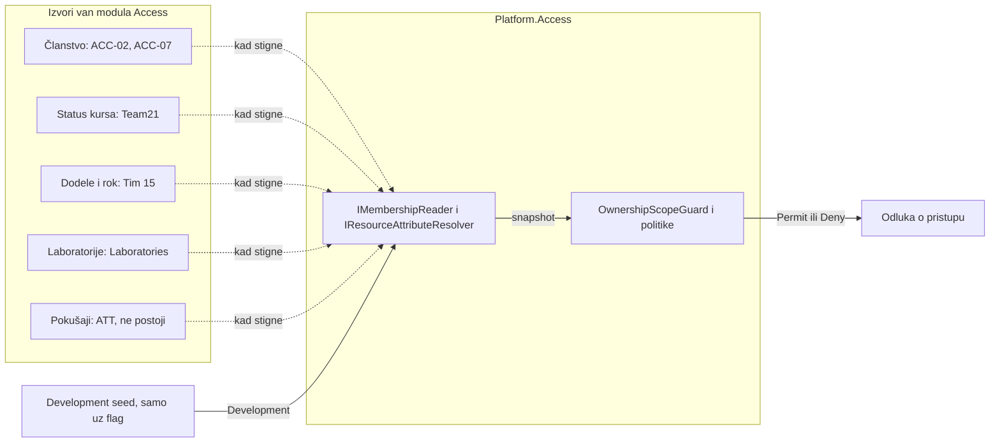

# ACC-08-11 — Izvori atributa resursa i članstva

| Stavka | Vrednost |
|---|---|
| Tim | Tim 3 |
| Zahtev | ACC-08 (US ACC-08-11, adapteri izvora atributa) |
| Status | Razvojni izvori implementirani; pravi izvori čekaju vlasnike (poglavlje 3) |
| Projekat | `backend/Platform.Access` |
| Student | PR 1/2023 Živanović Jovana |
| Datum | 25. 11. 2026. |

Komponenta autorizacije opisana je u [ACC-05-ACC-08.md](ACC-05-ACC-08.md). Ovaj dokument opisuje samo izvore činjenica koje ACC-08 politike čitaju.

## 1. Svrha

Politike ACC-08 odlučuju na osnovu činjenica koje modul Access ne poseduje: ko je upisan na kurs, čiji je pokušaj, u kom je stanju resurs, da li je rok istekao. Dokument navodi svaku takvu činjenicu, njen pravi izvor i vlasnika, stanje izvora i šta se koristi dok pravi izvor ne postoji.

Isprekidane linije su pravi izvori koji još ne postoje; do tada podatke daje seed, i to samo u `Development`.

## 2. Pravila koja važe za sve izvore

- Činjenica koja nedostaje je `AttributeValue.Missing`, a ishod je `Deny`. Nikad se ne pretpostavlja `false`, nula ili prazan tekst.
- Adapteri samo čitaju, i to kroz javne ugovore drugih modula. Tuđi moduli se ne menjaju.
- Probni (seed) podaci postoje samo u `Development` i samo uz izričit flag. U `Production` ostaju prazni odgovarači (`EmptyMembershipReader`, `EmptyResourceDescriptorResolver`), bez izvora atributa, pa kursne akcije daju `Deny`.
- Vreme dolazi samo sa servera (`TimeProvider`), nikad iz zahteva.

## 3. Popis izvora

| # | Činjenica | Gde se traži (ugovor) | Pravi izvor (vlasnik) | Stanje | Dok ne stigne |
|---|---|---|---|---|---|
| S1 | Članstvo u kursu (uloga, status) | `IMembershipReader.GetAsync(accountId, courseId)` | `StoreMembershipReader` u `Platform.Membership` (tim ACC-02) | Postoji samo na grani `feature/ACC-02-membership`, nije spojen. Klasa je `internal`, čita PostgreSQL. | Seed (`InMemoryMembershipReader`) |
| S2 | Delegirane radnje saradnika | `CourseMembership.DelegatedActions` | Tim ACC-07 (`CourseDelegation`, grana `feature/ACC-07-delegation`) | `StoreMembershipReader` vraća prazan skup | Prazan skup: saradnik dobija `Deny` |
| S3 | Kurs kome resurs pripada | `ResourceDescriptor.CourseId` (`IResourceAttributeResolver`); za kapiju G6 i `IResourceDescriptorResolver` | laboratory: `LabRevision.CourseId` (Laboratories); assignment: `Assignment.CourseId` (Tim 15); attempt: nema modula | Neutralan metod čitanja laboratorije po ID-u nije potvrđen. Dodele nemaju produkcionu implementaciju `IAssignmentRepository`. | Seed |
| S4 | Vlasnik resursa | `ResourceDescriptor.OwnerId`; za kapiju G6 i `IResourceOwnershipResolver` | attempt: ATT modul (ne postoji). KT1 `AttemptSnapshot.OwnerId` je samo Development simulator. | Nema produkcionog izvora | Seed |
| S5 | Status kursa | atribut `CourseStatus` | Team21, `CourseStatus` | `ICourseService` je scoped, vezan za trenutnog korisnika i sam proverava dozvolu. Nema neutralnog čitača. | `Missing` → `Deny` (ili seed) |
| S6 | Dostupnost dodele i rok | atributi `Availability`, `DueAtUtc`, `AvailableFromUtc`, `AllowStartAfterDeadline` | Tim 15, `Assignment.GetAvailability(now, individualDue)` | Metod postoji u domenu. Repozitorijum dodela nema produkcionu implementaciju. Istek je `now > rok` (odluka P1). | Seed; inače `Missing` → `Deny` |
| S7 | Broj pokušaja | atributi `MaxAttempts`, `AttemptsUsed` | Tim 15 | `Assignment.MaxAttempts` postoji. `IAttemptStore` iz Assignments nudi samo `TryStartAsync`, bez čitanja broja pokušaja. | Seed |
| S8 | Status pokušaja | `ResourceDescriptor.Status` | ATT modul (ne postoji); KT1 `AttemptState` je simulator | Nema produkcionog izvora. Podrazumevano samo `InProgress` (odluka P2). | Seed |

Ugovor v2 (`IResourceAttributeResolver`, `ResourceDescriptor`) je isporučen. Imena atributa i vrednosti statusa su u `ResourceAttributeKeys`. Izvori S5–S8 još nemaju pravu implementaciju, pa seed puni atribute probnim vrednostima.

## 4. Ograničenja koja utiču na dizajn adaptera

1. **Isti objekat, dva interfejsa.** `CourseRoleAccessPolicy` za akcije sa vlasništvom (`attempt.read`, `attempt.submit`, `assignment.read.own`) proverava da objekat registrovan kao `IResourceDescriptorResolver` istovremeno implementira `IResourceOwnershipResolver`. Inače je odgovor `Deny`.
2. **Singleton i scope.** Host ima `ValidateScopes = true` i `ValidateOnBuild = true`, a registar politika se gradi kao singleton. Adapter ne sme direktno da zavisi od scoped servisa (npr. Team21 `ICourseService`).
3. **Redosled registracije.** `AddAccessControl()` koristi `TryAdd` za čitač članstva i resolver. Registracija mora doći pre njega, kao što to radi `AddMembership(...)` na grani ACC-02.
4. **Čitač članstva.** Seed ne zamenjuje već registrovan pravi `IMembershipReader` (`TryAdd`), pa pravi čitač može da se koristi uz razvojne seed resurse.
5. **Bez mešanja izvora resursa.** Ako je pre `AddAccessDevelopmentSources` registrovan bilo koji `IResourceDescriptorResolver`, `IResourceOwnershipResolver` ili `IResourceAttributeResolver`, uključivanje seed-a uz `Access:DevelopmentSources=true` odmah baca grešku. Time se sprečava da G6 i G7 čitaju različite verzije kursa/vlasnika ili da se za isti tip resursa koriste seed i pravi resolver. Kad se uvede pravi izvor resursa, isključi se flag i registrišu se zajedno odgovarajući resolveri.
6. **Drugi korisnici istog čitača.** `RevisionPermissions` i `CourseAuditReadPolicy` takođe koriste `IMembershipReader`. Zamena praznog čitača stvarnim menja i njihovo ponašanje, pa je potrebna regresija.

## 5. Vlasnici izvora i šta se traži od njih

| Vlasnik | Šta se traži | Interfejs / mesto |
|---|---|---|
| Tim ACC-02 | Spajanje grane ACC-02 u `main`; potvrda da čitač ostaje `IMembershipReader`; ponašanje za člana sa statusom `Left`/`Suspended` i kad baza nije dostupna | `StoreMembershipReader`, `AddMembership(...)` |
| Tim ACC-07 | Čitač vraća samo trenutno važeće delegacije (istekle i opozvane ne), kao ID-jeve radnji iz kataloga | `CourseMembership.DelegatedActions` |
| Team21 | Neutralan način čitanja statusa kursa bez korisničkog konteksta | `CourseStatus` |
| Tim 15 | Produkciona implementacija repozitorijuma dodela, izvor broja iskorišćenih pokušaja, potvrda granice roka (P1) | `IAssignmentRepository`, `Assignment.GetAvailability` |
| Laboratories | Neutralno čitanje kursa laboratorije po ID-u | `LabRevision.CourseId` |
| ATT | Izvor vlasnika i statusa pokušaja, odluka o statusima (P2) | — |

## 6. Razvojni seed

Kod: `Platform.Access/Infrastructure/Development/AccessDevelopmentSeed.cs`, `Platform.Access/Infrastructure/Resources/InMemoryResourceAttributeResolver.cs` i `Platform.Access/Composition/AccessDevelopmentServiceCollectionExtensions.cs`.

**Uključivanje.** Seed se registruje samo ako su ispunjena oba uslova: okruženje je `Development` i konfiguracija ima `Access:DevelopmentSources=true` (promenljiva okruženja `Access__DevelopmentSources=true`). Bez toga se ponašanje aplikacije ne menja.

Ako je pravi izvor članstva već registrovan, seed ga ne zamenjuje. Ako je registrovan bilo koji pravi resolver resursa, poziv sa uključenim seed flagom prekida pokretanje jasnom greškom; isključi flag i registruj kompletan skup stvarnih resolvera.

**Šta se registruje.**
- Stari portovi (kapija G6): `IMembershipReader`, `IResourceDescriptorResolver`, `IResourceOwnershipResolver` (isti objekat za poslednja dva).
- Ugovor v2: po jedan `IResourceAttributeResolver` za tipove `laboratory`, `assignment` i `attempt`.
- Obe strane se pune iz jedne liste deskriptora (`CreateDescriptors`), pa se kurs i vlasnik ne mogu razići.

**Članstva.**

| Uloga u seed-u | ID | Kurs |
|---|---|---|
| Nastavnik A | `11111111-1111-1111-1111-111111111111` | A |
| Student A | `22222222-2222-2222-2222-222222222222` | A |
| Saradnik A (delegirano samo `attempt.read.course`) | `77777777-7777-7777-7777-777777777777` | A |
| Bivši student A (status `Left`) | `88888888-8888-8888-8888-888888888888` | A |
| Student B | `33333333-3333-3333-3333-333333333333` | B |
| Nastavnik B | `66666666-6666-6666-6666-666666666666` | B |

**Resursi.** Laboratorije A, A (arhivirana) i B; dodele A, A (istekla), A (nepotpuna, svi atributi `Missing`) i B; pokušaji A, A (predat), B i pokušaj bivšeg studenta. ID-jevi su u `AccessDevelopmentSeed`.

**Probni identiteti u ostatku koda.** ID-jevi kurseva i naloga A i B poklapaju se sa probnim podacima iz `Program.cs` (LabVisibility): kurs A `aaaaaaaa-aaaa-aaaa-aaaa-aaaaaaaaaaaa`, kurs B `bbbbbbbb-bbbb-bbbb-bbbb-bbbbbbbbbbbb`.

**Napomene.**
- Nalozi `66666666`, `77777777` i `88888888` postoje samo u seed-u, ne i u Identity seed-u.
- Nalog `11111111` je u Identity seed-u administrator, a u seed-u nastavnik kursa A (isto kao u postojećem LabVisibility demou).
- Grana ACC-02 koristi druge ID-jeve kurseva (`aaaaaaaa-0000-0000-0000-00000000000{1,2,3}`) i nastavnike `44444444` i `55555555`. Pri spajanju treba odabrati jedan skup.

## 7. Otvorena pitanja

- **P1** Granica roka: `now < rok` ili `now <= rok`. Odlučuju asistent i Tim 15.
- **P2** Statusi pokušaja za `attempt.submit`. Odlučuju asistent i ATT.
- **P10** Redosled spajanja grana ACC-02 i ACC-07 sa granom ACC-08.
- Potvrda imena atributa u `ResourceAttributeKeys` (SP i NT).
- Nijedan endpoint u hostu ne koristi 11 kursnih akcija, pa nema kroz šta da se pokaže `Allow` preko HTTP-a. Ko mapira takav endpoint, ili se dodaje razvojni demo endpoint?
- `scripts/access-demo.ps1` samo poziva `kt1-demo.ps1` (demo ACC-04). Pravi li se nova skripta za ACC-08 ili se menja postojeća?

## 8. Dokaz rada

**Dodati fajlovi (`backend/`):**
- `Platform.Access/Domain/Constants/ResourceAttributeKeys.cs`
- `Platform.Access/Infrastructure/Resources/InMemoryResourceAttributeResolver.cs`
- `Platform.Access/Infrastructure/Development/AccessDevelopmentSeed.cs`
- `Platform.Access/Composition/AccessDevelopmentServiceCollectionExtensions.cs`
- `Platform.Access.Tests/DevelopmentSourcesTests.cs`
- `Platform.Access.Tests/DevelopmentAttributeResolverTests.cs`

**Izmenjen fajl:** `Platform.Api/Program.cs`, tri dodata reda iznad `AddAccessControl()`.

**Testovi:** `dotnet test backend/Platform.Access.Tests`
- Registracija: Production, Staging i Testing ostaju bez probnih izvora čak i sa uključenim flagom; Development bez flaga ostaje nepromenjen; već registrovan pravi čitač se ne zamenjuje.
- Odluke nad seed podacima, kroz engine (kapija G6) i kroz `OwnershipScopeGuard` (kapija G7): isti kurs sa tuđim pokušajem, student ili nastavnik drugog kursa, saradnik bez delegacije, student koji je napustio kurs, nepostojeći resurs, resurs pogrešnog tipa i blokiran nalog daju `Deny`; vlasnik, nastavnik svog kursa i saradnik sa delegacijom dobijaju `Allow`.
- Izvori atributa: nepoznat resurs i resurs drugog tipa vraćaju `null`, atributi su nepromenljivi, a nepotpuna dodela izlaže atribute kao `Missing`.

**Napomena o demou:** nijedan endpoint u hostu ne koristi kursne akcije, pa se efekat seed-a trenutno vidi samo u testovima. HTTP demo čeka odluku iz poglavlja 7.

**Sledeći koraci:** potvrda imena atributa sa SP i NT; zamena seed-a pravim adapterima kako stignu (ACC-02, ACC-07, Team21, Tim 15, Laboratories, ATT); regresija za `RevisionPermissions` i `CourseAuditReadPolicy` kad pravi čitač članstva zameni prazan; demo skripta.

## 9. Istorija izmena

| Datum | Izmena |
|---|---|
| 25. 11. 2026. | Popis izvora i razvojni seed (ugovor v2). |