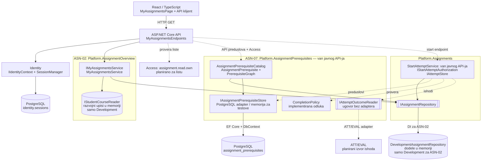
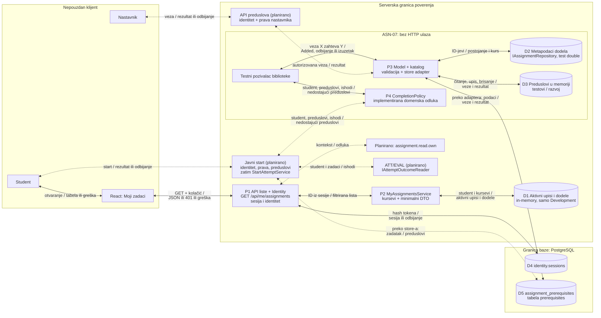

# ASN-02 / ASN-07 — tehnički pregled za KT1 i KT2

Stanje provereno 09.11.2026. na grani `feature/ASN-02-ASN-07`, revizija `f700550`. Pregled opisuje kod te revizije; implementacione veze u dijagramima ne znače da je svaka komponenta već dostupna kroz API.

## 1. Pregled

ASN-02 omogućava prijavljenom studentu pregled dodeljenih zadataka. Trenutno radi tok React stranica → API → serversko filtriranje po aktivnim upisima, uz razvojne podatke u memoriji. ASN-07 modeluje uslov „zadatak X zahteva prethodno urađen Y“ i definiše šta se smatra urađenim zadatkom. Njegov domen, katalog veza i PostgreSQL adapter postoje, ali nisu povezani sa javnim API-jem niti pokretanjem pokušaja.

Obe komponente pripadaju [modularnom monolitu Security Lab](../ARCHITECTURE.md) i koriste ugovore za identitet, članstva, dodele i rezultate pokušaja. Prema [KT1 smernicama](../CHECKPOINT_1.md), početna implementacija može imati nezavršene integracije; ovde su one označene kao planirane.

## 2. Trenutna implementacija

### ASN-02 — pregled dodela

| Deo | Implementirano stanje |
|---|---|
| Servis | [`MyAssignmentsService`](../../backend/Platform.AssignmentOverview/Application/MyAssignmentsService.cs) implementira `IMyAssignmentsService`. Preko `IStudentCourseReader` dobija aktivne kurseve, a preko `IAssignmentRepository.GetForCoursesAsync` dodele. Ponovo odbacuje dodele tuđih kurseva čak i ako ih repozitorijum vrati. |
| API | [`MyAssignmentsEndpoints`](../../backend/Platform.Api/Endpoints/MyAssignmentsEndpoints.cs): `GET /api/me/assignments`, bez ulaznog ID-ja studenta. `IIdentityContext.Current` daje identitet iz proverene sesije. Endpoint odbija neautentifikovan identitet sa `401`. |
| Odgovor | `assignments` i `correlationId`; stavka sadrži `assignmentId`, `courseId`, `publishedLabRevisionId`, `availableFromUtc`, `dueAtUtc`, `maxAttempts`. Bez upisa vraća se prazna lista. Endpoint postavlja `Cache-Control: no-store`. |
| Frontend | [`MyAssignmentsPage`](../../frontend/src/pages/MyAssignmentsPage.tsx), ruta `/my-assignments` iza `ProtectedRoute` i [`getMyAssignments`](../../frontend/src/api/myAssignments.ts). Klijent proverava oblik odgovora, zadržava dozvoljena polja i prikazuje tabelu, prazno stanje ili grešku. Vreme prikazuje u lokalnoj zoni korisnika. |
| Registracija i podaci | [`AddMyAssignments`](../../backend/Platform.Api/Modules/MyAssignments/MyAssignmentsModule.cs) registruje servis; u Development režimu koristi `DevelopmentStudentCourseReader` i `DevelopmentAssignmentRepository`. Izvan njega registruje `Unavailable*` implementacije koje bacaju izuzetak. |

[`SessionCheckMiddleware`](../../backend/Platform.Api/Middleware/SessionCheckMiddleware.cs) proverava kolačić preko `ISessionManager`, a [`SessionIdentityContext`](../../backend/Platform.Api/Services/Identity/SessionIdentityContext.cs) čita potvrđeni identitet iz serverskog konteksta. `MfaPending` ne prolazi proveru endpointa. Parametar poput `?studentId=...` ne menja korisnika čije se dodele čitaju.

Ruta koristi `DelegatesToLegacyAuthorization()`: postojeći Access middleware prepušta joj sopstvene provere. To nije izvršavanje akcije `assignment.read.own`. Zaštitu liste trenutno čine provera sesije i filtriranje po kursevima. Frontend ne donosi odluke o pristupu. Ograničenja liste i produkcionih adaptera navedena su u odeljku 7.

### ASN-07 — preduslovi i pravilo „urađeno“

| Deo | Implementirano stanje |
|---|---|
| Model | [`AssignmentPrerequisite`](../../backend/Platform.AssignmentPrerequisites/Domain/AssignmentPrerequisite.cs) čuva kurs, zadatke X i Y, zahtev za završetak, autora veze i UTC vreme. Odbija nevalidne identifikatore, samoreferencu i nepoznat zahtev. |
| Katalog | [`AssignmentPrerequisiteCatalog`](../../backend/Platform.AssignmentPrerequisites/Application/AssignmentPrerequisiteCatalog.cs) nudi dodavanje, čitanje i uklanjanje. Pri dodavanju proverava postojanje oba zadatka i isti kurs preko `IAssignmentRepository`, zatim duplikate i cikluse kroz `PrerequisiteGraph`. |
| Odluka | [`CompletionPolicy`](../../backend/Platform.AssignmentPrerequisites/Domain/CompletionPolicy.cs) nudi `CountsAsDone`, `IsSatisfied` i `FindMissing`. Računa samo pokušaj odgovarajućeg studenta i zadatka, sa `AttemptState.Completed`, `EvaluationStatus.Completed` i ishodom `Passed`, odnosno `Partial` kada veza dozvoljava `PassedOrPartial`. |
| Skladišta | `IAssignmentPrerequisiteStore` ima implementacije `InMemoryAssignmentPrerequisiteStore` i `PostgresAssignmentPrerequisiteStore`. PostgreSQL adapter koristi EF Core. |
| Spoljni podaci | [`IAttemptOutcomeReader`](../../backend/Platform.AssignmentPrerequisites/Contracts/IAttemptOutcomeReader.cs) i `AttemptOutcomeSnapshot` definišu ugovor za ATT/EVAL. Stvarna implementacija čitača ne postoji na ovoj reviziji. |

Za ispunjen preduslov dovoljan je jedan odgovarajući uspešan pokušaj; kasniji neuspešan pokušaj ne poništava prethodni uspeh. Pokušaji drugih studenata ili zadataka ne računaju se. To je provereno na domenskim ulazima, bez javnog HTTP toka.

[`AddAssignmentPrerequisites`](../../backend/Platform.AssignmentPrerequisites/Composition/AssignmentPrerequisitesServiceCollectionExtensions.cs) postoji, ali ga [`Program.cs`](../../backend/Platform.Api/Program.cs) ne poziva, a [`Platform.Api.csproj`](../../backend/Platform.Api/Platform.Api.csproj) nema referencu na ovaj modul. Nema API-ja za upravljanje preduslovima, autorizacije nastavnika u katalogu, niti ASN-07 polja i prikaza zaključavanja u aktuelnom frontendu.

## 3. Dijagram arhitekture

Legenda: **puna strelica** označava postojeći poziv, ugovor ili adapter; **isprekidana strelica** označava planiranu integraciju. ASN-07 i servis starta postoje kao kod van javnog toka. Memorijske implementacije imaju eksplicitno naveden razvojni/testni obim.



ASN-02 je povezan u [`Program.cs`](../../backend/Platform.Api/Program.cs) kroz `AddMyAssignments` i `MapMyAssignmentsEndpoints`. Zajednički `IAssignmentRepository` predstavlja ugovor: ASN-07 katalog ga u testovima koristi sa lažnim repozitorijumom, bez registracije u API-ju. Njegova veza na dijagramu ne znači da ASN-07 već koristi razvojni repozitorijum API-ja.

[`StartAttemptService`](../../backend/Platform.Assignments/Application/StartAttemptService.cs) trenutno proverava postojanje dodele, autorizaciju, dostupnost i ograničenje pokušaja preko svojih ugovora. Nema poziv preduslova ili `CompletionPolicy`. Isprekidane veze prikazuju predloženo mesto buduće integracije; izbor direktnog poziva ili obaveznog posrednog servisa tek treba usaglasiti.

## 4. Dijagram toka podataka (DFD)

Legenda: **puni tokovi** postoje u kodu; **isprekidani tokovi** su planirani. Tok ASN-07 validacije i skladištenja prikazuje pozive biblioteke i adaptera, dostupne za izolovano testiranje. Njegov HTTP ulaz još ne postoji.



Kod ASN-02, nepoznata/opozvana/istekla sesija ili čekanje na MFA dovode do `401` pre poziva servisa. Dodele tuđeg kursa se odbacuju na serveru. Izvan Development režima nedostajući adapter izaziva grešku bez liste; to nije autorizacioni odgovor `403`. PostgreSQL provera sesije pripada Identity modulu, dok ASN-02 upisi i dodele ostaju u memoriji.

Kod ASN-07, katalog vraća `AssignmentNotInCourse`, `Duplicate` ili `WouldCreateCycle` bez upisa; domen odbija samoreferencu i nevalidne ulaze izuzetkom. PostgreSQL adapter dodatno koristi ograničenja baze. Memorijsko i PostgreSQL skladište su alternative, a ne dvostruki upis. `CompletionPolicy` ne čita bazu samostalno: prima snapshot-e, proverava vlasništvo i vraća odluku bez studentskih odgovora.

Planirani start mora pre kreiranja pokušaja odbiti neispunjene preduslove. HTTP ruta, statusi tog odbijanja i stvarni čitač ishoda još nisu definisani implementacijom. Nijedan tok skladišta ne vraća podatke direktno studentu.

## 5. Perzistencija

ASN-02 koristi [`DevelopmentAssignmentData`](../../backend/Platform.AssignmentOverview/Infrastructure/DevelopmentAssignmentData.cs): dva kursa razvojnog studenta i tri dodele, od kojih jedna pripada tuđem kursu. Podaci nemaju trajnu perzistenciju. PostgreSQL baza identiteta ne znači da su i upisi/dodele povezani sa bazom.

ASN-07 koristi EF entitet `AssignmentPrerequisiteRow`, [`AssignmentPrerequisiteConfiguration`](../../backend/Platform.AssignmentPrerequisites/Infrastructure/Persistence/AssignmentPrerequisiteConfiguration.cs) i [`AssignmentPrerequisitesDbContext`](../../backend/Platform.AssignmentPrerequisites/Infrastructure/Persistence/AssignmentPrerequisitesDbContext.cs). Migracija [`20261108162435_InitialAssignmentPrerequisites`](../../backend/Platform.AssignmentPrerequisites/Infrastructure/Persistence/Migrations/20261108162435_InitialAssignmentPrerequisites.cs) pravi tabelu `assignment_prerequisites.prerequisites`; istorija migracija je u istoj zasebnoj šemi.

| Ograničenje / podatak | Značenje |
|---|---|
| PK `(assignment_id, required_assignment_id)` | Jedna veza X → Y može postojati samo jednom. |
| CHECK ograničenja | Zabranjena samoreferenca; `completion_requirement` je 1 ili 2; format `course_id` je ograničen. |
| Obavezne kolone i indeksi | Kurs, autor i vreme veze; indeksi po `course_id` i `required_assignment_id`. Ne skladište se odgovori ni bodovi studenta. |
| Integritet prema dodelama | Nema stranog ključa ka tabeli dodela. Postojanje i pripadnost istom kursu proverava katalog. |

`AddAssignmentPrerequisites` zahteva connection string i registruje katalog, kontekst i PostgreSQL store, ali API ga još ne koristi. Provera ciklusa i upis nisu obuhvaćeni zajedničkom transakcijom/zaključavanjem po kursu; konkurentni upisi ostaju otvoreno pitanje. Uputstvo za zasebno pokretanje baze i migracije nalazi se u [dokumentu modela](ASN-07-prerequisite-model.md#pokretanje-i-demonstracija).

## 6. Verifikacija i testovi

Sledeći backend rezultati su **izvršeni u prethodnoj lokalnoj proveri 09.11.2026. na istoj reviziji `f700550`**, u Debug konfiguraciji sa `--no-restore --disable-build-servers`. Pri izradi ovog dokumenta testovi nisu ponovo pokretani.

| Paket / izvor | Šta proverava | Dostupan rezultat |
|---|---|---|
| [`Platform.AssignmentOverview.Tests`](../../backend/Platform.AssignmentOverview.Tests/MyAssignmentsServiceTests.cs) | Sopstveni/tuđi kurs, dodatno filtriranje nepouzdanog rezultata repozitorijuma, prazan ID. | 4 prošla, 0 neuspešnih. |
| [`Platform.MyAssignments.Tests`](../../backend/Platform.MyAssignments.Tests/) | HTTP tok, sesijski identitet, odbijene sesije/MFA, ignorisanje klijentskog ID-ja, polja odgovora, razvojni podaci i greška izvan Development režima. | 11 prošlo, 0 neuspešnih. |
| [`Platform.AssignmentPrerequisites.Tests`](../../backend/Platform.AssignmentPrerequisites.Tests/) | Model, graf, katalog, `CompletionPolicy`, EF model/migracija i pomoćno čitanje konfiguracije; zasebni PostgreSQL testovi. | 67 prošlo, 5 preskočeno, 0 neuspešnih. |
| [`myAssignments.test.tsx`](../../frontend/src/__tests__/myAssignments.test.tsx) | 10 Vitest slučajeva: zahtev bez ID-ja studenta, oblik i polja odgovora, lista/prazno stanje, 401/403, mrežna greška, tekstualni prikaz i vremenska zona. | Istorijski uspeh naveden u [frontend dokumentaciji](ASN-02-frontend.md#evidence-of-work). Ovde nije izvršeno: `frontend/node_modules` nije prisutan. |

API build je u istoj prethodnoj proveri uspeo. ASN-02 HTTP testovi koriste testni `ISessionManager`; nisu dokaz kompletnog browser → realna prijava → trajne dodele toka. Frontend test za `403` proverava prikaz takvog odgovora, a ne postojanje `assignment.read.own` provere na serveru.

Pet [`PostgresStoreIntegrationTests`](../../backend/Platform.AssignmentPrerequisites.Tests/PostgresStoreIntegrationTests.cs) slučajeva pokriva trajnost, duplikat, samoreferencu, nevalidan zahtev i brisanje. Setup ih preskače bez connection string-a ili dostupne baze, a uz bazu izvršava migraciju. Njihovo preskakanje ne potvrđuje rad baze. Domenski test `AttemptOfAnotherStudent_DoesNotUnlock` postoji, ali nema HTTP testa koji dokazuje ASN-07 odbijanje ili dozvolu na javnoj putanji starta.

Za ponavljanje relevantnih backend provera iz korena repozitorijuma, uz već dostupne zavisnosti:

```powershell
dotnet test backend/Platform.AssignmentOverview.Tests --no-restore --configuration Debug --disable-build-servers
dotnet test backend/Platform.MyAssignments.Tests --no-restore --configuration Debug --disable-build-servers
dotnet test backend/Platform.AssignmentPrerequisites.Tests --no-restore --configuration Debug --disable-build-servers
```

Za KT1 demonstraciju ASN-02 može se pratiti [postojeće uputstvo](ASN-02-frontend.md#evidence-of-work): na pripremljenoj razvojnoj instalaciji prijaviti studenta i otvoriti „Moji zadaci“. Očekuju se dve dodele, bez tuđeg kursa. ASN-07 se trenutno demonstrira izolovanim testovima modela/politike i, kada je baza pripremljena, testovima store-a.

## 7. Trenutna ograničenja

- **ASN-02 podaci i filteri:** nema produkcionih adaptera za članstva/dodele; servis ne proverava arhiviranje, istek, otkazivanje, grupnu vidljivost ili duplikate. Još ne primenjuje individualni produženi rok pri sastavljanju liste. Aktivno članstvo nije isto što i trenutno dostupna dodela.
- **Autorizacija:** `assignment.read.own` nije povezan sa listom; katalog preduslova nema proveru prava nastavnika. `ProtectedRoute` i sakrivanje UI elemenata nisu serverska zaštita.
- **ASN-07 javni tok:** nema registracije modula, API-ja za preduslove, start endpointa koji koristi ASN-07 niti provere preduslova u `StartAttemptService`.
- **ATT/EVAL i integritet:** nedostaje stvarni `IAttemptOutcomeReader`; ostaju usaglašavanje važećeg rezultata pri ponovnoj evaluaciji, atomskost provere ciklusa/upisa i veza sa trajnim dodelama.
- **Frontend i potvrda rada:** nema `isLocked`, razloga zaključavanja ni pokretanja pokušaja; prikazuju se ID-jevi i lokalna vremenska zona. Ne postoji dokaz celog ASN-07 end-to-end toka, a PostgreSQL testovi u navedenoj proveri nisu izvršeni.

## 8. Planirani rad — KT2

**Zvanični tehnički zahtevi** iz [CHECKPOINT_2.md](../CHECKPOINT_2.md) obuhvataju dovršenje dodeljene komponente prema specifikaciji, demonstraciju funkcionalnog toka i integracija, pozitivne i negativne testove sa serverskom autorizacijom/validacijom, objašnjenje koda, dizajna i testova, ažurne dijagrame i uputstva za pokretanje, kao i zaštitu tajni i stvarnih studentskih odgovora u logovima i Git istoriji. Sledeći koraci su predloženi tehnički plan za ASN-02/ASN-07, a ne dodatni zvanični kriterijumi.

| Oblast | Predloženo dovršavanje |
|---|---|
| ASN-02 integracije | Povezati stvarna članstva i trajne dodele kroz postojeće ugovore; usaglasiti identifikatore kursa i Access kontekst liste. |
| Serverska pravila liste | Dodati `assignment.read.own` i filtere dostupnosti/statusa, uz individualni rok, grupe i uklanjanje duplikata prema dogovorenom obimu. |
| ASN-07 start | Uvesti obaveznu proveru preduslova pre `TryStartAsync`, povezati je sa javnim endpointom i DI konfiguracijom tako da javna putanja ne može da je zaobiđe. Identitet uzimati iz serverske sesije. |
| Podaci i upravljanje | Implementirati ATT/EVAL čitač važećih ishoda; povezati PostgreSQL store; dodati autorizovan API za preduslove i odgovarajući audit. Rešiti konkurentne izmene grafa i referencijalni integritet. |
| Frontend | Vraćati bezbedan status/razlog zaključavanja i prikazati ga; dodati pokretanje pokušaja, nazive kursa/laboratorije i odgovarajuću vremensku zonu. Ne otkrivati nedostupne zadatke kroz razloge zaključavanja. |
| Integracioni testovi | Dokazati odbijanje direktnog start zahteva bez preduslova, nevaženje tuđeg uspešnog pokušaja, dozvolu za sopstveni ispunjen preduslov i da odbijanje ne kreira pokušaj. Dodati testove autorizacije, nedostupnih provajdera, trajnosti i konkurentnih upisa. |
| Dokumentacija | Ažurirati oba dijagrama, ograničenja, rezultate provera i demonstraciju prema stvarno povezanoj implementaciji. |

Detalji postojećih delova: [ASN-02 filtriranje](ASN-02-filtering.md), [ASN-02 frontend](ASN-02-frontend.md), [ASN-07 model](ASN-07-prerequisite-model.md). Ovaj zajednički pregled dopunjuje njihove dijagrame i tehničke dokaze.
