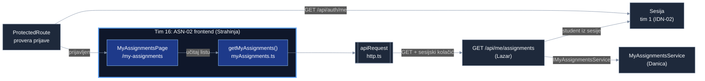
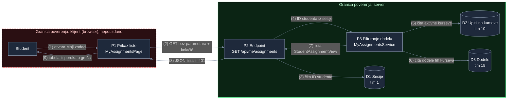

# Project component: ASN-02, prikaz dodela studentu (frontend)

**Team:** 16

**Student:** Strahinja Aćić (PR 127/2022)

**Specification requirements:** ASN-02 (povezano: SEC-01, SEC-05, OPS-07, OPS-09, ASN-15 delimično)

## Responsibilities and boundaries

- Processes and user scenarios: prijavljen student otvara stranicu „Moji zadaci" (`/my-assignments`) i vidi laboratorije dodeljene na kursevima na koje je upisan: kurs, revizija laboratorije, „dostupno od", rok i najveći broj pokušaja. Stranica prikazuje tačno ono što vrati server i ne donosi bezbednosne odluke.
- Contracts with other modules:
  - `GET /api/me/assignments` (koristimo): endpoint (Lazar, tim 16), koji poziva `IMyAssignmentsService` (Danica, tim 16).
  - Provera prijave (koristimo): `ProtectedRoute` i `AuthContext` preko `GET /api/auth/me` i sesijskog kolačića `SecurityLab.Session`, tim 1 (IDN-02).
  - `apiRequest` iz `frontend/src/api/http.ts` (koristimo): zajednički HTTP klijent frontenda.
- Implementation status: API klijent `frontend/src/api/myAssignments.ts`, stranica `frontend/src/pages/MyAssignmentsPage.tsx`, ruta `/my-assignments` iza `ProtectedRoute`, link „Moji zadaci" u navigaciji i 10 Vitest testova su implementirani. Nazivi kursa i laboratorije, vremenska zona kursa, status dostupnosti sa servera i dugme za početak pokušaja su planirani.

## Component architecture

Blok sa plavim okvirom je moj deo. Kutija sa duplim ivicama je zajednički HTTP klijent frontenda. Stranica zavisi samo od `getMyAssignments()`, pa se u testovima zamenjuje lažnim serverom (`setFetcher`). Klijent proverava oblik odgovora i zadržava samo dokumentovana polja; pogrešan oblik se prikazuje kao greška, a ne kao prazna lista.

## Data flow diagram

Browser je izvan granice poverenja: korisnik može da menja kod stranice i zahteve. Zato klijent ne šalje ID studenta (nema `?studentId=`), ne filtrira dodele i ne odlučuje da li je rok prošao (OPS-09); sve to radi server (koraci 3 do 7). `ProtectedRoute` je samo pogodnost za korisnika, a podatke štiti 401 sa servera.

## Decisions and dependencies

| Tema | Odluka / zavisnost |
|---|---|
| Ko filtrira dodele | Samo server (Danica, Lazar). Frontend ne filtrira i ne šalje ID studenta. |
| Rok i dostupnost | Frontend ne računa da li je rok prošao (OPS-09). Status dostupnosti i razlog zabrane (ASN-10) treba da vrati server; ASN-10 ne radi nijedan tim. |
| Endpoint `GET /api/me/assignments` | Lazar, tim 16: implementiran (PR #132, #137). Za Development koristi privremene podatke dok tim 10 (ACC-02) i tim 15 (ASN-04, ASN-06) ne povežu prave module. |
| Sesija | Tim 1 (IDN-02): `GET /api/auth/me` i kolačić `SecurityLab.Session`, koristi se postojeći `ProtectedRoute`. |
| Provera akcije `assignment.read.own` | Tim 3 (ACC-05): na serveru, planirano; frontend se ne menja. |
| Nazivi kursa i laboratorije | API vraća samo ID-jeve; nazive treba dodati u odgovor (tim 21, ACC-01 i katalog laboratorija). |
| Vremenska zona kursa (ASN-15) | API je ne vraća; do tada lokalna zona sa oznakom. |
| Mock režim (`npm run dev:mock`) | Ne koristi se: provera prijave (`AuthContext`) ne prolazi kroz mock, pa zaštićene stranice tamo nisu dostupne. Demo ide na pravom API-ju. |

## Security requirements

- Server-side access checks: frontend ih ne zamenjuje. Podatke štiti endpoint (sesija iz kolačića, filtriranje po aktivnim kursevima). Na 401 i 403 stranica ne prikazuje podatke; na 401 nudi ponovnu prijavu.
- Input validation and sensitive data:
  - Odgovor servera se proverava pre prikaza; zadržavaju se samo `assignmentId`, `courseId`, `publishedLabRevisionId`, `availableFromUtc`, `dueAtUtc`, `maxAttempts`.
  - Tekst iz API-ja se prikazuje kao tekst (React escaping, bez `dangerouslySetInnerHTML`) (SEC-05).
  - Vremena stižu u UTC i prikazuju se u lokalnoj zoni korisnika sa oznakom zone. ASN-15 traži zonu kursa, koju API još ne vraća. Prikaz je informativan: dostupnost i rok proverava server (OPS-09).
  - Poruke o grešci ne otkrivaju interne detalje, a dugme i link rade sa tastature (OPS-07).
- Negative scenarios:

| Pretnja / situacija | Kontrola | Test |
|---|---|---|
| Klijent bira čije dodele čita (IDOR) | zahtev nema parametre ni telo, student dolazi iz sesije | `sends GET to /api/me/assignments without a body or a student ID` |
| Server vrati interno polje (npr. `allowStartAfterDeadline`) | klijent zadržava samo dokumentovana polja | `keeps only the documented fields` |
| Neispravan ili izmenjen odgovor | provera oblika, prikaz greške | `rejects a response with the wrong shape` |
| Istekla ili nepostojeća sesija | 401: poruka i link za prijavu, bez podataka | `401 asks the user to log in again and shows no data` |
| Pristup odbijen | 403: poruka o zabrani, bez podataka | `403 shows a denial and no data` |
| Server nedostupan | poruka o grešci umesto lažne prazne liste | `network failure shows an error instead of an empty list` |
| XSS kroz podatke iz API-ja | prikaz kao tekst | `renders server text as plain text, never as HTML (SEC-05)` |
| Rok pogrešno protumačen zbog vremenske zone | prikaz sa oznakom zone | `shows the deadline with a time zone label` |

Pozitivni scenariji: `shows every assignment returned by the server`, `shows a message when the student has no assignments`.

## Evidence of work

- Changed files / commit / pull request: `frontend/src/api/myAssignments.ts`, `frontend/src/pages/MyAssignmentsPage.tsx`, `frontend/src/__tests__/myAssignments.test.tsx`, `frontend/src/App.tsx` (ruta), `frontend/src/components/AppShell.tsx` (link); grana `feature/ASN-02-3-frontend`, PR ka `feature/ASN-02-ASN-07`.
- Run instructions:
  1. Backend i baza po `README.md` (`.env`, `docker compose up -d db`, `dotnet run --project backend/Platform.Api --urls http://localhost:5080`).
  2. `cd frontend`, `npm ci`, `npm run dev`, pa <http://localhost:5173>.
  3. Prijava kao `student@example.com` (lozinka iz `.env`), link „Moji zadaci". Očekivano: dve dodele (`course-oib`, `course-security`), bez dodele sa `course-other`.
- Tests and results:
  - `cd frontend`, `npm test`: 70/70 (od toga 10 za ASN-02 frontend); `npm run build` prolazi.
  - Backend za isti tok: `Platform.MyAssignments.Tests` 11/11 i `Platform.AssignmentOverview.Tests` 4/4.
  - Ručno, na pokrenutom API-ju sa PostgreSQL-om, kroz frontend proxy: bez prijave `/my-assignments` preusmerava na prijavu, a `GET /api/me/assignments` vraća 401. Kao `student@example.com` vraća 200 sa tačno dve dodele (`course-oib`, `course-security`), bez dodele sa `course-other`, i sa `Cache-Control: no-store`. Dodat `?studentId=` drugog korisnika ne menja rezultat.
- Next steps: nazivi kursa i laboratorije i vremenska zona kursa kad ih API doda (ASN-15); status dostupnosti i razlog zabrane sa servera (ASN-10, sprint 2); prikaz zaključanih zadataka za ASN-07 (Tamara); dugme za početak pokušaja.
