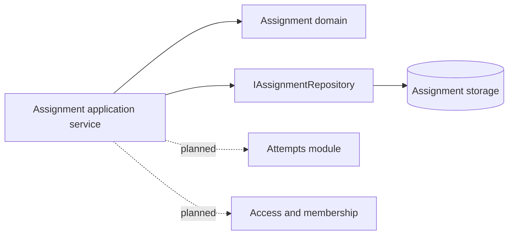
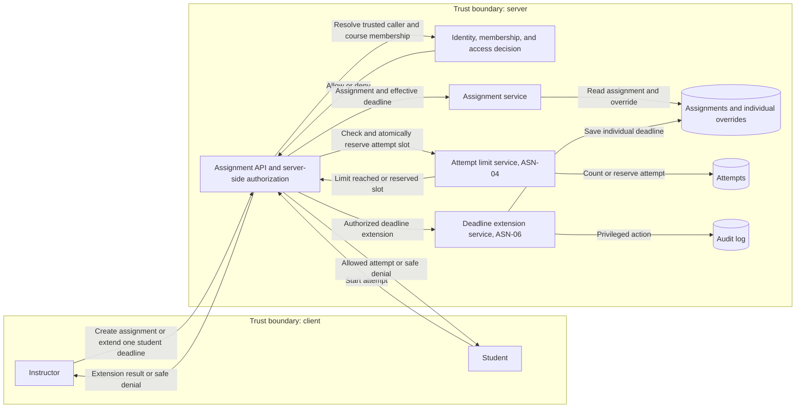
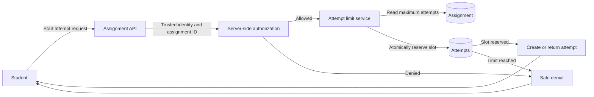
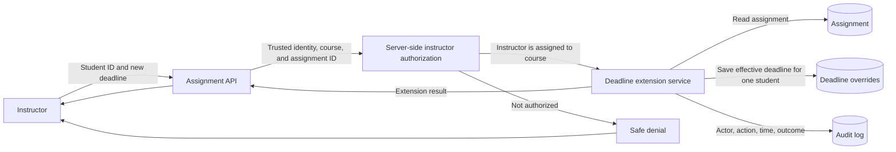

# Project component: ASN-04, Assignment domain foundation

**Team:** 15

**Students:** Đorđić Stefan      PR 129/2021
              Vasiljević Nataša  PR 150/2021
              Milanović Stela    PR 104/2022
              Ajduković Djordje  PR 143/2019
              Bubulj Milan       PR 136/2021

**Specification requirements:** ASN-04 and ASN-06

## Responsibilities and boundaries

- Processes and user scenarios: validates the assignment data that a later application service uses before starting an attempt: course, published laboratory revision, availability period, due date, and maximum attempt count.
- Contracts with other modules: `IAssignmentRepository` is the module persistence boundary. The future assignment service receives membership, authorization, and attempt-count data through other modules; it does not read their internal storage.
- Implementation status: `Assignment` domain model, availability calculation, status enums, repository contract, and five NUnit unit tests are implemented. API endpoints, database adapter, and atomic attempt reservation remain planned work for other team members. The ASN-06 use case (individual deadline extension with authorization and audit, tested with in-memory fakes) is implemented; see [ASN-06-ExtendDeadline.md](ASN-06-ExtendDeadline.md).

## Component architecture

## Data flow diagram

### Shared assignment flow (ASN-04 and ASN-06)

The client never supplies a trusted role, membership, attempt count, or effective deadline. Those values are resolved and checked on the server. `Assignments and individual overrides`, `Attempts`, and `Audit log` are separate stores so that an attempt-limit rejection does not create an attempt or change historical results.

### ASN-04: maximum attempt limit

Negative flow: an attempt above `MaxAttempts` returns a safe rejection. It must not create a new attempt or modify an existing result. The atomic reservation is planned work for the Attempts component; the currently implemented `Assignment` model validates and exposes `MaxAttempts`.

### ASN-06: individual deadline extension

Negative flow: a student or instructor outside the course cannot extend a deadline. Only a server-authorized instructor can make the change, and every change is written to the audit log. The service behind this flow (`ExtendDeadlineService`) is implemented and tested with in-memory fakes on branch `feature/ASN-06-deadline-extension`; the API endpoint, the database store and the real authorization and audit adapters are still planned. Details and contracts: [ASN-06-ExtendDeadline.md](ASN-06-ExtendDeadline.md), [../contracts/ASN-06-contracts.md](../contracts/ASN-06-contracts.md).

## Security requirements

- Server-side access checks: the domain model does not trust client-provided roles or membership. The future application service must obtain the caller identity and course membership from server-side contracts before it reads or changes an assignment.
- Input validation and sensitive data: IDs must be present, `MaxAttempts` must be at least one, and the availability start cannot be after the due date. The model stores no passwords, tokens, evaluator keys, or student answers.
- Negative scenarios: a zero attempt limit and an invalid availability interval throw validation errors. An archived assignment is unavailable, and a completed due date returns `Expired` unless late starts are explicitly enabled.

## Evidence of work

- Changed files / commit / pull request: `backend/Platform.Assignments/`; `backend/Platform.Tests/Assignments/AssignmentTests.cs`; one reference added to `backend/Platform.Tests/Platform.Tests.csproj`. Commit and PR will be added after review.
- Run instructions: `dotnet test .\backend\Platform.Tests\Platform.Tests.csproj`
- Tests and results: `AssignmentTests` contains five passing tests for valid creation, rejected zero limit, rejected invalid time range, expired assignment, and explicitly permitted late start.
- Next steps: member 1 implements the database and domain entities, including the individual deadline (`IDeadlineExtensionStore`, `IAssignmentRepository`), migrations and seed data; member 2 implements the ASN-04 start-attempt use case; member 3 implements the ASN-06 use case (service done, see ASN-06-ExtendDeadline.md); member 4 implements authorization (`IAccessDecision` and the adapters for `IDeadlineExtensionAuthorization` and `ICourseEnrollmentCheck`); member 5 implements the audit adapter and the API controllers.
