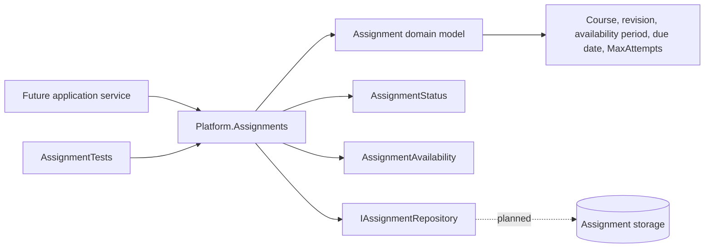
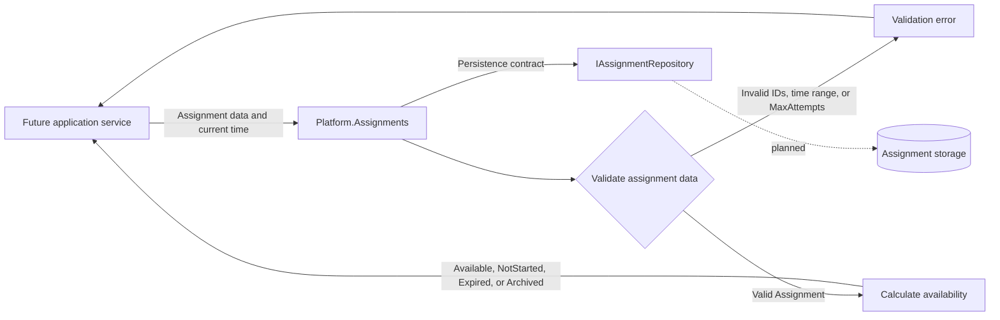

# Individual KT1 contribution: Assignment domain foundation

**Team:** 15

**Student:** Stela Milanović, PR 104/2022

**Team requirements:** ASN-04 and ASN-06

**Individual scope:** Initial `Platform.Assignments` domain foundation. This is a shared prerequisite for the later ASN-04 attempt-limit flow and ASN-06 individual-deadline flow; it does not implement those use cases.

## Responsibilities and implemented work

- Implemented the `Assignment` domain model with course ID, published laboratory revision ID, availability start, due date, `MaxAttempts`, and assignment status.
- Implemented `AssignmentStatus` and `AssignmentAvailability` enums.
- Implemented domain validation: IDs and required values must exist, `MaxAttempts` must be at least one, and the availability start cannot be after the due date.
- Implemented availability calculation through `GetAvailability(now)`: an assignment can be available, not started, expired, or archived.
- Defined `IAssignmentRepository` as the persistence boundary for a future database adapter.
- Added five NUnit unit tests in `Platform.Tests/Assignments/AssignmentTests.cs`.

## Component architecture



`Platform.Assignments` contains the domain rules. The future application service, database adapter, authorization, and attempt storage are outside this individual contribution and communicate through contracts.

## Data flow diagram



The current domain does not trust client-provided authorization or attempt counts. Those checks belong to later server-side application services. The model contains no passwords, tokens, answers, or other sensitive user data.

## Security and negative scenarios

- A zero or negative `MaxAttempts` value is rejected.
- An availability start after the due date is rejected.
- An archived assignment is unavailable.
- After the due date, the assignment is expired unless late start is explicitly allowed.
- The domain exposes `MaxAttempts`, but atomic counting and reservation of attempts is planned work for the ASN-04 start-attempt use case.

## Evidence and demonstration

- Changed files: `backend/Platform.Assignments/Domain/Models/Assignment.cs`, `backend/Platform.Assignments/Domain/Enums/AssignmentStatus.cs`, `backend/Platform.Assignments/Domain/Enums/AssignmentAvailability.cs`, `backend/Platform.Assignments/Contracts/IAssignmentRepository.cs`, and `backend/Platform.Tests/Assignments/AssignmentTests.cs`.
- Commit: `be8deec` - `ASN-04/ASN-06: add assignment domain, tests and KT1 diagrams`.
- Pull request: `#48`.
- Demonstration command:

  ```powershell
  dotnet test .\backend\Platform.Tests\Platform.Tests.csproj --filter "FullyQualifiedName~Platform.Tests.Assignments.AssignmentTests"
  ```

  This runs the five tests for this individual contribution.

## Planned dependencies and next steps

- A database adapter will implement `IAssignmentRepository`.
- The ASN-04 start-attempt service will read `MaxAttempts` and must atomically reserve an attempt slot.
- The ASN-06 deadline-extension service will use the assignment due date as the base deadline for an individual student override.
- API endpoints, server-side authorization, audit logging, and real persistence belong to separate team contributions.
