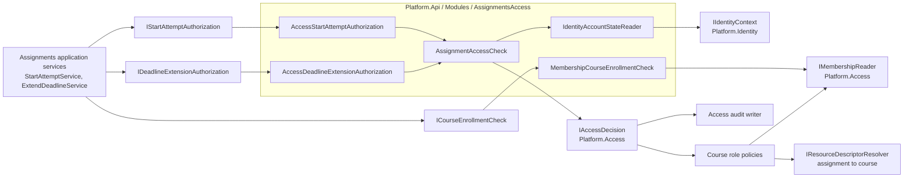
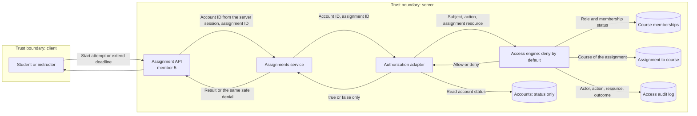

# Project component: ASN-04 / ASN-06 server-side authorization (team 15, member 4)

**Team:** 15

**Student:** Vasiljević Nataša PR 150/2021

**Specification requirements:** ASN-04 and ASN-06 (uses ACC-02, ACC-03, ACC-04, ACC-05, ACC-17, IDN-03 and the access audit of AUD-01)

## Responsibilities and boundaries

- Processes and user scenarios: answers "may this account start an attempt on this assignment?" (ASN-04) and "may this account extend a deadline of this assignment?" (ASN-06). The Assignments module asks these questions through its own ports and never reads roles, memberships or accounts itself.
- Contracts with other modules:
  - Implements `IStartAttemptAuthorization`, `IDeadlineExtensionAuthorization` and `ICourseEnrollmentCheck` (owned by `Platform.Assignments`).
  - Calls `IAccessDecision` and `IMembershipReader` (owned by `Platform.Access`) and `IIdentityContext` (owned by `Platform.Identity`).
  - `Platform.Assignments` does not reference `Platform.Access`; the adapters live in the host (`Platform.Api/Modules/AssignmentsAccess`), which already references both.
- Implementation status: adapters, the account-state reader, the dependency injection extension `AddAssignmentsAccess()` and NUnit tests are implemented. They are **not** called from an HTTP endpoint yet (member 5) and the assignment-to-course lookup for the real database is still planned (see Open points).

## Decisions

| Port | Engine action | Allowed roles | Why this action |
|-|-|-|-|
| `IStartAttemptAuthorization.CanStartAsync` | `attempt.create` on resource `assignment` | Student (active membership in the assignment's course) | Existing catalog action; no new action to register. |
| `IDeadlineExtensionAuthorization.CanExtendAsync` | `assignment.manage` on resource `assignment` | Teacher only | Existing catalog action. An assistant cannot receive it by delegation (`AllowAssistantDelegation` is false), so a delegated assistant cannot extend a deadline. |
| `ICourseEnrollmentCheck.IsActiveStudentAsync` | none (reads the membership) | Student with `Active` status in exactly that course | Yes or no only (ACC-17). |

Rules applied on every call:

1. **Fail closed.** A malformed ID, an unknown account, an engine error or a timeout all return `false`. Only a cancelled request is passed on.
2. **The course is not trusted from the caller.** The `courseId` argument of the two authorization ports is ignored for the decision. The access engine derives the course from the `assignment` resource, so a caller cannot gain access by naming a course it belongs to.
3. **Account state is checked.** Blocked, archived and unknown accounts are denied (IDN-03).
4. **Every decision is audited by the engine** (actor, action, resource, outcome, correlation ID), including denials.
5. **No secrets.** The adapters see account IDs and statuses only, never passwords, tokens or session IDs.

## Component architecture

## Data flow diagram

The client never supplies a trusted account, role, membership or course. The only values that leave the server to the client are the result of the use case or one fixed denial message, so a denial does not reveal whether an assignment exists or who belongs to a course.

## Security requirements

- Server-side access checks: every decision is made on the server by the platform engine, repeated in each use case (spec 2.1).
- Deny by default (ACC-05): a new action, an unknown assignment, a missing policy or an engine failure never grants access.
- Resource-level authorization (ACC-04): a student of another course, a former or suspended member and a non-member are denied for the assignment.
- Rights change on the next request (ACC-03): there is no cache in the adapters; removing a membership denies the next call.
- Input validation: account and assignment IDs must be non-empty GUIDs.
- Sensitive data: no secrets are read or logged by the adapters.

## Negative scenarios (covered by tests)

| Scenario | Expected result |
|-|-|
| Student tries to extend their own deadline | `false`, denial audited |
| Teacher of another course tries to extend a deadline | `false` |
| Caller names a course it belongs to for another course's assignment | `false` (the course argument is not trusted) |
| Assistant with the delegated action `assignment.manage` | `false` |
| Teacher membership removed between two calls | allowed, then `false` on the next call |
| Blocked, archived or unknown account | `false` |
| Student of another course, non-member, former or suspended member starts an attempt | `false` |
| Teacher starts an attempt | `false` |
| Unknown assignment, empty or non-GUID IDs | `false` |
| The access engine throws | `false` (fail closed) |
| The request is cancelled | cancellation is passed on |

## Open points

- **Course identifier type.** `Assignment.CourseId` is a string (for example `course-oib`); `Platform.Access` uses a GUID. `MembershipCourseEnrollmentCheck` answers `false` for a course ID that is not a GUID instead of guessing. The teams must agree on one type (also noted in [../contracts/ASN-06-contracts.md](../contracts/ASN-06-contracts.md)).
- **Assignment to course lookup.** The access engine needs an `IResourceDescriptorResolver` that knows the course of an assignment. Today only the in-memory resolver exists, so with the default empty resolver every call is denied (safe). A resolver backed by `IAssignmentRepository` is needed together with member 1's database work.
- **Account IDs.** The ports use string IDs; the adapters require account GUIDs. The API (member 5) must pass the account ID of the logged-in user.
- **Wiring.** `AddAssignmentsAccess()` is not called from `Program.cs` yet, because no Assignments service is registered there yet.

## Evidence of work

- Changed files: `backend/Platform.Api/Modules/AssignmentsAccess/` (adapters, account-state reader, dependency injection extension); one project reference added to `backend/Platform.Api/Platform.Api.csproj`; `backend/Platform.Tests/Assignments/AssignmentsAccessAdapterTests.cs`; this document.
- Run instructions: `dotnet test backend/Platform.Tests/Platform.Tests.csproj --filter "FullyQualifiedName~AssignmentsAccessAdapterTests"`
- Tests and results: 35 of 35 NUnit tests pass locally (`dotnet test`, .NET SDK 10.0.403). The tests use the real `DefaultDenyAccessDecision` with the real course role policies and in-memory data; they do not cover the database, the real identity store or HTTP.
- Next steps: member 5 passes the logged-in account ID from the API and registers `AddAssignmentsAccess()`; member 1 provides the assignment-to-course lookup; the course identifier type is agreed with the Access team.
