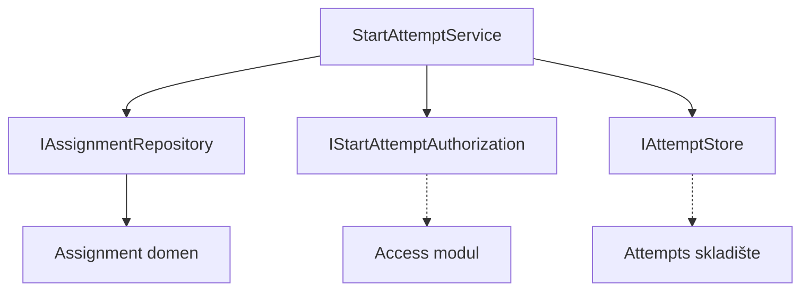
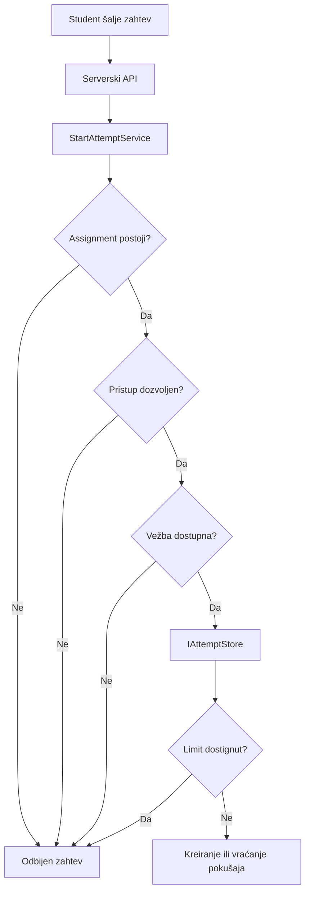

# ASN-04 — Ograničenje maksimalnog broja pokušaja

**Tim:** 15  
**Komponenta:** ASN-04  
**Zadatak:** Implementacija use-case-a za započinjanje studentskog pokušaja

## 1. Opis funkcionalnosti

Implementiran je servis `StartAttemptService` koji obrađuje zahtev studenta za započinjanje laboratorijske vežbe.

Servis proverava da li dodela postoji, da li student ima dozvolu za pristup, da li je vežba dostupna i da li je dostignut maksimalan broj pokušaja.

Ako su uslovi ispunjeni, servis preko `IAttemptStore` ugovora zahteva kreiranje novog pokušaja i vraća njegov identifikator.

## 2. Arhitektura komponente

`StartAttemptService` sadrži poslovnu logiku, dok se pristup podacima i autorizacija obavljaju preko interfejsa.

Veze ka stvarnoj autorizaciji i skladištu pokušaja predstavljaju planiranu integraciju.

## 3. Tok podataka

API i skladište su na dijagramu prikazani kao delovi planiranog kompletnog toka. Trenutna implementacija obuhvata servis i njegove ugovore.

## 4. Bezbednosni zahtevi

- Student bez odgovarajućeg prava pristupa ne može započeti pokušaj.
- Arhivirana i nedostupna vežba ne dozvoljava nove pokušaje.
- Prekoračenje `MaxAttempts` odbija se bez izmene prethodnih rezultata.
- `requestId` služi za prepoznavanje ponovljenih zahteva.
- Provera limita i kreiranje pokušaja moraju biti atomski u budućoj implementaciji skladišta.
- Identitet studenta mora dolaziti iz pouzdanog serverskog konteksta, a ne iz neproverenog korisničkog unosa.

## 5. Implementirani fajlovi

- `Application/StartAttemptService.cs` — poslovna logika.
- `Contracts/IAttemptStore.cs` — ugovor za proveru limita i kreiranje pokušaja.
- `Contracts/IStartAttemptAuthorization.cs` — ugovor za proveru prava pristupa.
- `Platform.Tests/Assignments/StartAttemptServiceTests.cs` — NUnit testovi.

## 6. Testiranje

Implementirano je sedam NUnit testova koji pokrivaju:

1. Dostignut maksimalni broj pokušaja.
2. Dozvoljeno započinjanje pokušaja.
3. Nepostojeću dodelu.
4. Istekao rok.
5. Arhiviranu dodelu.
6. Ponovljeni zahtev sa istim identifikatorom.
7. Odbijen pristup.

Rezultat poslednjeg lokalnog testiranja: **54 uspešna testa, 0 neuspešnih**.

Komanda za proveru:

`dotnet test backend/Platform.Tests/Platform.Tests.csproj`

Testovi koriste lažne implementacije interfejsa. Ne potvrđuju još ispravnost stvarne baze, atomskih operacija niti integracije sa autorizacionim modulom.

## 7. Preostala integracija

- Implementacija `IAttemptStore` sa atomskim ograničenjem pokušaja.
- Povezivanje `IStartAttemptAuthorization` sa modulom za autorizaciju i članstvo na kursu.
- Povezivanje servisa sa API kontrolerom i pouzdanim identitetom prijavljenog korisnika.
- Integracioni testovi sa stvarnim skladištem i istovremenim zahtevima.

Ovi delovi zahtevaju saradnju sa ostalim komponentama projekta.

## 8. Git istorija

**Branch:** `feat/asn04-djordje`

**Commit-i:**
- `8111660` — Start attempt service and unit tests.
- `f79762a` — Authorization check and tests.

Funkcionalnost je pripremljena za povezivanje sa ostalim modulima, ali kompletan serverski tok još nije integrisan.