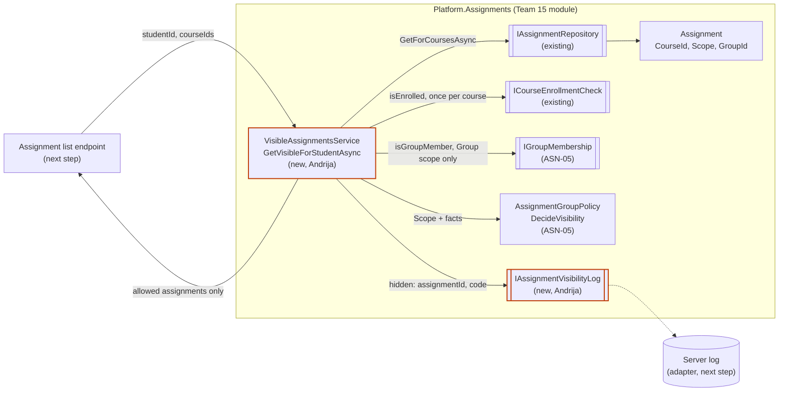
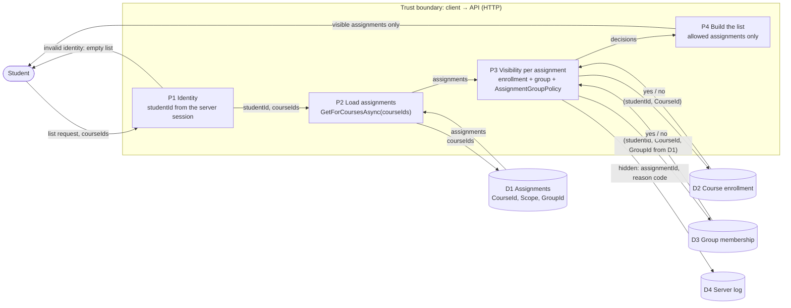

# Project component: ASN-05, assignment for a specific group (Team 13)

**Team:** 13

**Specification requirements:** ASN-05 (P) — assignment for a specific group; acceptance criterion: another group does not see a private assignment. A student from another group must neither see it in the list nor open or start it through a direct call. Related: ASN-16 and ACC-17 (membership checked on the server), ACC-05 (deny by default), SEC-01 (server-side authorization).

The work is split between team members. Each section below describes one part.

## Igor

To be completed.

## Đorđe

To be completed.

## Andrija — list of assignments visible to a student

**Student:** Andrija Gradištanac / PR 12/2022

### Responsibilities and boundaries

- Processes and user scenarios: a student asks for the list of assignments in their courses. The list contains only the assignments that `AssignmentGroupPolicy` allows for that student. A group assignment of another group is left out completely, so the list reveals nothing about it.
- What this part does:
  - `VisibleAssignmentsService.GetVisibleForStudentAsync(studentId, courseIds)`: loads the assignments of the given courses, decides visibility for each one and returns only the allowed ones, in stored order.
  - `IAssignmentVisibilityLog` (contract): records the reason code of every hidden assignment on the server side.
- What this part does NOT do: it does not check the start of an attempt (Igor, `StartAttemptService`), does not change `AssignmentGroupPolicy`, `IGroupMembership` or `InMemoryGroupMembership`, does not change any existing contract or service of the Assignments module (Team 15), does not decide availability (archived or expired assignments, ASN-04), and does not register anything in DI or add an API route.
- Contracts with other modules:
  - `IAssignmentRepository.GetForCoursesAsync` (existing, Team 15) — assignments of the given courses.
  - `ICourseEnrollmentCheck` (existing, Team 15) — active enrollment, asked once per course within one call.
  - `IGroupMembership` (existing, ASN-05) — asked only for a group assignment of an enrolled student, always with the group stored on the assignment.
  - `AssignmentGroupPolicy.DecideVisibility` (existing, ASN-05) — used as it is; `decision.Allowed` decides.
  - `IAssignmentVisibilityLog` (new) — the adapter to the server log is a next step.
- Implementation status: service and contract are implemented and covered by 12 NUnit tests with fake implementations. DI registration, the log adapter and the API route are next steps.

### Order of checks

1. An invalid `studentId` (`PrincipalId.IsValid`) or an empty course list returns an empty list without reading any assignment.
2. `GetForCoursesAsync(courseIds)` loads the assignments. `courseIds` comes from the caller and is not trusted: every assignment is checked against enrollment in its own stored `CourseId`, so a foreign course in the request opens nothing.
3. For each assignment: `isEnrolled` from `ICourseEnrollmentCheck`; `isGroupMember` from `IGroupMembership` only for a `Group` assignment of an enrolled student; then `AssignmentGroupPolicy.DecideVisibility`.
4. Allowed: added to the result. Denied: left out, and `IAssignmentVisibilityLog.RecordHiddenAsync(studentId, assignmentId, code)` records why.
5. Fail closed, consistent with `StartAttemptService`: an error in the enrollment or membership check hides only that assignment (code `CheckFailed`). Cancellation and a failure of the repository itself are passed on, not swallowed.

### Component architecture



The orange outline marks this part. The same policy is used by `StartAttemptService`, so the list and a direct start call follow one rule.

### Data flow diagram: assignment list



Assumptions at the boundary: `studentId` must come from the server session, never from the request body (the API route is a next step and must keep this). `courseIds` may come from the client and is not trusted (see Order of checks). `CourseId` and `GroupId` used in the checks always come from D1. D2 and D3 are fakes or in-memory implementations until the membership owners (ACC) provide real adapters.

### Security requirements

- Server-side access checks: every assignment in the list goes through `AssignmentGroupPolicy`; the same rule protects the start of an attempt.
- Deny by default: not enrolled, another group, no group, an unknown scope or a failed check hides the assignment.
- Input validation: invalid `studentId` or empty course list returns an empty list.
- Sensitive data: a hidden assignment is not in the result at all (no placeholder, no count); the reason code is recorded only through `IAssignmentVisibilityLog`.
- Negative scenarios: see the test table.

### Tests

`backend/Platform.Tests/Assignments/VisibleAssignmentsServiceTests.cs` — fake repository, fake enrollment, `InMemoryGroupMembership` and a recording visibility log.

| Requirement ID | Precondition | Action | Expected | Evidence (test) |
| --- | --- | --- | --- | --- |
| ASN-05 | enrolled student, course assignment of that course | get list | assignment is listed | `GetVisible_StudentSeesCourseAssignmentOfOwnCourse` |
| ASN-05 | member of `group-a`, group assignment for `group-a` | get list | assignment is listed | `GetVisible_GroupMemberSeesGroupAssignment` |
| ASN-05 | member of `group-b`; group assignment for `group-a` and course assignment of the same course | get list | only the course assignment | `GetVisible_StudentOfAnotherGroup_SeesCourseAssignmentButNotGroupAssignment` |
| ASN-05 | enrolled student in no group, group assignment | get list | empty | `GetVisible_StudentWithoutGroup_DoesNotSeeGroupAssignment` |
| ASN-05, ASN-16 | student not enrolled | get list | empty; reason `NotEnrolled` | `GetVisible_StudentNotEnrolled_SeesNothing` |
| ASN-05, SEC-01 | two courses (one not enrolled), course and group assignments of several groups | get list | exactly the allowed ones, in stored order; enrollment asked once per course | `GetVisible_MixedList_ReturnsExactlyAllowedAssignmentsInStoredOrder` |
| ASN-05 | invalid `studentId` (empty, spaces, space inside, trailing newline) | get list | empty; repository not called | `GetVisible_WithInvalidStudentId_ReturnsEmptyWithoutReadingAssignments` |
| ASN-05, ACC-05 | membership check throws | get list | only that assignment hidden (`CheckFailed`) | `GetVisible_WhenMembershipCheckFails_HidesOnlyThatAssignment` |
| ASN-05 | student of another group | get list | empty result; reason only in the log | `GetVisible_HiddenAssignment_IsOnlyInServerLog` |

Run: `dotnet test backend/SecurityLab.slnx` (the tests are in `Platform.Tests/Assignments`).

### Next steps

- DI registration (not done in this part):

  ```csharp
  builder.Services.AddScoped<VisibleAssignmentsService>();
  builder.Services.AddSingleton<IGroupMembership, InMemoryGroupMembership>();   // development
  builder.Services.AddSingleton<ICourseEnrollmentCheck, ...>();                 // real enrollment adapter
  builder.Services.AddSingleton<IAssignmentVisibilityLog, ...>();               // adapter to ILogger / Audit
  ```

- An `IAssignmentVisibilityLog` adapter that writes to the server log (and later to the Audit module).
- An API route for the student's assignment list that takes `studentId` from the session and returns only `GetVisibleForStudentAsync` results, with an HTTP negative test for a student of another group.

### Files

- `backend/Platform.Assignments/Application/VisibleAssignmentsService.cs` (new)
- `backend/Platform.Assignments/Contracts/IAssignmentVisibilityLog.cs` (new)
- `backend/Platform.Tests/Assignments/VisibleAssignmentsServiceTests.cs` (new)
