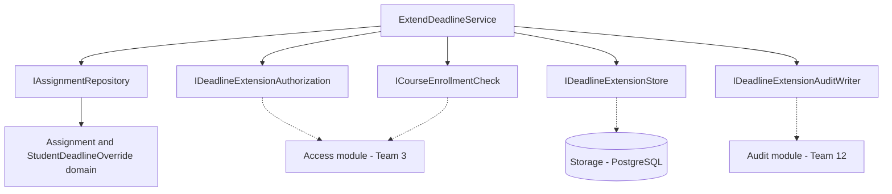
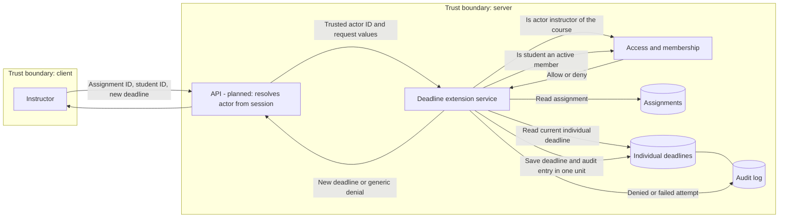
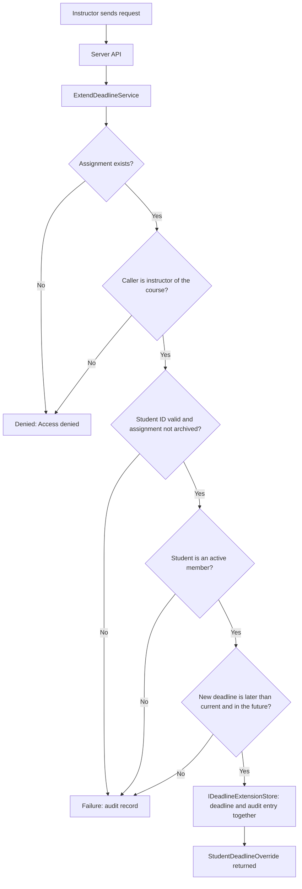

# Project component: ASN-06, individual deadline extension

**Team:** 15

**Student:** Đorđić Stefan / PR 129/2021

**Specification requirements:** ASN-06. Also prepares ASN-19 (the extension stores who changed the deadline and the previous value) and relies on ASN-16 and ACC-17 (membership checked on the server).

## Responsibilities and boundaries

- Processes and user scenarios: `ExtendDeadlineService` lets an authorized instructor of the course give one student a later deadline for one assignment. The extension applies to that student only; other students and the assignment itself keep their deadline. A student can be extended more than once, and each new deadline must be later than the one it replaces. A student, an instructor of another course, or an unknown caller is denied. The use case builds on the `Assignment` model and is described together with it in [ASN-04-ASN06-15.md](ASN-04-ASN06-15.md).
- Contracts with other modules: `IAssignmentRepository` (existing, ASN-04) loads the assignment. `IDeadlineExtensionAuthorization` asks the Access module (Team 3) whether the caller is an instructor of the course, and `ICourseEnrollmentCheck` asks whether the student is an active member; both answer only yes or no. `IDeadlineExtensionStore` reads the student's current extension and saves a new one together with its audit entry, both or neither. `IDeadlineExtensionAuditWriter` records denied and failed attempts through an adapter to the Audit module (Team 12). Details: [../contracts/ASN-06-contracts.md](../contracts/ASN-06-contracts.md).
- Implementation status: `ExtendDeadlineService`, `StudentDeadlineOverride`, `PrincipalId`, the five contracts, and `Assignment.GetEffectiveDueAtUtc` / `GetAvailability(now, individualDueAtUtc)` are implemented and covered by 37 NUnit tests that use fake implementations of the interfaces. The PostgreSQL store, real authorization, enrollment and audit adapters, API endpoint, and the connection to the start-attempt flow remain planned work.

## Component architecture

`ExtendDeadlineService` holds the business logic; data access, authorization, membership checks, and audit go through interfaces. `Platform.Assignments` does not reference `Platform.Access`, `Platform.Audit`, or `Platform.Api`; the host connects them. Dotted lines are planned integration.

## Data flow diagram

### ASN-06: individual deadline extension

The client never supplies the actor, the course, or the current time. The actor ID comes from the server-side identity, the course from the assignment itself, and the time from `TimeProvider`. The audit entry of a successful extension is saved together with the change, so a change cannot exist without its record.

### Order of checks

Negative flow: an unknown assignment, an unauthorized caller, and an invalid actor ID all return the same `Access denied.` error, and nothing is saved. Denied and failed attempts are audited on a best-effort basis; a failed audit write never turns a denial into access. The API, storage, and real adapters are planned parts of the full flow; the current implementation covers the service and its contracts.

## Security requirements

- Server-side access checks: the actor ID (`actorId`) must come from the trusted server context, never from the request body, and the course is taken from the assignment, never from the client. Authorization runs first, before any other data is read or changed. An unknown assignment, an unauthorized caller, and an invalid `actorId` give the same `Access denied.` error, so assignment IDs cannot be guessed. A student, an instructor of another course, or an unknown caller cannot extend a deadline.
- Input validation and sensitive data: actor and student IDs must match `^[A-Za-z0-9_-]{1,64}\z` (`PrincipalId`; `\z` is used because `$` accepts a trailing newline). The new deadline must be later than the current deadline and later than the current time, so an extension can never shorten a deadline, and an archived assignment cannot be extended. Audit entries contain only IDs, timestamps, and a fixed reason code; they hold no free text, tokens, or student answers.
- Negative scenarios: a student calls the use case; an instructor of another course; an unknown assignment; an invalid actor or student ID; a student who is not enrolled; an archived assignment; a deadline equal to, earlier than, or not later than the current one; a deadline in the past; a concurrent change by another instructor; a store failure; and an audit writer failure while denying. All are covered by tests.

## Evidence of work

- Changed files / commit / pull request: `backend/Platform.Assignments/Application/ExtendDeadlineService.cs`; `backend/Platform.Assignments/Contracts/` (`IDeadlineExtensionAuthorization`, `ICourseEnrollmentCheck`, `IDeadlineExtensionStore`, `IDeadlineExtensionAuditWriter`, `DeadlineExtensionAuditEntry`); `backend/Platform.Assignments/Domain/Models/StudentDeadlineOverride.cs`; `backend/Platform.Assignments/Domain/ValueObjects/PrincipalId.cs`; `backend/Platform.Assignments/Domain/Models/Assignment.cs` (added `GetEffectiveDueAtUtc` and `GetAvailability(now, individualDueAtUtc)`; the existing `GetAvailability(now)` behaves as before); `backend/Platform.Tests/Assignments/` (`ExtendDeadlineServiceTests.cs`, `AssignmentIndividualDeadlineTests.cs`, `StudentDeadlineOverrideTests.cs`); `backend/SecurityLab.slnx` (adds `Platform.Assignments`); `docs/contracts/ASN-06-contracts.md`; `docs/components/ASN-06-ExtendDeadline.md` (this file); `docs/components/ASN-04-ASN06-15.md` (status and next steps); `docs/PROJECT_COMPONENTS.md` (Team 15 row); `README.md` (repository structure). Branch `feature/ASN-06-deadline-extension`; pull request: [add link].
- Run instructions: `dotnet test backend/SecurityLab.slnx --configuration Release`
- Tests and results: 37 new NUnit tests (`ExtendDeadlineServiceTests` 24 cases, `AssignmentIndividualDeadlineTests` 5, `StudentDeadlineOverrideTests` 8 cases). The last local run of the whole solution gave **490 passed, 0 failed, 15 skipped** (505 total; build succeeded). The tests cover:
  1. A successful extension.
  2. A student calling the use case.
  3. An instructor of another course.
  4. An unknown assignment.
  5. An invalid instructor or student ID.
  6. A student who is not enrolled.
  7. An archived assignment.
  8. A deadline equal to, earlier than, or not later than the current one, and a deadline in the past.
  9. A concurrent change by another instructor.
  10. A store failure, and an audit writer failure while denying.

  The tests use fake implementations of the interfaces. They do not yet confirm a real database, atomic saving of the deadline and audit entry, or the integration with the authorization module.
- Next steps (team split): member 1 implements `IDeadlineExtensionStore` on PostgreSQL with a transaction for the deadline and audit entry and a check of the previous deadline, based on `StudentDeadlineOverride`; member 4 connects `IDeadlineExtensionAuthorization` and `ICourseEnrollmentCheck` to the Access and membership module (Team 3); member 5 writes the adapter for `IDeadlineExtensionAuditWriter`, agrees the event type with Team 12, and adds the API endpoint with the identity taken from the session and integration tests for 401, 403, and 404; member 2 connects `StartAttemptService` (ASN-04) to `GetAvailability(now, individualDueAtUtc)`.
