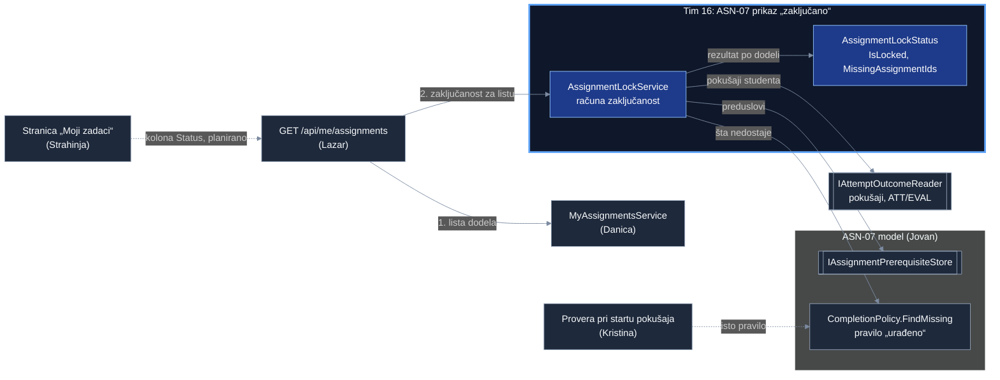
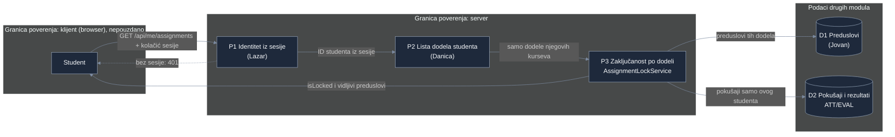

# Project component: ASN-07, prikaz „zaključano“ u listi dodela

**Team:** 16

**Student:** Tamara Opačić (PR 50/2022)

**Specification requirements:** ASN-07 (povezano: ASN-02, ASN-10, ATT-06, EVAL-04)

## Responsibilities and boundaries

- Processes and user scenarios: student otvori „Moji zadaci“ i za svaku dodelu vidi da li je zaključana i koji zadatak prvo mora da uradi. Zaključanost računa server, a klijent je samo prikazuje. Ovo je obaveštenje za studenta, ne zaštita: pravu zabranu pokretanja zaključanog zadatka radi provera pri startu pokušaja (Kristina).
- Contracts with other modules:
  - `AssignmentLockService` (nudimo): za listu dodela jednog studenta vraća `AssignmentLockStatus` (`IsLocked`, `MissingAssignmentIds`) po dodeli.
  - `GET /api/me/assignments` (proširujemo, Lazar): svaka dodela u odgovoru dobija polja `isLocked` i `missingAssignmentIds`.
  - `IMyAssignmentsService` (koristimo, Danica): lista dodela koje student sme da vidi.
  - `IAssignmentPrerequisiteStore` i `CompletionPolicy.FindMissing` (koristimo, Jovan): preduslovi dodele i pravilo šta znači „urađeno“. Isto pravilo koristi i provera pri startu, pa prikaz i zabrana uvek govore isto.
  - `IAttemptOutcomeReader` (koristimo, predlog za ATT/EVAL): pokušaji studenta sa stanjem i ishodom evaluacije.
- Implementation status: servis, polja u odgovoru API-ja, razvojni podaci, fail-closed varijante za ostala okruženja i testovi su implementirani. Prikaz na stranici „Moji zadaci“ (kolona „Status“) i prava implementacija `IAttemptOutcomeReader` su planirani.

## Component architecture



Blok sa plavim okvirom je moj deo. Pune strelice postoje u kodu, isprekidane su planirane. Kutije sa duplim ivicama su ugovori (interfejsi) na granici modula. Servis ne piše svoje pravilo „urađeno“, nego koristi Jovanov `CompletionPolicy`, isto kao provera pri startu.

Ko implementira ugovore zavisi od okruženja (`MyAssignmentsModule`): u Developmentu `DevelopmentLockData` (preduslovi u memoriji) i `DevelopmentAttemptOutcomeReader` (privremeni pokušaji), a u ostalim okruženjima `UnavailableAssignmentPrerequisiteStore` i `UnavailableAttemptOutcomeReader`, koji odbijaju rad (fail-closed) dok se ne povežu pravi moduli.

## Data flow diagram



Klijent ne šalje ID studenta ni spisak dodela. Server uzima studenta iz sesije, a zaključanost računa samo nad dodelama koje je taj student već dobio u listi. U `missingAssignmentIds` idu samo dodele koje student vidi; preduslov iz tuđe grupe ili kursa zaključava zadatak, ali se ne otkriva (ASN-10). Klijent polje `isLocked` samo prikazuje i ne odlučuje ništa.

## Security requirements

- Server-side access checks: zaključanost računa samo server, za studenta iz sesije. Pokušaji se traže samo za tog studenta, a `CompletionPolicy` ponovo proverava da pokušaj pripada baš njemu. Prikaz „zaključano“ nije kontrola pristupa: zabranu pokretanja radi provera pri startu (Kristina), pa uklanjanje oznake u browseru ne otključava zadatak.
- Input validation and sensitive data: prazan ID studenta se odbija. Odgovor ne sadrži pokušaje, bodove ni ishode, samo `isLocked` i ID-jeve preduslova koje student već vidi. Van Developmenta nema izmišljenih podataka: `UnavailableAttemptOutcomeReader` i `UnavailableAssignmentPrerequisiteStore` bacaju `DependencyUnavailableException`, a endpoint za taj slučaj vraća kontrolisan `503 service_unavailable` sa `correlationId`, bez podataka i detalja greške (fail-closed). Lista se nikad ne vraća bez zaključavanja.
- Negative scenarios:

| Pretnja | Kontrola | Test |
|---|---|---|
| Tuđi položen pokušaj otključa zadatak | pokušaji samo za studenta iz sesije, provera vlasnika u `CompletionPolicy` | `OtherStudentsPassedAttempt_DoesNotUnlock` |
| Traže se pokušaji drugog studenta | ID studenta samo iz sesije | `Attempts_AreRequestedOnlyForGivenStudent` |
| Predat, a neocenjen rad otključa zadatak | Jovanovo pravilo „urađeno“ (O2, O3) | `SubmittedButNotEvaluatedPrerequisite_StaysLocked` |
| Otkrivanje dodele druge grupe ili kursa | u odgovor idu samo preduslovi koje student vidi (ASN-10) | `HiddenPrerequisite_LocksButIsNotRevealed` |
| Poziv bez identiteta studenta | servis odbija prazan ID, endpoint vraća 401 | `EmptyStudentId_IsRejected`, `NoSessionCookie_Returns401_AndServiceIsNotCalled` |
| Odgovor oda više polja nego što treba | spisak dozvoljenih polja | `ResponseContainsOnlyStudentVisibleFields` |
| Izmišljeni podaci van razvoja | fail-closed implementacije, kontrolisan 503 | `OutsideDevelopment_FailsClosed_InsteadOfReturningInventedData` |
| Lista bez zaključavanja kad preduslovi ili pokušaji nisu povezani | 503 umesto liste u kojoj je sve „otključano“ | `OutsideDevelopment_LockDependenciesUnavailable_Returns503WithoutData` |

## Pokretanje i demonstracija

Sve komande se pokreću iz korena repozitorijuma.

1. Testovi:

```bash
   dotnet test backend/Platform.AssignmentOverview.Tests
   dotnet test backend/Platform.MyAssignments.Tests
```

2. Demonstracija preko API-ja (Development):

```bash
   docker compose up -d db
   dotnet run --project backend/Platform.Api --urls http://localhost:5080
   cd frontend && npm run dev
```

   Prijaviti se kao `student@example.com` na `http://localhost:5173`, pa otvoriti `http://localhost:5173/api/me/assignments`. Očekivano:

| Dodela | Preduslov | Stanje studenta | `isLocked` |
|---|---|---|---|
| `rev-sql-injection-1` | nema | | `false` |
| `rev-xss-1` | nema | položio | `false` |
| `rev-sql-injection-2` | `rev-sql-injection-1` | predao, ocenjivanje traje | `true` |
| `rev-xss-2` | `rev-xss-1` | položio preduslov | `false` |

## Evidence of work

- Changed files / commit / pull request: novi `AssignmentLockService`, `AssignmentLockStatus`, `DevelopmentLockData`, `UnavailableLockImplementations` u `backend/Platform.AssignmentOverview/`; polja `isLocked` i `missingAssignmentIds` u `MyAssignmentsEndpoints`; registracija u `MyAssignmentsModule`; testovi u `Platform.AssignmentOverview.Tests` i `Platform.MyAssignments.Tests`; ovaj dokument. Grana `feature/ASN-07-locked-view`, PR ka `feature/ASN-02-ASN-07`.
- Run instructions: odeljak „Pokretanje i demonstracija“ iznad.
- Tests and results: 8 novih jediničnih testova za `AssignmentLockService` i 2 nova integraciona testa (`Response_MarksAssignmentWithUnfinishedPrerequisiteAsLocked`, `OutsideDevelopment_LockDependenciesUnavailable_Returns503WithoutData`) prolaze; postojeći testovi ASN-02 su prošireni za nova polja i kontrolisan 503 i prolaze (`Platform.AssignmentOverview.Tests` 12/12, `Platform.MyAssignments.Tests` 13/13).
- Next steps:
  - Sa Strahinjom: kolona „Status“ na stranici „Moji zadaci“ (zaključano i šta prvo uraditi), bez odlučivanja u browseru.
  - Sa Kristinom: obe strane koriste `CompletionPolicy.FindMissing`, pa prikaz i zabrana pri startu daju isti odgovor.
  - Sa timom za pokušaje (ATT/EVAL): prava implementacija `IAttemptOutcomeReader` umesto razvojnih podataka.
  - Sa Jovanom: zamena `InMemoryAssignmentPrerequisiteStore` iz razvojnih podataka pravim `PostgresAssignmentPrerequisiteStore` kad se registruje u `Platform.Api`.
  - Sa Dimitrijem: scenario „direktan API poziv za zaključan zadatak“ kroz ceo tok.
