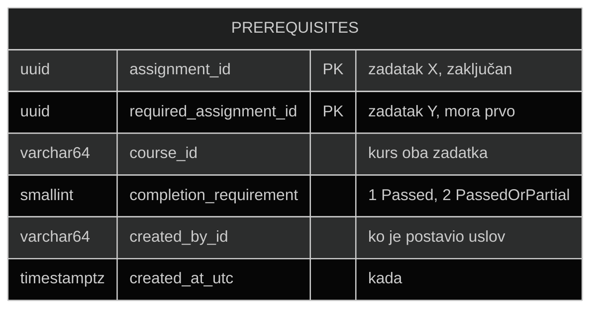
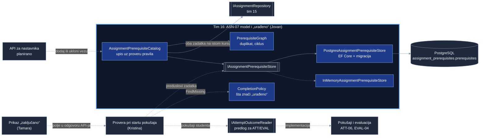
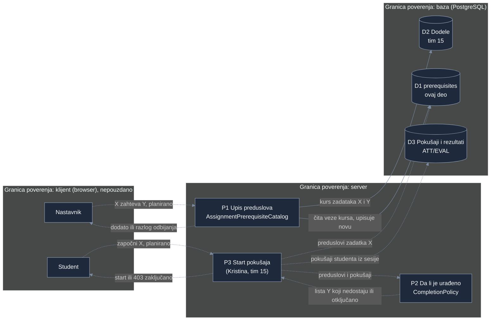

# Project component: ASN-07, model preduslova i odluka šta znači „urađeno“

**Team:** 16

**Student:** Jovan Budiša (PR 160/2022)

**Specification requirements:** ASN-07 (povezano: ATT-03, ATT-06, EVAL-04, EVAL-05, EVAL-06, ASN-09, ASN-13)

## Responsibilities and boundaries

- Processes and user scenarios: nastavnik određuje da zadatak X na kursu može da se započne tek kada student uradi zadatak Y na istom kursu. Ovaj deo čuva te veze u bazi, odbija neispravne veze (samoreferenca, duplikat, ciklus, zadatak drugog kursa) i kao kod definiše šta znači da je student „uradio“ Y.
- Contracts with other modules:
  - `IAssignmentPrerequisiteStore` (nudimo): čitanje i upis tabele preduslova. Implementacije: `PostgresAssignmentPrerequisiteStore` (EF Core, PostgreSQL) i `InMemoryAssignmentPrerequisiteStore` (testovi i rad bez baze).
  - `AssignmentPrerequisiteCatalog` (nudimo): upis uz proveru pravila, čitanje i brisanje veze.
  - `CompletionPolicy` (nudimo): `CountsAsDone`, `IsSatisfied` i `FindMissing`. Koristi ih provera pri startu pokušaja (Kristina) i prikaz „zaključano“ (Tamara).
  - `IAssignmentRepository` (koristimo): postojanje i kurs zadatka, modul `Platform.Assignments` (tim 15).
  - `IAttemptOutcomeReader` i `AttemptOutcomeSnapshot` (tražimo, predlog): stanje pokušaja i ishod evaluacije od modula za pokušaje (ATT) i evaluaciju (EVAL).
- Implementation status: modul `Platform.AssignmentPrerequisites` sa domenskim modelom, pravilima, odlukom „urađeno“, oba skladišta, `DbContext`, migracijom i registracijom za DI je implementiran. Test projekat `Platform.AssignmentPrerequisites.Tests` ima jedinične testove, testove EF modela i integracione testove nad PostgreSQL-om. Endpoint za nastavnika, povezivanje u `Platform.Api` i prava implementacija `IAttemptOutcomeReader` su planirani.

## Odluka: šta znači „urađeno“

Zadatak Y je urađen za studenta S ako postoji **bar jedan** pokušaj koji ispunjava sva pravila O1–O4. Pravila su u kodu u `Domain/CompletionPolicy.cs`, a svako pravilo ima test u `CompletionPolicyTests`.

| # | Pravilo | Obrazloženje |
|---|---|---|
| O1 | Pokušaj pripada baš studentu S i baš zadatku Y. Pokušaj drugog studenta ili drugog zadatka se nikad ne računa, čak ni ako ga čitač greškom vrati. | Vlasništvo pokušaja (ATT-03). ID studenta dolazi iz sesije, nikad od klijenta. |
| O2 | Stanje pokušaja je `Completed` (završen, ATT-06). Stanja započet, u toku, predat, u evaluaciji i čeka ručni pregled znače „još nije urađeno“. Istekao i otkazan nisu urađeni. | Predaja nije isto što i rezultat. Specifikacija razdvaja status pokušaja od ishoda evaluacije (uvod 4.7). |
| O3 | Evaluacija tog pokušaja ima status `Completed` (EVAL-04). Tehnička greška nije ni prolaz ni pad (EVAL-06): zadatak ostaje zaključan dok se evaluacija ne ponovi (EVAL-09). | Greška evaluatora ne sme da otključa zadatak, a ni da se računa kao studentov neuspeh. |
| O4 | Ishod je `Passed` (uspešan). Ako je nastavnik za tu vezu izabrao `PassedOrPartial`, prihvata se i `Partial` (delimičan). `Failed` se nikad ne prihvata. | Podrazumevano je strože. Nastavnik može da ublaži uslov po vezi (kolona `completion_requirement`). |
| O5 | Jednom urađen zadatak ostaje urađen: kasniji neuspešan pokušaj ne zaključava ponovo. Ako se isti pokušaj ponovo oceni, važi poslednji važeći rezultat (EVAL-05). | Student ne gubi otključan zadatak zato što je vežbao ponovo. |
| O6 | Rok ne utiče na „urađeno“. Ako je pokušaj regularno započet (rok i individualno produženje proverava tim 15, ASN-03 i ASN-06) i završen, računa se. | Provera roka je odgovornost starta pokušaja, ne ovog pravila. |
| O7 | Ako je Y kasnije otkazan ili arhiviran (ASN-09), urađeni pokušaji ostaju urađeni. Student koji Y nije uradio ostaje zaključan za X dok nastavnik ne ukloni vezu. | Otkazivanje ne briše istoriju. Upozorenje nastavniku o neispunjivom preduslovu je ASN-13 (planirano). |

Otvorena pitanja za dogovor sa Kristinom i timom za pokušaje:

- Da li se uslov proverava samo pri startu pokušaja ili i pri predaji? Predlog: samo pri startu, a već započet pokušaj se ne prekida ako nastavnik kasnije doda preduslov (kao zamrzavanje uslova, ASN-08).
- Tačan oblik `IAttemptOutcomeReader`: da li ATT vraća poslednji rezultat po pokušaju ili treba posebno pitati EVAL.

## Model podataka

Tabela `assignment_prerequisites.prerequisites` u sopstvenoj šemi, sa sopstvenom tabelom istorije migracija (`assignment_prerequisites.__EFMigrationsHistory`). Migracije ovog modula zato ne diraju šeme drugih timova.



| Ograničenje | Šta sprečava |
|---|---|
| `pk_prerequisites (assignment_id, required_assignment_id)` | Ista veza X → Y postoji najviše jednom. |
| `ck_prerequisites_not_self` | Zadatak kao sopstveni preduslov, čak i kad se upisuje mimo aplikacije. |
| `ck_prerequisites_completion_requirement` | Nepoznata vrednost zahteva (samo 1 ili 2). |
| `ck_prerequisites_course_id_format` | ID kursa van dozvoljenog skupa znakova (isto pravilo kao u domenu). |
| `ix_prerequisites_course_id` | Brzo čitanje svih veza kursa (provera ciklusa, pregled za nastavnika). |
| `ix_prerequisites_required_assignment_id` | Brzo „šta Y otključava“ (prikaz „zaključano“, ASN-13). |

Nema stranog ključa ka tabeli dodela jer modul dodela (tim 15) još nema tabelu u bazi. Postojanje oba zadatka i to da su na istom kursu proverava `AssignmentPrerequisiteCatalog` preko `IAssignmentRepository`. Strani ključ se dodaje novom migracijom kad tabela dodela postoji.

### Odnos prema LAB-06 (tim 20)

Tim 20 već ima tabelu `authoring.lab_prerequisites` (laboratorija zahteva laboratoriju). ASN-07 je namerno posebna tabela:

| | LAB-06, tim 20 | ASN-07, ovaj deo |
|---|---|---|
| Veza između | laboratorija (sadržaj) | dodela na kursu (zadatak) |
| Važi za | sve kurseve | jedan kurs |
| Ko je postavlja | autor laboratorije | nastavnik kursa |
| „Urađeno“ | nije definisano (`StubCompletedLaboratories`) | definisano pravilima O1–O7 |

Ista laboratorija može biti zadata na dva kursa sa različitim redosledom. Veze LAB-06 mogu kasnije da posluže kao predlog nastavniku pri zadavanju (ASN-13), ali se ne primenjuju automatski.

## Component architecture



Blok sa plavim okvirom je moj deo. Pune strelice postoje u kodu, isprekidane su planirane veze sa delovima kolega i drugih timova. Kutije sa duplim ivicama su ugovori (interfejsi) na granici modula. `CompletionPolicy` ne zavisi ni od baze ni od drugih modula, pa je isto pravilo iskoristivo u proveri pri startu i u prikazu „zaključano“.

## Data flow diagram



Sve što dolazi od klijenta je nepouzdano. ID studenta se uzima iz sesije, a ID kursa se proverava prema dodelama na serveru, ne prema onome što klijent pošalje. Odluka „urađeno“ donosi se samo na serveru (ASN-07: „uslov se proverava na serveru, ne samo u interfejsu“). Baza je posebna granica: pravila iz domena ponavlja kroz ključ i CHECK ograničenja, pa ni upis mimo aplikacije ne može da napravi samoreferencu ili nepoznat zahtev.

## Security requirements

- Server-side access checks: odluka „urađeno“ se donosi samo na serveru (`CompletionPolicy`). Upis veze proverava da oba zadatka postoje i pripadaju istom kursu. Ko sme da menja preduslove (samo nastavnik kursa) proveravaće se preko modula Access pre poziva `AssignmentPrerequisiteCatalog`; to je sledeći korak.
- Input validation and sensitive data: prazni ID-jevi, samoreferenca, nepoznat zahtev, ID kursa ili korisnika van `^[A-Za-z0-9_-]{1,64}$` se odbijaju u domenu, a ključna pravila ponovo u bazi. Tabela ne čuva odgovore, bodove ni lične podatke, samo ID-jeve, ko je postavio uslov i kada. `AttemptOutcomeSnapshot` nosi samo statuse i ishod, bez odgovora studenta i skrivenih rešenja (EVAL-03).
- Negative scenarios:

| Pretnja | Kontrola | Test |
|---|---|---|
| Tuđi uspešan pokušaj otključa zadatak | O1, poređenje ID-ja studenta | `AttemptOfAnotherStudent_DoesNotUnlock` |
| Uspeh na drugom zadatku otključa zadatak | O1, poređenje ID-ja zadatka | `AttemptOfAnotherAssignment_DoesNotUnlock` |
| Predaja bez rezultata otključa zadatak | O2, samo `Completed` | `AttemptThatIsNotCompleted_DoesNotCount` (7 slučajeva) |
| Greška evaluatora otključa zadatak | O3, tehnička greška nije prolaz | `EvaluationThatIsNotCompleted_DoesNotCount` |
| Delimičan ishod prođe kad nije dozvoljen | O4, poređenje sa zahtevom | `Outcome_IsComparedWithRequirement` (6 slučajeva) |
| Ciklus zauvek zaključa zadatke | `PrerequisiteGraph.WouldCreateCycle` | `TwoAssignmentCycle_IsDetected`, `ThreeAssignmentCycle_IsDetected`, `Cycle_IsRejected_AndNothingIsWritten` |
| Preduslov poveže zadatke dva kursa | provera kursa preko `IAssignmentRepository` | `RequiredAssignmentFromOtherCourse_IsRejected`, `CourseIdThatDoesNotMatchAssignments_IsRejected` |
| Dupla veza | primarni ključ i provera pre upisa | `Duplicate_IsRejected_AndStoredOnce`, `Duplicate_IsRejectedByPrimaryKey` |
| Samoreferenca upisana mimo aplikacije | `ck_prerequisites_not_self` u bazi | `AssignmentCannotRequireItself`, `SelfReference_IsRejectedByDatabase` |
| Nepoznat zahtev u bazi tiho otključa | CHECK u bazi, domen baca grešku pri čitanju | `UnknownCompletionRequirement_IsRejected`, `UnknownCompletionRequirement_IsRejectedByDatabase` |
| Ubacivanje znakova kroz ID kursa | dozvoljen skup znakova, `\z` umesto `$` | `InvalidCourseId_IsRejected` (6 slučajeva) |
| Model promenjen bez migracije | poređenje modela i migracija | `Migrations_MatchTheModel` |

## Pokretanje i demonstracija

Sve komande se pokreću iz korena repozitorijuma.

1. Testovi ovog dela:

```bash
   dotnet test backend/Platform.AssignmentPrerequisites.Tests/Platform.AssignmentPrerequisites.Tests.csproj
```

   Integracioni testovi (`Category=Integration`) koriste `.env` i lokalnu bazu. Bez pokrenute baze ili bez `.env` (na primer u CI-ju) se preskaču.

2. Tabela u bazi:

```bash
   docker compose up -d db
   dotnet tool restore
   dotnet ef database update --project backend/Platform.AssignmentPrerequisites --startup-project backend/Platform.AssignmentPrerequisites --context AssignmentPrerequisitesDbContext
   docker compose exec -T db psql -U securitylab_bootstrap -d securitylab -c "\d assignment_prerequisites.prerequisites"
```

3. Baza odbija samoreferencu i kad se zaobiđe aplikacija (očekivana greška `ck_prerequisites_not_self`):

```bash
   docker compose exec -T db psql -U securitylab_bootstrap -d securitylab -c "INSERT INTO assignment_prerequisites.prerequisites (assignment_id, required_assignment_id, course_id, completion_requirement, created_by_id, created_at_utc) VALUES ('a0000000-0000-0000-0000-000000000001', 'a0000000-0000-0000-0000-000000000001', 'course-oib', 1, 'demo', now());"
```

Connection string: `ConnectionStrings__Assignments`, a ako ga nema, `ConnectionStrings__Identity` iz `.env` (ista lokalna baza). Nova migracija posle promene modela:

```bash
dotnet ef migrations add <Naziv> --project backend/Platform.AssignmentPrerequisites --startup-project backend/Platform.AssignmentPrerequisites --context AssignmentPrerequisitesDbContext --output-dir Infrastructure/Persistence/Migrations
```

## Evidence of work

- Changed files / commit / pull request: `backend/Platform.AssignmentPrerequisites/`, `backend/Platform.AssignmentPrerequisites.Tests/`, `backend/SecurityLab.slnx`, ovaj dokument. Grana `feature/ASN-07-prerequisite-model`, PR ka `feature/ASN-02-ASN-07`.
- Run instructions: odeljak „Pokretanje i demonstracija“ iznad.
- Tests and results: jedinični testovi domena, pravila i kataloga (62) prolaze; testovi EF modela i integracioni testovi nad PostgreSQL-om se pokreću lokalno uz `docker compose up -d db`.
- Next steps:
  - Sa Kristinom: oblik `IAttemptOutcomeReader` i poziv `CompletionPolicy.FindMissing` pri startu pokušaja.
  - Sa Tamarom: koja polja API vraća za „zaključano“ (npr. `isLocked` i ID-jevi zadataka koji nedostaju, bez detalja tuđih grupa, ASN-10).
  - Sa Dimitrijem: zajednički test podaci za ASN-07 i scenariji „direktan API poziv bez urađenog preduslova“.
  - Registracija `AddAssignmentPrerequisites` u `Platform.Api` i razvojni podaci za `course-oib`.
  - API za nastavnika uz proveru prava preko modula Access (tim 3) i zapis promene u audit (tim 12).
  - Provera ciklusa i upis u jednoj transakciji (zaključavanje po kursu), da dva istovremena upisa ne naprave krug.
  - Strani ključ ka tabeli dodela kad je tim 15 napravi.