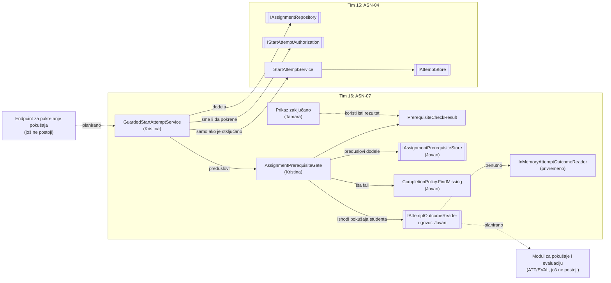
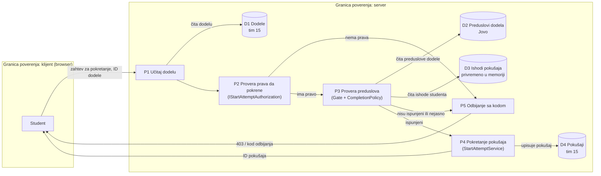

# Project component: ASN-07, provera preduslova pri pokretanju pokušaja

**Team:** 16

**Student:** Kristina Pavlovic (PR 144/2020)

**Specification requirements:** ASN-07 (povezano: ASN-04, ACC-05, ATT-03, ATT-06, EVAL-06)

## Responsibilities and boundaries

- Processes and user scenarios: student pokušava da pokrene zadatak. Server proverava da li dodela postoji, da li student sme da je pokrene, i tek onda da li je student uradio svaki preduslov (zadatak koji mora prvo, ASN-07). Ako nije, pokušaj se ne pravi, a student dobija samo kod odbijanja i ID-jeve zadataka koji fale. Provera se radi na serveru, ne u interfejsu.
- Contracts with other modules:
  - `IAssignmentPrerequisiteStore` (koristimo): preduslovi jedne dodele, modul `Platform.AssignmentPrerequisites` (Jovan, tim 16).
  - `CompletionPolicy.FindMissing` i `Identifiers` (koristimo): odluka šta znači „urađeno“ i koji zadaci fale, ista pravila koja koristi prikaz „zaključano“ (Tamara). Tako brava i poruka servera uvek govore isto.
  - `IAttemptOutcomeReader` (koristimo, ugovor definisao Jovan): stanje pokušaja i ishod evaluacije studenta. Modul za pokušaje i evaluaciju (ATT/EVAL) još ne postoji, pa koristimo privremenu `InMemoryAttemptOutcomeReader`.
  - `IAssignmentRepository`, `IStartAttemptAuthorization` i `StartAttemptService` (koristimo, ne menjamo): dodela, pravo pokretanja i kreiranje pokušaja, modul `Platform.Assignments` (tim 15).
  - `IAssignmentPrerequisiteGate` (nudimo): rezultat provere za jednu dodelu (`PrerequisiteCheckResult` sa poljima `IsUnlocked`, `MissingAssignmentIds`, `ReasonCode`), koristi ga i Tamara za prikaz.
- Implementation status: u modulu `Platform.AssignmentOverview` (folder `Prerequisites`) implementirani su `AssignmentPrerequisiteGate`, `GuardedStartAttemptService`, `PrerequisiteCheckResult`, `PrerequisitesNotMetException` i privremena `InMemoryAttemptOutcomeReader`, uz NUnit testove u `StartCheck`. `GuardedStartAttemptService` još **nije registrovan** u `Program.cs`, i nijedan endpoint ga ne poziva (u repozitorijumu još nema endpointa za pokretanje pokušaja). Prava implementacija `IAttemptOutcomeReader` (ATT/EVAL) i ubacivanje provere u sam `StartAttemptService` su planirani za KT2.

## Component architecture

Pune strelice postoje u kodu. Isprekidane su planirane ili privremene veze. Kutije sa duplim ivicama su ugovori (interfejsi) na granici modula. Moduli tima 15 nisu menjani: `GuardedStartAttemptService` je omotač koji prvo proveri preduslove, pa tek onda pozove `StartAttemptService`.

## Data flow diagram

Sve što dolazi od klijenta je nepouzdano. Klijent šalje samo ID dodele: identitet studenta mora da dolazi iz sesije na serveru, a odluka o preduslovima se donosi na serveru. Provera prava (P2) ide pre provere preduslova (P3), da student koji nema pristup ne sazna šta je zaključano.

## Decisions and dependencies

| Tema | Odluka |
|---|---|
| Model preduslova | Veza je između **dodela istog kursa** (zadatak X zahteva zadatak Y), kako je definisano u modulu `Platform.AssignmentPrerequisites`. Zato nije potrebna veza dodela → laboratorija. |
| „Urađeno“ | Ne definišemo ga mi: koristimo `CompletionPolicy` (pokušaj mora biti završen, evaluacija završena i ishod uspešan, ili delimičan ako to nastavnik dozvoli). Tehnička greška evaluatora i neuspeh ne otključavaju. Pravila su opisana u dokumentu ASN-07 model preduslova. |
| Redosled provera | Dodela postoji, pa pravo pokretanja, pa preduslovi, pa pokušaj. Autorizacija je pre preduslova da se ne otkrije šta je zaključano onome ko nema pristup. |
| Podrazumevano odbijanje | Nevalidan ili prazan ID studenta znači „zaključano“. Bez ishoda pokušaja preduslov nije ispunjen. |
| ID studenta | Dozvoljen skup znakova je isti kao u modulu preduslova (`Identifiers.IsValidPrincipalId`). Gate proverava ID unapred, jer `CompletionPolicy` za nevalidan ID baca izuzetak. |
| Kada se proverava | Samo pri pokretanju pokušaja (predlog iz modela preduslova); već započet pokušaj se ne prekida ako se preduslov doda kasnije. |
| Odgovor | Sadrži samo kod odbijanja i ID-jeve zadataka koji fale, bez skrivenih kriterijuma i bez podataka o drugim studentima. Isti oblik koristi prikaz „zaključano“. |
| Tuđi moduli | Ne menjamo `StartAttemptService`. Pravimo omotač `GuardedStartAttemptService`. |
| Zaobilaženje provere | Omotač štiti samo ako se svi pokušaji pokreću kroz njega; direktan poziv `StartAttemptService` zaobilazi preduslove. Konačno rešenje za KT2: tim 15 u svom modulu definiše interfejs za proveru preduslova, a naš `AssignmentPrerequisiteGate` ga implementira, pa se provera izvršava unutar `StartAttemptService`. |
| Registracija i endpoint | Nije urađeno u KT1: dok pokušaji i evaluacija (ATT/EVAL) nemaju pravu implementaciju `IAttemptOutcomeReader`, privremena memorijska verzija ne sme da bude povezana u `Program.cs`. |
| Poznato ograničenje | Dodela se učita dva puta (u omotaču i u `StartAttemptService`), što je cena toga da tuđi servis ostane netaknut. |

## Security requirements

- Server-side access checks: provera preduslova se radi u servisu na serveru, pre nego što se pokušaj kreira. Pravo pokretanja (`IStartAttemptAuthorization`) proverava se pre preduslova. Ako preduslovi nisu ispunjeni, `StartAttemptService` se ne poziva.
- Input validation and sensitive data: ID studenta se proverava pre bilo kakvog čitanja. Poruka izuzetka ne sadrži ID-jeve, a odgovor samo kod i zadatke koji fale. Audit zapis nije deo ovog dela.
- Negative scenarios:

| Pretnja | Kontrola | Test |
|---|---|---|
| Student pokrene zadatak bez urađenog preduslova | odbijanje, pokušaj se ne kreira | `Start_WhenPrerequisiteMissing_Throws_AndCreatesNoAttempt` |
| Tuđi uspešan pokušaj otključa zadatak | provera po studentu | `OtherStudentsCompletion_DoesNotUnlock` |
| Preduslov nije urađen | zaključano, vraća šta fali | `Assignment_WhenPrerequisiteNotCompleted_IsLocked` |
| Predato, ali neocenjeno otključa zadatak | samo završen pokušaj se računa | `SubmittedButNotEvaluated_DoesNotUnlock` |
| Greška evaluatora otključa zadatak | tehnička greška nije prolaz | `TechnicalError_DoesNotUnlock` |
| Neuspešan ishod otključa zadatak | uspeh je uslov | `FailedOutcome_DoesNotUnlock` |
| Nevalidan ili prazan ID studenta | podrazumevano odbijanje | `InvalidStudentId_IsDenied` |
| Student bez prava sazna šta je zaključano | autorizacija pre preduslova | `Start_WhenNotAuthorized_ThrowsAccessDenied_NotPrerequisiteError` |
| Nepostojeća dodela | `KeyNotFoundException` | `Start_WhenAssignmentNotFound_Throws` |
| Ispunjen uslov propusta (pozitivan) | otključano, pokušaj se pokreće | `Assignment_WhenPrerequisitePassed_IsUnlocked`, `Start_WhenPrerequisitePassed_CreatesAttempt` |

## Evidence of work

- Changed files / commit / pull request: PR #___ (grana `feature/ASN-07-6-start-check`, ka `feature/ASN-02-ASN-07`). Fajlovi: `backend/Platform.AssignmentOverview/Prerequisites/*`, `backend/Platform.AssignmentOverview.Tests/StartCheck/*`, jedna `ProjectReference` linija u `Platform.AssignmentOverview.csproj`.
- Run instructions: `dotnet test backend/Platform.AssignmentOverview.Tests`
- Tests and results: total 18, failed 0, succeeded 18, skipped 0, duration 1.2s (`dotnet test`, 9. 11. 2026, lokalno).
- Next steps (KT2): prava implementacija `IAttemptOutcomeReader` kad ATT/EVAL postoje (ili dogovor ko je pravi); dogovor sa timom 15 o ubacivanju provere u `StartAttemptService` preko interfejsa (da se provera ne može zaobići); registracija u `Program.cs` i endpoint za pokretanje pokušaja; usaglašavanje oblika odgovora sa Tamarom i Lazarom (`isLocked`, `missingAssignmentIds`).
