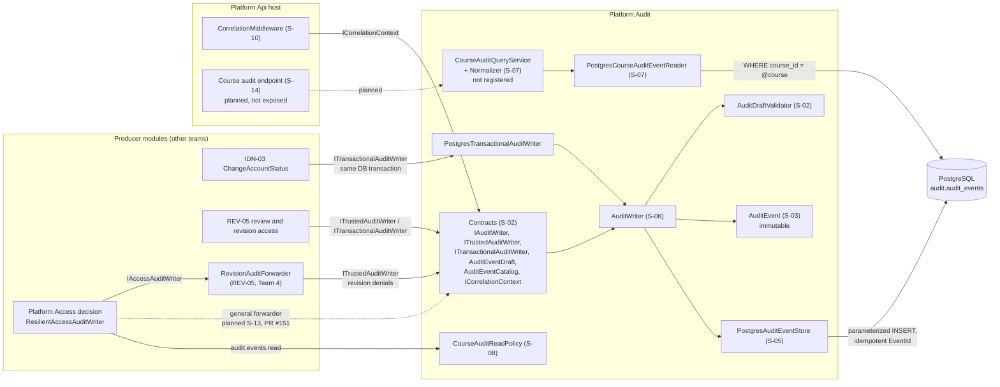
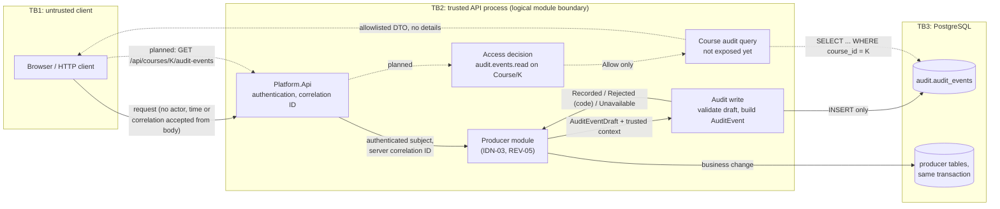

# Project component: AUD-01, AUD-06 — Audit

**Team:** 12

**Students:** Bogdan Pećanac (PR 149/2023), Aleksandar Petrović (PR 153/2023), Mladen Kovačević
(PR 85/2023), Konstantin Ristivojević (PR 106/2023), Bojan Kostić (PR 15/2022), Nikola Zeković
(PR 139/2022), Vanja Jovanov (PR 75/2023), Nikola Jevtić (PR 96/2023), Aleksa Mandarić
(PR 102/2023), Kristijan Oros (PR 159/2023)

**Specification requirements:** AUD-01 (core): audit record of login and changes of rights, with
actor, event, time and outcome. AUD-06 (extension): teacher view of only those security events the
teacher is authorized for. Respected: AUD-03 (no secrets in the log), AUD-04 (correlation ID),
ADM-07 (records stay verifiable), SEC-01, SEC-02, SEC-05, OPS-08, OPS-09.

This document describes `main` at commit `f225edb` (2026-11-09). Every item below is marked
**implemented**, **partial** (code exists but is not connected end to end) or **planned**. Nothing
here claims a finished production integration.

Detailed documents: [contract](audit/CONTRACTS.md), [decisions and KT1 scope](audit/DECISIONS.md),
[agreements with other teams](audit/INTEGRATION.md), [threat model](audit/THREAT_MODEL.md),
[security matrix](audit/SECURITY_MATRIX.md), [persistence](audit/PERSISTENCE.md),
[correlation](audit/CORRELATION.md), [course authorization](audit/S08-COURSE-AUTHORIZATION.md),
[integration tests](audit/S09-TESTING.md), [DI lifetimes](audit/DI-GUIDELINES.md).

## Responsibilities and boundaries

### Processes and user scenarios

- **Record an event (AUD-01).** A module that performs a security-relevant action describes it as an
  `AuditEventDraft`. The Audit module adds the trusted actor, the server time and the correlation
  ID, checks the draft against the event catalog and appends an immutable record to PostgreSQL.
- **Teacher view (AUD-06).** A teacher of course K asks for the security events of K. Access is
  decided on the server for the action `audit.events.read` on `Course/K`; the query always filters by
  that course and returns only allowlisted fields.

### Contracts with other modules

| Contract | Direction | Status | Used by |
|-|-|-|-|
| `IAuditWriter` | producers → Audit | **partial**: registered, but no ambient context provider exists yet (D10), so a call without explicit context is rejected with `InvalidContext` | nobody yet |
| `ITrustedAuditWriter` | server adapters → Audit | **implemented** | REV-05 revision audit (`RevisionAccessAuditWriter`, `RevisionAuditForwarding`) |
| `ITransactionalAuditWriter` | producers → Audit, inside the caller's PostgreSQL transaction | **implemented** (added with REV-05, PR #85) | IDN-03 `ChangeAccountStatus` (PR #148), REV-05 `ReviewService` |
| `AuditEventCatalog`, `AuditEventTypes` | Audit → producers | **implemented**: 13 event types (including `revision.submitted`, `revision.approved`, `revision.returned`), schema version 1 | all producers |
| `ICorrelationContext` + `UseCorrelationContext()` | host → Audit | **implemented**: first middleware in `Program.cs` | any module |
| Access policy for `audit.events.read` | Audit → Access | **implemented**: registered through `AddAccessPolicy` | Access decision |
| `ICourseAuditQueryService` | API → Audit | **partial**: implemented and tested, not registered in DI and not exposed | planned S-14 endpoint |
| `IAccessAuditWriter` forwarder | Access → Audit | **partial**: Access registers `ResilientAccessAuditWriter` (wrapping `FilteringAccessAuditWriter`); the host wraps it with `RevisionAuditForwarder` (REV-05, Team 4), which forwards denials of revision actions to Audit through `ITrustedAuditWriter`. A general forwarder for all decisions is planned in S-13 (PR #151). | REV-05 |

Dependency rules: `Platform.Audit` references `Platform.Access` only for its policy hook. Access does
not reference Audit. Producers use only `Platform.Audit.Contracts`. Outside `Contracts`, only the
composition entry points (`AddAudit`, `AddAuditPersistence`, `MigrateAuditDatabaseAsync`,
`UseCorrelationContext`) and `PostgresTransactionalAuditWriter` are public; everything else is
`internal`.

### Implementation status

| Part | Story | Status |
|-|-|-|
| Module skeleton, solution, CI that fails on zero executed tests | S-01 | implemented |
| Contract, event catalog, draft validation | S-02 | implemented |
| Immutable domain record `AuditEvent` | S-03 | implemented |
| Threat model, security matrix, DFD | S-04 | implemented as of PR #76; the DFD predates later merges (see below) |
| PostgreSQL storage, migration, restricted runtime role | S-05 | implemented; the role is created by `bootstrap-runtime.sql` and tested, but the API host does not connect with it yet |
| Writer on the contract with trusted context | S-06 | implemented |
| Course query, filter normalization, page reader | S-07 | implemented, not registered or exposed |
| Course read policy | S-08 | implemented |
| PostgreSQL integration tests in CI | S-09 | implemented |
| Request correlation context | S-10 | implemented |
| Agreements with other teams | S-11 | proposals written; none accepted with a link yet |
| Identity producers through the Audit contract | S-12 | partial: IDN-03 status change already writes through `ITransactionalAuditWriter`; PR #113 open for the rest |
| Access forwarder | S-13 | planned: PR #151 open; REV-05 already forwards revision denials |
| Course endpoint, `audit.events.viewed` | S-14, S-15 | planned |
| Append-only rights for all write paths, SQL tests | S-16 | planned |

## Component architecture



## Data flow diagram



Trust boundaries:

- **TB1 → TB2:** nothing from the client is trusted. The actor comes from the server session, the
  time from `TimeProvider`, and the correlation ID is always generated by the middleware; an incoming
  `X-Correlation-ID` header is ignored (see [CORRELATION.md](audit/CORRELATION.md)).
- **TB2 (between modules):** a logical boundary. Producers can only describe an event through the
  contract; the catalog decides what is allowed. It does not protect against fully compromised code
  in the same process.
- **TB2 → TB3:** the restricted role `securitylab_audit_runtime` can only `SELECT` and `INSERT`
  audit rows, and `AuditRuntimePermissionsTests` prove that `UPDATE`, `DELETE` and `TRUNCATE` fail
  ([PERSISTENCE.md](audit/PERSISTENCE.md)). The API host does not use it yet: `AddAuditPersistence`
  connects with the `Laboratories` connection string, and `PostgresTransactionalAuditWriter` joins the
  caller's transaction and writes with the caller's connection and rights (the local IDN-03 example
  uses the bootstrap account from `ConnectionStrings__Identity`). Append-only rights for every write
  path are a residual risk, planned in S-16; until then append-only is enforced only by the
  application, which has no update or delete path.

The detailed S-04 diagram [diagrams/audit-dfd.mmd](audit/diagrams/audit-dfd.mmd) shows the state of
PR #76 (2026-11-05). Since then `AddAudit`, the writer registration, correlation and the course
query were merged, so that file needs an update in S-18.

## Security requirements

- **Server-side access checks:** `audit.events.read` is decided by Access with
  `CourseAuditReadPolicy`: allowed only for an active account with an active teacher membership in
  that course, or an assistant to whom exactly `audit.events.read` is delegated; everyone else,
  including students, is denied by default, and rights are re-read on every request.
  The query service has no global mode: the course comes from the route and is always in the SQL.
  The endpoint that exposes it is not built, so AUD-06 is not reachable over HTTP yet.
- **Input validation and sensitive data:** every draft is checked against `AuditEventCatalog`:
  event type, outcome, actor kind, course and resource rules, per-type detail allowlist, at most
  20 keys and 2048 bytes, no control characters, secret-like key names rejected. Rejected values
  are never copied into a result, log or exception. Query filters are normalized with limits
  (D5 in [DECISIONS.md](audit/DECISIONS.md)); the teacher DTO does not include `details`.
- **Negative scenarios covered by tests:** forged or mismatched actor, malformed correlation ID,
  unknown type, disallowed outcome, missing or forbidden course, `password`/`token` keys, oversized
  details, reuse of an `EventId` with different content, runtime role trying `UPDATE`/`DELETE`,
  teacher of another course, student, revoked membership, invalid or out-of-range query filters.
  The full list with owners is in [SECURITY_MATRIX.md](audit/SECURITY_MATRIX.md).

## Evidence of work

### Individual contribution

Facts from Git history and GitHub pull requests on `main` at `f225edb`. Test counts are from the
local run below.

| # | Student | GitHub | Story | Pull request | Main files | Tests | What it demonstrates |
|-|-|-|-|-|-|-|-|
| 1 | Bogdan Pećanac | `Bogdan00004` | S-01 | #35 | `Platform.Audit` skeleton, `SecurityLab.slnx`, CI test discovery, `DI-GUIDELINES.md` | `CompositionScopeTests`, `HostStartupScopeTests` | Strict DI validation; CI fails when zero tests run |
| 2 | Aleksandar Petrović | `AcoProgramer` | S-05 | #73 | `Infrastructure/Persistence/*`, migration `InitialAudit`, `IAuditEventStore`, `PERSISTENCE.md` | `AuditPersistenceMappingTests`, `AuditRuntimePermissionsTests`, `PostgresAuditEventStoreTests` | Append-only storage; runtime role cannot change or delete rows |
| 3 | Mladen Kovačević | `mladenkovacevic901` | S-06, S-12 | #72; #113 open | `Application/AuditWriter.cs` | `AuditWriterTests` | Trusted context, validation before storage, `Unavailable` without leaking errors |
| 4 | Konstantin Ristivojević | `cvetko1e` (commits as `kiksaros`) | S-07, S-11 | #98, #53 | `Contracts/CourseAuditQuery.cs`, `CourseAuditQueryNormalizer`, `CourseAuditQueryService`, `PostgresCourseAuditEventReader`, `INTEGRATION.md`, D5 | `CourseAuditQueryNormalizerTests`, `CourseAuditQueryServiceTests`, `PostgresCourseAuditQueryTests` | One course per query, bounded filters, stable sorting |
| 5 | Bojan Kostić | `Bojan763` | S-08 | #57 | `Application/Authorization/CourseAuditReadPolicy.cs`, registration in `AddAudit`, `S08-COURSE-AUTHORIZATION.md` | `CourseAuditReadPolicyTests`, `CourseAuditAccessDecisionTests`, `CourseAuditHostRegistrationTests` | Default deny, membership and delegation rules |
| 6 | Nikola Zeković | `nikolazekovic` | S-09 | #82 | `AuditHostFactory`, PostgreSQL CI job, `S09-TESTING.md` | `AuditHostPostgresTests`, `AuditProductionIsolationTests` | Tests against real PostgreSQL; no test stubs in Production |
| 7 | Vanja Jovanov | `VanjaSigma` | S-04, S-18 | #76 | `THREAT_MODEL.md`, `SECURITY_MATRIX.md`, `diagrams/audit-dfd.mmd` | — (documentation) | Threat → control → test → owner |
| 8 | Nikola Jevtić | `jevt1c` | S-02, S-03, S-20 | #42, #51, this PR | `Contracts/*` (writer interfaces, draft, catalog, schemas), `AuditDraftValidator`, `AuditDetailFormats`, `Domain/AuditEvent.cs`, `CONTRACTS.md`, `DECISIONS.md`, this document | `AuditDraftValidatorTests`, `AuditEventCatalogTests`, `AuditEventTests` | T03: unknown type, disallowed outcome or detail schema rejected; immutable record |
| 9 | Aleksa Mandarić | `VelikiVojvoda` | S-13 | #151 open | Access forwarder | in PR #151 | Not on `main` yet |
| 10 | Kristijan Oros | `Kikiriki007` | S-10 | #88 | `Correlation/*`, `ICorrelationContext`, `UseCorrelationContext`, `CORRELATION.md` | `CorrelationContextTests` | Server-generated correlation ID, assigned once per request |

Contribution from another team: `ITransactionalAuditWriter`, `PostgresTransactionalAuditWriter` and
`AddAuditPersistence` were added by the REV-05 team (`kukicl03`, PR #85) so that a business change
and its audit record share one transaction.

### Run instructions

From the repository root, with .NET SDK 10:

```bash
dotnet test backend/SecurityLab.slnx --configuration Release
```

PostgreSQL tests of the Audit module are skipped without a database; CI runs them against an
isolated PostgreSQL with `scripts/audit/test-postgres.ps1`. Other teams' integration tests start
PostgreSQL through Testcontainers and need Docker; without Docker they fail with
`DockerUnavailableException`. Database setup: [docs/DEVELOPMENT.md](../DEVELOPMENT.md) and
[PERSISTENCE.md](audit/PERSISTENCE.md).

### Tests and results

Local run on 2026-11-09, commit `f225edb`, Windows, .NET SDK 10.0.200, without Docker:

| Scope | Passed | Failed | Not run |
|-|-|-|-|
| `Platform.Audit.Tests` | 273 | 0 | 28 (PostgreSQL, no database) |
| Whole solution | 1673 | 118 | 40 |

All 118 failures are other teams' Testcontainers tests that need Docker
(`DockerUnavailableException`); none is an Audit test.

### Next steps (KT2 backlog)

| Item | Owner | Depends on |
|-|-|-|
| Merge S-12 Identity producers (PR #113) | 3 | D10 |
| Merge S-13 Access forwarder (PR #151) | 9 | D2, D13, Team 3 review |
| Register the course query and build the endpoint (S-14) | 4 | S-07, S-08 |
| Authorization in the query path and `audit.events.viewed` (S-15) | 5 | S-14, D5 |
| Runtime rights or trigger for all audit writes, SQL tests, transaction or outbox evidence (S-16) | 2 | S-05, S-09, S-11 |
| Ambient context provider so `IAuditWriter` works without explicit context | 3, 9 | D10 |
| Update the S-04 DFD to the current state (S-18) | 7 | — |
| Test matrix T01–T13 with CI evidence (S-17) | 6 | S-12 to S-16 |
| Seed, demo script and README commands (S-19) | 10 | S-14 |
| Release check from a clean clone (S-21) | 1 | all above |
| Accept the S-11 proposals with links; decisions D4 and D8 | 9, with owners | assistant for D4 |

## Change history

| Date | Change |
|-|-|
| 2026-11-09 | Initial component document and individual evidence (S-20) |
| 2026-11-09 | Review: REV-05 Access audit path, 13 event types, database rights per write path, public API of the module, S-16 |
