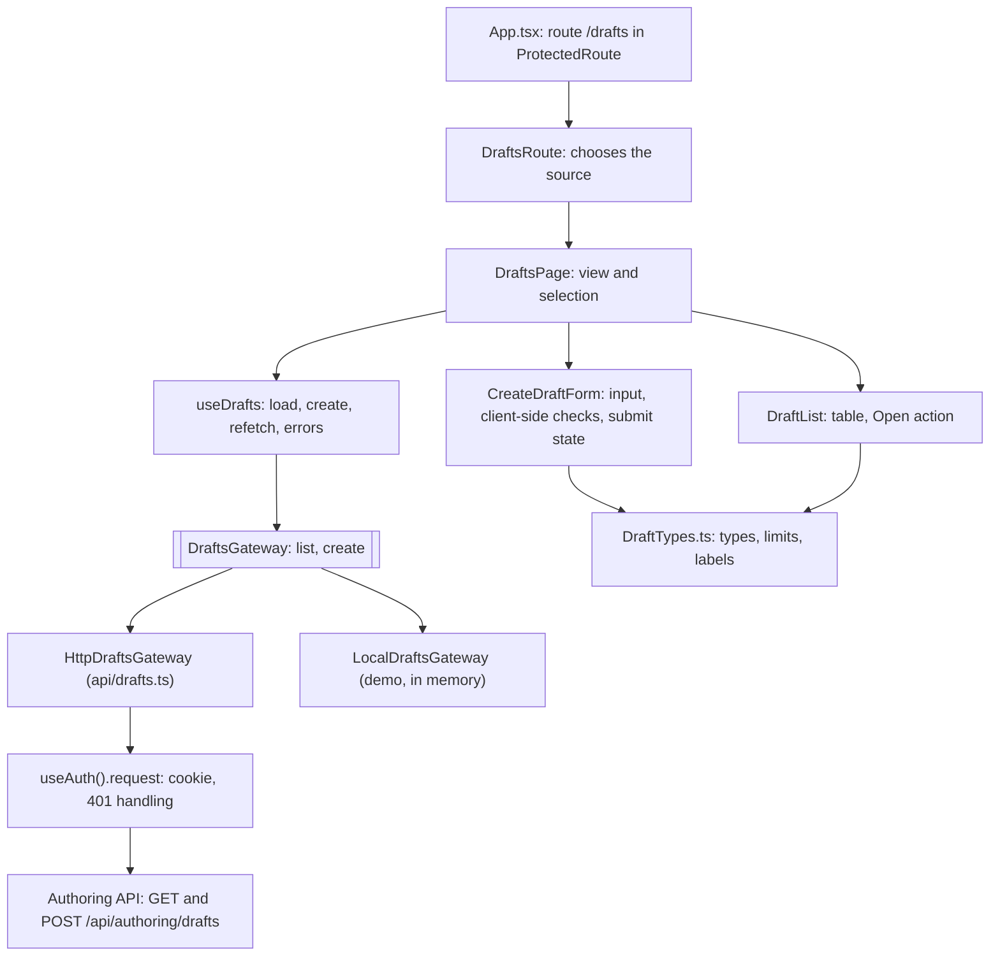
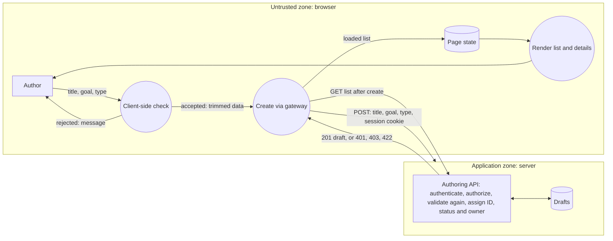

# Project component: AUT-01 frontend — draft list and draft creation form

**Team:** 11

**Student:** Nikola PR5/2023

**Specification requirements:** AUT-01 (create and edit drafts, frontend part), related: AUT-03 (input validation), AUT-04 (no evaluator key on the client), LAB-02 (metadata fields), SEC-03 (session and cookie handling), SEC-05 (safe text rendering), OPS-07 (accessible forms)

Backend side of the same component: [AUT-authoring](../AUT-authoring.md).

## Responsibilities and boundaries

- **Processes and user scenarios:**
  - A signed-in author opens the drafts page (`/drafts`), which shows a loading state, then the list of drafts or a message when there are none.
  - The author opens the creation form, enters a title (required, at most 120 characters), a goal (optional, at most 2000) and a laboratory type, and submits. While the request runs the button is disabled. On success the form closes and the list is loaded again from the source. On failure the message is shown and the entered values stay in the form.
  - The author opens a draft from the list and sees its title, goal and type.
  - Editing an existing draft is a separate screen and is not part of this document.
- **Contracts with other modules:**
  - `useAuth().request` (shared session request in `AuthContext`): sends the session cookie (`same-origin`) and signs the user out on `401`. All server calls of this component go through it.
  - `ProtectedRoute`: the `/drafts` route is mounted inside it. This is a convenience for the user, not a security control.
  - `DraftTypes.ts`: the only place for draft types, length limits, lab types and labels. The limits (120 and 2000) match `LabContent` in the authoring module ([AUT-authoring](../AUT-authoring.md)).
  - Authoring API (backend): the frontend expects `GET /api/authoring/drafts` returning `{ drafts: [...] }` and `POST /api/authoring/drafts` with `{ title, goal, type }` returning `201` and the draft. The shape of a draft follows `DraftResponse`. These two routes are described in `src/api/drafts.ts` and are the agreed integration point.
- **Implementation status:**
  - Implemented and tested: drafts page, creation form with client-side validation and asynchronous submit, draft list with readable labels, draft details, loading and error states with retry, data access layer with two interchangeable sources, protected route.
  - Source of data is one build-time switch (`VITE_DRAFTS_API`): **server** (`createHttpDraftsGateway`) or **demo** (`createLocalDraftsGateway`, in memory, clearly marked on the page). The default is demo.
  - See "Remaining limitations" for what depends on the backend.

## Component architecture

| Component | Input | Output |
| --- | --- | --- |
| `CreateDraftForm` | `submitting`, `error` | `onCreate(CreateDraftData)` returns `Promise<boolean>`; fields are cleared only on `true` |
| `DraftList` | `drafts: Draft[]` | `onOpen(draftId: string)` |
| `useDrafts(gateway)` | a `DraftsGateway` | `drafts`, `loadState`, `creating`, `createError`, `create`, `reload` |
| `DraftsGateway` | `create(data)`, `list()` | `Draft` / `Draft[]`, or `DraftsApiError` |

`DraftsPage` depends on the `DraftsGateway` interface only, so the page and its tests do not change when the source changes. `DraftsPage` keeps only the id of the selected draft and derives the draft from the list.

## Data flow diagram

Everything from the browser is untrusted. The client sends only the three fields chosen by the user. ID, status and owner are assigned by the server, and the response is reduced to the fields the screen shows (for example the owner id is not kept). In demo mode the same flow runs against in-memory state and nothing leaves the browser.

## Security requirements

- **Server-side access checks:**
  - None are made by this component, because the frontend is not a security boundary. It maps server decisions to messages: `401` signs the user out through the shared request, `403` shows that the user may not work with drafts, `400` and `422` show a validation message.
  - Server messages are never displayed. Only fixed local texts are shown, so a response cannot reveal internal details.
- **Input validation and sensitive data:**
  - Title is trimmed and required, at most 120 characters. Goal is trimmed, at most 2000. Type comes from a fixed list. These checks help the user and do not replace server validation (AUT-03).
  - The form uses `noValidate`, so the application's accessible error message is always shown instead of the browser's own.
  - The request body is built field by field (`title`, `goal`, `type`). ID, status and owner are never sent.
  - Responses are validated before use: unknown lab types or statuses, missing ids and wrong JSON are rejected as an unexpected response.
  - Text is rendered through React, never as HTML, so a title such as `<script>` is shown as plain text (SEC-05). The data model has no secrets or evaluator keys (AUT-04).
  - Accessibility (OPS-07): labelled fields, hint and error linked with `aria-describedby`, errors in `role="alert"`, busy state on the submit button, unique accessible name for every Open button.
- **Negative scenarios (covered by tests):**
  - Empty title and title with only spaces: nothing is sent and the error is shown.
  - `401`, `403`, `422` on create: the message is shown, the form stays open with the entered values, the list is not reloaded.
  - An unknown error shows a general message without technical details.
  - Double click: the button is disabled and only one request is sent.
  - List failure shows an error and a retry button, and retry loads the list.
  - Malformed list or draft (unknown type or status, missing id, non-JSON): rejected without using its content.
  - Aborted request is not shown as a server error.
  - Demo mode never claims that a draft was saved and sends no network request.

## Remaining limitations

- The authoring API on the current main exposes template list and copy-template routes. The list and create routes for drafts that this component expects are not exposed there yet. The server mode of the page depends on them. Until they exist, the default is the demo mode, and the server mode shows the load error with retry.
- Status names in `DraftTypes.ts` (`Draft`, `InReview`, `Published`, `Archived`) must match `DraftStatus` in the authoring module. A response with another name is rejected.
- Creating a draft sends a cookie-authenticated `POST`. When CSRF protection is added to the platform, the token must be sent by the shared request, which is the single place to change.
- Opening a draft shows the data returned by the list. There is no separate read request, pagination or editing in this component.
- Demo mode keeps drafts only in the memory of the open page, so they disappear on reload. The page says so.

## Evidence of work

- **Changed files / commit / pull request:** branch `feature/AUT-01-drafts-api`. Files: `frontend/src/api/drafts.ts`, `frontend/src/api/localDraftsGateway.ts`, `frontend/src/components/drafts/` (`useDrafts.ts`, `CreateDraftForm.tsx`, `DraftTypes.ts`), `frontend/src/pages/DraftsPage.tsx`, `frontend/src/pages/DraftsRoute.tsx`, the route in `frontend/src/App.tsx`, tests, `frontend/README.md`. Pull request: [add link].
- **Run instructions:** [AUT-01 frontend KT2 demonstration](AUT-01-frontend-KT2-DEMO.md) and `frontend/README.md`.
- **Tests and results:** 68 test cases for this component: data access layer 24, demo gateway 4, form 12, page 16, route and source selection 3, demo mode 4, list 5. The whole frontend run: 26 test files, 241 tests, all passed. `npm run build` passes. Date of the run: [add date].
- **Next steps:** connect the server mode to the real draft routes when the authoring API exposes them and confirm the status names; add a separate read and an edit flow; send the CSRF token once the platform requires it; remove the demo mode and its development-only route.
