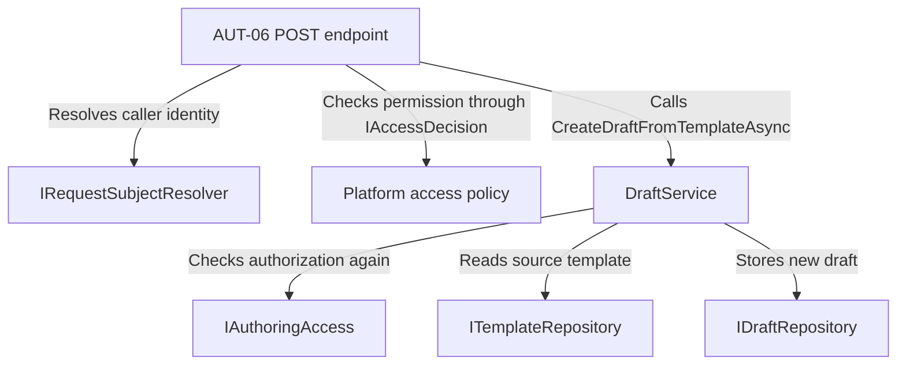
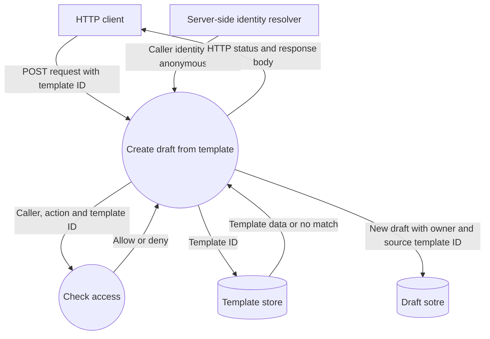

# AUT06 - Creating drafts from a template

`POST /api/authoring/templates/{templateId}/drafts` creates a draft from an existing template. The server resolves the caller's identity and checks access before reading the template. The new draft has its own ID and owner and retains the source template ID, title, goal and lab type. The open source template is unchanged.

## Component architecture

The endpoint handles the HTTP request and maps the result to a HTTP response. 
`DraftService` applies the Authoring rules and uses the repository interfaces to read the template and store the draft.

## Data flow diagram

AUT-06 endpoints use AuthoringSessionSubjectResolver to resolve the caller from the session validated by SessionCheckMiddleware. The resolver is registered under the AuthoringSession key and uses the existing SessionIdentityContext. The draft owner comes from the validated session.

| Status | Outcome |
|---|---|
| `201 Created` | The API stores and returns its data|
|`401 Unauthorized` | The request has no authenticated caller|
|`403 Forbidden` | The caller has no permission to create a draft from a template|
|`404 Not Found` | The authorized caller requested a template that doesn't exist|

The `401`, `403` and `404` paths end before a draft is stored

## HTTP verification

`AuthoringHttpTests.cs` contains five HTTP tests covering successful creation (201), an unknown template requested by an authorized assistant (404), student access denial (403), central authorization denial for an assistant (403), and draft ownership when the session user differs from `Identity:DevSubjectId`