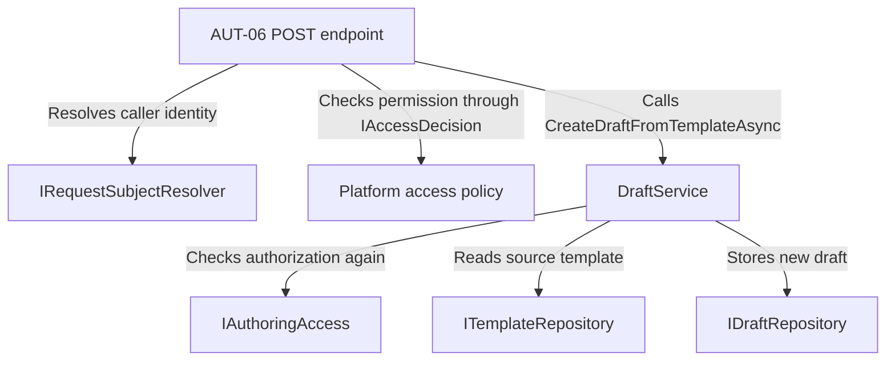
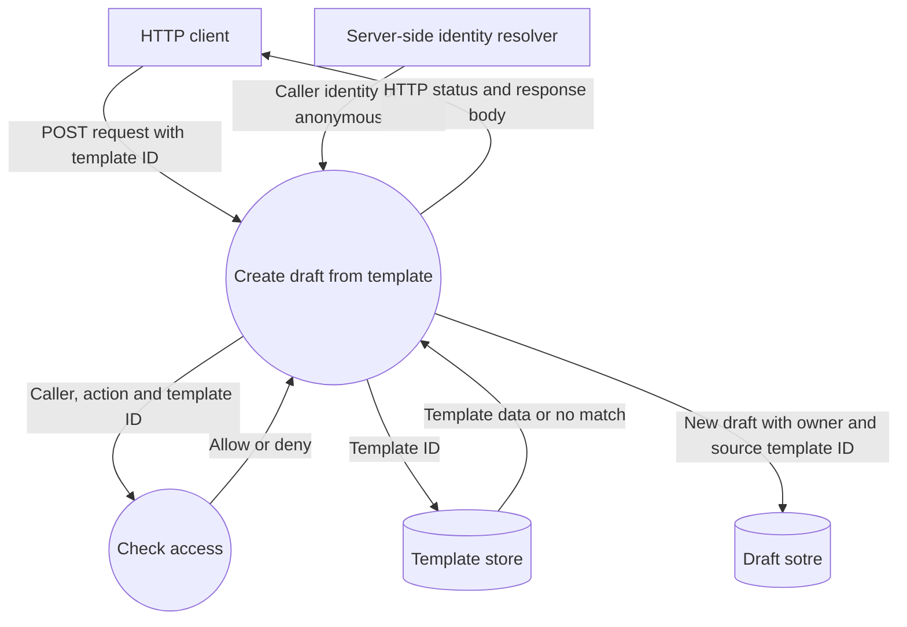

# AUT06 - Creating drafts from a template

`POST /api/authoring/templates/{templateId}/drafts` creates a draft from an existing template. The server resolves the caller's identity and checks access before reading the template. The new draft has its own ID and owner and retains the source template ID, title, goal and lab type. The open source template is unchanged.

## Component architecture

The endpoint handles the HTTP request and maps the result to a HTTP response. 
`DraftService` applies the Authoring rules and uses the repository interfaces to read the template and store the draft.

## Data flow diagram

In Development, `DevelopmentSubjectResolver` reads the caller ID from the server setting `Identity:DevSubjectId`. The HTTP tests set that value in their test host configuration.

| Status | Outcome |
|---|---|
| `201 Created` | The API stores and returns its data|
|`401 Unauthorized` | The request has no authenticated caller|
|`403 Forbidden` | The caller has no permission to create a draft from a template|
|`404 Not Found` | The authorized caller requested a template that doesn't exist|

The `401`, `403` and `404` paths end before a draft is stored

## HTTP verification

`AuthoringHttpTests.cs` covers: successful creation (`201`), an unknown template required by an authorized assistant(`404`) and
an existing template required by a student who has no permission to do so(`403`). Both negative tests verify that the draft store stays empty.