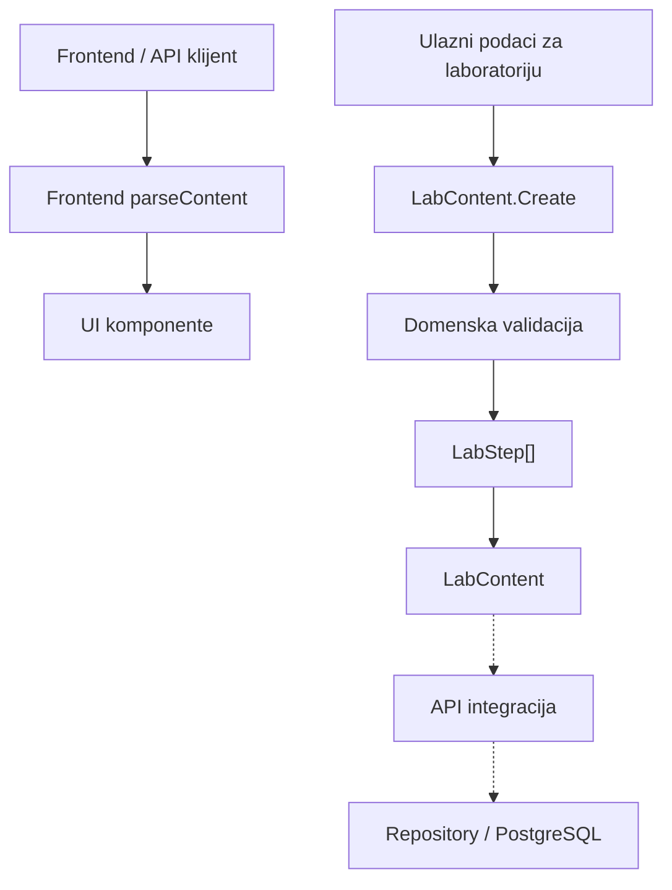

# AUT-02: Strukturisani koraci i uputstva laboratorije

**Tim:** 11

**Student:** Mihailo Rodic (student ID: PR 78/2023)

**Zahtevi:** AUT-02 (strukturisani koraci i uputstva);

**Grana:** `feature/AUT-02-lab-step`

## Odgovornosti i granice

Ovaj deo implementira strukturisane korake (`LabStep[]`) u domenskom modelu laboratorije, uz podršku za njihovu validaciju i obradu na frontend strani.
Trenutna implementacija obuhvata:
- LabStep kao domenski model pojedinaènog koraka laboratorije.
- LabContent kao model koji sadrži kolekciju strukturisanih koraka.
- Validaciju naziva, instrukcija i redosleda koraka.
- Proveru ispravnosti podataka prilikom kreiranja domenskih objekata.
- Prilagoðavanje frontend funkcije parseContent za èitanje polja steps.

Domenski model koristi fabrièke metode (Create) kako bi se validacija izvršila prilikom kreiranja objekata.

## Arhitektura komponente



Domenski model predstavlja granicu validacije sadržaja laboratorije. 
API i repository sloj treba da obezbede odgovarajuæe mapiranje i trajno èuvanje podataka kada integracija bude implementirana.

## DFD i granica poverenja

```mermaid
flowchart TD
    subgraph Client["Klijent - nepouzdana zona"]
        User["Korisnik / Preglednik"]
        Parser["Frontend parser"]
    end

    subgraph Domain["Serverski domen"]
        Factory["Fabrièke metode Create"]
        Validation["Validacija domenskih pravila"]
        Models["LabContent / LabStep[]"]s
    end

    subgraph Future["Planirana integracija"]
        API["API sloj"]
        Storage[("Baza podataka")]
    end

    User --> Parser
    Parser --> Factory
    Factory --> Validation
    Validation --> Models
    Models -.-> API
    API -.-> Storage
```

Prikazani API i skladišni sloj predstavljaju planiranu integraciju, a ne dokaz da su HTTP i database scenariji veæ implementirani.

## Bezbednosna pravila i validacija
Domenski sloj proverava: obavezna tekstualna polja, maksimalne dozvoljene dužine, dozvoljene kontrolne karaktere, 
validnost tipa laboratorije, ispravnost redosleda koraka i prisustvo validnih objekata koraka.

### Struktura koraka
- Koraci se predstavljaju nizom `LabStep[]` u domenskom modelu.
- Svaki korak mora imati pozitivan redni broj, validan naziv i instrukciju.
- Naziv koraka ne može biti duži od 120 karaktera, a instrukcija od 5000 karaktera.
- Redni brojevi moraju biti uzastopni i poèinjati od 1.
- Koraci se èuvaju u rastuæem redosledu prema SequenceOrder.
- Neispravni podaci odbacuju se kroz kontrolisani `DomainRuleException` sa odgovarajuæim kodom greške.

### Integritet i prikaz
- Domenski model proverava ispravnost podataka prilikom kreiranja laboratorijskog sadržaja.
- Instrukcije treba prikazivati kao bezbedan tekst, bez izvršavanja potencijalno malicioznog HTML-a ili JavaScript-a.
- Potrebno je obezbediti odgovarajuæi escaping ili sanitizaciju na mestu prikazivanja.
- Potpuna XSS zaštita na frontend i API granici još nije potvrðena testovima.
- Zaštita nepromenljivosti kolekcije Steps i metapodataka tokom izmena treba dodatno da se proveri.

## Negativni scenariji i testovi

Domenski testovi trenutno pokrivaju:
- Odbijanje praznih naziva i instrukcija;
- Odbijanje naziva i instrukcija koji sadrže samo praznine;
- Odbijanje naziva i instrukcija koji prelaze maksimalnu dozvoljenu dužinu;
- Odbijanje nultih i negativnih rednih brojeva;
- Odbijanje dupliranih i nedostajuæih rednih brojeva;
- Odbijanje kolekcije koja sadrži null element;
- Proveru pravilnog redosleda koraka nakon kreiranja.

API testovi za 400 Bad Request, XSS testovi i verifikacija èuvanja podataka preko Testcontainers-a nisu obuhvaæeni trenutno potvrðenim 
domenskim testovima i ostaju deo buduæe integracione provere.

## Dokazi rada

Izmenjeni i dodati fajlovi:
- `backend/Platform.Authoring/Domain/AuthoringErrors.cs`
- `backend/Platform.Authoring/Domain/LabContent.cs`
- `backend/Platform.Authoring/Domain/LabStep.cs`
- `backend/Platform.Authoring.Tests/Domain/LabContentStepTests.cs`
- `frontend/src/api/labs.ts`

Pokretanje testova:

- Backend (uz pokrenut Docker Desktop):
```powershell
dotnet test SecurityLab.slnx
```

- Frontend:
```powershell
npm test
```

Lokalna provera (Novembar 2026):
- Backend testovi: **1578 uspešnih, 0 neuspešnih**.
- Frontend testovi: **60 uspešnih kroz 8 test fajlova**.
- Build rešenja je potpuno stabilan i bez grešaka.

## Plan za KT2

Za KT2 je planirano:
- Dalja integracija API i persistence sloja.
- Proširenje integracionih testova, ukljuèujuæi proveru rada sa bazom.
- Pokrivanje dodatnih edge-case scenarija.
- Stroža validacija frontend odgovora.
- Verifikacija bezbednog prikazivanja korisnièkog sadržaja.