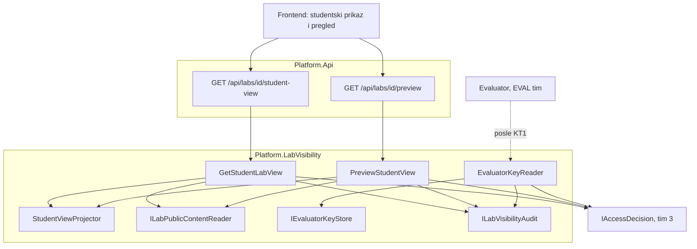
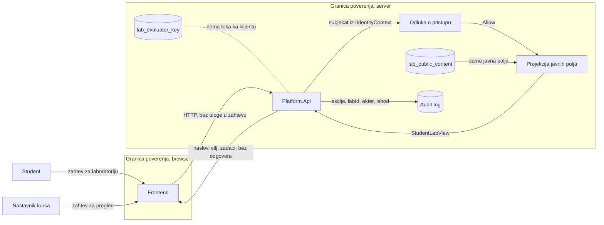

# AUT-04 i AUT-07 — šta student sme da vidi u laboratoriji

| Stavka | Vrednost |
|---|---|
| Tim | Tim 6 |
| Zahtevi | AUT-04 (J), AUT-07 (П); povezano: AUD-03, LAB-04 |
| Status | KT1: kostur, domen i pristup ključu su na `main`; baza, pregled i ekrani su u otvorenim PR-ovima; API za studentski prikaz je u izradi |
| Projekat | `backend/Platform.LabVisibility` |
| Studenti | PR 6/2023 Kovačević Dušan (koordinator)<br>PR 22/2023 Vladimir Gajić<br>PR 7/2023 Antonić Luka<br>PR 20/2023 Stojanović Uroš<br>PR 67/2023 Cvetojević Ninko<br>PR 73/2023 Danilo Ferjuc |

## Odgovornost i granice

- **AUT-04:** klijentu se nikada ne isporučuju tačni odgovori unapred. Javni sadržaj laboratorije i evaluator ključ su dva odvojena tipa i dve odvojene tabele.
- **AUT-07:** nastavnik kursa pre objave vidi tačno ono što bi student video, i ništa više. Pregled i studentski prikaz prave se istim projektorom, koji ključ nikad ne dobija.
- Modul ne pravi i ne menja nacrt laboratorije (to je AUT-01/AUT-06) i ne ocenjuje odgovore (to su EVAL zahtevi).

## Ugovori

| Ugovor | Šta radi | Pravilo |
|---|---|---|
| `ILabPublicContentReader` | čita javni sadržaj laboratorije po ID-ju | nikad ne vraća odgovore |
| `IEvaluatorKeyStore` | čita i čuva evaluator ključ | koristi ga samo `EvaluatorKeyReader`; kontroleri ga ne dobijaju |
| `ICourseMembership` | uloga korisnika na kursu (`None`, `Student`, `Teacher`) | razvojni stub dok ACC timovi ne objave ugovor |
| `ILabVisibilityAudit` | bezbednosni događaj za prikaz, pregled i čitanje ključa | događaj nema polje za sadržaj (AUD-03) |
| `LabVisibilityActions` | `lab.student.view`, `lab.preview`, `lab.key.read` | registrovane u katalogu tima 3; bez politike se odbijaju |

Autorizacija ide preko `IAccessDecision` (tim 3). Identitet dolazi iz `IIdentityContext`, nikad iz tela ili query stringa zahteva. Odbijen i nepostojeći resurs vraćaju isti `404`, a zahtev bez identiteta `401`.

## Dijagram arhitekture



Jedini put do ključa je `EvaluatorKeyReader`, i on nije povezan ni sa jednim kontrolerom.

## Dijagram toka podataka



## Lični delovi (KT1)

| Student | Deo | Grana | Dokument |
|---|---|---|---|
| Kovačević | kostur modula, pristup evaluator ključu, audit bez tajni | `feature/AUT-04-skeleton`, `feature/AUT-04-evaluator-key-access` | [evaluator-key-access.md](AUT-04-AUT-07/evaluator-key-access.md) |
| Gajić | domen i `StudentViewProjector` | `feature/AUT-04-domain-split` | [domain-split.md](AUT-04-AUT-07/domain-split.md) |
| Antonić | EF Core, migracija, odvojene tabele | `feature/AUT-04-persistence` | `persistence.md` (u PR-u) |
| Stojanović | API za studentski prikaz | `feature/AUT-04-student-view-api` | u izradi |
| Cvetojević | pregled pre objave (backend) | `feature/AUT-07-preview` | `preview.md` (u PR-u) |
| Ferjuc | ekrani za prikaz i pregled | `feature/AUT-07-frontend` | `frontend.md` (u PR-u) |

Svako dokumentuje svoj deo u `docs/components/AUT-04-AUT-07/` po [šablonu komponente](../templates/PROJECT_COMPONENT.md).

## Zavisnosti od drugih timova

| Tim / modul | Šta nam treba | Stanje |
|---|---|---|
| Tim 3, `Platform.Access` | `IAccessDecision`, katalog radnji (`ActionDefinition`) i registar politika | koristimo sa `main`; `lab.key.read` je registrovana kao radnja nad resursom `lab` |
| IDN timovi | `IIdentityContext` | koristimo sa `main` |
| AUT-01/AUT-06, `Platform.Authoring` | ID nacrta i javni sadržaj nacrta za pregled; tačni odgovori se ne čuvaju u nacrtu | dogovor u toku |
| ACC timovi | članstvo na kursu | do tada razvojni stub |
| AUD timovi, `Platform.Audit` | trajni audit | do tada naš `ILabVisibilityAudit` |

## Demonstracija

```bash
dotnet build backend/SecurityLab.slnx
dotnet test backend/Platform.Tests/Platform.Tests.csproj --filter "FullyQualifiedName~LabVisibility"
```

Očekivano: nepoznata laboratorija i nepoznata radnja se uvek odbijaju; evaluator ključ dobijaju samo evaluator i nastavnik kursa, a u logu nema teksta odgovora.
