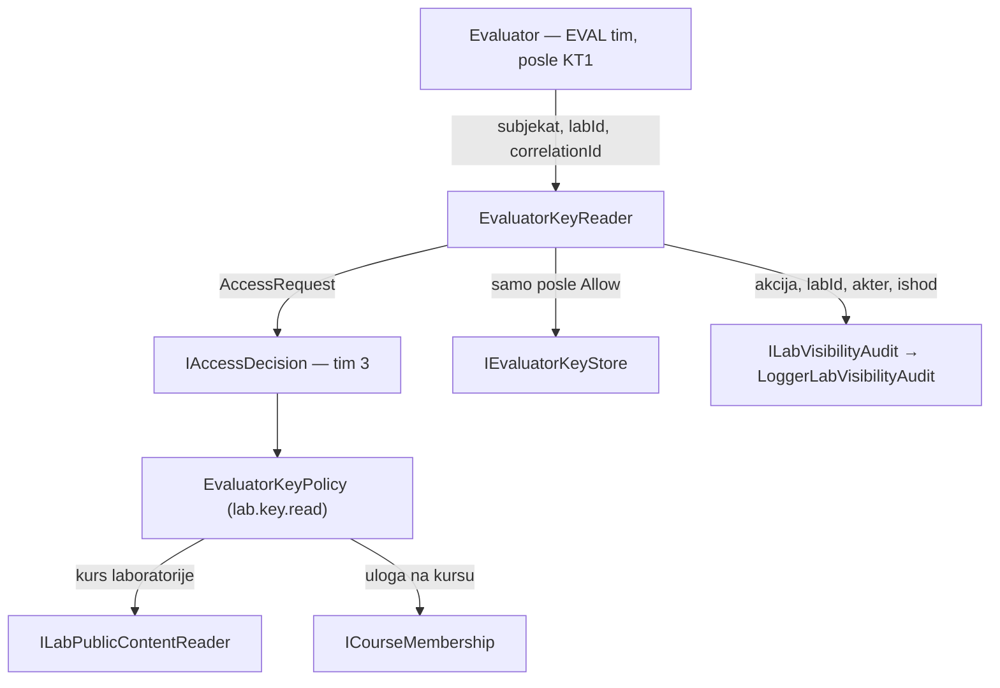
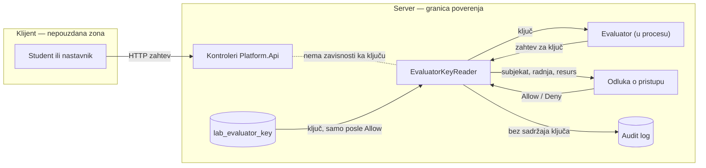

# AUT-04: Kostur modula i pristup evaluator ključu

**Tim:** 6

**Student:** Dušan Kovačević, PR 6/2023 (koordinator tima)

**Zahtevi:** AUT-04; povezano AUD-03

**Grane:** feature/AUT-04-skeleton (PR #44), feature/AUT-04-evaluator-key-access (PR #75)

**Revieweri:** Gajić (kostur), Antonić (pristup ključu)

## Odgovornosti i granice

Ovaj deo pravi okvir modula `Platform.LabVisibility` i jedini put do evaluator ključa.

- Kostur (PR #44): projekat modula, ugovori `ILabPublicContentReader`, `IEvaluatorKeyStore`, `ICourseMembership`, `ILabVisibilityAudit`, nazivi radnji `LabVisibilityActions`, registracija modula u `Program.cs` i InMemory implementacije za razvoj i testove.
- Pristup ključu (PR #75): politika `EvaluatorKeyPolicy` za radnju `lab.key.read`, servis `EvaluatorKeyReader` i audit `LoggerLabVisibilityAudit`.
- Ključ sme da čita samo servisni subjekat evaluatora (`system:evaluator`) i nastavnik kursa kome laboratorija pripada. Student nikad, ni kada je upisan na kurs.
- Ključ nema HTTP endpoint. Do njega se dolazi samo pozivom `EvaluatorKeyReader` unutar servera.

Domenski modeli, baza, studentski prikaz, pregled pre objave i ekrani pripadaju drugim članovima tima.

## Arhitektura komponente



`EvaluatorKeyReader` prvo traži odluku, a tek posle dozvole čita ključ. Svako čitanje, dozvoljeno ili odbijeno, ide u audit.

Politika je registrovana u registru tima 3 u `RegisterLabVisibilityAccess()`. Radnja `lab.key.read` je u katalogu označena kao radnja nad resursom `lab` u okviru kursa.

## DFD i granica poverenja



Ključ nikada ne prelazi granicu server–klijent. Nijedan kontroler ne prima `IEvaluatorKeyStore` ni `EvaluatorKeyReader`, što proverava arhitekturni test.

## Bezbednosni zahtevi

### Provere na serveru

- Odluku donosi `IAccessDecision` tima 3; bez identiteta, sa blokiranim nalogom ili bez politike zahtev se odbija.
- `EvaluatorKeyPolicy` dozvoljava evaluatoru i nastavniku kursa te laboratorije, a sve ostalo odbija: studenta, korisnika van kursa, nastavnika drugog kursa i nepoznatu laboratoriju.
- ID evaluatora nije GUID, a korisnički ID iz `IIdentityContext` uvek jeste, pa se korisnik ne može predstaviti kao evaluator.

### Osetljivi podaci

- `LabVisibilityAuditEvent` nema polje za sadržaj; zapisuju se samo radnja, laboratorija, akter, ishod i correlation ID (AUD-03).
- Odbijen zahtev vraća `null`, bez razloga odbijanja i bez informacije da li ključ postoji.

### Ograničenja

- Audit trenutno ide u aplikacioni log; prelazak na trajni audit AUD tima je plan za KT2.
- Članstvo na kursu je razvojni stub dok ACC timovi ne objave ugovor.

## Negativni scenariji i testovi

Fajl: `backend/Platform.Tests/LabVisibility/EvaluatorKeyAccessTests.cs` (10 testova)

- evaluator i nastavnik kursa dobijaju ključ;
- upisan student, korisnik van kursa, nastavnik drugog kursa, blokiran nalog i anoniman korisnik dobijaju odbijanje;
- odbijeno čitanje upisuje audit događaj sa ishodom `Deny`;
- dozvoljeno čitanje upisuje audit događaj, a uhvaćen log ne sadrži tekst odgovora;
- arhitekturni test: nijedan kontroler ne zavisi od `IEvaluatorKeyStore` ni `EvaluatorKeyReader`.

Fajl: `backend/Platform.Tests/LabVisibility/LabVisibilitySkeletonTests.cs` (6 testova)

- nepoznata laboratorija se odbija za sve tri radnje;
- nepoznata radnja `lab.answers.dump` se odbija kao `UnknownAction`;
- dupla registracija radnji pada pri pokretanju;
- korisnik bez članstva nema ulogu na kursu.

## Dokazi rada

- PR #44: `AUT-04: add Platform.LabVisibility skeleton and contracts`
- PR #75: `AUT-04: evaluator key access policy and audit without secrets`

Pokretanje testova ove komponente:

```powershell
dotnet test backend/Platform.Tests/Platform.Tests.csproj --configuration Release --filter "FullyQualifiedName~EvaluatorKeyAccessTests|FullyQualifiedName~LabVisibilitySkeletonTests"
```

Lokalna provera 7.11.2026 na `main`: 16 uspešnih, 0 neuspešnih, 0 preskočenih.

## Plan za KT2

Povezaću `EvaluatorKeyReader` sa evaluatorom EVAL tima, tako da ključ i dalje ostane samo na serveru.

Zameniću audit u logu trajnim auditom AUD tima i dodati test da ni tamo ne završava sadržaj ključa.

Zameniću razvojni stub članstva ugovorom ACC tima i proširiti negativne testove za promenu uloge na kursu.
