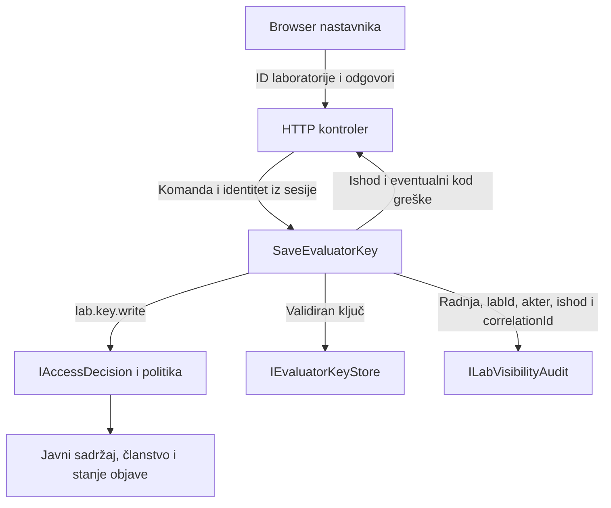

# AUT-04 — Upis evaluatorskog ključa za nacrt

Tim 6 · KT2-05 · Vladimir Gajić

## Arhitektura

`SaveEvaluatorKey` obrađuje zahtev za upis ključa. Identitet korisnika dobija iz serverskog konteksta. Pre obrade odgovora traži odluku `IAccessDecision` za radnju `lab.key.write` nad konkretnom laboratorijom.

`EvaluatorKeyWritePolicy` učitava laboratoriju i koristi njen `CourseId` da proveri članstvo. Upis je dozvoljen aktivnom nastavniku tog kursa kada i lokalni zapis i izvor objave pokazuju stanje `Draft`. Centralni servis pristupa proverava stanje naloga.

Ako je upis odbijen, samo nastavnik sa pravom pregleda može dobiti ishod `Published` za objavljenu ili arhiviranu laboratoriju. Student i nastavnik drugog kursa dobijaju `NotFound`. Zahtev bez identiteta dobija `Unauthenticated`.

## Tok podataka



Granica poverenja je između browsera i servera. Server određuje identitet, kurs i dozvolu. Posle uspešne validacije servis prosleđuje ključ skladištu. Rezultat operacije i audit događaj ne sadrže tekst odgovora.

## Validacija i čuvanje

Svaki zadatak mora imati tačno jedan odgovor. Nepoznat zadatak, duplikat, izostavljen odgovor, prazan tekst ili predugačak odgovor daju `Invalid` sa odgovarajućim kodom iz `SaveEvaluatorKeyErrors`. Implementacija prihvata najviše 4096 UTF-16 kodnih jedinica po odgovoru. Validacija se završava pre poziva `SaveAsync`, tako da neispravan zahtev čuva prethodni ključ.

## Pokretanje testova

Iz korena repozitorijuma, uz .NET 10 SDK:

```powershell
dotnet test .\backend\Platform.Tests\Platform.Tests.csproj --filter "FullyQualifiedName~LabVisibility"
```

Lokalni rezultat na grani `feature/AUT-04-evaluator-key-write` je 115 uspešnih, 0 neuspešnih i 0 preskočenih testova.

Za demonstraciju T11 pokrenuti samo:

```powershell
dotnet test .\backend\Platform.Tests\Platform.Tests.csproj --filter "FullyQualifiedName~SaveEvaluatorKey_AfterPublication_PreservesOriginalKey"
```

Test prvo čuva ključ A dok je laboratorija nacrt. Posle promene stanja na `Published`, nastavnik pokušava da sačuva ključ B. Očekivani ishod je `Published`, a ponovnim čitanjem skladišta proverava se da je ključ A očuvan.

## Pokrivenost i preostalo ograničenje

Testovi pokrivaju uspešan upis nastavnika kursa, odbijanje studenta i nastavnika drugog kursa, blokiran nalog, objavu i arhiviranje, pet grešaka validacije i audit svih pet ishoda. Audit test proverava događaj koji servis predaje interfejsu `ILabVisibilityAudit`.

T27 ostaje otvoren. Ako objava i upis teku istovremeno, trenutna provera stanja i zamena ključa nisu jedna atomska operacija. Za T27 je potrebna zajednička zaštita putanje objave i putanje upisa, uz test nad PostgreSQL-om.

[KT2 ugovor](../../contracts/LabVisibility-KT2.md) · [Model pretnji](threat-model.md)
