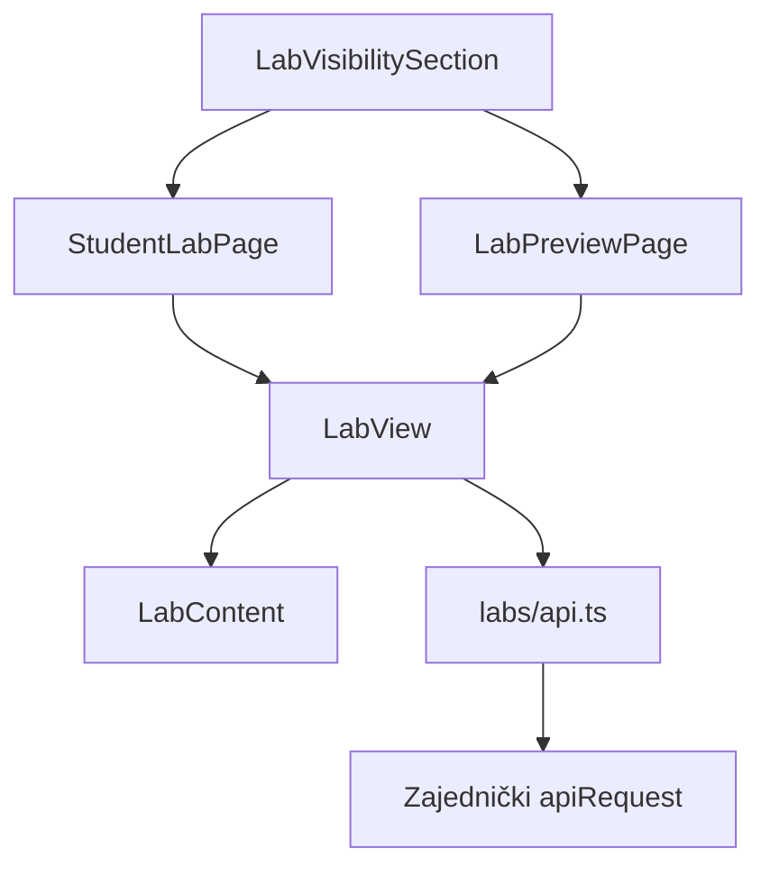
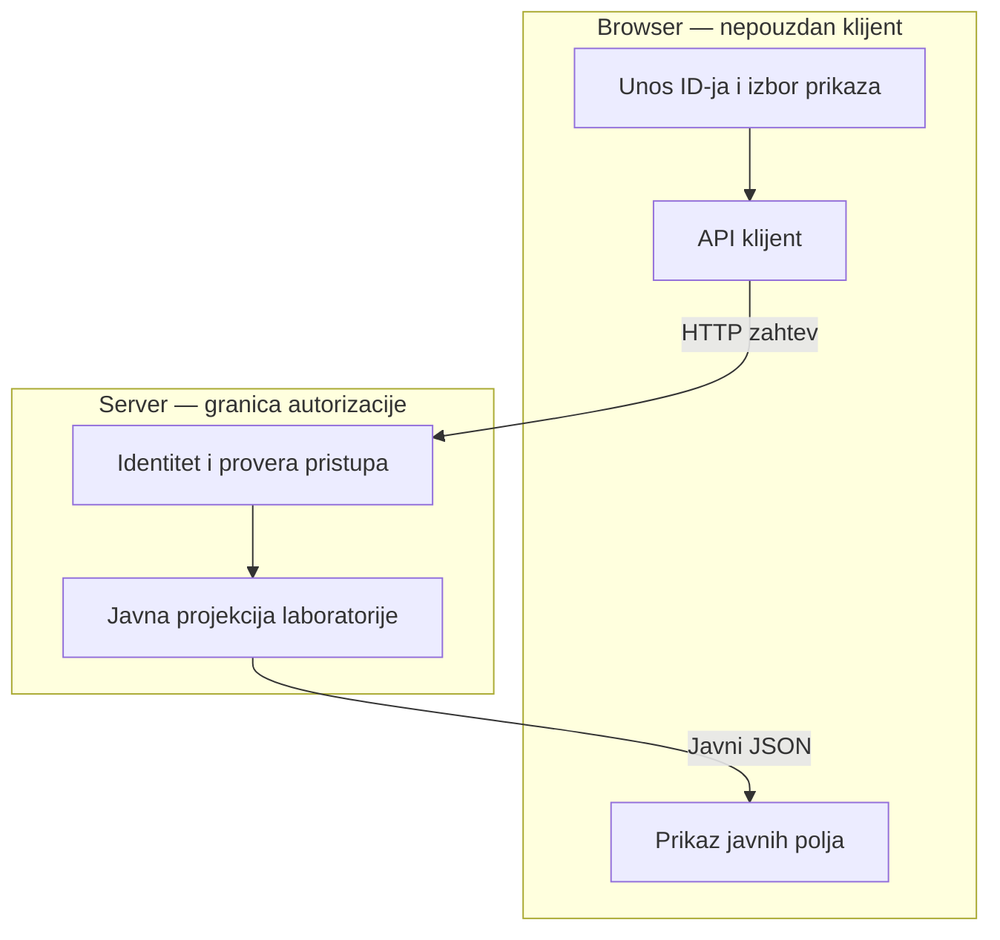

# AUT-07 — Studentski prikaz i pregled laboratorije

## Autor i obuhvat

Autor: Danilo Ferjuc
Grana: `feature/AUT-07-frontend`
Reviewer: Cvetojević

Implementacija obuhvata React ekrane, API klijent, razvojni izbor
korisnika, lokalni mock i frontend testove.

## Komponente i arhitektura

`LabVisibilitySection` omogućava unos ID-ja laboratorije i izbor prikaza.
U development režimu omogućava i izbor demo korisnika.

`StudentLabPage` učitava studentski prikaz.
`LabPreviewPage` učitava pregled pre objave i prikazuje traku
„Pregled kao student“.

Oba ekrana koriste `LabView` za učitavanje i obradu rezultata,
a `LabContent` za prikaz javnog sadržaja.

## API ugovori

| Namena | Metod i ruta | Očekivani odgovor |
| --- | --- | --- |
| Studentski prikaz | `GET /api/labs/{id}/student-view` | `StudentLabView` |
| Pregled pre objave | `GET /api/labs/{id}/preview` | `{ isPreview, state, view }` |

Frontend iz preview odgovora koristi `view`.
Javni tipovi obuhvataju naslov, cilj, zadatke, tekst pitanja i opcije.

Zajednički `apiRequest` šalje zahteve i obrađuje odgovore i greške.
Pri integraciji backend određuje identitet iz sesijskog kolačića.
Odgovori sa statusima 401, 403 i 404 u ovom modulu prikazuju istu
poruku „Laboratorija nije dostupna“.

## Tok podataka i granica poverenja

Server proverava identitet, članstvo na kursu, stanje laboratorije
i dozvolu za traženu radnju.

Frontend prikazuje konkretna javna polja. TypeScript tipovi sami
ne uklanjaju dodatna polja iz primljenog JSON-a.

`X-Stub-User` se dodaje samo kada je `import.meta.env.DEV`.
Razvojni birač korisnika takođe je dostupan samo u developmentu.

## Lokalni mock

Pokretanje iz foldera `frontend` koristi komandu `npm run dev:mock`.

Mock handler za ovaj modul nalazi se u `frontend/src/labs/mock.ts`.
Postojeći zajednički mock prosleđuje mu studentsku i preview rutu.

| Scenario | Demo ID |
| --- | --- |
| Objavljena laboratorija | `44444444-4444-4444-4444-444444444444` |
| Nacrt laboratorije | `55555555-5555-5555-5555-555555555555` |
| Nepostojeća laboratorija | `99999999-9999-9999-9999-999999999999` |

Mock simulira odgovore i pravila pristupa radi razvoja frontenda.
Rezultati zasebne probe sa stvarnim backendom navedeni su
u odeljku „Zavisnosti i integracija“.

## Provere i negativni testovi

`LabPages.test.tsx` za oba ekrana proverava prikaz javnog sadržaja
i izostavljanje dodatnog polja `expectedAnswer` i njegove vrednosti.
Takođe proverava isti renderovani rezultat za statuse 401, 403 i 404.

`api.test.ts` proverava slanje razvojnog identiteta u developmentu
i izostavljanje zaglavlja `X-Stub-User` u produkciji.

Nakon usklađivanja sa main granom, lokalno je prošlo svih 68 frontend testova komandom `npm test`.
TypeScript provera i produkcijski build uspešno prolaze komandom `npm run build`.

Ručno su u mock režimu provereni studentski prikaz objavljene
laboratorije, nastavnički pregled nacrta, odbijen pristup studenta
preview prikazu i prikaz nepostojeće laboratorije.

## Zavisnosti i integracija

Studentsku backend rutu implementira Stojanović (PR #153),
a preview rutu Cvetojević (PR #125).

Lokalna integraciona provera frontenda izvršena je 8.11.2026. na lokalnoj grani
`integration/AUT-07-demo`, koja uključuje frontend i Cvetojevićev
commit `6ac5e17`. Ta verzija sadrži i Stojanovićev studentski API.
Commitovi nespojenih studentske i preview backend grane nisu uključeni
u frontend granu namenjenu ovom PR-u.

Prošao je 71 odabrani backend test iz projekta Platform.Tests,
sa filterom `FullyQualifiedName~LabVisibility`.
Ovaj rezultat se odnosi na testove modula, ne na celu backend soluciju.

API je pokrenut uz lokalnu PostgreSQL bazu za identitet i sesije.
LabVisibility demo sadržaj u ovoj probi koristi InMemory skladište,
jer ConnectionStrings:LabVisibility nije podešen.

Kroz frontend, pokrenut komandom `npm run dev`, provereno je:

- prijava demo studenta preko stvarnog sistema prijave;
- prikaz objavljene laboratorije preko studentske API rute;
- odbijanje studentskog pristupa preview prikazu nacrta;
- isti prikaz poruke za odbijen pristup i nepostojeći ID.

Uspešan nastavnički pregled nacrta još nije potvrđen u ovoj probi.
Otkriveno je nepoklapanje demo podataka: nalog teacher@example.com
ima ID 4444…, dok je u demo članstvu kursa kao nastavnik upisan
ID 1111…. Prijavljeni nastavnik zato dobija odbijen pristup.
Potrebno je da se backend demo članstvo i povezani testni podaci
usklade, pa da se ovaj scenario ponovo proveri.

Razvojni birač korisnika određuje identitet u lokalnom mock režimu.
Pri radu sa stvarnim backendom identitet određuje prijavljena sesija;
promena tog birača ne menja prijavljeni nalog.

## Plan za KT2

Ponovićemo nastavnički preview nakon usklađivanja backend demo podataka
i proveriti oba ekrana nakon spajanja odgovarajućih PR-ova u main.

Uskladićemo razvojni birač sa načinom pokretanja, tako da bude jasno
kada se koristi mock identitet, a kada stvarna prijavljena sesija.

Proširićemo integracione provere na promenu prijavljenog korisnika,
odjavu i promenu dostupnosti laboratorije.