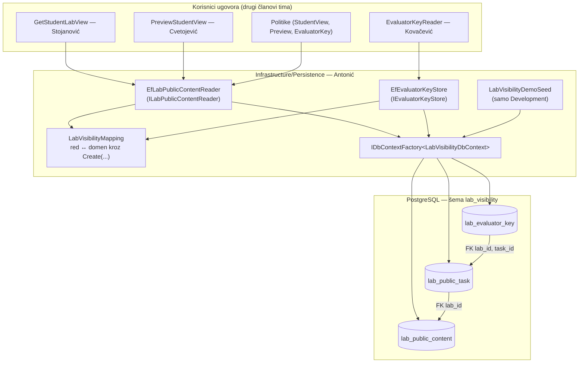
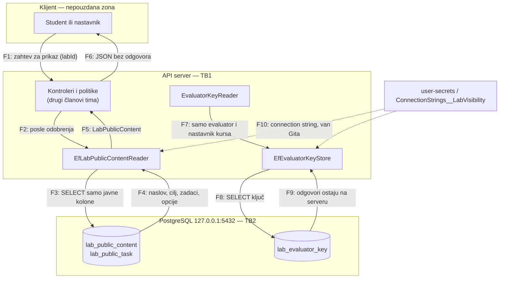

# AUT-04: Baza — odvojene tabele za javni sadržaj i evaluator ključ

**Tim:** 6

**Student:** Luka Antonić

**Zahtevi:** AUT-04; povezano AUD-03

**Grana:** feature/AUT-04-persistence

**Reviewer:** Kovačević

## Odgovornosti i granice

Ovaj deo čuva laboratorije u PostgreSQL-u tako da tačan odgovor fizički ne postoji u tabelama iz kojih se pravi studentski prikaz.

- `lab_public_content` i `lab_public_task` čuvaju samo ono što student sme da vidi: naslov, cilj, stanje, tekst zadatka i ponuđene opcije.
- `lab_evaluator_key` čuva tačne odgovore, u posebnoj tabeli. Strani ključ ide samo od ključa ka javnom zadatku; javne tabele nemaju ni kolonu ni navigaciju ka ključu.
- `EfLabPublicContentReader` implementira `ILabPublicContentReader` i čita samo dve javne tabele.
- `EfEvaluatorKeyStore` implementira `IEvaluatorKeyStore` i jedina je klasa koja čita `lab_evaluator_key`. Koristi ga samo `EvaluatorKeyReader` (kartica 5).
- Redovi iz baze prolaze kroz `LabPublicContent.Create` i `EvaluatorKey.Create`, pa podatak iz baze prolazi istu validaciju kao novi unos. Nepotpun ključ u bazi se odbija.
- Sa `ConnectionStrings:LabVisibility` modul koristi PostgreSQL; bez njega (CI, testovi, članovi tima bez Dockera) koristi InMemory implementacije iz kostura. Ugovori i potpis `AddLabVisibility()` se ne menjaju.

Ugovori `ILabPublicContentReader` i `IEvaluatorKeyStore` (Kovačević) i domenski tipovi (Gajić) su nepromenjeni. API, politike i frontend pripadaju drugim članovima tima.

**Status:** EF model, migracija `InitialLabVisibility`, EF reader i store, registracija, demo seed i testovi su implementirani i provereni lokalno sa PostgreSQL-om iz `docker-compose.yml`.

## Arhitektura komponente



Reader i store su singletoni jer ih koriste singleton politike i `EvaluatorKeyReader`. Zato ne drže jedan `DbContext`, nego za svaki poziv otvaraju nov iz `IDbContextFactory` (`DbContext` nije thread-safe).

Šema baze:

```
lab_public_content          lab_public_task                 lab_evaluator_key
──────────────────          ───────────────                 ─────────────────
lab_id   (PK)  ◄──────────  lab_id   (PK, FK)  ◄──────────  lab_id    (PK, FK)
course_id                   task_id  (PK)      ◄──────────  task_id   (PK, FK)
author_id                   task_order                      expected_answer
state                       prompt
title                       options (text[])
goal
```

## DFD i granica poverenja



| Granica | Tokovi | Pravilo |
|---|---|---|
| TB1: klijent → server | F1, F6 | Klijent dobija samo ono što vrati `ILabPublicContentReader`; taj tip nema polje za odgovor. |
| TB2: server → baza | F3, F4, F8, F9 | Tok javnog sadržaja (F3–F4) ne dodiruje `lab_evaluator_key`. Ključ čita samo `EfEvaluatorKeyStore` (F8–F9) i nikad ne prelazi TB1. |
| Tajne | F10 | Connection string dolazi iz user-secrets ili promenljive okruženja; `.env` je u `.gitignore`, `appsettings` nema lozinki. |

## Bezbednosni zahtevi

- **Odvajanje po konstrukciji:** odgovor ne postoji u javnim tabelama, pa ga nijedan upit nad njima ne može vratiti, čak ni sa `Include`.
- **Validacija podataka iz baze:** ručno pokvareni podaci (prazan naslov, dupli `task_id`, nepotpun ključ) bacaju grešku umesto da se tiho prikažu ili pogrešno ocene.
- **Bez odgovora u logu (AUD-03):** EF ne ispisuje vrednosti parametara (`@p2='?'`), jer je *sensitive data logging* isključen. `EvaluatorKeyRow.ToString()` vraća `[REDACTED]`. Poruka greške seed-a sadrži samo razlog greške baze.
- **Atomična izmena ključa:** `SaveAsync` briše stari i upisuje novi ključ u jednoj transakciji.
- **Baza samo lokalno:** `docker-compose.yml` vezuje port na `127.0.0.1`.
- **Migracije i seed samo u Development okruženju.**

## Negativni scenariji i testovi

Fajl: `backend/Platform.Tests/LabVisibility/LabVisibilityPersistenceTests.cs`

| Test | Šta dokazuje |
|---|---|
| `PublicTable_HasNoAnswerColumn` (2 slučaja) | `lab_public_content` i `lab_public_task` nemaju kolonu sa `answer`, `expected`, `solution` ili `correct` u imenu. |
| `AnswerColumn_ExistsOnlyInEvaluatorKeyTable` | `expected_answer` postoji u tačno jednoj tabeli. |
| `PublicRows_HaveNoNavigationToEvaluatorKey` | Javni redovi nemaju navigaciju ka ključu. |
| `PublicContentReaderContract_CannotCarryKey` | Iz `LabPublicContent` se ne stiže ni do jednog tipa ključa ni svojstva sa „Answer“/„Key“. |
| `EfReader_ReturnsPublicContent_WithoutAnswer` | Reader vraća laboratoriju, a u njenom JSON-u nema teksta odgovora koji jeste u bazi. |
| `EfKeyStore_ReadsAnswerFromSeparateTable` | Kontrola: odgovor zaista jeste u bazi i čita ga samo store; `ToString()` ga ne otkriva. |
| `EfKeyStore_RejectsIncompleteKeyFromDatabase` | Nepotpun ključ iz baze se odbija. |
| `EfReaderAndStore_UnknownLab_ReturnNull` | Nepoznata laboratorija vraća `null`. |
| `WithoutConnectionString_UsesInMemory` | Bez connection string-a modul radi kao pre (CI, kolege). |
| `WithConnectionString_UsesEf_AndSingletonsResolveWithScopeValidation` | EF reader i store su singletoni; `EvaluatorKeyReader` se pravi bez greške uz `ValidateScopes`. |

Testovi modela ne otvaraju vezu ka bazi, a testovi ponašanja koriste EF InMemory provider, pa rade bez Dockera i u CI-ju.

## Pokretanje

1. Lokalna baza (iz korena repozitorijuma):

   ```powershell
   copy .env.example .env          # pa u .env postaviti POSTGRES_PASSWORD
   docker-compose up -d db
   docker-compose ps               # STATUS: healthy
   ```

   PostgreSQL lozinku iz `.env` čita samo pri prvom pravljenju volume-a. Posle promene lozinke: `docker-compose down -v`, pa ponovo `up`.

2. Connection string za API, van Gita:

   ```powershell
   dotnet user-secrets set "ConnectionStrings:LabVisibility" 'Host=127.0.0.1;Port=5432;Database=securitylab;Username=securitylab_bootstrap;Password=<lozinka iz .env>' --project backend/Platform.Api
   ```

3. Migracije ručno (opciono, API ih u Development okruženju primenjuje sam pri pokretanju):

   ```powershell
   dotnet tool restore
   $env:ConnectionStrings__LabVisibility = 'Host=127.0.0.1;Port=5432;Database=securitylab;Username=securitylab_bootstrap;Password=<lozinka iz .env>'
   dotnet ef database update --project backend/Platform.LabVisibility --startup-project backend/Platform.LabVisibility
   ```

4. Pokretanje API-ja: `dotnet run --project backend/Platform.Api`. U logu se pojavljuje `LabVisibility: migracije primenjene, demo laboratorije upisane u PostgreSQL.`

5. Provera:

   ```powershell
   docker-compose exec db psql -U securitylab_bootstrap -d securitylab -c "\d lab_visibility.lab_public_task"
   docker-compose exec db psql -U securitylab_bootstrap -d securitylab -c "SELECT lab_id, state, title FROM lab_visibility.lab_public_content;"
   ```

Bez koraka 2 API radi sa InMemory skladištem i istim demo podacima.

**Demo podaci (izmišljeni):** kurs `aaaaaaaa-…`, nastavnik `1111…`; laboratorija `4444…` je objavljena („Analiza sumnjivih prijava“, 2 zadatka), a `5555…` je nacrt („Provera integriteta preuzetog fajla“, 1 zadatak). Isti ID-jevi se koriste u frontend mock-u.

**Ako `docker-compose up` javi `ports are not available ... 5432`:** port drži lokalno instaliran PostgreSQL servis; zaustaviti ga u `services.msc`.

## Dokazi rada

Dodati i izmenjeni fajlovi:

- `backend/Platform.LabVisibility/Infrastructure/Persistence/` — `LabVisibilityDbContext`, `LabVisibilityRows`, `LabVisibilityMapping`, `EfLabPublicContentReader`, `EfEvaluatorKeyStore`, `LabVisibilityDatabase`, `LabVisibilityDemoSeed`, `LabVisibilityDesignTimeDbContextFactory`, `Migrations/…_InitialLabVisibility`
- `backend/Platform.LabVisibility/Composition/LabVisibilityServiceCollectionExtensions.cs` — registracija EF/InMemory
- `backend/Platform.LabVisibility/Platform.LabVisibility.csproj` — `Npgsql.EntityFrameworkCore.PostgreSQL`, `Microsoft.EntityFrameworkCore.Design`
- `backend/Platform.Api/Program.cs` — jedna linija za demo seed u Development bloku
- `backend/Platform.Tests/LabVisibility/LabVisibilityPersistenceTests.cs`, `backend/Platform.Tests/Platform.Tests.csproj` (`Microsoft.EntityFrameworkCore.InMemory`)

Lokalna provera 6.11.2026:

- `dotnet test --filter FullyQualifiedName~LabVisibility`: svi testovi modula prolaze, uključujući 10 novih.
- Migracija primenjena na PostgreSQL 17 iz `docker-compose.yml`; `\d lab_visibility.lab_public_task` nema kolonu sa odgovorom.
- Demo seed upisuje 2 laboratorije, 3 zadatka i 3 odgovora; vrednosti parametara se ne pojavljuju u logu.

## Plan za KT2

Prebaciću članstvo na kursu i stanje laboratorije na ugovore ACC i AUT-01/AUT-06 timova, tako da se objavljeni nacrt upisuje kroz `IEvaluatorKeyStore`, a ne kroz demo seed.

Dodaću integracione testove nad pravim PostgreSQL-om (Testcontainers) za EF reader, store i transakciju u `SaveAsync`, i proveriću da `student-view` i `preview` endpointi rade nad bazom.

Razmotriću dve PostgreSQL uloge, po uzoru na runtime grant-ove AUD tima: javni reader bi se povezivao ulogom koja nema `SELECT` nad `lab_evaluator_key`, a samo `EfEvaluatorKeyStore` ulogom koja ga ima.
