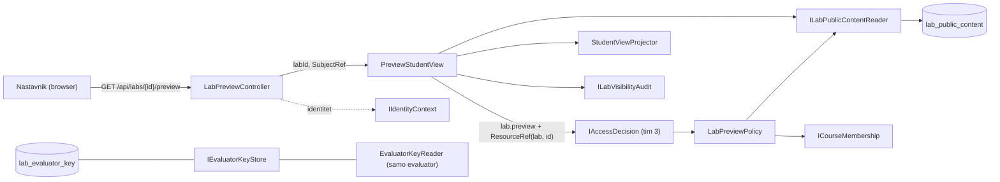
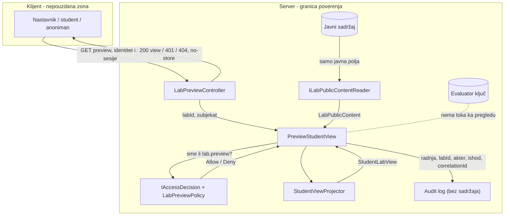

# AUT-07: Pregled studentskog prikaza pre objave (backend)

**Tim:** 6

**Student:** Ninko Cvetojević

**Zahtevi:** AUT-07; koristi zajednički projektor iz AUT-04

**Grana:** feature/AUT-07-preview

**Reviewer:** Gajić

## Odgovornosti i granice

Ovaj deo omogućava nastavniku kursa da otvori „Pregled kao student“ za laboratoriju, i kad je ona još nacrt, i da vidi tačno ono što bi student video posle objave, bez evaluator ključa.

- `GET /api/labs/{id}/preview` vraća `{ isPreview, state, view }`, gde je `view` tipa `StudentLabView`.
- `LabPreviewPolicy` (radnja `lab.preview`): pregled sme samo nastavnik kursa kome laboratorija pripada. Student nikad, ni kad je upisan na kurs.
- `PreviewStudentView`: odluka kroz `IAccessDecision` tima 3 → `ILabPublicContentReader` → `StudentViewProjector` → audit kroz `ILabVisibilityAudit`. Radi za svako stanje laboratorije, uključujući nacrt.
- `LabPreviewController`: prevodi ishod u HTTP kod i postavlja `Cache-Control: no-store`.
- `lab.preview` je u katalogu registrovan kao radnja nad resursom `lab` (kao `lab.key.read`).

Ugovori sa drugim delovima:

- `ILabPublicContentReader` (Antonić) i `StudentViewProjector` (Gajić) se koriste bez izmena.
- `ICourseMembership` je dev stub iz kostura (Kovačević) dok ACC timovi ne objave članstvo.
- Identitet dolazi iz `IIdentityContext` (tim za IDN). `CurrentSubject()` u kontroleru je privremen i zamenjuje se Stojanovićevim `LabCaller` helperom.
- Ruta je označena sa `[DelegatedAuthorization]` i upisana u `ApprovedDelegatedRoutes` (ACC-05), jer autorizaciju radi `PreviewStudentView` pre čitanja sadržaja. `[RequireAccess]` nije korišćen jer middleware odbijanje vraća kao 403, a AUT-07 traži isti 404 za zabranjeno i nepostojeće.

Frontend ekran „Pregled kao student“ pripada Ferjucu (feature/AUT-07-frontend).

## Arhitektura komponente



`PreviewStudentView` nema zavisnost od `IEvaluatorKeyStore`, `EvaluatorKeyReader` ni `EvaluatorKey`. Ključ zato ne može da uđe u odgovor pregleda, što proverava i test.

## DFD i granica poverenja



Sve odluke o pristupu donose se na serveru. Klijent šalje samo ID laboratorije; identitet se nikad ne čita iz tela zahteva. Evaluator ključ ne prelazi granicu server-klijent.

## Bezbednosni zahtevi

- Provera pristupa na serveru: `IAccessDecision` tima 3 proverava identitet, aktivan nalog i registrovanu radnju, a `LabPreviewPolicy` ulogu `Teacher` na kursu te laboratorije.
- Odbijeno i nepostojeće vraćaju isti `404` sa istim telom (`lab_not_available`), da se ne može pogađati koji ID postoji. Bez identiteta `401`.
- Odgovor sadrži samo polja `StudentLabView`; nema odgovora ni u JSON-u, ni u auditu (događaj nema polje za sadržaj, AUD-03).
- `Cache-Control: no-store` na svakom odgovoru, i na 401/404, da nacrt ne ostane u kešu browsera ili proxy-ja.
- Neispravan ID u ruti odbija rutiranje (`{id:guid}`).

## Negativni scenariji i testovi

Fajl: `backend/Platform.Tests/LabVisibility/LabPreviewHttpTests.cs` (ceo HTTP pipeline, `WebApplicationFactory<Program>`):

- nastavnik kursa 1111 → 200 na nacrt, `isPreview: true`, `state: "Draft"`;
- student 2222 (upisan), korisnik van kursa 3333 i nastavnik drugog kursa 4444 → 404;
- bez identiteta → 401;
- zabranjeno i nepostojeće daju isti status i isto telo;
- `Cache-Control: no-store` na 200, 404 i 401.

Fajl: `backend/Platform.Tests/LabVisibility/LabPreviewNegativeTests.cs` (za istu laboratoriju na serveru postoji ključ sa tajnim odgovorom):

- `view` iz pregleda nacrta je JSON-jednak studentskom prikazu istog sadržaja posle objave;
- odgovor ne sadrži tajni odgovor ni reč „answer“;
- `PreviewStudentView` u konstruktoru ne prima nijedan tip ključa.

U testovima je `IIdentityContext` zamenjen sa `StubIdentityContext` (`X-Stub-User`); ostatak pipeline-a je isti kao u aplikaciji.

## Dokazi rada

Izmenjeni i dodati fajlovi:

- `backend/Platform.LabVisibility/Infrastructure/Policies/LabPreviewPolicy.cs`
- `backend/Platform.LabVisibility/Application/Preview/PreviewStudentView.cs`
- `backend/Platform.LabVisibility/Composition/LabVisibilityServiceCollectionExtensions.cs`
- `backend/Platform.Api/Controllers/LabVisibility/LabPreviewController.cs`
- `backend/Platform.Access.Tests/ApiEndpointCoverageTests.cs`
- `backend/Platform.Tests/Platform.Tests.csproj` (`Microsoft.AspNetCore.Mvc.Testing`)
- `backend/Platform.Tests/LabVisibility/LabPreviewHostFactory.cs`
- `backend/Platform.Tests/LabVisibility/LabPreviewHttpTests.cs`
- `backend/Platform.Tests/LabVisibility/LabPreviewNegativeTests.cs`
- `docs/components/AUT-04-AUT-07/preview.md`

Pokretanje testova ove komponente:

```powershell
dotnet test backend/SecurityLab.slnx --filter "FullyQualifiedName~LabPreview"
```

Lokalna provera 7.11.2026:

- Testovi ove komponente: 12 uspešnih, 0 neuspešnih.
- `Platform.Tests` 84/84 i `Platform.Access.Tests` 335/335 (uključujući ACC-05 pokrivenost ruta).
- Ceo backend lokalno: padaju samo testovi koji padaju i na `main` (`CorrelationContextTests` 7, `ReviewAuthorizationTests` 1) i `Platform.LaboratoryPersistence.Tests` bez Dockera.

## Plan za KT2

Zameniću privremeni `CurrentSubject()` zajedničkim `LabCaller` helperom i proveriću pregled sa pravom sesijom kad IDN tim omogući identitet i na `/api/labs` rutama.
Kad ACC-05 middleware dobije subjekat iz sesije, preći ću sa `[DelegatedAuthorization]` na `[RequireAccess]` uz zadržavanje istog 404 za zabranjeno i nepostojeće.
Dodaću integracioni test pregleda nad EF repozitorijumom i PostgreSQL bazom (Antonić) i povezati endpoint sa Ferjucovim ekranom „Pregled kao student“.
