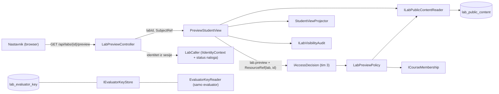
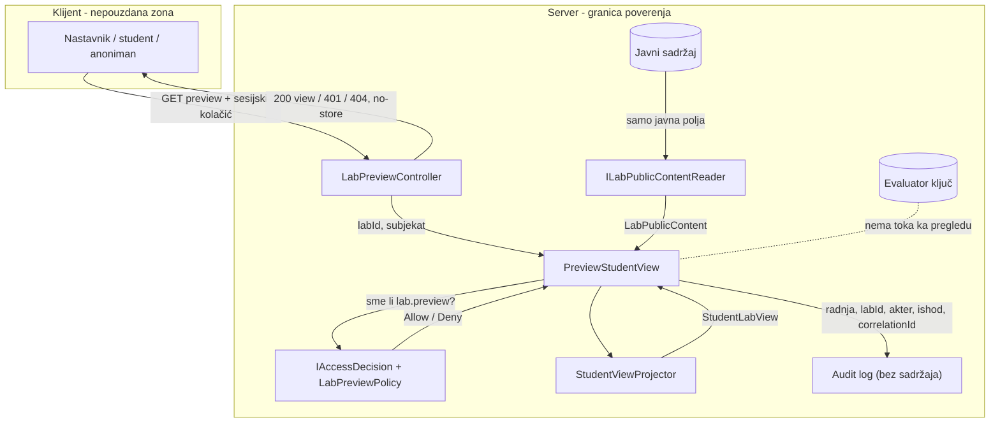
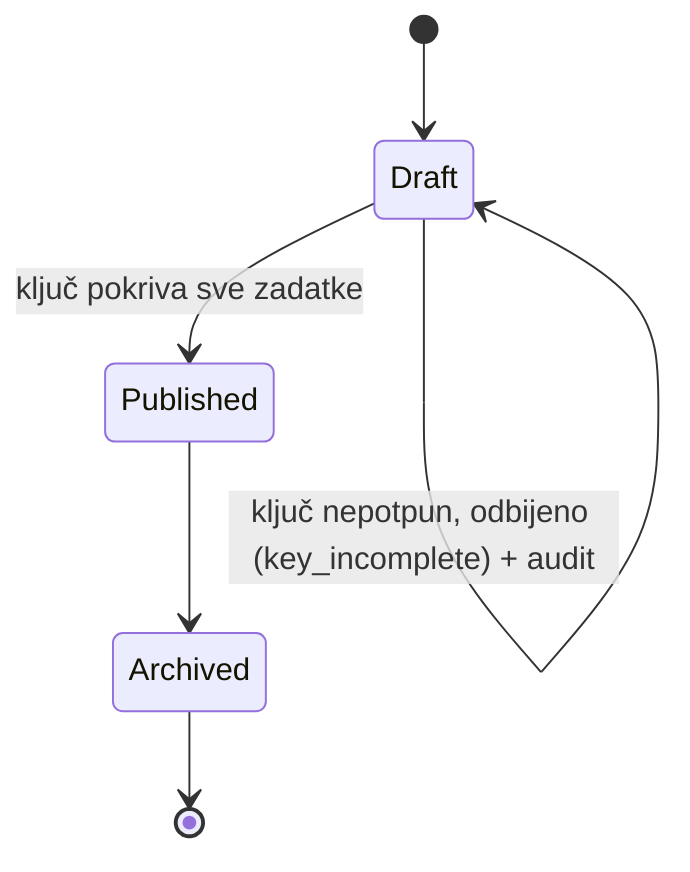

# AUT-07: Pregled studentskog prikaza pre objave (backend)

**Tim:** 6

**Student:** Ninko Cvetojević

**Zahtevi:** AUT-07; koristi zajednički projektor iz AUT-04

**Grana:** feature/AUT-07-preview (KT1), feature/AUT-07-publication-state (KT2)

**Reviewer:** Gajić

## Odgovornosti i granice

Ovaj deo omogućava nastavniku kursa da otvori „Pregled kao student“ za laboratoriju, i kad je ona još nacrt, i da vidi tačno ono što bi student video posle objave, bez evaluator ključa.

- `GET /api/labs/{id}/preview` vraća `{ isPreview, state, view }`, gde je `view` tipa `StudentLabView`.
- `LabPreviewPolicy` (radnja `lab.preview`): pregled sme samo nastavnik kursa kome laboratorija pripada. Student nikad, ni kad je upisan na kurs.
- `PreviewStudentView`: odluka kroz `IAccessDecision` tima 3 → `ILabPublicContentReader` → `StudentViewProjector` → audit kroz `ILabVisibilityAudit`. Radi za svako stanje laboratorije, uključujući nacrt.
- `LabPreviewController`: prevodi ishod u HTTP kod i postavlja `Cache-Control: no-store`.
- `lab.preview` je u katalogu registrovan kao radnja nad resursom `lab` (kao `lab.key.read`).

Ugovori sa drugim delovima:

- `ILabPublicContentReader` (Antonić) i `StudentViewProjector` (Gajić) se koriste bez izmena.
- `ICourseMembership` je dev stub iz kostura (Kovačević) dok ACC timovi ne objave članstvo.
- Identitet dolazi iz sesije preko zajedničkog `LabCaller.GetSubjectAsync()` (Stojanović, AUT-04): korisnik iz `IIdentityContext` i trenutni status naloga iz `IAccountStatusReader`. Isti helper koristi i studentski prikaz.
- `SessionCheckMiddleware`: `/api/labs/{id}/preview` traži pravu sesiju i u Developmentu, kao `/student-view`.
- Ruta ima `[RequireAccess(LabVisibilityActions.Entry)]` (strogi ACC-05): middleware tima 3 proverava samo da zahtev ima sesiju i aktivan nalog. Odluku o konkretnoj laboratoriji (`lab.preview`) donosi `PreviewStudentView`, pa zabranjeno i nepostojeće ostaju isti 404. (Na KT1 je ruta bila `[DelegatedAuthorization]`.)

Frontend ekran „Pregled kao student“ pripada Ferjucu (feature/AUT-07-frontend).

## Arhitektura komponente



`PreviewStudentView` nema zavisnost od `IEvaluatorKeyStore`, `EvaluatorKeyReader` ni `EvaluatorKey`. Ključ zato ne može da uđe u odgovor pregleda, što proverava i test.

## DFD i granica poverenja



Sve odluke o pristupu donose se na serveru. Klijent šalje samo ID laboratorije; identitet se nikad ne čita iz tela zahteva. Evaluator ključ ne prelazi granicu server-klijent.

## Bezbednosni zahtevi

- Provera pristupa na serveru: `IAccessDecision` tima 3 proverava identitet, aktivan nalog i registrovanu radnju, a `LabPreviewPolicy` ulogu `Teacher` na kursu te laboratorije.
- Odbijeno i nepostojeće vraćaju isti `404` sa istim telom (`lab_not_available`), da se ne može pogađati koji ID postoji. Bez identiteta `401`.
- Odgovor sadrži samo polja `StudentLabView`; nema odgovora ni u JSON-u, ni u auditu (događaj nema polje za sadržaj, AUD-03).
- `Cache-Control: no-store` na svakom odgovoru kontrolera (200, 401, 404), da nacrt ne ostane u kešu browsera ili proxy-ja. Zahtev bez važeće sesije odbija `SessionCheckMiddleware` praznim 401 pre kontrolera.
- Neispravan ID u ruti odbija rutiranje (`{id:guid}`).

## Negativni scenariji i testovi

Fajl: `backend/Platform.Tests/LabVisibility/LabPreviewHttpTests.cs` (ceo HTTP pipeline, `WebApplicationFactory<Program>`):

- nastavnik kursa 1111 → 200 na nacrt, `isPreview: true`, `state: "Draft"`;
- student 2222 (upisan), korisnik van kursa 3333 i nastavnik drugog kursa 4444 → 404;
- bez identiteta → 401;
- zabranjeno i nepostojeće daju isti status i isto telo;
- `Cache-Control: no-store` na 200 i 404.

Fajl: `backend/Platform.Tests/LabVisibility/LabPreviewNegativeTests.cs` (za istu laboratoriju na serveru postoji ključ sa tajnim odgovorom):

- `view` iz pregleda nacrta je JSON-jednak studentskom prikazu istog sadržaja posle objave;
- odgovor ne sadrži tajni odgovor ni reč „answer“;
- `PreviewStudentView` u konstruktoru ne prima nijedan tip ključa.

Testovi se prijavljuju sesijskim kolačićem (`SecurityLab.Session`), isto kao testovi studentskog prikaza. Zamenjeni su samo `ISessionManager`, `IAccountStatusReader` i skladište (uvek InMemory); `SessionCheckMiddleware`, `LabCaller`, ACC-05 middleware, katalog i politike su isti kao u aplikaciji.

## Dokazi rada

Izmenjeni i dodati fajlovi:

- `backend/Platform.LabVisibility/Infrastructure/Policies/LabPreviewPolicy.cs`
- `backend/Platform.LabVisibility/Application/Preview/PreviewStudentView.cs`
- `backend/Platform.LabVisibility/Composition/LabVisibilityServiceCollectionExtensions.cs`
- `backend/Platform.Api/Controllers/LabVisibility/LabPreviewController.cs`
- `backend/Platform.Api/Middleware/SessionCheckMiddleware.cs` (jedna linija za `/preview`)
- `backend/Platform.Access.Tests/ApiEndpointCoverageTests.cs`
- `backend/Platform.Tests/Platform.Tests.csproj` (`Microsoft.AspNetCore.Mvc.Testing`)
- `backend/Platform.Tests/LabVisibility/LabPreviewHostFactory.cs`
- `backend/Platform.Tests/LabVisibility/LabPreviewHttpTests.cs`
- `backend/Platform.Tests/LabVisibility/LabPreviewNegativeTests.cs`
- `docs/components/AUT-04-AUT-07/preview.md`

Pokretanje testova ove komponente:

```powershell
dotnet test backend/SecurityLab.slnx --filter "FullyQualifiedName~LabPreview"
```

Lokalna provera 7.11.2026:

- Testovi ove komponente: 12 uspešnih, 0 neuspešnih.
- `Platform.Tests` 84/84 i `Platform.Access.Tests` 335/335 (uključujući ACC-05 pokrivenost ruta).
- Ceo backend lokalno: padaju samo testovi koji padaju i na `main` (`CorrelationContextTests` 7, `ReviewAuthorizationTests` 1) i `Platform.LaboratoryPersistence.Tests` bez Dockera.

Provera 8.11.2026, posle spajanja sa `main` i granom studentskog prikaza (`feature/AUT-04-student-view-api`):

- LabVisibility, LabPreview, StudentLabView i ACC-05 testovi: 73 uspešna, 0 neuspešnih (oba endpointa zajedno).
- GitHub CI: zelen (3/3) posle sinhronizacije sa `main`.

## KT2: objava i arhiviranje (AUT-07-2)

Mi ne objavljujemo laboratoriju. Stanje javlja vlasnik objave (AUT-01/AUT-06, REV) kroz `ILabPublicationSource`, a `ApplyLabPublication` ga primenjuje na naš javni sadržaj. Od tog stanja zavisi da li student vidi laboratoriju. Ugovor i tabela svih ishoda su u `docs/contracts/LabVisibility-KT2.md`.



- **Objava samo uz potpun ključ.** `IEvaluatorKeyCoverage` vraća samo ID-jeve zadataka koji imaju odgovor, pa use case poredi dva skupa ID-jeva i nikad ne čita odgovore.
- **Uslovna promena stanja.** `ILabPublicationStateStore` menja stanje samo ako je ono i dalje ono koje smo pročitali (`UPDATE … WHERE state = očekivano`). Ako je neko u međuvremenu promenio stanje, vraća se `state_changed` i ništa se ne prepisuje (T27).
- **Nedozvoljeni prelazi** (arhivirana → objavljena, objavljena → nacrt, nacrt → arhivirana) se odbijaju kodom `invalid_transition` i idu u audit.
- **Audit** (`lab.publication.publish`, `lab.publication.archive`) nosi samo radnju, laboratoriju, aktera, ishod i `correlationId`.
- **Arhivirana laboratorija:** student dobija isti 404 kao za nepostojeću, nastavnik i dalje ima pregled.
- **Neaktivan nastavnik:** blokiran ili arhiviran nalog inače nema sesiju (401). Ako mu sesija još važi, `LabCaller` čita trenutni status naloga i pregled vraća 404 (T30).

Za sada `ApplyLabPublication` poziva samo test. Pravi poziv dolazi kad AUT-01/AUT-06 ili REV naprave adapter ili događaj o objavi.

### Negativni scenariji i testovi (KT2)

Fajl `backend/Platform.Tests/LabVisibility/ApplyLabPublicationTests.cs`:

- nacrt bez ključa → `Rejected` (`key_incomplete`), ostaje nacrt, pokušaj u auditu;
- ključ ne pokriva novi zadatak → odbijeno;
- nacrt sa potpunim ključem → objavljena, audit uspeha;
- objavljena → arhivirana, audit;
- arhivirana → objavljena, objavljena → nacrt, nacrt → arhivirana → odbijeno, stanje ostaje;
- laboratorija nepoznata vlasniku objave → ništa se ne menja; isto stanje → bez promene i bez audita;
- uslovna promena stanja ne radi kad stanje nije očekivano;
- rezultat i audit ne sadrže odgovor.

Fajl `backend/Platform.Tests/LabVisibility/LabPublicationFlowHttpTests.cs` (ceo HTTP pipeline): pregled nacrta → student dobija 404 → objava → studentski prikaz je JSON-jednak pregledu nacrta i nema odgovor → arhiviranje → student 404, nastavnik i dalje vidi pregled sa stanjem `Archived`.

Fajl `backend/Platform.Tests/LabVisibility/LabPreviewHttpTests.cs`: `InactiveCourseTeacher_WithStillValidSession_Gets404` (blokiran i arhiviran nastavnik kursa).

### Dokazi rada (KT2)

- `backend/Platform.LabVisibility/Application/Publication/ApplyLabPublication.cs`
- `backend/Platform.LabVisibility/Contracts/IEvaluatorKeyCoverage.cs`, `ILabPublicationStateStore.cs`
- `backend/Platform.LabVisibility/Infrastructure/Persistence/EfEvaluatorKeyCoverage.cs`, `EfLabPublicationStateStore.cs`, `InMemoryEvaluatorKeyStore.cs`, `InMemoryLabPublicContentReader.cs`
- `backend/Platform.LabVisibility/Composition/LabVisibilityServiceCollectionExtensions.cs`
- `backend/Platform.Tests/LabVisibility/ApplyLabPublicationTests.cs`, `LabPublicationFlowHttpTests.cs`, `LabPreviewHttpTests.cs`, `LabPreviewHostFactory.cs`
- `docs/contracts/LabVisibility-KT2.md`, `docs/components/AUT-04-AUT-07/threat-model.md` (T20–T23, T27, T30)

Pokretanje:

```powershell
dotnet test backend/SecurityLab.slnx --filter "FullyQualifiedName~LabVisibility|FullyQualifiedName~LabPreview|FullyQualifiedName~ApplyLabPublication|FullyQualifiedName~LabPublicationFlow"
```

Lokalna provera 28.11.2026: 108 uspešnih, 0 neuspešnih.

### Ostaje posle KT2

- Pravi adapter za `ILabPublicationSource` (AUT-01/AUT-06, REV) umesto stub-a.
- Integracioni test pregleda i `EfLabPublicationStateStore` nad PostgreSQL bazom (sa Antonićem).
- Povezivanje sa Ferjucovim ekranom „Pregled kao student“.
