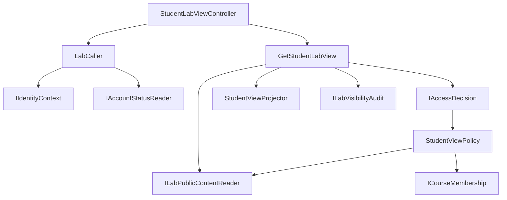
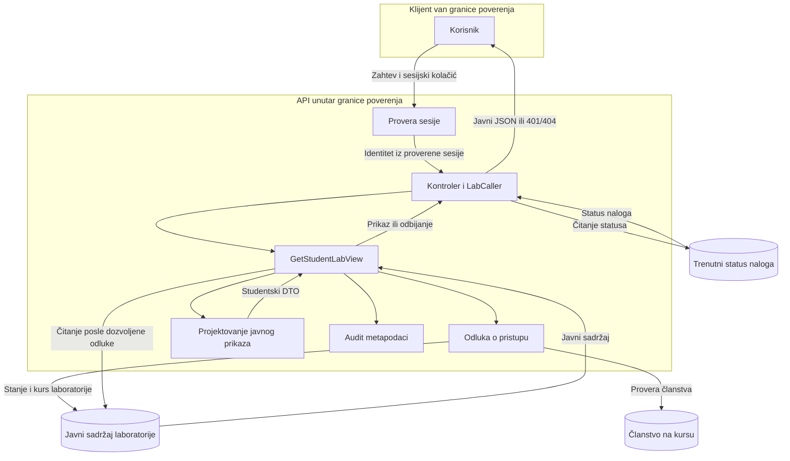

# Project component: AUT-04 — API za studentski prikaz

**Team:** 6

**Student:** Uroš Stojanović

**Specification requirements:** AUT-04, povezano sa AUD-03

**Branch:** feature/AUT-04-student-view-api

**Reviewer:** Ferjuc

## Responsibilities and boundaries

Komponenta izlaže GET /api/labs/{id}/student-view.

- LabCaller čita identitet preko API IIdentityContext ugovora i trenutno stanje naloga preko IAccountStatusReader.
- StudentViewPolicy proverava aktivan nalog, objavljenu laboratoriju i članstvo na njenom kursu. Prihvaćene uloge članstva su Student i Teacher.
- GetStudentLabView traži odluku od IAccessDecision, čita javni sadržaj, poziva StudentViewProjector i beleži ishod preko ILabVisibilityAudit.
- StudentLabViewController vraća 200 sa javnim prikazom, 401 bez identiteta i 404 za odbijen pristup ili nepostojeću laboratoriju.

Zajednički ugovori su IAccessDecision, ILabPublicContentReader,
ICourseMembership, ILabVisibilityAudit i IAccountStatusReader.

StudentViewProjector i javni domenski tipovi pripadaju domenskom delu
AUT-04. Implementacije reader-a i skladišta pripadaju persistence delu.

Studentski servis i kontroler ne zavise od IEvaluatorKeyStore.
Evaluator ključ se ne učitava u studentskom toku.

Implementacija je prilagođena Identity ugovorima nakon sinhronizacije
sa main granom. LabCaller koristi asinhronu metodu
GetSubjectAsync(CancellationToken).

## Component architecture



StudentViewPolicy dobija CourseId iz serverskog zapisa laboratorije.
Klijent u ruti šalje ID laboratorije, a identitet dolazi iz sesije.

Registracija javnog reader-a zadržava postojeći izbor PostgreSQL ili
InMemory implementacije, u zavisnosti od konfiguracije aplikacije.

## Data flow diagram



Sesijski token i ID iz rute su ulazi sa klijentske strane granice
poverenja. Identitet, status naloga, stanje laboratorije i članstvo
proveravaju se na serveru.

Audit događaj sadrži akciju, ID laboratorije, aktera, ishod i
identifikator zahteva. U tom događaju nema sadržaja zadataka
ni tačnih odgovora.

## Security requirements

### Server-side access checks

StudentViewPolicy zahteva aktivan nalog, objavljenu laboratoriju
i članstvo na njenom kursu.

LabCaller odbija odsutan ili nevažeći identitet. Nalog koji nije
pronađen mapira se na blokirano stanje. Status naloga čita se
sa servera pri zahtevu.

Kontroler ima DelegatedAuthorization. GetStudentLabView sprovodi
autorizaciju preko zajedničkog IAccessDecision pre vraćanja sadržaja.
Delegiranje omogućava zahtevani odgovor 404 za odbijen pristup,
dok zajednički Access middleware trenutno vraća 403.

Ruta je dodata u ApprovedDelegatedRoutes u testu pokrivenosti endpointa.
Ovu odluku i izmenu inventara treba izričito pregledati u PR-u.

Studentski endpoint prolazi proveru sesije i u Development okruženju.
Izuzetak za razvojne /api/labs rute sužen je tako da student-view
zahtevi zahtevaju sesiju, uključujući URL sa završnom kosom crtom.

### Input validation and sensitive data

- Ruta prihvata Guid identifikator laboratorije.
- Prazan identifikator korisnika odbija se u LabCaller helperu.
- Politika proverava identifikatore korisnika i laboratorije.
- CourseId se čita iz serverskog zapisa laboratorije.
- Studentski DTO nastaje preko postojećeg StudentViewProjector.
- JSON test proverava tačan spisak dozvoljenih polja laboratorije i zadatka.
- Studentski tok koristi samo javni reader.
- Audit događaj ne sadrži tekst zadataka ni tačne odgovore.

### Negative scenarios

Integracioni testovi proveravaju sledeće ishode u Testing i
Development okruženju.

| Scenario | Očekivani odgovor |
| --- | --- |
| Aktivan student na kursu, objavljena laboratorija | 200 i javni JSON |
| Korisnik van kursa | 404 |
| Student traži nacrt | 404 |
| Nepostojeća laboratorija | 404 |
| Zahtev bez sesije | 401 |
| Blokiran član kursa sa ranije izdatom testnom sesijom | 404 |
| Nevažeći sesijski token | 401 |
| Dozvoljen zahtev sa završnom kosom crtom u URL-u | 200 |

Test blokiranog naloga koristi testni sesijski servis koji vraća sesiju,
dok nezavisno čitanje trenutnog statusa vraća Blocked. Time se proverava
da postojeća sesija sama po sebi ne omogućava pristup blokiranom nalogu.

## Evidence of work

### Changed files

- backend/Platform.Api/Services/Identity/LabCaller.cs
- backend/Platform.Api/Controllers/LabVisibility/StudentLabViewController.cs
- backend/Platform.Api/Middleware/SessionCheckMiddleware.cs
- backend/Platform.Api/Program.cs
- backend/Platform.LabVisibility/Application/StudentView/GetStudentLabView.cs
- backend/Platform.LabVisibility/Infrastructure/Policies/StudentViewPolicy.cs
- backend/Platform.LabVisibility/Composition/LabVisibilityServiceCollectionExtensions.cs
- backend/Platform.Tests/LabVisibility/StudentLabViewTests.cs
- backend/Platform.Tests/LabVisibility/LabVisibilitySkeletonTests.cs
- backend/Platform.Tests/Platform.Tests.csproj
- backend/Platform.Access.Tests/ApiEndpointCoverageTests.cs
- docs/components/AUT-04-AUT-07/student-view-api.md

Kod je na grani feature/AUT-04-student-view-api.
Link na PR biće dodat nakon njegovog otvaranja.

### Run instructions

Iz korena repozitorijuma pokrenuti API.

```bash
dotnet run --project backend/Platform.Api/Platform.Api.csproj --urls http://localhost:5080
```

Za ručni poziv endpointa potrebni su važeća sesija, aktivan nalog,
objavljena laboratorija i odgovarajuće članstvo na kursu.

Poziv ima oblik GET /api/labs/{id}/student-view.
Identitet se dobija iz sesijskog kolačića SecurityLab.Session.
X-Stub-User se ne koristi za identitet ovog kontrolera.

Za testove cele solucije potrebno je pokrenuti Docker Desktop,
jer deo integracionih testova koristi Testcontainers.

### Tests and results

Studentski integracioni testovi koriste WebApplicationFactory<Program>
i izvršavaju se u Testing i Development okruženju.

Koriste stvarni HTTP pipeline, sesijski middleware,
SessionIdentityContext, LabCaller, kontroler, Access odluku,
StudentViewPolicy i projektor. Testne implementacije obezbeđuju
sesije i statuse naloga, a javni sadržaj i članstvo koriste
kontrolisane podatke u memoriji.

```bash
dotnet test backend/Platform.Tests/Platform.Tests.csproj --configuration Release --filter "FullyQualifiedName~StudentLabViewTests"
```

Rezultat je 16 uspešnih slučajeva, po osam u svakom okruženju,
bez neuspešnih i preskočenih testova.

Testovi studentskog JSON-a proveravaju javna polja laboratorije
i zadatka. Test sa završnom kosom crtom proverava da razvojni
izuzetak u middleware-u ne preskoči sesijski tok za taj URL.

Test pokrivenosti endpointa proveravan je sledećom komandom.

```bash
dotnet test backend/Platform.Access.Tests/Platform.Access.Tests.csproj --configuration Release --filter "FullyQualifiedName~ApiEndpointCoverageTests"
```

Oba testa pokrivenosti ruta prošla su nakon dodavanja studentske
rute u inventar.

Završna provera cele backend solucije pokrenuta je sledećom komandom.

```bash
dotnet test backend/SecurityLab.slnx --configuration Release
```

Rezultat je 1657 uspešnih, 0 neuspešnih i 29 preskočenih testova.
Build je prošao sa 2 upozorenja.

GitHub CI treba potvrditi nakon push-a.

### Dependencies and known limitations

- Ninkov PR #125 koristi privremeni CurrentSubject. Pri integraciji
  preview kontroler treba prebaciti na zajednički
  LabCaller.GetSubjectAsync(CancellationToken).
- Studentski API je testiran sa preuzetom main granom. Zajednički rad
  sa nespojenim preview kodom iz PR-a #125 još treba proveriti.
- Pri spajanju treba sačuvati registracije studentskog prikaza,
  preview-a i pristupa evaluator ključu.
- Članstvo na kursu koristi postojeći privremeni ICourseMembership ugovor.
- Studentski HTTP testovi koriste zamene za skladištenje sesija
  i statusa naloga. PostgreSQL implementacije tih ugovora nisu
  obuhvaćene ovim HTTP testovima.
- Access audit mapiranje u pregledanoj verziji nema poseban slučaj
  za PolicyDenied, pa se taj razlog u logu prikazuje kao policy_error.
- Delegirana autorizacija zahteva izričit review pre spajanja PR-a.
- Ručni demo sa pravom prijavom, bazom i frontend-om još treba potvrditi.

### Next steps — KT2

Uskladiti korišćenje zajedničkog LabCaller helpera sa preview komponentom
i proveriti oba endpointa nakon integracije.

Povezati članstvo sa konačnim ACC ugovorom i proveriti endpoint
sa stvarnim skladištima i frontend-om.

Proširiti provere na opozvanu sesiju i promene prava pristupa tokom rada.