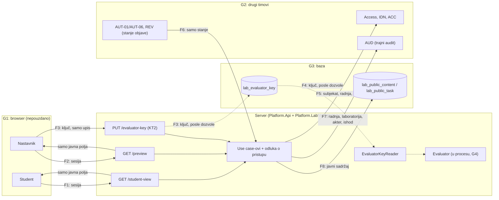

# Model pretnji: AUT-04 i AUT-07 (Tim 6)

**Vlasnik dokumenta:** Dušan Kovačević (kartica AUT-04-3). Svaki član tima dodaje i održava redove za svoj deo.
**Osnova procene:** `main` na commitu `868ce1f` (26.11.2026) i PR #226 (trajni audit). Redovi za ostale KT2 kartice su označeni kao „Plan KT2“ i ažuriraju se u PR-u te kartice.
**Stanja:** `Urađeno` (kod i test su na `main`), `U PR-u` (kod i test postoje, PR nije spojen), `Plan KT2` (kontrola je dogovorena, test se piše u ovom sprintu).
**Postupak:** kao na vežbi 4: imovina → tok i granica → scenario → bezbednosni zahtev → kontrola → test → dokaz, kroz četiri pitanja: Na čemu radimo? Šta može poći po zlu? Šta ćemo preduzeti? Da li je dovoljno?

## Cilj

AUT-04: klijent nikad ne dobija tačne odgovore laboratorije, ni kroz API, ni kroz grešku, log, audit ili keš.
AUT-07: nastavnik pre objave vidi tačno ono što će student videti, a niko drugi ne vidi nacrt.

## 1. Na čemu radimo?

### Imovina

Uticaj je ocena imovine na skali 1–5 i ne zavisi od pojedinačne pretnje.

| ID | Imovina | Vlasnik | Svojstvo koje štitimo | Uticaj | Životni ciklus |
|---|---|---|---|---|---|
| A1 | Evaluator ključ (tačni odgovori, tabela `lab_evaluator_key`) | nastavnik kursa (sadržaj), tim 6 (čuvanje i pristup) | poverljivost: čitaju ga samo evaluator i nastavnik kursa, samo na serveru; integritet: menja ga samo nastavnik kursa dok je nacrt | 5 | unos u nacrtu → čuvanje u odvojenoj tabeli → čitanje evaluatora → zamrznut posle objave → arhiva |
| A2 | Javni sadržaj laboratorije (naslov, cilj, zadaci, ponuđeni odgovori) | nastavnik kursa, AUT-01/AUT-06 (nacrt) | vidi ga samo upisan student kad je laboratorija objavljena | 2 | nacrt → pregled → objava → arhiva |
| A3 | Nacrt laboratorije | nastavnik kursa | vidi ga samo nastavnik kursa, kroz pregled; ranije otkrivanje daje studentu prednost | 3 | pravljenje kod AUT-01 → pregled → objava |
| A4 | Stanje objave (nacrt, objavljena, arhivirana) | AUT-01/AUT-06 i REV (vlasnik), tim 6 (primena) | integritet: menja se samo po stanju koje javlja vlasnik objave | 4 | `Draft` → `Published` → `Archived` |
| A5 | Audit zapisi (`lab.visibility.accessed`) | tim 12 (skladište), tim 6 (sadržaj zapisa) | poreklo i integritet: akter i vreme sa servera; poverljivost: bez odgovora i sadržaja | 3 | nastaje pri radnji → samo dodavanje → pregled za nastavnika (AUD-06) |
| A6 | Identitet i članstvo na kursu | IDN (sesija), ACC (članstvo) | dolaze iz serverske sesije i ACC modula, nikad iz zahteva | 4 | prijava → sesija → odjava ili opoziv; upis na kurs → uklanjanje |

### Tokovi podataka

| ID | Tok | Imovina | Prelazi granicu |
|---|---|---|---|
| F1 | Student → `GET /api/labs/{id}/student-view` → javna polja | A2, A6 | G1 |
| F2 | Nastavnik → `GET /api/labs/{id}/preview` → javna polja nacrta | A3, A6 | G1 |
| F3 | Nastavnik → `PUT /api/labs/{id}/evaluator-key` → `lab_evaluator_key` (KT2) | A1, A6 | G1, G3 |
| F4 | `lab_evaluator_key` → `EvaluatorKeyReader` → evaluator | A1 | G3, G4 |
| F5 | Use case → odluka o pristupu, sesija i članstvo (tim 3, IDN, ACC) | A6 | G2 |
| F6 | AUT-01/AUT-06 i REV → stanje objave | A4 | G2 |
| F7 | Use case → trajni audit (tim 12) | A5 | G2 |
| F8 | Use case → `lab_public_content` / `lab_public_task` | A2, A3 | G3 |

### Granice poverenja

Za svaku granicu: koja pretpostavka na njoj prestaje da važi i koja kontrola je zamenjuje.

| ID | Granica | Pretpostavka koja tu ne važi | Kontrola koja je zamenjuje |
|---|---|---|---|
| G1 | Browser → API | Da je zahtev poslao onaj za koga se predstavlja, da mu ID iz rute pripada i da telo sadrži samo ono što šalje naš ekran | Identitet samo iz serverske sesije; svaka radnja ide kroz odluku o pristupu nad konkretnom laboratorijom; odgovor sadrži samo javna polja; odbijeno i nepostojeće daju isti `404` |
| G2 | Naš modul → moduli drugih timova | Da je drugi modul uvek dostupan i da šalje samo ono što ugovor kaže | Ispad nikad ne znači dozvolu (odbijanje); ugovor objave nosi samo stanje; nepoznata laboratorija → `null`, ništa se ne menja; neuspeh audita ne menja odluku i diže alarm |
| G3 | Aplikacija → baza | Da svaki upit ide samo kroz ispravan kod i nikad ne spoji javne podatke sa ključem | Odvojene tabele bez veze između javnih redova i ključa; javni reader po tipu ne može da vrati ključ; KT2: test nad pravim SQL-om |
| G4 | Server → evaluator | Da ključ traži samo evaluator | Ključ izlazi samo kroz `EvaluatorKeyReader`, posle odluke o pristupu; ID evaluatora nije GUID, a korisnički ID iz sesije uvek jeste; ključ nema HTTP endpoint za čitanje |

Isprekidane linije su jedini putevi ključa. Nijedna ne ide ka browseru: odgovor na `student-view` i `preview` pravi `StudentViewProjector` od javnog sadržaja, a upis ključa vraća `204` bez tela.

## 2. Šta može poći po zlu? 3. Šta ćemo preduzeti?

Kolona „Zahtev“ je bezbednosni zahtev iz specifikacije koji kontrola ispunjava.

### AUT-04: odgovori nikad ne stižu do klijenta

| # | Tok | Imovina | Pretnja / zloupotreba | Zahtev | Kontrola | Automatski test | Dokaz | Stanje | Vlasnik |
|---|---|---|---|---|---|---|---|---|---|
| T1 | F1 | A1 | Student dobije tačne odgovore u JSON-u studentskog prikaza | AUT-04 | `StudentLabView` sadrži samo javna polja; projekcija iz `LabPublicContent`, koji nema ključ | `StudentView_Reflection_ContainsOnlyApprovedPublicProperties`, `StudentView_JsonContainsOnlyPublicData`, `EnrolledStudent_GetsOnlyPublicFields` | NUnit, CI | Urađeno | Gajić, Stojanović |
| T2 | F1, F2 | A1 | Programer greškom poveže kontroler sa skladištem ključa | AUT-04 | Arhitekturni test: nijedan kontroler ne zavisi od `IEvaluatorKeyStore` ni `EvaluatorKeyReader` | `NoController_DependsOnKeyStoreOrReader` | NUnit, CI | Urađeno | Kovačević |
| T3 | F8 | A1 | Upit za javni sadržaj pročita ili spoji tabelu ključa | AUT-04 | Odvojene tabele; javni redovi nemaju kolonu ni navigaciju ka ključu; `ILabPublicContentReader` ne može da nosi ključ | `PublicTable_HasNoAnswerColumn`, `PublicRows_HaveNoNavigationToEvaluatorKey`, `AnswerColumn_ExistsOnlyInEvaluatorKeyTable`, `PublicContentReaderContract_CannotCarryKey`, `EfReader_ReturnsPublicContent_WithoutAnswer` | NUnit, CI | Urađeno | Antonić |
| T4 | F8 | A1 | Isto kao T3, ali na pravom PostgreSQL-u (InMemory ne pokazuje stvarni SQL) | AUT-04 | Test hvata SQL javnog reader-a i proverava da ne pominje `lab_evaluator_key`; oba endpointa nad bazom | _upisuje Antonić_ | NUnit nad bazom u CI-ju | Plan KT2 (AUT-04-6) | Antonić |
| T5 | F4 | A1 | Student, nastavnik drugog kursa, korisnik van kursa, blokiran nastavnik ili anoniman korisnik čita ključ | AUT-04, ACC-05 | `EvaluatorKeyPolicy` (`lab.key.read`): samo evaluator i aktivan nastavnik kursa; odbijanje vraća `null` bez razloga | `EnrolledStudent_IsDenied`, `TeacherOfAnotherCourse_IsDenied`, `UserOutsideCourse_IsDenied`, `BlockedTeacher_IsDenied`, `Anonymous_IsDenied` | NUnit, CI | Urađeno | Kovačević |
| T6 | interno | A1 | Odgovor procuri kroz `ToString`, log ili poruku izuzetka | AUD-03 | `EvaluatorKey`, `SaveEvaluatorKeyCommand` i `EvaluatorKeyAnswerInput` ne ispisuju odgovore; log nosi samo radnju, laboratoriju, aktera i ishod | `ToString_DoesNotExposeAnswers`, `Command_ToString_NeverContainsAnswer`, `AllowedRead_IsAuditedWithoutAnswer` | NUnit, CI | Urađeno | Gajić, Kovačević |
| T7 | F7 | A1 | Odgovor završi u trajnom auditu drugog tima | AUD-03 | Zapis `lab.visibility.accessed` ima samo `action`, `laboratoryId` i `reasonCode`; AUD katalog odbija sve ostalo | `RecordedAudit_NeverContainsAnswer`, `Mapping_MatchesAuditCatalog` | NUnit; primer u `AuditDraftExamples` prolazi upis u PostgreSQL | U PR-u (#226) | Kovačević |
| T8 | F7 | A5 | Akter u auditu je lažiran ili pogrešno pripisan | AUD-01 | Akter je subjekat iz sesije: `User`, `Service` (evaluator) ili `Anonymous`; nikad ID iz zahteva | `TeacherReadsKey_RecordsSuccessWithUserActor`, `EvaluatorReadsKey_IsRecordedAsServiceActor`, `AnonymousReadsKey_IsRecordedWithAnonymousActor` | NUnit | U PR-u (#226) | Kovačević |
| T9 | F7 | A5 | Zapis se tiho izgubi ili ispad AUD modula promeni odluku | AUD-01 | Odluka se ne menja (odbijanje ostaje odbijanje), diže se alarm `LabVisibilityAuditLost` bez sadržaja | `AuditUnavailable_KeepsDecisionAndRaisesAlarmWithoutAnswer`, `StudentReadsKey_IsDeniedAndRecordedAsDenied` | NUnit | U PR-u (#226) | Kovačević |
| T10 | F3 | A1 | Student ili nastavnik drugog kursa upiše ključ i tako menja ocene | AUT-04, ACC-05 | `lab.key.write`: politika je registrovana i do pravila za upis odbija sve; posle AUT-04-4 samo nastavnik kursa, samo dok je nacrt | `EnrolledStudent_IsDeniedKeyWrite`, `SaveEvaluatorKey_IsResolvable_AndDeniesStudent`; _HTTP test upisuje Stojanović_ | NUnit, CI | Delimično (ugovor urađen), Plan KT2 (AUT-04-4, AUT-04-5) | Gajić, Stojanović |
| T11 | F3 | A1 | Ključ se promeni posle objave, pa se već predati radovi ocenjuju drugačije | AUT-04 | Upis ključa za objavljenu ili arhiviranu laboratoriju vraća `Published` → `409` | _upisuju Gajić i Stojanović_ | NUnit, HTTP test | Plan KT2 (AUT-04-4, AUT-04-5) | Gajić, Stojanović |
| T12 | F3 | A1 | Neispravan ključ prođe, ili poruka o grešci vrati poslat odgovor | AUT-04 | Validacija u domenu (nepoznat zadatak, duplikat, nedostaje odgovor); greška nosi samo kod iz `SaveEvaluatorKeyErrors` | `CreateKey_UnknownTaskId_IsRejected`, `CreateKey_DuplicateAnswer_IsRejected`, `CreateKey_IncompleteKey_IsRejected`; _test „400 bez odgovora u telu“ upisuje Stojanović_ | NUnit | Delimično, Plan KT2 (AUT-04-4, AUT-04-5) | Gajić, Stojanović |
| T13 | F3 | A1 | Odgovor na upis vrati ključ ili ga browser ili proxy sačuva u kešu | AUT-04 | `PUT /evaluator-key` vraća `204` bez tela; `Cache-Control: no-store` | _upisuje Stojanović_ | HTTP test | Plan KT2 (AUT-04-5) | Stojanović |
| T14 | F1 | A2 | Napadač razlikuje „zabranjeno“ od „ne postoji“ i tako nabraja laboratorije | AUT-04 | Isti `404` i isto telo za odbijen i nepostojeći zahtev, na API-ju i na ekranu | `Forbidden_And_Missing_LookTheSame`, `EnrolledStudent_RequestingMissingLab_GetsNotFound`, `UserOutsideCourse_GetsNotFound`; Vitest „jednako prikazuje odbijen pristup i nepostojeću laboratoriju“ | NUnit, Vitest | Urađeno | Stojanović, Cvetojević, Ferjuc |
| T15 | F1, F2 | A6 | Klijent pošalje lažan identitet (zaglavlje, razvojni nalog u produkciji) | IDN, ACC-05 | Ulazna radnja je vezana za sesiju; razvojni identitet postoji samo u Development režimu | `EntryAction_IsSessionBound_AndLabActionsUseRealPolicies`, `InvalidSession_GetsUnauthorized`, `RequestWithoutIdentity_GetsUnauthorized`; Vitest „izostavlja razvojni identitet u produkciji“ | NUnit, Vitest | Urađeno | Stojanović, Ferjuc |
| T16 | F5 | A6 | Razvojni stub članstva radi i van testova, pa uloge nisu prave; opozvana sesija ili uklonjen član i dalje vidi laboratoriju | ACC-05 | `AccCourseMembership` preko `Platform.Access.IMembershipReader`; prikaz i pregled kroz `SessionIdentityContext` | _upisuje Stojanović (opozvana sesija → 401, uklonjen sa kursa → 404)_ | NUnit, HTTP test | Plan KT2 (AUT-04-5) | Stojanović |
| T17 | F5 | A1 | Nepoznata laboratorija ili neregistrovana radnja dobije podrazumevanu dozvolu | ACC-05 | Podrazumevano odbijanje kod tima 3; dupla registracija radnje ruši pokretanje | `UnknownLab_IsDeniedForEveryAction`, `UnregisteredLabAction_IsDeniedAsUnknown`, `RegisteringTwice_FailsAtStartup` | NUnit, CI | Urađeno | Kovačević |
| T27 | F3, F6 | A1 | Trka: nastavnik upisuje ključ u istom trenutku kad se laboratorija objavljuje, pa se ključ promeni posle objave | AUT-04 | Provera stanja i upis ključa u istoj transakciji, uz proveru verzije reda stanja; objava čita ključ u istoj transakciji | _upisuju Gajić i Cvetojević (istovremena objava i upis: posle objave ključ je onaj koji je objava videla)_ | NUnit nad bazom | Plan KT2 (AUT-04-4, AUT-07-2) | Gajić, Cvetojević |
| T28 | F5 | A1, A3 | Ispad Access, IDN ili ACC modula (izuzetak, timeout) se pretvori u dozvolu | ACC-05 | Svaki izuzetak u odluci ili čitanju članstva daje odbijanje (`404` ili `null`), bez delimičnog odgovora | _upisuje Stojanović (ispad članstva → odbijanje za studentski prikaz, pregled i ključ)_ | NUnit | Plan KT2 (AUT-04-5) | Stojanović |
| T29 | F4 | A1 | Korisnik se predstavi kao evaluator i dobije ključ | AUT-04 | Politika priznaje samo tačan ID `system:evaluator`; korisnički ID iz sesije je uvek GUID i ne može da bude jednak njemu | `EvaluatorIdVariant_IsDenied`, `BlockedEvaluator_IsDenied`, `EvaluatorId_IsNeverAValidUserId` | NUnit, CI | Urađeno | Kovačević |

### AUT-07: pregled pre objave

| # | Tok | Imovina | Pretnja / zloupotreba | Zahtev | Kontrola | Automatski test | Dokaz | Stanje | Vlasnik |
|---|---|---|---|---|---|---|---|---|---|
| T18 | F2 | A3 | Student ili nastavnik drugog kursa otvori pregled nacrta | AUT-07 | `lab.preview`: samo nastavnik kursa; student za nacrt dobija `404` | `NotCourseTeacher_Gets404`, `EnrolledStudent_RequestingDraft_GetsNotFound`, `WithoutIdentity_Gets401` | NUnit, HTTP test | Urađeno | Cvetojević |
| T19 | F2 | A1 | Pregled pokaže odgovore, jer nastavnik „sme da ih vidi“ | AUT-04, AUT-07 | Pregled koristi isti `StudentViewProjector` kao student i ne zavisi od ključa | `PreviewJson_ContainsNoAnswer`, `PreviewStudentView_DoesNotDependOnEvaluatorKey` | NUnit | Urađeno | Cvetojević |
| T20 | F2 | A3 | Pregled se razlikuje od onoga što student zaista dobije, pa nastavnik objavi pogrešno | AUT-07 | Isti projektor za pregled i studentski prikaz; test jednakosti posle objave | `PreviewView_EqualsStudentViewOfSameContentAfterPublish`; _test kroz tok objave nad istim seed-om upisuje Cvetojević_ | NUnit | Urađeno; proširenje Plan KT2 (AUT-07-2) | Cvetojević |
| T21 | F6 | A4 | Objavi se laboratorija bez potpunog ključa | AUT-07 | `ApplyLabPublication`: nacrt → objavljena samo ako ključ pokriva sve zadatke; pokušaj ide u audit | _upisuje Cvetojević_ | NUnit | Plan KT2 (AUT-07-2) | Cvetojević |
| T22 | F1 | A2 | Arhivirana laboratorija ostane vidljiva studentu | AUT-07 | Objavljena → arhivirana; student dobija `404` | _upisuje Cvetojević_ | NUnit | Plan KT2 (AUT-07-2) | Cvetojević |
| T23 | F6 | A4 | Susedni tim javi lažno ili nepoznato stanje, ili kroz objavu pošalje odgovore | AUT-07 | Ugovor `ILabPublicationSource` nosi samo stanje; nepoznata laboratorija → `null`, ništa se ne menja; ključ se nikad ne čuva u nacrtu | `PublicationStub_ReturnsNullForUnknownLab`, `PublicationStub_ReturnsStateForDemoLabs` | NUnit; ugovor u `docs/contracts/LabVisibility-KT2.md` | Urađeno (stub); pravi adapter čeka AUT-01/REV | Cvetojević |
| T24 | F3 | A1 | Ekran za unos ključa prikaže postojeći ključ ili ga ponovi u grešci | AUT-04 | Forma radi samo `PUT`, nikad `GET`; polja se prazne posle snimanja; greška bez poslatog odgovora | Vitest „prikazuje javni sadržaj i izostavlja expectedAnswer iz odgovora“; _testove forme upisuje Ferjuc_ | Vitest | Delimično, Plan KT2 (AUT-07-3) | Ferjuc |
| T25 | F1 | A1 | Student vidi dugme ili stranicu za unos ključa | AUT-04 | Ekran za ključ samo za nastavnika; zaštita je i na serveru (T10), ekran je samo dodatna prepreka | _upisuje Ferjuc_ | Vitest | Plan KT2 (AUT-07-3) | Ferjuc |
| T26 | F2 | A1 | Browser ili proxy sačuva odgovor pregleda | AUT-04 | `Cache-Control: no-store` na svakom odgovoru | `EveryResponse_IsNotCached` | NUnit, HTTP test | Urađeno | Cvetojević |

## 4. Da li je dovoljno?

### Procena rizika

Pravilo iz vežbe 4 (`ThreatRiskCalculator`): **rizik = verovatnoća (1–5) × uticaj imovine (1–5) × 2 ako tok prelazi granicu poverenja**. Scenario sa rizikom **24 ili više** mora da ima kontrolu (tretman). „Posle“ je procena verovatnoće kada kontrola radi; uticaj imovine se ne menja. Za `Plan KT2` redove „posle“ važi tek kad se kartica spoji.

| # | Uticaj | Verovatnoća pre | Granica (×2) | Rizik pre | Tretman (≥ 24) | Verovatnoća posle | Rizik posle | Preostali rizik |
|---|---|---|---|---|---|---|---|---|
| T1 | 5 | 4 | da | 40 | da | 1 | 10 | novo polje u modelu mora proći test refleksije |
| T2 | 5 | 3 | da | 30 | da | 1 | 10 | test pokriva samo kontrolere u `Platform.Api` |
| T3 | 5 | 3 | da | 30 | da | 1 | 10 | potvrđeno nad modelom, ne nad stvarnim SQL-om (T4) |
| T4 | 5 | 3 | da | 30 | da | 1 | 10 | administrator baze i dalje vidi tabelu ključa |
| T5 | 5 | 4 | da | 40 | da | 1 | 10 | zavisi od tačnosti članstva (T16, T28) |
| T6 | 5 | 3 | ne | 15 | ne, tretirano zbog AUD-03 | 1 | 5 | logovi drugih modula nisu pod našom kontrolom |
| T7 | 5 | 3 | da | 30 | da | 1 | 10 | — |
| T8 | 3 | 3 | da | 18 | ne, tretirano zbog AUD-01 | 1 | 6 | — |
| T9 | 3 | 3 | da | 18 | ne, tretirano | 3 | 18 | alarm otkriva gubitak zapisa, ali ga ne sprečava |
| T10 | 5 | 4 | da | 40 | da | 1 | 10 | do AUT-04-4 upis je potpuno zatvoren |
| T11 | 5 | 3 | da | 30 | da | 1 | 10 | vidi T27 |
| T12 | 5 | 3 | da | 30 | da | 1 | 10 | — |
| T13 | 5 | 2 | da | 20 | ne, tretirano | 1 | 10 | — |
| T14 | 2 | 4 | da | 16 | ne, tretirano | 1 | 4 | vreme odgovora može da se razlikuje |
| T15 | 4 | 4 | da | 32 | da | 1 | 8 | — |
| T16 | 4 | 4 | da | 32 | da | 1 | 8 | do AUT-04-5 važi razvojni stub |
| T17 | 5 | 2 | da | 20 | ne, tretirano | 1 | 10 | — |
| T18 | 3 | 4 | da | 24 | da | 1 | 6 | — |
| T19 | 5 | 3 | da | 30 | da | 1 | 10 | — |
| T20 | 3 | 2 | da | 12 | ne, tretirano | 1 | 6 | — |
| T21 | 4 | 3 | da | 24 | da | 1 | 8 | — |
| T22 | 2 | 3 | da | 12 | ne, tretirano | 1 | 4 | — |
| T23 | 4 | 3 | da | 24 | da | 2 | 16 | do pravog adaptera stanje dolazi iz stub-a |
| T24 | 5 | 3 | da | 30 | da | 1 | 10 | — |
| T25 | 5 | 2 | da | 20 | ne, tretirano | 1 | 10 | — |
| T26 | 5 | 2 | da | 20 | ne, tretirano | 1 | 10 | — |
| T27 | 5 | 3 | da | 30 | da | 1 | 10 | — |
| T28 | 5 | 3 | da | 30 | da | 1 | 10 | — |
| T29 | 5 | 2 | da | 20 | ne, tretirano | 1 | 10 | — |

Najveći rizik pre kontrole (40) imaju T1, T5 i T10, odnosno izlazak, čitanje i upis evaluator ključa. Sva tri imaju kontrolu na serveru i negativan test. Posle kontrola nijedan scenario ne prelazi prag 24. Najviši preostali rizik imaju T9 (18) i T23 (16): kod njih kontrola otkriva problem ili zavisi od stub-a, ali ga ne sprečava.

### Preostali rizici koje prihvatamo do kraja KT2

- **Članstvo je razvojni stub** dok se ne spoji AUT-04-5 (T16).
- **Upis ključa i audit nisu u istoj transakciji.** Upis ključa je privilegovana promena, pa po pravilima AUD tima treba da padne ako zapis ne uspe. To se rešava u AUT-04-4; do tada važi samo alarm (T9).
- **Audit zapisi nemaju kurs**, pa ih pregled za nastavnika (AUD-06) još ne prikazuje.
- **Stanje objave dolazi iz stub-a** dok AUT-01/AUT-06 i REV ne potvrde ugovor i ne naprave adapter (T23).
- **Evaluator EVAL tima nije povezan.** Ključ čita samo `EvaluatorKeyReader` u istom procesu; drugi put do ključa ne postoji.
- **Administrator baze** može da pročita tabelu ključa. Odvojena uloga baze bez prava na `lab_evaluator_key` je opcioni deo AUT-04-6.
- **Isti `404`** za odbijeno i nepostojeće ne znači i isto vreme odgovora. Jednako vreme odgovora ne tvrdimo.

## Održavanje modela

Model se menja kad dobijemo novi ulaz, integraciju, način čuvanja ili privilegovanu radnju.

1. U PR-u svoje kartice pronađi redove u kojima piše tvoje ime u koloni „Vlasnik“.
2. Umesto _upisuje …_ stavi tačno ime testa, a stanje promeni u `U PR-u`. Posle spajanja PR-a promeni ga u `Urađeno`.
3. Nova pretnja dobija sledeći broj (T30, T31…), red u obe tabele i, ako uvodi novi tok, oznaku na DFD-u. Kontrola bez automatskog testa se ne upisuje kao `Urađeno`.
4. Ako promena menja tok ili granicu, ažuriraj tabele tokova i granica i DFD.
