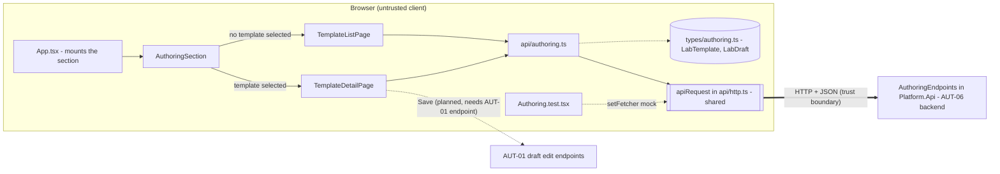
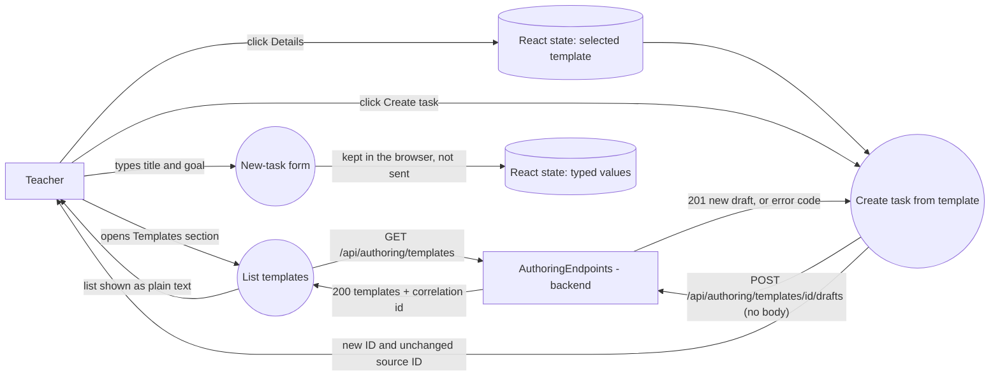

# Project component: AUT-06 frontend — template list and "create task from template"

This page describes the frontend part of AUT-06. The backend part (endpoints, access decision, template catalog, draft store) is described in [AUT-authoring.md](AUT-authoring.md) and is not changed here.

## Responsibilities and boundaries

The frontend lets an author:

- see the list of lab templates (read only),
- open one template and see its title, type and goal,
- create a new task (draft) from the template with one click.

The server creates the copy. The new draft gets a new ID and the source template is not changed (AUT-06). The frontend only shows the result: the new ID, the unchanged source template ID, the status and the version.

Out of scope for this part:

- Saving the edited title and goal. The form is shown, but the **Save** button is disabled until the AUT-01 draft edit endpoint is exposed.
- Any authorization decision. The server decides (SEC-01). The frontend only shows the result, for example "403: only authors can create tasks from templates".

Files (all under `frontend/src`):

| File | Role |
|---|---|
| `types/authoring.ts` | `LabTemplate` and `LabDraft`, the shapes of the API responses |
| `api/authoring.ts` | `listTemplates()`, `createDraftFromTemplate(templateId)`, `authoringErrorMessage(error)` |
| `pages/TemplateListPage.tsx` | table of templates, loading, empty and error states |
| `pages/TemplateDetailPage.tsx` | template details, create button, new draft info, form |
| `components/authoring/AuthoringSection.tsx` | keeps the selected template and switches between list and detail |
| `App.tsx` | existing file, only the import and `<AuthoringSection />` were added |
| `__tests__/Authoring.test.tsx` | tests for the API client, both pages and the section |

The shared helper `api/http.ts` (`apiRequest`) is used as it is and is not changed.

## Component architecture

`api/authoring.ts` is the only place in this component that crosses the trust boundary between the browser and the server.

## Data flow diagram

The POST request has no body. The client sends no owner, no ID and no content, so it cannot forge them. The server takes the caller from the request and sets the owner.

## Endpoints used

| Call | Success | Errors shown to the author |
|---|---|---|
| `GET /api/authoring/templates` | `200 { templates, correlationId }` | 401 "Niste prijavljeni." |
| `POST /api/authoring/templates/{templateId}/drafts` | `201` new draft (`id`, `sourceTemplateId`, `ownerId`, `status`, `version`, `title`, `goal`, `type`) | 401, 403, 404, 409 with a message chosen by HTTP status |

The shared `apiRequest` reads `code` and `message` from error bodies, while the authoring backend returns `error`. Because of this, error messages are chosen by HTTP status and not by the response text.

## Security requirements

| Requirement | How the frontend handles it |
|---|---|
| SEC-01 server-side authorization | No decision in the client. A button is never hidden "for security". A 403 is shown as a message. |
| SEC-05 safe text rendering | All server data (title, goal, type, names) is rendered as plain text through React, never as HTML. |
| No client-supplied identity or content | POST without a body. Owner, ID and content come from the server. |
| No secrets in the client | The template payload has only `id`, `name`, `title`, `goal`, `type`. |
| Input stays local | Title and goal typed in the form stay in React state and are not sent anywhere yet. |

## Acceptance criteria mapping

| Criterion (AUT-06) | Where it is shown |
|---|---|
| The copy of a template has a new ID | `TemplateDetailPage` shows "Novi ID" from the `201` response |
| The source template is not changed | `TemplateDetailPage` shows the source template ID next to it, and the template list is not modified by the create action |

## How to try it (development)

1. Start the backend as described in `DEVELOPMENT.md` (default `http://localhost:5080`).
2. In `frontend`: `npm ci`, then `npm run dev`. Vite proxies `/api` to the backend.
3. Open the page, find the "Šabloni laboratorija" section, open a template and click "Kreiraj zadatak iz šablona".

Tests: `npm test` (the whole suite) and `npm run build`.

## Evidence of work

- `Authoring.test.tsx`: 27 tests for the API client, the list page, the detail page (including a double click on the create button, and the 403, 404 and 409 errors) and the section flow.
- The whole frontend test suite passes and `npm run build` passes.
