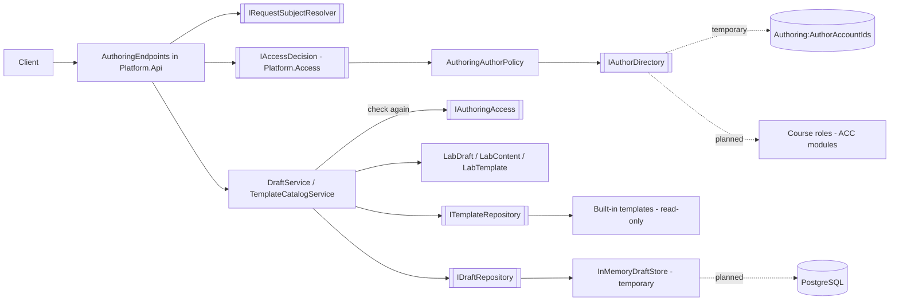
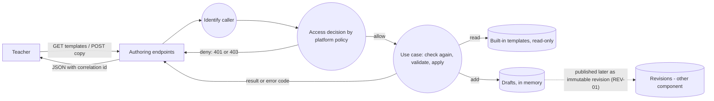

# Project component: AUT — Authoring tool (drafts and templates)

**Team:** 11

**Student:** SopalovicDjordje (student ID: PR 70/2023)

**Specification requirements:** AUT-01 (create and edit drafts), AUT-06 (templates for quick task creation)

## Responsibilities and boundaries

- **Processes and user scenarios:**
  - A teacher lists the built-in laboratory templates and creates a draft from one; the copy gets a new ID and the template is never changed (AUT-06, exposed over HTTP).
  - A teacher creates and edits a draft while it is in the *Draft* state (AUT-01: domain and use cases are implemented and tested; the HTTP endpoints for it are not exposed yet).
  - Part of UC-03 (teacher publishes a laboratory): this component owns the editable working copy that later validation and publication read.
- **Contracts with other modules:**
  - `IAccessDecision`, `IActionCatalog`, `IAccessPolicyRegistry` (Platform.Access): every endpoint asks the platform for a decision first. Actions `authoring.template.list` and `authoring.template.copy` are registered at start-up with one policy; anything unregistered is denied by default.
  - `IRequestSubjectResolver` (Platform.Api): who the caller is. The owner of a new draft always comes from here, never from the request.
  - `IAuthorDirectory` (this module's port): "may this account author?". Temporary configuration-backed implementation until the ACC modules publish course roles.
  - Attempts never reference a draft; they are bound to an immutable published revision (REV-03), so draft edits cannot change a started attempt.
  - Publication (REV-01/REV-02) will read draft content through this module. Not implemented here.
- **Implementation status:**
  - Implemented and tested: `LabContent`, `LabDraft`, `LabTemplate`, `DraftService`, `TemplateCatalogService`, built-in templates, optimistic concurrency, Access policy and registration, `GET` template list and `POST` copy-template endpoints, in-memory draft store.
  - Planned, not implemented: PostgreSQL repository, endpoints to read and edit a draft with an owner check (AUT-01 backend), audit events, course-role backed author check, course binding (LAB-03), structured steps (AUT-02), parameter validation (AUT-03).

## Endpoints

| Method and path | Success | Errors |
| --- | --- | --- |
| `GET /api/authoring/templates` | `200` `{ templates: [{ id, name, title, goal, type }], correlationId }` | `401 unauthenticated`, `403 forbidden` |
| `POST /api/authoring/templates/{templateId}/drafts` (no body) | `201` `{ id, sourceTemplateId, ownerId, status, version, title, goal, type, correlationId }` | `401 unauthenticated`, `403 forbidden`, `404 template_not_found`, `409 conflict`, `400 invalid_request` |

Errors have the shape `{ error, correlationId }` and never contain internal details. A template id that is not a GUID does not match the route (`404`).

## Component architecture



Layers inside `backend/Platform.Authoring`: `Domain` (rules, no dependencies), `Application` (use cases, ports, access policy), `Infrastructure` (adapters: built-in templates, in-memory store, configuration-backed author directory), `Composition` (`AddAuthoring()` and `RegisterAuthoringAccess()`, called from `Program.cs`). The HTTP layer lives in `backend/Platform.Api/Endpoints/AuthoringEndpoints.cs`, next to the identity endpoints.

## Data flow diagram



Trust boundary: everything left of the API is untrusted. The caller identity is resolved on the server, the platform access decision runs before any data is read or changed, and the use case checks authorization again (defence in depth).

**Implemented vs planned:** the whole flow above is implemented and tested with the real Access module; the draft store is in memory and temporary. The PostgreSQL store, the link to revisions and audit events are planned.

## Security requirements

- **Server-side access checks:**
  - Deny by default: an action that is not registered, or an account that is not active, is denied by the Access module. Only accounts on the author list pass the policy.
  - No session gives `401`; a signed-in non-author, a blocked or archived account, or a subject id that is not a GUID gives `403`.
  - Outside the Development environment no subject resolver identifies anyone yet, so every request is `401` (fails closed).
  - Inside the use cases, only listing and copying templates are allowed, and only for authors. Creating a blank draft and editing a draft stay denied until their endpoints bring an ownership check.
- **Input validation and sensitive data:**
  - `LabContent` is immutable and always valid: title 1–120 characters without control characters, goal up to 2000 characters, defined lab type. Setters are private, so `with` expressions cannot bypass validation.
  - The copy endpoint takes no request body, so the owner, ID and content cannot be forged by the client.
  - Drafts and templates hold no secrets. Evaluator keys and correct answers are not part of this component (AUT-04 is separate).
- **Negative scenarios (all covered by tests):**
  - No session, student, blocked or archived account, or a non-GUID subject lists or copies a template: denied, nothing stored.
  - Unknown template: `404`, nothing stored. Every error carries a correlation id and no internal details.
  - A host where the policy was never registered denies the request (deny by default).
  - Another author edits a draft: denied, draft unchanged. A stale edit gives `CONFLICT`. An *In review* draft gives `DRAFT_NOT_EDITABLE`.
  - Template ID reused as a draft ID is rejected; editing a copy leaves the template unchanged.

## Acceptance criteria mapping

| Requirement | Minimum acceptance criterion | Where it is tested |
| --- | --- | --- |
| AUT-01 | An unpublished draft can be changed without affecting existing attempts | `LabDraftTests`, `DraftServiceTests` |
| AUT-06 | A copy of a template has a new ID and does not modify the source template | `LabTemplateTests`, `DraftServiceTests`, `AuthoringEndpointsTests` (HTTP boundary) |

## How to try it (development)

The Development environment identifies the caller from the configuration key `Identity:DevSubjectId`; `appsettings.Development.json` lists the author account in `Authoring:AuthorAccountIds`. Start the API, then call the endpoints from a second terminal (PowerShell):

```powershell
$env:Identity__DevSubjectId = "11111111-1111-1111-1111-111111111111"   # an author
cd backend/Platform.Api
dotnet run --urls http://localhost:5080
```
```powershell
curl.exe -i http://localhost:5080/api/authoring/templates
$t = "a1000000-0000-4000-8000-000000000001"
curl.exe -i -X POST "http://localhost:5080/api/authoring/templates/$t/drafts"
```
Stop the API (`Ctrl+C`) and restart it with `"22222222-2222-2222-2222-222222222222"` (a student) to see `403`, or with `Remove-Item Env:Identity__DevSubjectId` to see `401`.

## Evidence of work

- **Changed files / commit / pull request:** `backend/Platform.Authoring`, `backend/Platform.Authoring.Tests`, `backend/Platform.Api/Endpoints/AuthoringEndpoints.cs`, three wiring lines in `backend/Platform.Api/Program.cs`, the project reference and the development settings; this document.
- **Run instructions:** `dotnet test backend/Platform.Authoring.Tests/Platform.Authoring.Tests.csproj --configuration Release` (or `dotnet test backend/SecurityLab.slnx`).
- **Tests and results:** 84 NUnit test cases (content validation, draft rules, template copy, use cases, author directory, policy, access check, in-memory store, DI validation, and the endpoint boundary with the real Access module). Record the actual run result and date here after running locally.
- **Dependencies on other components:**
  - Platform.Access (decision, catalog, policy registry): in use.
  - Identity (`IRequestSubjectResolver`, real sessions): development subject only; a real login replaces it without changing this component.
  - ACC modules (course roles): replace `ConfigAuthorDirectory`.
  - Audit: no authoring events yet.
  - AUT-01 backend: draft read/edit endpoints and the owner policy.
  - Revisions (REV): consumer of draft content.
- **Next steps:** PostgreSQL repository and migration; draft read/edit endpoints with an ownership policy (AUT-01); audit events; course-role author check; AUT-02/AUT-03 content (steps, parameters); hand-off of draft content to REV-01/REV-02.
