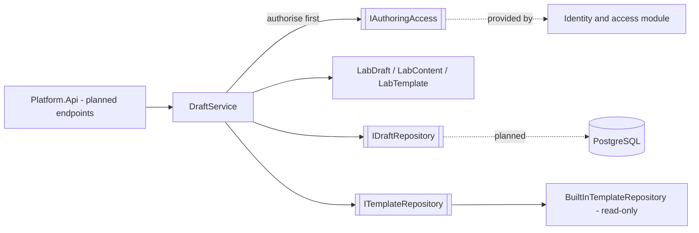
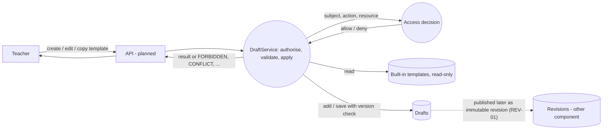

# Project component: AUT — Authoring tool (drafts and templates)

**Team:** [fill in]

**Student:** [fill in name / student ID]

**Specification requirements:** AUT-01 (create and edit drafts), AUT-06 (templates for quick task creation)

## Responsibilities and boundaries

- **Processes and user scenarios:**
  - A teacher creates a laboratory draft and edits it while it is in the *Draft* state (AUT-01).
  - A teacher starts a new draft from a built-in template; the copy gets a new ID and the template is never changed (AUT-06).
  - Part of UC-03 (teacher publishes a laboratory): this component owns the editable working copy that the later validation and publication steps read.
- **Contracts with other modules:**
  - `IAuthoringAccess` (this module's view of `IAccessDecision`, specification 3.1): subject + action + concrete resource, deny by default. Implemented by the Identity and access module; a fake is used in tests until then.
  - Attempts never reference a draft. They are bound to an immutable published revision (REV-03), so draft edits cannot change a started attempt.
  - Publication (REV-01/REV-02) will read the draft content through this module and create the immutable `LabRevision` snapshot. Not implemented here.
- **Implementation status:**
  - Implemented and unit-tested: `LabContent`, `LabDraft`, `LabTemplate`, `DraftService`, built-in templates, optimistic concurrency by version number.
  - Planned, not implemented: PostgreSQL repository, HTTP endpoints, audit events, the Identity-backed `IAuthoringAccess`, course binding (LAB-03), structured steps (AUT-02), parameter validation (AUT-03).

## Component architecture

Layers inside `backend/Platform.Authoring`: `Domain` (rules, no dependencies), `Application` (use cases and ports), `Infrastructure` (adapters; currently only the read-only built-in templates).

## Data flow diagram

Trust boundary: everything left of `API` is untrusted. The authorisation check runs on the server before any data is read or changed. Student accounts never reach this module's use cases (they are denied).

**Implemented vs planned:** the process, access check, draft store port and template store in the diagram are implemented in code and tests, with in-memory test doubles for the stores. The HTTP API, the PostgreSQL store and the link to revisions are planned.

## Security requirements

- **Server-side access checks:**
  - Every use case calls `IAuthoringAccess` first; an empty actor id is always denied.
  - Editing is allowed only for the draft's owner. A missing draft and someone else's draft are denied identically (`FORBIDDEN`), so draft IDs cannot be probed.
  - Templates are exposed through a read-only port, so no authoring path can modify one.
- **Input validation and sensitive data:**
  - `LabContent` is immutable and always valid: title 1–120 characters without control characters, goal up to 2000 characters, defined lab type. Setters are private, so `with` expressions cannot bypass validation.
  - Drafts hold no secrets. Evaluator keys and correct answers are not part of this component yet (AUT-04 is a separate requirement).
- **Negative scenarios (all covered by tests):**
  - Student or non-author creates, edits or copies a template, so access is denied and nothing is stored.
  - Another author edits a draft, so it is denied and the draft is unchanged.
  - Stale edit (old version number) gives `CONFLICT` and does not overwrite newer work.
  - Editing a draft that is *In review* gives `DRAFT_NOT_EDITABLE`.
  - Template ID reused as a draft ID is rejected; editing a copy leaves the template unchanged.

## Acceptance criteria mapping

| Requirement | Minimum acceptance criterion | Where it is tested |
| --- | --- | --- |
| AUT-01 | An unpublished draft can be changed without affecting existing attempts | `LabDraftTests`, `DraftServiceTests` (edit paths, content captured earlier is unchanged) |
| AUT-06 | A copy of a template has a new ID and does not modify the source template | `LabTemplateTests`, `DraftServiceTests` (template paths) |

## Evidence of work

- **Changed files / commit / pull request:** branch `feature/AUT-01-AUT-06-lab-drafts` (`backend/Platform.Authoring`, `backend/Platform.Authoring.Tests`, `docs/components/AUT-authoring.md`, CI job).
- **Run instructions:** `dotnet test backend/Platform.Authoring.Tests/Platform.Authoring.Tests.csproj`
- **Tests and results:** 55 NUnit test cases (content validation, draft rules, template copy, use cases, negative access paths). Record the actual run result and date here after running locally.
- **Next steps:** `IAuthoringAccess` adapter on top of the Identity module; PostgreSQL repository and migration; HTTP endpoints once authentication exists; audit events; AUT-02/AUT-03 content (steps, parameters); hand-off of draft content to REV-01/REV-02.
