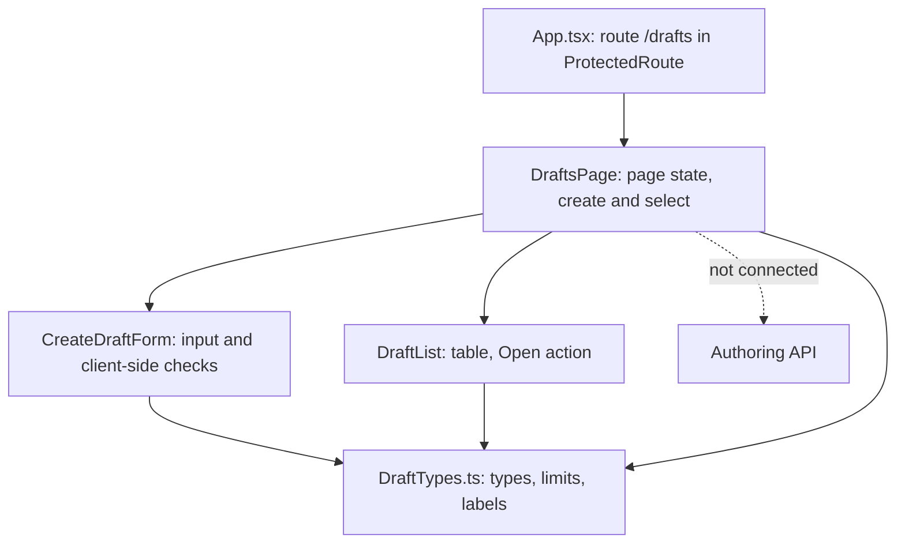
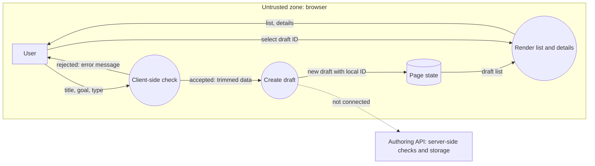

# Project component: AUT-01 frontend — draft list and draft creation form

**Team:** 11

**Student:** Nikola PR5/2023

**Specification requirements:** AUT-01 (create and edit drafts, frontend part), related: AUT-03 (input validation), AUT-04 (no evaluator key on the client), LAB-02 (metadata fields), SEC-05 (safe text rendering), OPS-07 (accessible forms)

Backend side of the same component: [AUT-authoring](../AUT-authoring.md).

## Responsibilities and boundaries

- **Processes and user scenarios:**
  - A signed-in user opens the drafts page (`/drafts`) and sees the list of drafts, or a message when there are none.
  - The user opens the creation form, enters a title (required), a goal (optional) and a laboratory type, and creates a draft. The new draft appears in the list.
  - The user opens a draft from the list and sees its title, goal and type.
  - Editing an existing draft is a separate screen and is not part of this document.
- **Contracts with other modules:**
  - `ProtectedRoute` and `AppShell` (existing frontend): the `/drafts` route is mounted inside `ProtectedRoute`, so it is shown only to signed-in users. This is a convenience for the user, not a security control.
  - Shared types in `DraftTypes.ts` (`Draft`, `CreateDraftData`, `LabType`, `DraftStatus`, length limits and labels) are the only place where these definitions live. Other draft screens can import them instead of redefining them.
  - Backend authoring API: **not connected.** The draft HTTP endpoints for AUT-01 are not exposed yet (see [AUT-authoring](../AUT-authoring.md)), so this component keeps drafts in the browser only.
  - The title limit (120) and goal limit (2000) match the limits of `LabContent` documented in [AUT-authoring](../AUT-authoring.md).
- **Implementation status:**
  - Implemented and tested: drafts page, creation form with client-side validation, draft list with readable type and status labels, draft details, protected route, shared types.
  - Temporary: draft ID and status are generated in the browser (`createLocalDraft` in `DraftsPage`). The server must assign them once the page is connected, and the client must never send them.
  - Not implemented: any call to the server, loading drafts from storage, error and loading states for network calls, pagination.

## Component architecture



| Component | Input | Output |
| --- | --- | --- |
| `CreateDraftForm` | none | `onCreate(CreateDraftData)` with trimmed values |
| `DraftList` | `drafts: Draft[]` | `onOpen(draftId: string)` |
| `DraftsPage` | none | renders list, form and selected draft |

`DraftsPage` keeps only the selected draft **id** and derives the selected draft from the list, so it never shows a stale copy.

## Data flow diagram



All data stays in the browser page state and is lost on reload. Nothing crosses a trust boundary yet. When the page is connected, the server becomes the boundary: it must authenticate the caller, authorize the action, validate the input again and assign the draft ID, status and owner.

## Security requirements

- **Server-side access checks:**
  - None are performed by this component. The frontend is not a security boundary, and `ProtectedRoute` only hides the page from users who are not signed in.
  - When connected, authorization and ownership checks must be done by the server (ACC-04, AUT-01).
- **Input validation and sensitive data:**
  - The title is trimmed and must not be empty. It is limited to 120 characters and the goal to 2000 (`maxLength`). The goal is trimmed, and the type is chosen from a fixed list.
  - The form disables the browser's own validation (`noValidate`) so the application's accessible error message is always shown. These checks help the user and are not a replacement for server validation (AUT-03).
  - Text is rendered through React and never as HTML (no `dangerouslySetInnerHTML`), so a title such as `<script>` is displayed as plain text (SEC-05).
  - The data model contains no secrets, evaluator keys or correct answers (AUT-04).
  - Accessibility (OPS-07): labelled fields, hint and error linked with `aria-describedby`, error in `role="alert"`, unique accessible name for every Open button, named region for the selected draft.
- **Negative scenarios (covered by tests):**
  - Empty title and a title with only spaces: `onCreate` is not called and the error is shown (clicking the submit button, so the browser validation path is exercised).
  - The error disappears after a valid submit.
  - A goal with only spaces is sent as an empty goal.
  - After a successful creation all fields, including the type, are reset.
  - Opening the creation form closes the selected draft view.
  - With several drafts, the selected one is the one that was opened.

## Evidence of work

- **Changed files / commit / pull request:** branch `feature/AUT-01-drafts-frontend`. Files: `frontend/src/pages/DraftsPage.tsx`, `frontend/src/components/drafts/` (`CreateDraftForm.tsx`, `DraftList.tsx`, `DraftTypes.ts`, `drafts.css`, tests), `frontend/src/__tests__/DraftsPage.test.tsx`, the `/drafts` route in `frontend/src/App.tsx`. Pull request: [add link].
- **Run instructions:**

  ```powershell
  cd frontend
  npm ci
  npm run dev      # sign in, then open /drafts
  npm test
  npm run build
  ```

- **Tests and results:** 22 test cases for this component (form 9, list 5, page 8) run with Vitest and Testing Library. Record the actual result and date here after running locally.
- **Next steps:** agree the route, field names, status names and limits of the draft endpoints with the authoring backend contract; add a data-access layer and loading and error states; stop generating ID and status in the browser; update the diagrams to the real implementation.
