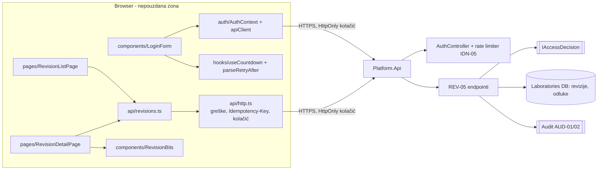
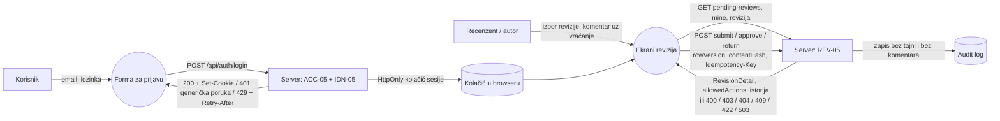

# Projektna komponenta: IDN-05 / REV-05 — korisnički interfejs

**Tim:** 4

**Student:** Daniel Radovanovic,PR8/2023

**Zahtevi iz specifikacije:** IDN-05 (ograničenje broja pokušaja prijave), REV-05 (dvostepeno odobrenje objave); povezano: REV-01, REV-02, AUD-02

## Odgovornosti i granice

- **Procesi i korisnički scenariji:**
  - Korisnik se prijavljuje. Posle previše pokušaja server vraća `429` + `Retry-After`, a forma za prijavu prikazuje poruku „pokušajte kasnije" sa odbrojavanjem i blokira slanje do isteka (IDN-05).
  - Autor predaje reviziju na pregled (*Predaj*).
  - Recenzent vidi listu revizija na čekanju, otvara reviziju i odobrava je (*Odobri*) ili je vraća autoru sa obaveznim komentarom (*Vrati sa komentarom*) (REV-05).
  - Autor i recenzent vide istoriju odluka: ko je šta uradio, kada, nad kojim hash-om sadržaja i sa kojim brojem revizije (REV-01, AUD-02).
- **Ugovori sa drugim modulima:**
  - `POST /api/auth/login` (`AuthController`, ACC-05) i odgovor `429` + `Retry-After` iz `IdentityRateLimitingExtensions` (IDN-05). Sesija je HttpOnly kolačić; UI nikad ne vidi token.
  - REV-05 HTTP API: [`REV-05-use-cases-api.md`](REV-05-use-cases-api.md) (Marko). Rute: `GET /api/revisions/pending-reviews`, `GET /api/revisions/mine`, `GET /api/revisions/{id}`, `POST /api/revisions/{id}/submit|approve|return`.
  - UI ne odlučuje o pravima. Dugmad se prikazuju prema `allowedActions` koje vraća server, a server svaku radnju ponovo proverava (`IAccessDecision`, Luka).
- **Status implementacije:**
  - Urađeno i pokriveno testovima: poruka „pokušajte kasnije" u formi za prijavu (`components/LoginForm.tsx`), lista na čekanju, „moje revizije", detalj revizije sa radnjama, istorija odluka.
  - Usklađeno sa pravim REV-05 API-jem: komentar se šalje samo uz vraćanje (API odbija komentar uz odobrenje), poruke za sve kodove grešaka koje API vraća, sesija preko kolačića.
  - Stari zaseban ekran za prijavu (`pages/LoginPage.tsx`, `api/auth.ts`) je uklonjen; ponašanje za `429` je prebačeno u aktivnu formu `components/LoginForm.tsx`, koju koriste rute `/login` i početna strana.
  - Dev mock (`npm run dev:mock`, `api/mock.ts`) ostaje kao alat za lokalni razvoj; koristi ga i LAB demo (`handleLabMock`). Pravila za revizije u mocku prate pravi API (npr. komentar samo uz vraćanje). Mock ne ulazi u produkcioni build.

## Arhitektura komponente

Unutar `frontend/src`: `api/` (komunikacija sa REV-05 API-jem, bez React-a), `pages/` (ekrani revizija), `components/` (forma za prijavu, prikaz statusa i istorije), `hooks/` (odbrojavanje).

## Dijagram toka podataka

Granica poverenja je između browsera i `Platform.Api`. Sve levo od servera smatra se nepouzdanim: provere u UI-ju (blokada dugmeta, prazan komentar) služe samo za korisničko iskustvo i ne zamenjuju serverske.

## Bezbednosni zahtevi

- **Serverske provere pristupa:**
  - UI ne zaključuje sam ko sme šta. Koristi samo `allowedActions` sa servera, a server svaku komandu ponovo autorizuje (spec. 2.1).
  - Za tuđu reviziju server vraća `404`, pa UI prikazuje istu poruku za „ne postoji" i „nemate pristup".
  - Autor koji pokuša da odobri svoju reviziju dobija `403 self_approval_forbidden` (REV-05), i UI to jasno prikazuje.
- **Validacija ulaza i osetljivi podaci:**
  - Sesija je HttpOnly kolačić (ACC-05), pa JavaScript (i eventualni XSS) ne može da pročita token. Browser ga sam šalje uz zahteve na isti origin; UI ne čuva nikakav token. (`session` u `api/http.ts` služi samo dev mocku.)
  - Za pogrešne podatke i zaključan nalog uvek se prikazuje ista generička poruka, bez otkrivanja da li nalog postoji (IDN-05).
  - Komentari i ostali tekst sa servera prikazuju se kao običan tekst (React escaping), nikad kao HTML.
  - ID revizije se enkoduje u URL-u (`encodeURIComponent`), pa nema path traversal-a kroz ID.
  - `Retry-After` se parsira strogo (sekunde ili HTTP datum) i ograničen je na najviše 1 h. Bez headera čeka se 60 s.
  - Svaka komanda šalje `rowVersion` i `contentHash` koje je korisnik video, pa server odbija odobrenje sadržaja koji se u međuvremenu promenio (TOCTOU, `409`).
  - Komentar postoji samo uz vraćanje; otkazivanje ga briše, a uz odobrenje se nikad ne šalje.
  - `Idempotency-Key` se zadržava posle mrežne greške, pa ponovni pokušaj ne pravi dve odluke.
- **Negativni scenariji (pokriveni testovima):**
  - `429` blokira formu za prijavu i ne šalje nove zahteve do isteka; posle isteka forma ponovo radi.
  - Neispravan ili nedostajući `Retry-After` (`abc`, `-5`, `1.5`, ogromna vrednost, bez headera) daje bezbednu vrednost.
  - Vraćanje bez komentara ili samo sa razmacima se ne šalje; uz odobrenje i predaju komentar se ne šalje.
  - `403`, `404`, `409` (sa osvežavanjem), `422` (sa listom grešaka), greške samo sa `code` (npr. `policy_missing`) i mrežna greška prikazuju razumljivu poruku i ne ruše stranicu.
  - Komentar `` se prikazuje kao tekst i ne pravi HTML element.

## Mapiranje kriterijuma prihvatanja

| Zahtev | Minimalni kriterijum | Gde je testirano |
| --- | --- | --- |
| IDN-05 | Prekomerni neuspešni pokušaji aktiviraju usporavanje/blokadu | `http.test.ts` (parsiranje `Retry-After`), `LoginForm.test.tsx` (poruka, odbrojavanje, blokada, odgovor kao iz pravog limitera). Samu blokadu sprovode server (limiter po IP-u) i zaključavanje naloga; zaključan nalog namerno dobija istu generičku poruku kao pogrešna lozinka. |
| REV-05 | Autor ne može sam da odobri reviziju ako je politika to zahtevala | `revisions.test.tsx` (prikaz `self_approval_forbidden`, dugmad prema `allowedActions`), `mock.test.ts`; serverska strana u Markovim testovima |
| REV-02 | Neispravan tip ili nepotpun evaluator blokira objavu | `revisions.test.tsx` (prikaz grešaka za `422`) |
| AUD-02 | Vidljiv je autor promene i ID objavljene verzije | `revisions.test.tsx` (istorija: akter, vreme, broj revizije) |

## Dokaz o radu

- **Grane:** `feature/REV-05-IDN-05-ui` (prvi PR, spojen), `feature/IDN-05-REV-05-login-429` (poruka za `429` u aktivnoj formi i usklađivanje sa pravim API-jem).
- **Fajlovi:** `frontend/src/components/LoginForm.tsx` (poruka za `429`), `frontend/src/api/{http,revisions,mock}.ts`, `frontend/src/pages/Revision*.tsx`, `frontend/src/components/RevisionBits.tsx`, `frontend/src/hooks/useCountdown.ts`, `frontend/src/__tests__/{LoginForm.test.tsx,revisions.test.tsx,http.test.ts,mock.test.ts}`, `frontend/src/App.tsx` (sekcija revizija), `frontend/README.md`, ovaj dokument.
- **Pokretanje:** `cd frontend && npm ci && npm test` (testovi), `npm run dev` uz pokrenut backend (vidi `docs/DEVELOPMENT.md`), `npm run dev:mock` bez backenda.
- **Testovi i rezultati:** 2026-11-24 / 197 passed (22 fajla, ceo frontend; od toga IDN-05/REV-05 UI: `LoginForm.test.tsx`, `revisions.test.tsx`, `http.test.ts`, `mock.test.ts`).
- **Integracija sa backendom:** `/api/auth/login` ima `[EnableRateLimiting(RateLimitPolicies.Login)]`, a odbijanje vraća `429`, `Retry-After` u sekundama i `{ code: "rate_limited" }`; `LoginForm.test.tsx` koristi isti oblik odgovora.
- **Sledeći koraci:** zajednička ručna demonstracija kompletnog toka sa backendom i bazom.