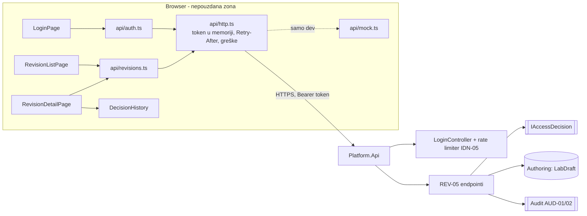
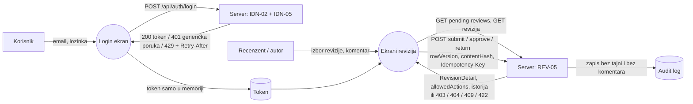

# Projektna komponenta: IDN-05 / REV-05 — korisnički interfejs

**Tim:** 4

**Student:** Daniel Radovanovic,PR8/2023

**Zahtevi iz specifikacije:** IDN-05 (ograničenje broja pokušaja prijave), REV-05 (dvostepeno odobrenje objave); povezano: REV-01, REV-02, AUD-02

## Odgovornosti i granice

- **Procesi i korisnički scenariji:**
  - Korisnik se prijavljuje. Posle previše neuspešnih pokušaja server vraća `429` + `Retry-After`, a UI prikazuje poruku „pokušajte kasnije" sa odbrojavanjem i blokira slanje do isteka (IDN-05).
  - Autor predaje nacrt laboratorije na pregled (*Predaj*).
  - Recenzent vidi listu revizija na čekanju, otvara reviziju i odobrava je (*Odobri*) ili je vraća autoru sa obaveznim komentarom (*Vrati sa komentarom*) (REV-05).
  - Autor i recenzent vide istoriju odluka: ko je šta uradio, kada, nad kojim hash-om sadržaja i sa kojim brojem revizije (REV-01, AUD-02).
- **Ugovori sa drugim modulima:**
  - `POST /api/auth/login` (`LoginController`, IDN-02) i odgovor `429` + `Retry-After` (IDN-05, Nemanja i Milan).
  - REV-05 HTTP API: predlog ugovora v0.2 poslat Marku (vlasnik API-ja). Posle potvrde ide u `docs/contracts/REV-05-API.md`.
  - UI ne odlučuje o pravima. Dugmad se prikazuju prema `allowedActions` koje vraća server, a server svaku radnju ponovo proverava (`IAccessDecision`, Luka).
- **Status implementacije:**
  - Urađeno i pokriveno testovima: HTTP sloj, login ekran, lista na čekanju, „moje revizije", detalj revizije sa radnjama, istorija odluka.
  - Do završetka backenda UI radi preko dev mocka (`npm run dev:mock`), koji poštuje pravila iz ugovora. Mock se ne pakuje u produkcioni build.
  - Planirano: integracija sa pravim IDN-05 i REV-05 endpointima kad budu spojeni u `main`; serverski logout kad IDN-02 bude gotov.

## Arhitektura komponente

Unutar `frontend/src`: `api/` (komunikacija sa serverom, bez React-a), `pages/` (ekrani), `components/` (prikaz statusa i istorije), `hooks/` (odbrojavanje).

## Dijagram toka podataka

Granica poverenja je između browsera i `Platform.Api`. Sve levo od servera smatra se nepouzdanim: provere u UI-ju (blokada dugmeta, prazan komentar) služe samo za korisničko iskustvo i ne zamenjuju serverske.

## Bezbednosni zahtevi

- **Serverske provere pristupa:**
  - UI ne zaključuje sam ko sme šta. Koristi samo `allowedActions` sa servera, a server svaku komandu ponovo autorizuje (spec. 2.1).
  - Za tuđu reviziju server vraća `404`, pa UI prikazuje istu poruku za „ne postoji" i „nemate pristup".
  - Autor koji pokuša da odobri svoju reviziju dobija `403 self_approval_forbidden` (REV-05), i UI to jasno prikazuje.
- **Validacija ulaza i osetljivi podaci:**
  - Token se čuva samo u memoriji, ne u `localStorage`, da ga XSS ne bi lako pročitao. Lozinka se briše iz forme posle svakog pokušaja.
  - Za pogrešne podatke uvek se prikazuje ista generička poruka, bez otkrivanja da li nalog postoji (IDN-05).
  - Komentari i ostali tekst sa servera prikazuju se kao običan tekst (React escaping), nikad kao HTML.
  - ID revizije se enkoduje u URL-u (`encodeURIComponent`), pa nema path traversal-a kroz ID.
  - `Retry-After` se parsira strogo (sekunde ili HTTP datum) i ograničen je na najviše 1 h.
  - Svaka komanda šalje `rowVersion` i `contentHash` koje je korisnik video, pa server odbija odobrenje sadržaja koji se u međuvremenu promenio (TOCTOU, `409`).
  - Komentar se uvek odnosi na jednu nameru: otkazivanje ili promena radnje ga briše, pa komentar za „vrati" ne može da završi uz odobrenje.
  - `Idempotency-Key` se zadržava posle mrežne greške, pa ponovni pokušaj ne pravi dve odluke.
- **Negativni scenariji (pokriveni testovima):**
  - `429` blokira formu i ne šalje nove zahteve do isteka, ni preko Enter-a.
  - Neispravan `Retry-After` (`abc`, `-5`, `1.5`, ogromna vrednost) daje bezbednu podrazumevanu vrednost.
  - Vraćanje bez komentara ili samo sa razmacima se ne šalje.
  - `403`, `404`, `409` (sa osvežavanjem), `422` (sa listom grešaka) i mrežna greška prikazuju odgovarajuću poruku i ne ruše stranicu.
  - Komentar `` se prikazuje kao tekst i ne pravi HTML element.

## Mapiranje kriterijuma prihvatanja

| Zahtev | Minimalni kriterijum | Gde je testirano |
| --- | --- | --- |
| IDN-05 | Prekomerni neuspešni pokušaji aktiviraju usporavanje/blokadu | `http.test.ts` (parsiranje `Retry-After`), `LoginPage.test.tsx` (blokada i odbrojavanje). Samu blokadu sprovodi server. |
| REV-05 | Autor ne može sam da odobri reviziju ako je politika to zahtevala | `revisions.test.tsx` (prikaz `self_approval_forbidden`, dugmad prema `allowedActions`), `mock.test.ts` (očekivano ponašanje servera) |
| REV-02 | Neispravan tip ili nepotpun evaluator blokira objavu | `revisions.test.tsx` (prikaz grešaka za `422`) |
| AUD-02 | Vidljiv je autor promene i ID objavljene verzije | `revisions.test.tsx` (istorija: akter, vreme, broj revizije) |

## Dokaz o radu

- **Izmenjeni fajlovi / grana:** `feature/REV-05-IDN-05-ui`. Fajlovi: `frontend/src/api/{http,auth,revisions,mock}.ts`, `frontend/src/pages/*`, `frontend/src/components/RevisionBits.tsx`, `frontend/src/hooks/useCountdown.ts`, `frontend/src/__tests__/*`, `frontend/src/App.tsx`, `frontend/src/main.tsx`, `frontend/src/style.css`, `frontend/src/vite-env.d.ts`, `frontend/package.json`, `frontend/package-lock.json`, `frontend/vitest.config.ts`, `frontend/README.md`, ovaj dokument.
- **Pokretanje:** `cd frontend && npm ci && npm test` (testovi), `npm run dev:mock` (UI sa mockom), `npm run dev` (sa pravim backendom).
- **Testovi i rezultati:** 34 vitest testa u 4 fajla. Upisati datum, commit i rezultat posle lokalnog pokretanja: [datum] / [commit] / 34 passed.
- **Sledeći koraci:** potvrda ugovora sa Markom; integracija i ručna provera sa pravim IDN-05 i REV-05 endpointima; usklađivanje mocka sa konačnim API-jem (mock ostaje kao alat za lokalni razvoj); predlog Nikoli da CI pokreće i `npm test`.