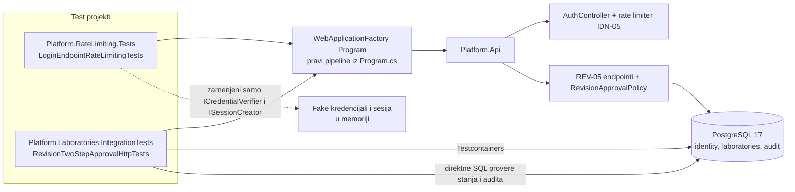
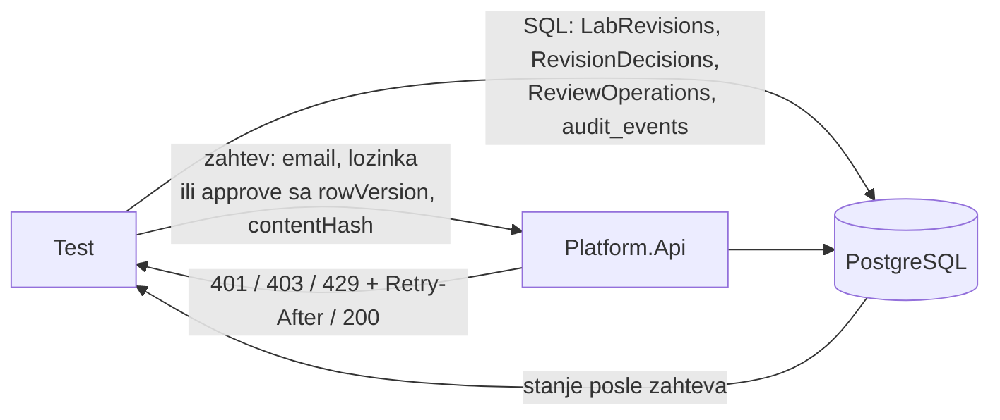

# Projektna komponenta: IDN-05 / REV-05 — integracioni testovi

**Tim:** 4

**Student:** Nikola Tasić, PR68/2023

**Zahtevi iz specifikacije:** IDN-05 (ograničenje broja pokušaja prijave), REV-05 (dvostepeno odobrenje objave); povezano: SEC-04, ACC-05, AUD-02, AUD-03, AUD-04, IDN-04

## Odgovornosti i granice

- **Procesi i korisnički scenariji:**
  - Napadač ili korisnik šalje zahteve za prijavu. Posle prekoračenja limita server vraća `429` + `Retry-After`, a tačna lozinka posle toga ne sme da dobije sesiju (IDN-05, SEC-04).
  - Autor predaje reviziju, pokušava da je sam odobri i dobija `403`. Nezavisni recenzent posle toga može da je odobri (REV-05).
  - Testovi proveravaju i šta ostaje u bazi: stanje revizije, zapis odluke i audit.
- **Ugovori sa drugim modulima:**
  - `POST /api/auth/login` (`AuthController`, IDN-02) i politika `RateLimitPolicies.Login` (IDN-05).
  - `POST /api/revisions/{id}/approve` i `ReviewService` / `RevisionApprovalPolicy` (REV-05, ACC-05).
  - Ova komponenta ne menja produkcioni kod. Testovi samo gađaju postojeće ugovore preko HTTP-a.
- **Status implementacije:**
  - IDN-05: napisano 10 testova, 8 aktivnih i 2 `[Ignore]` (blokada po nalogu, `ILoginAttemptLimiter` ne postoji). Poslednje pokretanje: 25 prošlo, 7 palo, 2 preskočena (cela biblioteka, ne samo moji testovi). Svih 7 pada jer `AuthController.Login` nema `[EnableRateLimiting(RateLimitPolicies.Login)]`.
  - REV-05: napisano 8 testova nad pravim PostgreSQL-om. Kompajliraju se, ali još nisu uspešno pokrenuti (zahtevaju Docker).
  - Planirano: ponovno pokretanje kad vlasnik IDN-02 doda atribut na `Login`; skidanje `[Ignore]` kad se implementira blokada po nalogu.

## Arhitektura komponente

IDN-05 testovi ne koriste bazu. REV-05 testovi koriste pravi PostgreSQL, prave sesije, grantove, politiku i audit; ništa se ne simulira kao „dozvoljeno“.

## Dijagram toka podataka

Detaljan DFD obe komponente je u `DFD_REV-05_IDN-05.md`. Tok samih testova:

Test uvek proverava dvoje: odgovor koji vidi klijent i stanje koje je ostalo u bazi.

## Bezbednosni zahtevi

- **Serverske provere pristupa:**
  - Samoodobravanje autora se odbija na serveru kad kurs traži nezavisno odobrenje, čak i kad autor ima approve pravo.
  - Recenzent bez approve prava za taj kurs (ili samo za drugi kurs, ili bez read prava) ne može da odobri.
  - Ako politika kursa ne postoji, niko ne može da objavi (fail closed).
  - Politika važi u trenutku odluke, ne u trenutku predaje.
- **Validacija ulaza i osetljivi podaci:**
  - Odgovor 429 je isti za postojeći i nepostojeći email (IDN-04).
  - Log ne sadrži email ni lozinku (AUD-03). Odbijanje u logu nosi isti correlation ID kao odgovor (AUD-04).
  - Lažni `X-Forwarded-For` se ignoriše kad proxy nije naveden.
  - Odbijeno samoodobravanje se u auditu beleži jednom kao `access.denied`, sa autorom kao akterom.
  - Testovi koriste sintetičke naloge i privremenu bazu, bez stvarnih korisnika i tajni.
- **Negativni scenariji (pokriveni testovima):**
  - Blokirani zahtev ne stiže do provere lozinke.
  - Tačna lozinka posle blokade vraća 429 i ne postavlja sesijski kolačić.
  - Odbijeno odobrenje ne menja stanje: revizija ostaje `InReview`, verzija je ista, nema zapisa odluke i `revision.approved` audita.
  - Blokirani klijent ne utiče na drugog klijenta.

## Mapiranje kriterijuma prihvatanja

| Zahtev | Minimalni kriterijum | Gde je testirano |
| --- | --- | --- |
| IDN-05 / SEC-04 | Prekomerni neuspešni pokušaji aktiviraju usporavanje/blokadu | `LoginEndpointRateLimitingTests` (`FailedLogins_AboveTheLimit…`, `CorrectPassword_FromAThrottledClient…`, `Throttling_IsPerClient…`). Blokada po nalogu: dva testa `[Ignore]`. |
| IDN-04 | Ne otkriva postojanje naloga | `Throttle429_IsIdenticalForExistingAndNonExistingEmail` |
| AUD-03 / AUD-04 | Tajne se ne upisuju u log; zahtev se prati kroz module | `ThrottledAttempt_IsLoggedWithCorrelationId_ButWithoutCredentials` |
| REV-05 | Autor ne može sam da odobri reviziju ako je politika to zahtevala | `AuthorSelfApproval_WhenPolicyRequiresIndependence…`, `IndependentReviewer_CanApprove_After…`, `PolicyTightenedAfterSubmission…`, `PolicyRowRemovedAfterSubmission…` |
| ACC-05 | Odbijanje po defaultu, uz trajan zapis | `DeniedSelfApproval_IsAuditedOnce…`, `IndependentReviewer_WithoutApproveGrant…` (2 slučaja), `…WithApproveButWithoutReadGrant…` |

## Dokaz o radu

- **Izmenjeni fajlovi / grana:** `<grana>`. Fajlovi: `backend/Platform.RateLimiting.Tests/LoginEndpointRateLimitingTests.cs`, `backend/Platform.Laboratories.IntegrationTests/RevisionTwoStepApprovalHttpTests.cs`, ovaj dokument.
- **Pokretanje:**
  - IDN-05: `cd backend/Platform.RateLimiting.Tests && dotnet test`
  - REV-05 (zahteva Docker): `cd backend/Platform.Laboratories.IntegrationTests && dotnet test --filter "FullyQualifiedName~RevisionTwoStepApprovalHttpTests"`
- **Testovi i rezultati:**
  - IDN-05: 7.11.2026, trenutni `main`, 34 testa u projektu: 25 prošlo, 2 preskočena, 7 palo (nedostaje `[EnableRateLimiting]` na `Login`).
  - REV-05: [datum] / [commit] / [rezultat].
- **Sledeći koraci:** vlasnik IDN-02 dodaje atribut na `Login` i ponovo pokrećem IDN-05; pokretanje REV-05 testova uz Docker; skidanje `[Ignore]` kad `ILoginAttemptLimiter` bude gotov; predlog da CI pokreće i `Platform.RateLimiting.Tests`.
