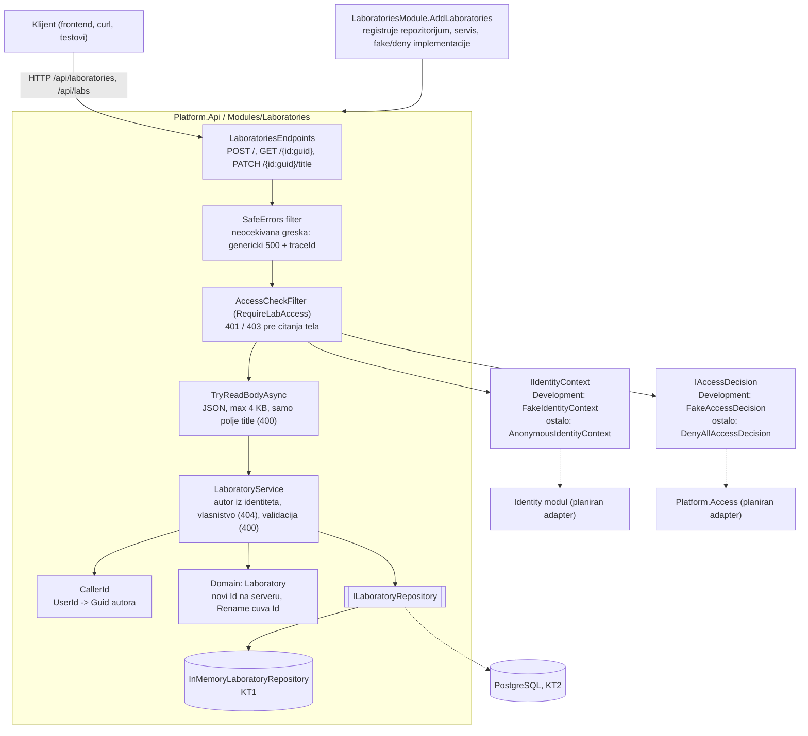
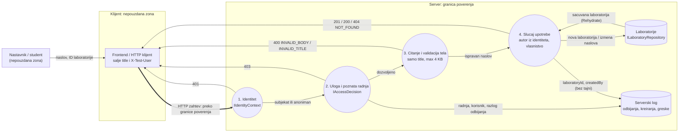

# Komponenta projekta: LAB-01 API (kreiranje, citanje i preimenovanje laboratorije)

**Tim:** 14

**Student:** Predrag Radovanović (PR 147/2023)

**Zahtevi iz specifikacije:** LAB-01 (kreiranje laboratorije sa trajnim ID; kriterijum: ID ostaje isti kroz revizije i izmene naslova). Zajednicki zahtevi koje ovaj deo pokriva: SEC-01 (serverska autorizacija), SEC-05 (validacija ulaza), ACC-04 (autorizacija nad konkretnim resursom), ACC-05 (podrazumevano odbijanje), OPS-07 (poruke o gresci bez tajni).

**Grana:** `feature/LAB-01-api`

## Odgovornosti i granice

- **Procesi i scenariji:**
  - Nastavnik kreira laboratoriju: `POST /api/laboratories` sa telom `{ "title": "..." }`. Server dodeljuje `Id`, autora (iz identiteta pozivaoca), status `Draft` i UTC vreme kreiranja, i vraca `201 Created` + `Location`.
  - Nastavnik cita svoju laboratoriju: `GET /api/laboratories/{id}` vraca `200` ili `404`.
  - Nastavnik menja naslov svoje laboratorije: `PATCH /api/laboratories/{id}/title`; `Id`, autor, status i vreme kreiranja ostaju isti.
  - `/api/labs` je alias iz timskog plana: iste rute, isti handleri i iste provere. `Location` uvek pokazuje kanonsku putanju `/api/laboratories`. Ako tim odluci da ostane samo jedna putanja, brise se jedna linija u `LaboratoriesEndpoints.MapLaboratoriesEndpoints`.
- **Sta ovaj deo NE radi:** ne cuva podatke sam (koristi `ILaboratoryRepository`, Gordana), ne menja domenska pravila (`Laboratory`, Visnja), ne izdaje objavljene revizije (REV-01), ne vezuje laboratoriju za kurs (LAB-03) i ne bira jezik sadrzaja (LAB-07, Lana).
- **Ugovori sa drugim delovima:**

| Veza | Svrha | Stanje |
| --- | --- | --- |
| `IIdentityContext` (lokalni port LAB modula) | ko je pozivalac | razvoj: `FakeIdentityContext` (`X-Test-User`); van Development-a `AnonymousIdentityContext` (niko nije prijavljen) |
| `IAccessDecision` (lokalni port LAB modula) | sme li uloga da izvrsi radnju | razvoj: `FakeAccessDecision`; van Development-a `DenyAllAccessDecision`. Planiran adapter na `Platform.Access.Contracts.IAccessDecision` |
| `ILaboratoryRepository` | cuvanje i citanje | KT1: `InMemoryLaboratoryRepository` (singleton), KT2: PostgreSQL implementacija istog ugovora |
| `Laboratory` (domen) | trajni ID, validacija naslova | koristi se novi konstruktor za kreiranje i `Rename()` za izmenu |
| Frontend `api/labs.ts` (Marija) | poziva `POST /api/laboratories/`, cita `id` iz odgovora i prevodi kod greske `INVALID_TITLE` | uskladjeno: kodovi gresaka su `INVALID_TITLE`, `INVALID_BODY`, `NOT_FOUND` |
| LAB-07 citanje po jeziku (Lana) | frontend planira `GET /api/laboratories/{id}?lang=` | **otvoreno pitanje:** ista ruta danas vraca LAB-01 podatke i ignorise `lang`. Treba dogovoriti da li LAB-07 dobija posebnu rutu (npr. `/{id}/content?lang=`) ili prosiruje ovaj odgovor |

- **Stanje implementacije:** POST, GET po ID-u i PATCH naslova su implementirani i pokriveni HTTP i jedinicnim testovima. `GET /` (lista) je ostao kostur koji vraca praznu listu.

## Matrica odluka o pristupu (Subject – Action – Resource)

| Subjekat | Radnja | Resurs | Odluka |
| --- | --- | --- | --- |
| anoniman / neispravno `X-Test-User` / vise zaglavlja | bilo koja | bilo koji | Deny, 401 |
| Student | `laboratory.create` | nova laboratorija | Deny, 403 |
| Student | `laboratory.read`, `laboratory.rename` | bilo koja laboratorija | Deny, 403 (bez sadrzaja) |
| Nastavnik | `laboratory.create` | nova laboratorija | Allow, 201 |
| Nastavnik, autor | `laboratory.read`, `laboratory.rename` | sopstvena laboratorija | Allow, 200 |
| Nastavnik, nije autor | `laboratory.read`, `laboratory.rename` | tudja laboratorija | Deny, 404 (isti odgovor kao za nepostojecu) |
| bilo ko | nepoznata radnja | bilo koji | Deny (nema politike) |
| bilo ko, van Development okruzenja | bilo koja | bilo koji | Deny, 401 |

Uloga se proverava u `AccessCheckFilter` kroz `IAccessDecision`, a vlasnistvo nad konkretnom laboratorijom u `LaboratoryService`. Tudja laboratorija vraca 404, ne 403, da odgovor ne otkrije da laboratorija sa tim ID-em postoji. Siri pristup (saradnici, nastavnici istog kursa) dolazi sa LAB-03 i ACC integracijom.

## Dijagram arhitekture API sloja

Puna strelica oznacava postojecu vezu, isprekidana planiranu integraciju.



## DFD sa granicom poverenja klijent–server



Sve sto dolazi preko granice poverenja smatra se nepouzdanim: naslov, ID iz putanje, `X-Test-User` i eventualna dodatna polja u JSON-u (`id`, `createdBy`, `status`, `createdAt`). Server iz tela uzima samo `title`; `Id`, autor, status i vreme nastaju na serveru. Odbijen zahtev nikad ne stize do skladista.

## Model pretnji: imovina -> zloupotreba -> kontrola -> test -> dokaz

| Imovina | Moguca zloupotreba | Kontrola | Test |
| --- | --- | --- | --- |
| Trajni ID laboratorije | klijent salje svoj `id` i pregazi ili zauzme tudji ID | zahtev nema polje `id`; domen generise `Guid`; skladiste odbija duplikat | `PostLabs_WhenClientSendsOwnId_ServerIgnoresItAndAssignsNewId` |
| Autor laboratorije | klijent salje `createdBy` i predstavlja se kao drugi nastavnik | autor dolazi iz `IIdentityContext` | isti test + `Create_UsesServerIdentityAsCreatorAndServerTime` |
| Pravo kreiranja | student kreira laboratoriju | `RequireLabAccess(laboratory.create)`, samo nastavnik | `PostLabs_WhenStudentCreates_Returns403AndStoresNothing` |
| Tudji nacrt (IDOR) | nastavnik cita ili menja tudju laboratoriju pogadjanjem ID-a | provera vlasnistva u `LaboratoryService`, 404 isti kao za nepostojecu | `GetLabById_WhenLabBelongsToAnotherTeacher_Returns404SameAsMissing`, `PatchLabTitle_WhenAnotherTeacherRenames_Returns404AndKeepsTitle` |
| Interni detalji servera | 404 ili 500 odgovor otkriva ID, tip izuzetka, stack trace ili konekcioni string | fiksne poruke sa kodom; `SafeErrors` vraca genericki 500 + `traceId` | `GetLabById_WhenIdDoesNotExist_Returns404WithoutInternalDetails`, `WhenStorageFails_Returns500WithoutInternalDetails` |
| Integritet podataka | prazan, predug ili neispravan unos | validacija pre domena + domensko pravilo; JSON samo sa `application/json`, max 4 KB | `PostLabs_WhenTitleIsMissingOrBlank_...`, `PostLabs_WhenTitleIsTooLong_...`, `PostLabs_WhenBodyIsMalformed_...` |
| Razvojni identitet | `X-Test-User: marko:Teacher` u produkciji | fake se registruje samo u Development-u; drugde `AnonymousIdentityContext` + `DenyAllAccessDecision` | `OutsideDevelopment_TestTeacherHeaderDoesNotGrantAccess` |

## Bezbednosni zahtevi

- **Provere na serveru:** svaka ruta ima `RequireLabAccess` sa svojom radnjom (`laboratory.create`, `laboratory.read`, `laboratory.rename`). Provera prava ide pre citanja tela zahteva. Vlasnistvo se proverava u svakom slucaju upotrebe koji radi nad postojecom laboratorijom.
- **Validacija ulaza:** telo se cita rucno: samo `application/json`, najvise 4 KB, a neispravan JSON daje kontrolisan `400 INVALID_BODY` i u Development rezimu (bez developer exception page). Naslov je obavezan i ima najvise 200 znakova posle `Trim()`. ID iz putanje mora biti `Guid` (ogranicenje rute `{id:guid}`), inace 404.
- **Osetljivi podaci:** odgovori ne sadrze tip izuzetka, stack trace, ID iz zahteva u poruci o gresci ni interni tekst greske. Log belezi ID laboratorije i autora, bez tajni.
- **Ogranicenja (poznata):**
  - `X-Test-User` je simulacija identiteta, ne dokaz. Fake ne proverava postojanje naloga. Van Development okruzenja pristup laboratorijama se odbija dok se ne poveze Identity modul.
  - Razvojni korisnik (`marko`) se deterministicki mapira u `Guid` autora (`CallerId`). Pravi Identity ID je vec `Guid` i koristi se direktno.
  - Dva istovremena preimenovanja iste laboratorije: poslednji upis pobedjuje. Kontrola verzije (kao `LabDraft.Version` kod tima 11) nije deo LAB-01.
  - Skladiste je u memoriji: podaci nestaju posle restarta.

## Dokaz rada

- **Fajlovi:**
  - `backend/Platform.Api/Modules/Laboratories/Api/LaboratoriesEndpoints.cs` (rute, citanje tela, `SafeErrors`)
  - `backend/Platform.Api/Modules/Laboratories/Api/LaboratoryContracts.cs` (zahtevi, odgovor, kodovi gresaka)
  - `backend/Platform.Api/Modules/Laboratories/Application/LaboratoryService.cs` (slucajevi upotrebe, vlasnistvo)
  - `backend/Platform.Api/Modules/Laboratories/Application/CallerId.cs`
  - `backend/Platform.Api/Modules/Laboratories/Application/LabActions.cs` (`laboratory.read`, `laboratory.rename`)
  - `backend/Platform.Api/Modules/Laboratories/Infrastructure/FakeAccessDecision.cs` (politike za nove radnje)
  - `backend/Platform.Api/Modules/Laboratories/LaboratoriesModule.cs` (registracija repozitorijuma i servisa)
  - `backend/Laboratories.Tests/LaboratoriesHttpTests.cs`, `LaboratoryServiceTests.cs`, `FakeAccessDecisionTests.cs`
- **Pokretanje testova** (iz korena repozitorijuma, .NET SDK 10):

```powershell
dotnet test backend/Laboratories.Tests/Laboratories.Tests.csproj
dotnet test backend/SecurityLab.slnx --configuration Release
```

- **Kljucni testovi (stavke iz zaduzenja):**

| Stavka | Test |
| --- | --- |
| POST uz proveru uloge nastavnika -> 201 + Id | `PostLabs_WhenTeacherCreates_Returns201WithServerIdAndLocation` |
| ignorisanje klijentskog `id` | `PostLabs_WhenClientSendsOwnId_ServerIgnoresItAndAssignsNewId` |
| GET -> 200 ili 404 bez internih detalja | `GetLabById_WhenOwnerReads_Returns200WithSameData`, `GetLabById_WhenIdDoesNotExist_Returns404WithoutInternalDetails` |
| PATCH naslova, isti Id | `PatchLabTitle_WhenTeacherRenamesLab_UpdatesTitleAndKeepsSameId`, `PatchLabTitle_RenamedTwice_IdStaysTheSame` |
| negativan: student kreira -> 403 | `PostLabs_WhenStudentCreates_Returns403AndStoresNothing` |
| negativan: neispravan naslov -> 400 | `PostLabs_WhenTitleIsMissingOrBlank_Returns400AndStoresNothing`, `PostLabs_WhenTitleIsTooLong_Returns400AndStoresNothing` |
| negativan: nepostojeci ID -> 404 bez curenja | `GetLabById_WhenIdDoesNotExist_Returns404WithoutInternalDetails` |

- **Rucna demonstracija** (Development, API na portu 5080):

```powershell
$env:ASPNETCORE_ENVIRONMENT = 'Development'
dotnet run --project backend/Platform.Api/Platform.Api.csproj --no-launch-profile --urls http://localhost:5080

# drugi terminal
# 1) nastavnik kreira; klijentski id se ignorise -> 201, novi id u odgovoru
curl.exe -i -X POST http://localhost:5080/api/laboratories -H "X-Test-User: marko:Teacher" -H "Content-Type: application/json" -d '{\"id\":\"11111111-1111-1111-1111-111111111111\",\"title\":\"RBAC\"}'
# 2) student kreira -> 403
curl.exe -i -X POST http://localhost:5080/api/laboratories -H "X-Test-User: ana:Student" -H "Content-Type: application/json" -d '{\"title\":\"RBAC\"}'
# 3) prazan naslov -> 400 INVALID_TITLE
curl.exe -i -X POST http://localhost:5080/api/laboratories -H "X-Test-User: marko:Teacher" -H "Content-Type: application/json" -d '{\"title\":\"  \"}'
# 4) citanje (zameniti <ID> vrednoscu iz koraka 1) -> 200; drugi nastavnik -> 404
curl.exe -i http://localhost:5080/api/laboratories/<ID> -H "X-Test-User: marko:Teacher"
curl.exe -i http://localhost:5080/api/laboratories/<ID> -H "X-Test-User: jelena:Teacher"
# 5) promena naslova -> 200, isti id
curl.exe -i -X PATCH http://localhost:5080/api/laboratories/<ID>/title -H "X-Test-User: marko:Teacher" -H "Content-Type: application/json" -d '{\"title\":\"RBAC v2\"}'
```

- **Sledeci koraci:** dogovor sa Lanom oko rute za LAB-07 sadrzaj po jeziku; adapter na pravi Identity i `Platform.Access` (predlog u `LAB-01-LAB-07.md`); PostgreSQL repozitorijum (Gordana, KT2); veza sa kursom (LAB-03) umesto provere samo po autoru; strukturisan audit zapis kroz `Platform.Audit` umesto serverskog loga.