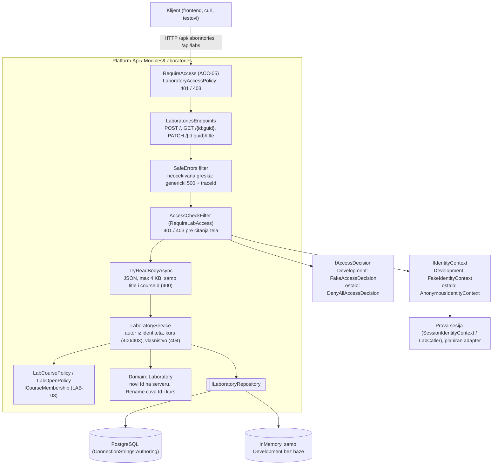
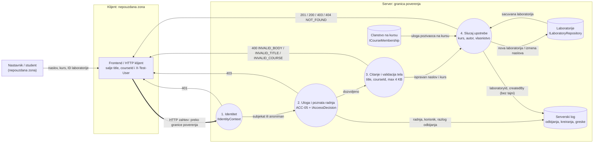

# Komponenta projekta: LAB-01 API (kreiranje, citanje i preimenovanje laboratorije)

**Tim:** 14

**Student:** Predrag Radovanović (PR 147/2023)

**Zahtevi iz specifikacije:** LAB-01 (kreiranje laboratorije sa trajnim ID; kriterijum: ID ostaje isti kroz revizije i izmene naslova). Zajednicki zahtevi koje ovaj deo pokriva: SEC-01 (serverska autorizacija), SEC-05 (validacija ulaza), ACC-04 (autorizacija nad konkretnim resursom), ACC-05 (podrazumevano odbijanje), OPS-07 (poruke o gresci bez tajni).

**Grane:** KT1 `feature/LAB-01-api` (PR #78), KT2 `feature/LAB-01-api-contract-tests`

## Odgovornosti i granice

- **Procesi i scenariji:**
  - Nastavnik kreira laboratoriju na kursu na kome predaje: `POST /api/laboratories` sa telom `{ "title": "...", "courseId": "..." }`. Server dodeljuje `Id`, autora (iz identiteta pozivaoca), status `Draft` i UTC vreme kreiranja, i vraca `201 Created` + `Location`. Ulogu na kursu proverava LAB-03 (`LabCoursePolicy`).
  - Nastavnik cita svoju laboratoriju: `GET /api/laboratories/{id}` vraca `200` ili `404`.
  - Nastavnik menja naslov svoje laboratorije: `PATCH /api/laboratories/{id}/title`; `Id`, kurs, autor, status i vreme kreiranja ostaju isti.
  - `/api/labs` je alias iz timskog plana: iste rute, isti handleri i iste provere. `Location` uvek pokazuje kanonsku putanju `/api/laboratories`.
- **Sta ovaj deo NE radi:** ne cuva podatke sam (koristi `ILaboratoryRepository`), ne menja domenska pravila (`Laboratory`), ne odredjuje ko je clan kursa (LAB-03, `ICourseMembership`), ne izdaje objavljene revizije (REV-01) i ne bira jezik sadrzaja (LAB-07).
- **Ugovori sa drugim delovima:**

| Veza | Svrha | Stanje |
| --- | --- | --- |
| `IIdentityContext` (lokalni port LAB modula) | ko je pozivalac | razvoj: `FakeIdentityContext` (`X-Test-User`); van Development-a `AnonymousIdentityContext` (niko nije prijavljen). **Prava prijava jos nije povezana** (vidi "KT2: provera toka kroz aplikaciju") |
| `IAccessDecision` (lokalni port LAB modula) | sme li uloga da izvrsi radnju | razvoj: `FakeAccessDecision`; van Development-a `DenyAllAccessDecision` |
| Centralni ACC-05 middleware (`RequireAccess`) | ista provera radnje kroz `LaboratoryAccessPolicy` | povezano (issue #185, opis u `LAB-03.md`) |
| `ICourseMembership` + `LabCoursePolicy` / `LabOpenPolicy` (LAB-03) | uloga na kursu pri kreiranju i citanju | povezano; LAB-01 samo prosledjuje `courseId` i mapira ishod u HTTP odgovor |
| `ILaboratoryRepository` | cuvanje i citanje | `PostgresLaboratoryRepository` kada postoji `ConnectionStrings:Authoring`; bez nje u Development-u `InMemoryLaboratoryRepository`, a van njega `UnavailableLaboratoryRepository` (bez tihog upisa u memoriju) |
| `Laboratory` (domen) | trajni ID, validacija naslova, obavezan kurs | koristi se `Create` za kreiranje i `Rename()` za izmenu |
| Frontend `api/labs.ts` i `CreateLabForm` (Marija) | salje `{ title, courseId }`, cita `id` iz odgovora, prevodi kodove gresaka | **uskladjeno u KT2:** kodovi `INVALID_TITLE`, `INVALID_COURSE`, `INVALID_BODY`, `NOT_FOUND`; 401/403 kao ProblemDetails |

- **Stanje implementacije:** POST, GET po ID-u i PATCH naslova su implementirani i pokriveni HTTP i jedinicnim testovima. U KT2 su dodati negativni testovi za ugovor (neispravan JSON, polja koja klijent ne sme da zada, tudja laboratorija, sadrzaj poruka o gresci), frontend salje kurs, a ceo tok je rucno proveren kroz aplikaciju.

## Ugovor zahteva i odgovora (KT2, frontend uskladjen; usaglaseno s Marijom)

**Kreiranje:** `POST /api/laboratories`, `Content-Type: application/json`, najvise 4 KB.

```json
{ "title": "RBAC", "courseId": "aaaaaaaa-aaaa-aaaa-aaaa-aaaaaaaaaaaa" }
```

**Promena naslova:** `PATCH /api/laboratories/{id}/title`, isto zaglavlje i limit.

```json
{ "title": "RBAC v2" }
```

Server cita samo navedena polja. Ostala polja (`id`, `createdBy`, `status`, `createdAt`, i `courseId` kod PATCH-a) se ignorisu, bez obzira na velicinu slova u imenu polja.

**Uspesan odgovor** (201 za POST, 200 za GET i PATCH):

```json
{
  "id": "b0427232-f9f6-4d59-b97c-3deb1c729e65",
  "courseId": "aaaaaaaa-aaaa-aaaa-aaaa-aaaaaaaaaaaa",
  "title": "RBAC",
  "status": "Draft",
  "createdBy": "11111111-1111-1111-1111-111111111111",
  "createdAt": "2026-11-26T00:45:07.3592247+00:00"
}
```

**Odgovori sa greskom:**

| Status | Telo | Kada | Poruka korisniku na frontendu |
| --- | --- | --- | --- |
| 400 | `{ "code": "INVALID_BODY", "message": "Request body is invalid." }` | telo nije JSON, nije `application/json`, vece od 4 KB, prazno ili nije objekat | "Zahtev nije ispravan. Osvezite stranicu i pokusajte ponovo." |
| 400 | `{ "code": "INVALID_TITLE", "message": "Laboratory title is required and must not exceed 200 characters." }` | naslov nedostaje, prazan je ili ima vise od 200 znakova | poruka uz polje naslova |
| 400 | `{ "code": "INVALID_COURSE", "message": "Laboratory course is required." }` | `courseId` nedostaje ili je `Guid.Empty` (samo POST) | "Izaberite kurs na kome predajete." uz polje kursa |
| 401 | ProblemDetails `{ "type", "title", "status" }` uz `correlationId` ili `traceId` | nema identiteta, neispravno ili visestruko `X-Test-User` zaglavlje | "Niste prijavljeni. Izaberite test korisnika." |
| 403 | ProblemDetails, naslov `Access denied` | uloga ne dozvoljava radnju, ili nastavnik ne predaje na trazenom kursu (isti odgovor za postojeci i nepostojeci kurs) | "Nemate dozvolu za ovu radnju. Server je odbio zahtev." + ID zahteva |
| 404 | `{ "code": "NOT_FOUND", "message": "Laboratory was not found." }` | laboratorija ne postoji **ili** nije pozivaocu dostupna (isti odgovor) | "Laboratorija nije pronadjena." |
| 500 | ProblemDetails `Unexpected error` + `traceId` | neocekivana greska | "Doslo je do greske. Pokusajte ponovo." |

Redosled provera pri kreiranju: identitet i radnja (401/403), telo (400 `INVALID_BODY`), kurs (400 `INVALID_COURSE`), uloga na tom kursu (403), naslov (400 `INVALID_TITLE`). Kurs se proverava pre naslova, pa ko nije nastavnik na kursu ne dobija ni povratnu informaciju o naslovu. Kod PATCH-a: identitet i radnja, telo, vlasnistvo (404), naslov (400). Odbijen zahtev ne menja skladiste.

## Matrica odluka o pristupu (Subject – Action – Resource)

| Subjekat | Radnja | Resurs | Odluka |
| --- | --- | --- | --- |
| anoniman / neispravno `X-Test-User` / vise zaglavlja | bilo koja | bilo koji | Deny, 401 |
| Student | `laboratory.create` | nova laboratorija | Deny, 403 |
| Student | `laboratory.read`, `laboratory.rename` | bilo koja laboratorija | Deny, 403 (bez sadrzaja) |
| Nastavnik na kursu C | `laboratory.create` | nova laboratorija na kursu C | Allow, 201 |
| Nastavnik koji ne predaje na kursu C | `laboratory.create` | nova laboratorija na kursu C | Deny, 403 |
| Nastavnik, autor, na kursu laboratorije | `laboratory.read`, `laboratory.rename` | sopstvena laboratorija | Allow, 200 |
| Nastavnik, nije autor (i kad predaje na istom kursu) | `laboratory.read`, `laboratory.rename` | tudja laboratorija | Deny, 404 (isti odgovor kao za nepostojecu) |
| bilo ko | nepoznata radnja | bilo koji | Deny (nema politike) |
| bilo ko, van Development okruzenja | bilo koja | bilo koji | Deny, 401 |

Uloga se proverava u centralnom middleware-u i `AccessCheckFilter`, uloga na kursu u `LabCoursePolicy`/`LabOpenPolicy`, a vlasnistvo u `LaboratoryService`.

### Zasto tudja laboratorija vraca 404, a ne 403

Zadatak za KT2 pominje 403 za PATCH tudje laboratorije. Zadrzan je 404, isti kao za nepostojecu laboratoriju:

- 403 bi potvrdio da laboratorija sa tim ID-em postoji, pa bi napadac mogao da proverava ID-eve (enumeracija, IDOR).
- Isto pravilo vec vazi za `GET /{id}` (LAB-01 i LAB-03, `LAB-03.md`, "Zasto 404, a ne 403") i za pretragu (LAB-05). Drugaciji odgovor samo za PATCH bi bio nedosledan i otkrivao bi isto sto GET krije.
- 403 ostaje za slucajeve kada problem nije konkretan resurs: pogresna uloga (student) ili kurs na kome nastavnik ne predaje.

To proverava `PatchLabTitle_ForeignLab_ReturnsSameResponseAsMissingAndKeepsTitle`: status i telo odgovora za tudju i nepostojecu laboratoriju su identicni, i kada drugi nastavnik predaje na istom kursu.

## Dijagram arhitekture API sloja

Puna strelica oznacava postojecu vezu, isprekidana planiranu integraciju.



## DFD sa granicom poverenja klijent–server



Sve sto dolazi preko granice poverenja smatra se nepouzdanim: naslov, kurs, ID iz putanje, `X-Test-User` i eventualna dodatna polja u JSON-u (`id`, `createdBy`, `status`, `createdAt`). `Id`, autor, status i vreme nastaju na serveru, a kurs se proverava na serveru. Odbijen zahtev nikad ne stize do skladista.

## Model pretnji: imovina -> zloupotreba -> kontrola -> test

| Imovina | Moguca zloupotreba | Kontrola | Test |
| --- | --- | --- | --- |
| Trajni ID laboratorije | klijent salje svoj `id` i pregazi ili zauzme tudji ID | zahtev nema polje `id`; domen generise `Guid` | `PostLabs_WhenClientSendsOwnId_ServerIgnoresItAndAssignsNewId`, `PostLabs_WhenClientSetsIdCreatorOrStatus_StoredLabHasServerValues` |
| Autor i status | klijent salje `createdBy` ili `status` (i kao `CreatedBy`, `Status`) | autor iz `IIdentityContext`, status uvek `Draft`; proverava se i sacuvan zapis, ne samo odgovor | `PostLabs_WhenClientSetsIdCreatorOrStatus_StoredLabHasServerValues`, `PatchLabTitle_CannotChangeIdCreatorOrCourseThroughBody` |
| Pravo kreiranja | student kreira, ili nastavnik na tudjem kursu | uloga (ACC-05 + filter) i uloga na kursu (LAB-03) | `PostLabs_WhenStudentCreates_Returns403AndStoresNothing`, `PostLabs_WhenTeacherSwapsCourseId_Returns403AndStoresNothing` |
| Tudji nacrt (IDOR) | nastavnik cita ili menja tudju laboratoriju pogadjanjem ID-a | provera vlasnistva, 404 isti kao za nepostojecu | `GetLabById_WhenLabBelongsToAnotherTeacher_Returns404SameAsMissing`, `PatchLabTitle_ForeignLab_ReturnsSameResponseAsMissingAndKeepsTitle` |
| Interni detalji servera | odgovor otkriva tip izuzetka, stack trace, imena klasa, ID ili unos | fiksne poruke sa kodom; dozvoljena su samo poznata polja; `SafeErrors` | `ErrorResponses_DoNotRevealInternalDetailsOrInput`, `WhenStorageFails_Returns500WithoutInternalDetails` |
| Integritet podataka | neispravan JSON, pogresan `Content-Type`, prazan ili predug naslov | rucno citanje tela, max 4 KB, validacija pre domena; izmena se ne upisuje | `PostLabs_WhenBodyIsMalformed_Returns400WithoutInternalDetails`, `PatchLabTitle_WhenBodyIsMalformed_Returns400AndKeepsTitle`, `PostLabs_WhenTitleIsTooLong_...` |
| Razvojni identitet | `X-Test-User: marko:Teacher` u produkciji | fake se registruje samo u Development-u | `OutsideDevelopment_TestTeacherHeaderDoesNotGrantAccess` |

## Bezbednosni zahtevi

- **Provere na serveru:** svaka ruta ima `RequireAccess` i `RequireLabAccess` sa svojom radnjom (`laboratory.create`, `laboratory.read`, `laboratory.rename`). Provera prava ide pre citanja tela. Kurs i vlasnistvo se proveravaju u svakom slucaju upotrebe.
- **Validacija ulaza:** samo `application/json`, najvise 4 KB; neispravan JSON daje kontrolisan `400 INVALID_BODY` i u Development rezimu. Naslov je obavezan, najvise 200 znakova posle `Trim()`. `courseId` je obavezan pri kreiranju. ID iz putanje mora biti `Guid`, inace 404.
- **Osetljivi podaci:** odgovori o gresci imaju samo polja `code`, `message`, `type`, `title`, `status`, `traceId`, `correlationId`. Ne sadrze tip izuzetka, stack trace, imena klasa, ID iz zahteva ni poslati naslov. Log belezi ID laboratorije i autora, bez tajni.
- **Ogranicenja (poznata):**
  - `X-Test-User` je simulacija identiteta, ne dokaz. LAB modul jos nije povezan sa pravom prijavom (vidi ispod). Van Development okruzenja pristup laboratorijama se odbija.
  - Razvojni korisnik (`marko`) se deterministicki mapira u `Guid` autora (`CallerId`). Pravi korisnicki ID je vec `Guid` i koristi se direktno.
  - Dva istovremena preimenovanja iste laboratorije: poslednji upis pobedjuje.

## KT2: provera toka kroz aplikaciju

Provereno 26. novembra 2026. na lokalnom racunaru: backend `dotnet run --project backend/Platform.Api/Platform.Api.csproj --launch-profile Platform.Api` (Development, `http://localhost:5080`, bez baze, pa `InMemoryLaboratoryRepository`), frontend `npm run dev` iz `frontend/`. Korisnik 1111 je nastavnik na demo kursu `aaaaaaaa-...`, 3333 nije nastavnik na tom kursu (demo podaci iz `Program.cs`).

| # | Korak | Kroz | Korisnik | Dobijeno |
| --- | --- | --- | --- | --- |
| 1 | kreiranje na "Demo kurs" | aplikacija (forma) | nastavnik 1111 | 201, ID `b0427232-f9f6-4d59-b97c-3deb1c729e65` |
| 2 | kreiranje na "Drugi demo kurs" | aplikacija | nastavnik 1111 | 403 |
| 3 | kreiranje | aplikacija | student | 403 sa ID-em zahteva |
| 4 | citanje laboratorije iz koraka 1 | HTTP (`curl.exe`) | 1111 | 200, isti `id`, `courseId`, naslov `lab01`, `createdBy` 1111, status `Draft` |
| 5 | citanje iste laboratorije | HTTP | 3333 kao Teacher | 404 `NOT_FOUND`, isto kao nepostojeca |
| 6 | promena naslova sa pokvarenim JSON-om (greska u PowerShell navodnicima) | HTTP | 1111 | 400 `INVALID_BODY`, bez detalja; naslov ostao `lab01` |
| 7 | promena naslova u "Promenjen naslov" | HTTP (`Invoke-RestMethod`) | 1111 | 200, isti `id`, novi naslov |
| 8 | ponovno citanje | HTTP | 1111 | 200, naslov "Promenjen naslov", `id`, kurs, autor i `createdAt` nepromenjeni |

**Zakljucak:** kreiranje, citanje i preimenovanje rade kroz pravi host, sa istim kodovima kao u testovima. Trajni ID je isti posle preimenovanja.

**Nalazi:**

- **Prava prijava nije povezana sa LAB modulom.** Aplikacija nije trazila prijavu: identitet dolazi iz razvojnog `X-Test-User` zaglavlja (`FakeIdentityContext`). Platforma vec ima sesiju (`SessionIdentityContext`, `LabCaller`), ali je koriste samo LabVisibility/AUT-07 rute, a Identity za nju trazi PostgreSQL. Povezivanje je posao sa Identity timom: adapter koji iz sesije daje `CallerId` i proverava status naloga, dok uloga na kursu ostaje iz `ICourseMembership`. Do tada je tok proveren sa razvojnim identitetom, a van Development-a LAB rute odbijaju svaki zahtev (401).
- **Citanje i preimenovanje nemaju ekran.** Frontend ima samo formu za kreiranje, pa su koraci 4–8 provereni direktno preko API-ja.
- Kod `curl.exe` u PowerShell-u JSON telo se lako pokvari zbog navodnika. Za rucnu proveru koristiti `Invoke-RestMethod` (primer ispod).

## Dokaz rada

- **Fajlovi:**
  - `backend/Platform.Api/Modules/Laboratories/Api/LaboratoriesEndpoints.cs` (rute, citanje tela, `SafeErrors`)
  - `backend/Platform.Api/Modules/Laboratories/Api/LaboratoryContracts.cs` (zahtevi, odgovor, kodovi gresaka)
  - `backend/Platform.Api/Modules/Laboratories/Application/LaboratoryService.cs` (slucajevi upotrebe, kurs, vlasnistvo)
  - `backend/Platform.Api/Modules/Laboratories/Application/CallerId.cs`, `LabActions.cs`
  - `backend/Laboratories.Tests/LaboratoriesHttpTests.cs`, `LaboratoryServiceTests.cs`, `FakeAccessDecisionTests.cs`
  - `frontend/src/api/labs.ts`, `frontend/src/components/labs/CreateLabForm.tsx` i njihovi testovi
- **Pokretanje testova** (iz korena repozitorijuma):

```powershell
dotnet test backend/Laboratories.Tests/Laboratories.Tests.csproj
cd frontend; npm ci; npm test; npm run build
```

Ostali test projekti u `SecurityLab.slnx` traze PostgreSQL i prolaze u CI-ju.

- **Kljucni testovi KT1:**

| Stavka | Test |
| --- | --- |
| POST uz proveru uloge nastavnika -> 201 + Id | `PostLabs_WhenTeacherCreates_Returns201WithServerIdAndLocation` |
| GET -> 200 ili 404 bez internih detalja | `GetLabById_WhenOwnerReads_Returns200WithSameData`, `GetLabById_WhenIdDoesNotExist_Returns404WithoutInternalDetails` |
| PATCH naslova, isti Id | `PatchLabTitle_WhenTeacherRenamesLab_UpdatesTitleAndKeepsSameId`, `PatchLabTitle_RenamedTwice_IdStaysTheSame` |
| student kreira -> 403 | `PostLabs_WhenStudentCreates_Returns403AndStoresNothing` |
| neispravan naslov -> 400 | `PostLabs_WhenTitleIsMissingOrBlank_Returns400AndStoresNothing`, `PostLabs_WhenTitleIsTooLong_Returns400AndStoresNothing` |

- **Kljucni testovi KT2:**

| Stavka iz zaduzenja | Test |
| --- | --- |
| klijent pri kreiranju ne moze da zada id, autora ili status | `PostLabs_WhenClientSetsIdCreatorOrStatus_StoredLabHasServerValues` (camelCase, PascalCase, `status` kao broj) |
| PATCH tudje laboratorije je odbijen (404, vidi obrazlozenje) | `PatchLabTitle_ForeignLab_ReturnsSameResponseAsMissingAndKeepsTitle` (drugi nastavnik, i na istom kursu) |
| neispravan JSON -> 400 | `PatchLabTitle_WhenBodyIsMalformed_Returns400AndKeepsTitle`, `PostLabs_WhenBodyIsMalformed_Returns400WithoutInternalDetails` |
| poruke 400/401/403/404 bez internih detalja | `ErrorResponses_DoNotRevealInternalDetailsOrInput` (8 scenarija) |
| frontend salje `{ title, courseId }` i prevodi kodove | `labsApi.test.ts`, `CreateLabForm.test.tsx` |

- **Rucna demonstracija** (Development, API na portu 5080):

```powershell
dotnet run --project backend/Platform.Api/Platform.Api.csproj --launch-profile Platform.Api

# drugi terminal
$base = "http://localhost:5080/api/laboratories"
$marko = @{ "X-Test-User" = "11111111-1111-1111-1111-111111111111:Teacher" }
$drugi = @{ "X-Test-User" = "33333333-3333-3333-3333-333333333333:Teacher" }

# 1) kreiranje na kursu na kome 1111 predaje -> 201
$lab = Invoke-RestMethod -Method Post -Uri $base -Headers $marko -ContentType "application/json" `
  -Body '{"title":"RBAC","courseId":"aaaaaaaa-aaaa-aaaa-aaaa-aaaaaaaaaaaa"}'
$lab

# 2) citanje -> 200; drugi nastavnik -> 404 (crvena greska sa 404)
Invoke-RestMethod -Uri "$base/$($lab.id)" -Headers $marko
Invoke-RestMethod -Uri "$base/$($lab.id)" -Headers $drugi

# 3) promena naslova -> 200, isti id
Invoke-RestMethod -Method Patch -Uri "$base/$($lab.id)/title" -Headers $marko -ContentType "application/json" `
  -Body '{"title":"RBAC v2"}'
```

- **Sledeci koraci:** adapter na pravu sesiju (sa Identity timom); ekran za citanje i preimenovanje na frontendu; dogovor sa LAB-07 oko rute za sadrzaj po jeziku; strukturisan audit zapis kroz `Platform.Audit`.