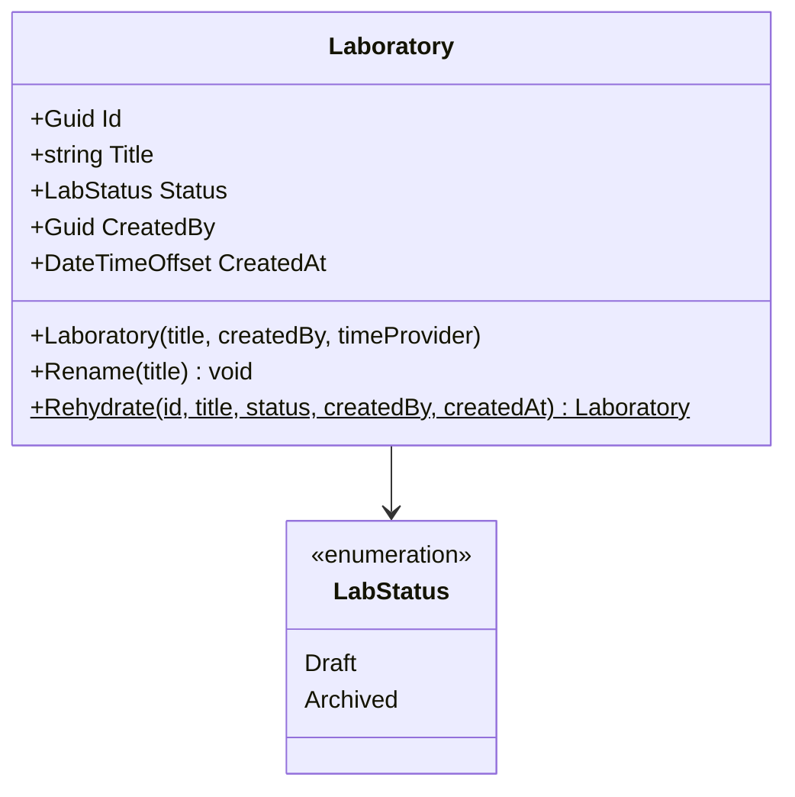
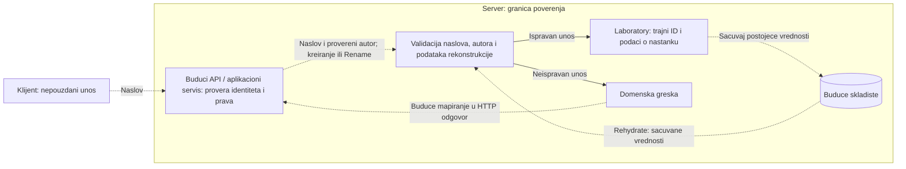

# LAB-01: domenski model laboratorije

**Tim:** 14

**Zaduzenje:** Visnja Maksimovic — LAB-01 domen

**Grana:** `feature/LAB-01-domain`

**Zahtev:** LAB-01 — trajni identitet laboratorije kroz izmene naslova i revizije.

## Odgovornost i implementacija

`Laboratory` predstavlja trajni identitet laboratorije. Postojeci model sa ID-jem i naslovom dopunjen je statusom, autorom i vremenom kreiranja. Ovo je domenski deo: ne implementira HTTP endpoint, proveru prava, repozitorijum ili izdavanje revizija.

| Podatak | Pravilo |
| --- | --- |
| `Id` | Nepromenljiv `Guid`. Pri kreiranju ga generise server. |
| `Title` | Obavezan naslov, najvise 200 znakova posle uklanjanja okolnih razmaka. Menja se samo kroz `Rename()`. |
| `Status` | Nova laboratorija dobija `LabStatus.Draft`. Nema javni seter. |
| `CreatedBy` | Nepromenljiv, neprazan `Guid` autora. API/aplikacioni servis mora ga dobiti iz serverskog identiteta pozivaoca. |
| `CreatedAt` | Nepromenljiv `DateTimeOffset`, sacuvan u UTC. Pri kreiranju dolazi iz serverskog `TimeProvider`-a. |

`LabStatus` trenutno sadrzi `Draft` i `Archived`. To je pocetni skup statusa za ovaj model; prelazi statusa, arhiviranje i objavljivanje nisu implementirani. `Rename()` trenutno ne zavisi od statusa: i rekonstruisana arhivirana laboratorija moze dobiti novi naslov. Pravila za eventualnu zabranu te promene treba usaglasiti pri dodavanju upravljanja zivotnim ciklusom.

## Kreiranje i rekonstrukcija

Za novu laboratoriju koristi se konstruktor:

```csharp
var laboratory = new Laboratory("Kontrola pristupa", authenticatedUserId);
```

`authenticatedUserId` predstavlja prethodno proveren identitet na serveru, ne ID autora iz klijentskog JSON-a. Model odbija `Guid.Empty`, ali ne proverava postojanje naloga, clanstvo u kursu ili dozvole. Te provere pripadaju Identity/Access integraciji i aplikacionom sloju.

Opcioni `TimeProvider` omogucava deterministicke testove. U redovnom kreiranju koristi se `TimeProvider.System`; klijent ne bira vreme ili ID.

Za ucitavanje postojece laboratorije koristi se:

```csharp
var laboratory = Laboratory.Rehydrate(id, title, status, createdBy, createdAt);
```

`Rehydrate` je namenjen pouzdanom adapteru skladista. Zadrzava sacuvani identitet i podatke o nastanku, normalizuje vremensku zonu u UTC i ponavlja validaciju. Ne sme se koristiti za kreiranje nove laboratorije direktnim mapiranjem klijentskog zahteva. Raniji konstruktori `Laboratory(string)` i `Laboratory(Guid, string)` zamenjeni su novim konstruktorom i ovom metodom; pozivi u postojecim LAB testovima su prilagodjeni.

## Klasni dijagram



Svi podaci se javno citaju. Samo `Title` ima privatni seter, koji koristi domenska operacija. Ostali podaci imaju samo getter i dodeljuju se tokom kreiranja/rekonstrukcije.

## DFD i granica poverenja

Pune veze predstavljaju postojecu domensku logiku. Isprekidane veze ka API-ju i skladistu predstavljaju planiranu integraciju.



Pri novom kreiranju domenski konstruktor generise ID i cita serverski sat. Pri preimenovanju prvo se proverava novi naslov, a tek zatim menja `Title`. Ako validacija ne prodje, prethodno stanje ostaje. Trenutni domen se izvrsava kroz testove; jos nema upisa ovog modela u skladiste ni potpunog HTTP toka kreiranja.

## Granice prema ostalim delovima

- **Predrag / LAB-01 API:** koristi novi konstruktor sa proverenim autorom, ignorise klijentski ID i poziva `Rename()` nakon serverske provere prava. HTTP mapiranje gresaka nije deo ovog domena.
- **Gordana / skladiste:** cuva ID, naslov, status, autora i UTC vreme; pri ucitavanju poziva `Rehydrate`. Ne generise novi ID za vec sacuvanu laboratoriju.
- **LAB-02:** `LaboratoryMetadata.LaboratoryId` referencira trajni LAB-01 ID. Ne uvodi se druga klasa laboratorije niti novi identitet.
- **Tim 11 / Authoring:** uredjivanje nacrta i verzija nacrta ostaju u njihovom modulu. Vezu nacrta sa laboratorijom treba usaglasiti; `LabDraft.Version` nije broj objavljene revizije.
- **Lana / LAB-07 i REV:** prevod se vezuje za reviziju, a revizija za trajnu laboratoriju. Ovaj model ne sadrzi prevode, evaluator ili operaciju objavljivanja.

Otvoreno pitanje: LAB naslov trenutno ima limit 200, dok Authoring i LabLocalization koriste 120 znakova. Limit nije menjan u ovoj izmeni; pre povezivanja potrebno je dogovoriti pravila prenosa teksta. Statusi i njihovi prelazi takodje zahtevaju zajednicki dogovor pre integracije sa objavljivanjem/arhiviranjem.

## Testovi i dokazi

Postojeci testovi proveravaju serversko generisanje razlicitih nepraznih ID-jeva, nepromenljivost ID-ja pri preimenovanju, prazne/preduge naslove, granicnu duzinu, normalizaciju naslova i ocuvanje stanja posle odbijene promene.

Dodati testovi proveravaju:

- pocetni status `Draft`, autora i UTC vreme iz kontrolisanog serverskog sata;
- odbijanje praznog autora pri kreiranju i rekonstrukciji;
- rekonstrukciju postojeceg identiteta, statusa i podataka o nastanku;
- odbijanje nepoznatog statusa i nedostajuceg vremena kreiranja;
- ocuvanje ID-ja, statusa, autora i vremena pri uspesnom i neuspesnom preimenovanju.

Iz korena repozitorijuma, uz .NET SDK 10:

```powershell
# Samo domenski testovi
dotnet test backend/Laboratories.Tests/Laboratories.Tests.csproj --configuration Release --filter FullyQualifiedName~LaboratoryTests

# Sve provere zajednickog backend solution-a
dotnet test backend/SecurityLab.slnx --configuration Release
```

Lokalni rezultat 4. novembra 2026. (.NET SDK 10.0.403): proslo je svih **410 testova** iz zajednickog solution-a, bez neuspesnih i preskocenih. `Laboratories.Tests` ima **40** uspesnih slucajeva, ukljucujuci domenske i ranije HTTP/policy testove. Authoring ima 55, LabLocalization 54, LabMetadata 7, RateLimiting 24, Audit 95, Platform.Tests 70 i Kt1 65. Ovo je lokalna provera, ne GitHub CI rezultat ove grane.

Dokaz LAB-01 da identitet ostaje isti kroz objavljene revizije zahteva povezivanje sa revizijama; ovde je pokriven deo koji se odnosi na kreiranje, rekonstrukciju i promenu naslova.

## Kratka demonstracija za KT1

1. Pokazati `Laboratory` i `LabStatus`, posebno gettere za trajne podatke.
2. Pokazati test kreiranja sa poznatim autorom i kontrolisanim vremenom.
3. Pokazati preimenovanje: menja se naslov, a ID i podaci o nastanku ostaju isti.
4. Pokazati odbijanje praznog/predugog naslova bez promene prethodnog stanja.
5. Pokazati rekonstrukciju iz sacuvanih vrednosti i objasniti buducu vezu sa repozitorijumom.

Objasnjenje: "Moj deo je domenski model laboratorije. Pri kreiranju server dodeljuje trajni ID i vreme, a autor dolazi iz proverene serverske sesije kada se API poveze. Preimenovanje prolazi validaciju i ne menja identitet ni podatke o nastanku. Testovi pokazuju da neispravna promena ostavlja prethodno stanje."
