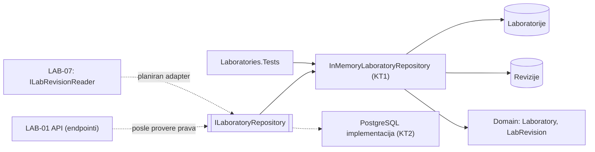
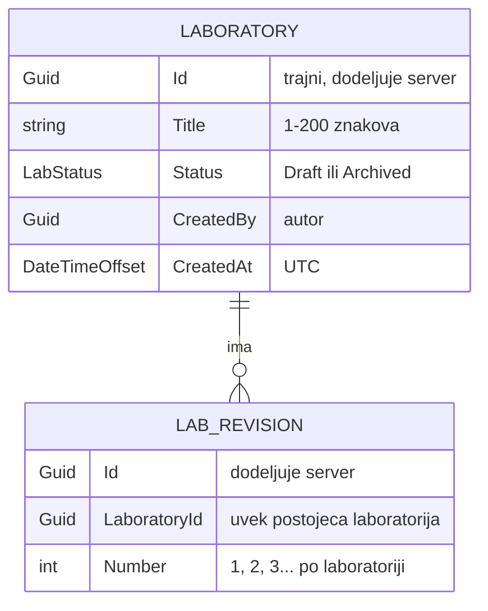
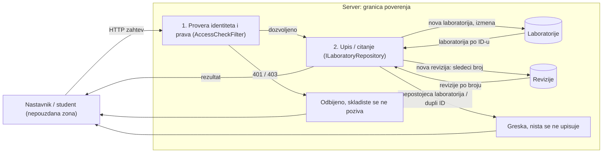

# Komponenta projekta: LAB-01 skladiste laboratorija i revizije

**Tim:** 14

**Student:** Gordana Petrovic (PR 51/2023)

**Zahtevi iz specifikacije:** LAB-01 (kreiranje laboratorije sa trajnim ID; kriterijum: ID ostaje isti kroz revizije i izmene naslova)

**Grana:** `feature/LAB-01-storage`

## Odgovornosti i granice

- **Procesi i scenariji:**
  - Cuvanje laboratorije pod njenim trajnim ID-em i citanje po ID-u. Cuvaju se ID, naslov, status, autor i UTC vreme kreiranja; pri ucitavanju se laboratorija rekonstruise kroz `Laboratory.Rehydrate`, bez novog ID-a.
  - Izmena vazi tek kada se sacuva (`UpdateAsync`), kao red u bazi. Autor i vreme kreiranja se izmenom ne menjaju.
  - Cuvanje izmene postojece laboratorije (npr. posle `Rename`) bez promene ID-a.
  - Dodavanje revizije laboratoriji: skladiste dodeljuje sledeci broj (1, 2, 3...), a ID laboratorije ostaje isti.
  - Odbijanje revizije za nepostojecu laboratoriju i odbijanje druge laboratorije sa vec postojecim ID-em.
- **Ugovori sa drugim delovima:**
  - `ILaboratoryRepository` (`Application`) je jedini ulaz u skladiste. LAB-01 API (endpointi) ga koristi posle serverske provere prava.
  - Skladiste ne proverava prava: provera ostaje u `AccessCheckFilter` / aplikacionom servisu, pre poziva skladista.
  - `LabRevision` je **minimalna demonstraciona revizija** (Id, LaboratoryId, Number) koja dokazuje kriterijum LAB-01. Objava sa nepromenljivim snapshot-om definicije pripada zahtevu REV-01 i ovde nije implementirana.
  - LAB-07 (`Platform.LabLocalization`) cita reviziju preko svog `ILabRevisionReader`. Adapter izmedju njega i ovog skladista je planiran, kada revizija dobije verziju evaluatora (REV-01).
- **Stanje implementacije:**
  - Implementirano i pokriveno testovima: `LabRevision`, `ILaboratoryRepository`, `InMemoryLaboratoryRepository`.
  - Planirano: registracija skladista u `LaboratoriesModule` (dogovor sa vlasnikom kostura), PostgreSQL implementacija za KT2, adapter za LAB-07.

## Arhitektura komponente

Puna strelica: postojeca veza. Isprekidana: planirano.



### Model podataka



`Laboratory 1 — 0..* LabRevision`. Nova laboratorija nema revizija. Broj revizije se racuna posebno za svaku laboratoriju.

### Plan prelaska na PostgreSQL (KT2)

- Nova klasa implementira isti `ILaboratoryRepository`; endpointi i testovi ugovora se ne menjaju.
- Tabele `laboratories (id PK, title, status, created_by, created_at)` i `lab_revisions (id PK, laboratory_id FK, number)`, uz jedinstveni par `(laboratory_id, number)`, tako da baza sama sprecava dupli broj.
- Migracija kroz EF Core; kredencijali samo iz `.env` / konfiguracije, nikad u Gitu.
- Zamena registracije u `LaboratoriesModule`: memorija u testovima, PostgreSQL u aplikaciji.

## Dijagram toka podataka (DFD)



**Ko sme da pise:** upis (nova laboratorija, izmena, revizija) dozvoljen je samo posle serverske provere prava; trenutno samo radnja `laboratory.create` za ulogu nastavnika. Citanje liste dozvoljeno je svim prijavljenim ulogama. Klijent nikad ne bira ID laboratorije ni broj revizije: oba dodeljuje server.

**Implementirano / planirano:** procesi 2, skladista i greske su implementirani i testirani direktno nad skladistem. Povezivanje procesa 1 sa skladistem (endpointi) je naredni korak LAB-01 API dela.

## Bezbednosni zahtevi

- **Provere na serveru:** skladiste se poziva tek posle `AccessCheckFilter`; odbijen zahtev ne dolazi do podataka.
- **Integritet identiteta:** postojeca laboratorija se ne moze pregaziti novom sa istim ID-em (`DuplicateLaboratoryException`); ID se ne menja izmenom ni revizijama.
- **Integritet revizija:** broj dodeljuje skladiste pod zakljucavanjem, pa ni istovremeni zahtevi ne dobijaju isti broj; revizija nepostojece laboratorije se odbija i nista se ne upisuje. `LabRevision` nema setere.
- **Ulaz:** prazni ID-evi i broj manji od 1 se odbijaju u domenu; naslov, status, autora i vreme validira `Laboratory` (i pri `Rehydrate`).
- **Rekonstrukcija:** skladiste ne vraca sacuvani objekat nego novu instancu kroz `Rehydrate`, pa nesacuvana izmena ne zavrsava u skladistu.
- **Osetljivi podaci:** skladiste ne cuva lozinke ni tokene; greske ne otkrivaju sadrzaj tudjih laboratorija.
- **Negativni scenariji (testovi):** revizija i citanje revizija za nepostojecu laboratoriju, izmena nesacuvane laboratorije, dupli ID, neispravan ID / broj revizije.

## Dokaz rada

- **Fajlovi:**
  - `backend/Platform.Api/Modules/Laboratories/Domain/LabRevision.cs`
  - `backend/Platform.Api/Modules/Laboratories/Application/ILaboratoryRepository.cs`
  - `backend/Platform.Api/Modules/Laboratories/Infrastructure/InMemoryLaboratoryRepository.cs`
  - `backend/Laboratories.Tests/LaboratoryRepositoryTests.cs`
  - `backend/Laboratories.Tests/LabRevisionTests.cs`
- **Pokretanje testova** (iz korena repozitorijuma, .NET SDK 10):

```powershell
dotnet test backend/Laboratories.Tests/Laboratories.Tests.csproj
```

- **Kljucni testovi:**

| Test | Sta dokazuje |
| --- | --- |
| `AfterTwoRevisions_LaboratoryIdIsUnchanged` | kriterijum LAB-01: ID isti posle 2 revizije |
| `RevisionNumbers_GrowOneTwoThree` | broj revizije raste 1, 2, 3 |
| `AddRevision_ForNonExistingLaboratory_Throws` | revizija nepostojece laboratorije je greska |
| `RenameAndUpdate_KeepsIdAndRevisions` | izmena naslova ne menja ID ni revizije |
| `Add_WithExistingId_IsRejectedAndKeepsOriginal` | postojeca laboratorija se ne pregazuje |
| `ChangeWithoutUpdate_IsNotStored` | izmena vazi tek posle cuvanja |
| `ConcurrentRevisions_GetUniqueConsecutiveNumbers` | istovremene revizije dobijaju jedinstvene brojeve |

- **Sledeci koraci:** registracija skladista u modulu i povezivanje sa endpointima (LAB-01 API), PostgreSQL implementacija i migracija (KT2), adapter za LAB-07 kada REV-01 definise reviziju sa evaluatorom.
