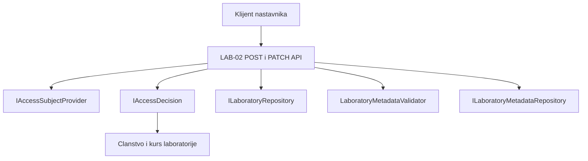

# LAB-02: API za nastavnika (Osoba 4)

## Obim i zavisnosti

Ovaj deo obuhvata unos i izmenu metapodataka, proveru prava preko
`Platform.Access.Contracts.IAccessDecision` i HTTP testove nastavnickog API-ja.
Zahtevi: LAB-02, ACC-05 i SEC-01.

API koristi postojecu laboratoriju i njen trajni LAB-01 ID. Ne kreira novu
laboratoriju niti menja njen naziv. Naziv se uredjuje postojecim LAB-01 API-jem.
Katalog, frontend, migracije, domenska pravila i implementacija Access modula
pripadaju drugim delovima projekta.

| Zavisnost | Uloga i trenutno stanje |
| --- | --- |
| `ILaboratoryRepository` | Provera da laboratorija postoji |
| `ILaboratoryMetadataRepository` | Citanje i cuvanje metapodataka; u Development okruzenju koristi se privremeni `InMemoryLaboratoryMetadataRepository` |
| `LaboratoryMetadataValidator` | Postojeca validacija Osobe 3; API vraca njene greske po poljima |
| `IAccessSubjectProvider` | Identitet pozivaoca |
| `IAccessDecision` | Serverska odluka za `lab.draft.manage` nad resursom `laboratory` i konkretnim ID-em |

Repozitorijum u memoriji je KT1 stub: podaci nestaju posle restarta. Sa Osobom 2
treba usaglasiti povezivanje sa trajnim skladistem. Njegove migracije i bazu
ovaj deo ne implementira. Za uspesan pristup potrebni su i podaci o clanstvu
nastavnika i vezi laboratorije sa kursom, koje koristi Access modul.

## Rute i zahtevi

Obe rute primaju `Content-Type: application/json`. `{id}` je GUID postojece
laboratorije. Ove metadata rute nemaju `/api/labs` alias.

| Metod i ruta | Namena | Uspeh |
| --- | --- | --- |
| `POST /api/laboratories/{id}/metadata` | Prvi unos metapodataka postojece laboratorije | `201 Created`, JSON i `Location` zaglavlje |
| `PATCH /api/laboratories/{id}/metadata` | Izmena postojecih metapodataka | `200 OK` i JSON |

Primer POST zahteva:

```http
POST /api/laboratories/cccccccc-cccc-cccc-cccc-cccccccccccc/metadata
Content-Type: application/json

{
  "objective": "Nauciti osnove kontrole pristupa",
  "difficulty": 0,
  "type": 0,
  "tags": ["bezbednost", "osnove"]
}
```

Primer PATCH zahteva koristi istu rutu i celo telo metapodataka:

```json
{
  "objective": "Primena kontrole pristupa u okviru kursa",
  "difficulty": 1,
  "type": 0,
  "tags": ["bezbednost", "autorizacija"]
}
```

PATCH trenutno zamenjuje sva cetiri metapolja; ne implementira JSON Patch niti
delimicno spajanje samo prosledjenih polja.

| Polje | Trenutna pravila |
| --- | --- |
| `objective` | Neprazan tekst, najvise 2000 znakova nakon uklanjanja okolnih razmaka |
| `difficulty` | Broj: `0` Easy, `1` Medium, `2` Hard |
| `type` | Broj: `0` AccessControl, `1` LogAnalysis, `2` SecurityConfiguration, `3` ThreatModeling, `4` MfaAndSessions, `5` ContextualAuthorization, `6` IncidentResponse, `7` IsolatedService |
| `tags` | Niz stringova koji nije `null`; prazna lista je dozvoljena |

Slati numericke vrednosti enum polja. Trenutni ugovor koristi nenullabilne enum
vrednosti: izostavljeni `difficulty` ili `type` dobijaju podrazumevanu vrednost
`0`, pa se njihovo izostavljanje trenutno ne odbija kao obavezno polje.
Strozu proveru prisustva treba usaglasiti sa Osobom 3.

Domenski model uklanja okolne razmake cilja, a oznake pretvara u mala slova,
uklanja prazne oznake, okolne razmake i duplikate.

## Odgovori i greske

Primer odgovora na uspesan POST (`201`):

```http
Location: /api/laboratories/cccccccc-cccc-cccc-cccccccccccc/metadata
Content-Type: application/json

{
  "laboratoryId": "cccccccc-cccc-cccc-cccc-cccccccccccc",
  "objective": "Nauciti osnove kontrole pristupa",
  "difficulty": 0,
  "type": 0,
  "tags": ["bezbednost", "osnove"]
}
```

PATCH vraca isti oblik JSON-a sa sacuvanim novim vrednostima, bez kreiranja
novog ID-a laboratorije.

| Status | Uslov u metadata handleru |
| --- | --- |
| `400 Bad Request` | Neispravan JSON, `null` telo ili neuspesna validacija |
| `401 Unauthorized` | `IAccessSubjectProvider` nije pronasao subjekta |
| `403 Forbidden` | Odluka Access modula nije `Allow` |
| `404 Not Found` | Laboratorija ne postoji; za PATCH i kada metapodaci ne postoje |
| `409 Conflict` | POST kada metapodaci vec postoje |

Pristup se proverava pre citanja zahteva i metapodataka. Postojeci middleware
moze odbiti zahtev pre handlera; prikazani odgovori nisu zamena za integraciju
sa stvarnim identitetom i sesijom.

Validaciona greska je `application/problem+json`; primer relevantnih polja:

```json
{
  "title": "One or more validation errors occurred.",
  "status": 400,
  "errors": {
    "objective": ["Laboratory objective is required."]
  }
}
```

Ostala polja Problem Details odgovora moze dodati ASP.NET Core.
Primeri poruka koje sam handler vraca:

```json
{"error": "Invalid JSON request."}
```

```json
{"error": "Request body is required."}
```

```json
{"error": "Laboratory metadata already exists."}
```

```json
{"error": "Laboratory metadata was not found."}
```

Greske `401`, `403` i `404` za nepostojecu laboratoriju u handleru nemaju
posebno definisano JSON telo. Klijent ne treba da pokusava da ih bezuslovno
deserijalizuje kao JSON. Neispravan GUID u putanji ne odgovara ruti.

## Provera prava i dijagram arhitekture

API ne odlucuje prema ulozi koju posalje klijent. Poziva `IAccessDecision` sa
serverom dobijenim subjektom, akcijom `lab.draft.manage`, konkretnim resursom i
`HttpContext.TraceIdentifier`. Svaki ishod razlicit od `Allow` se odbija.
Podrazumevano odbijanje nepoznate akcije obezbedjuje postojeci Access modul.

Ovaj prikaz opisuje deo Osobe 4 za ukljucivanje u zajednicki dijagram Osobe 1:



Na zajednickom sastanku objasniti ulazni JSON, proveru identiteta i prava,
validaciju, upis i povratni HTTP odgovor. Ovaj dokument sam po sebi ne dokazuje
ucesce na sastanku ili pregled zajednickog PR-a za dijagrame.

## Testovi i KT1 demonstracija

Iz korena repozitorijuma:

```powershell
dotnet test backend/Laboratories.Tests/Laboratories.Tests.csproj --configuration Release --filter FullyQualifiedName~LaboratoryMetadataApiTests
```

| Test | Dokaz |
| --- | --- |
| `CourseTeacher_CanCreateLaboratoryMetadata` | POST vraca `201` i cilj je sacuvan |
| `CourseTeacher_CanUpdateLaboratoryMetadata` | PATCH vraca `200` i cilj je izmenjen |
| `Student_CannotUpdateLaboratoryMetadata` | PATCH vraca `403` |
| `TeacherOfAnotherCourse_CannotUpdateLaboratoryMetadata` | PATCH vraca `403` |

Poslednja lokalna provera: 8. 11. 2026, commit `3906b0c`: sva cetiri testa
prolaze. To je provera ovog API-ja, ne potvrda prolaska celog CI-ja.

Redosled demonstracije:

1. Pokazati POST i PATCH handler i njihov poziv `IAccessDecision`.
2. Pokrenuti navedenu komandu i pokazati cetiri uspesna testa.
3. U testu kreiranja pokazati poslati JSON, status `201` i sacuvani cilj.
4. U testu izmene pokazati status `200` i novu vrednost cilja.
5. U negativnim testovima pokazati studenta i nastavnika drugog kursa, oba sa `403`.
6. Objasniti stub skladista i preostalu integraciju sa Osobom 2 i Access/Identity modulima.

Testovi koriste `WebApplicationFactory`, posebno testno zaglavlje
`X-LAB02-Test-User` i testne podatke o clanstvima i kursu laboratorije.
To zaglavlje radi samo u ovom testnom hostu. Nije mehanizam prijave za zasebno
pokrenut API. Obican Development host koristi drugi provider i nema ove
testne podatke; ne treba tvrditi da isti rucni pozivi vec rade u Postman-u.
Za rucni demo prvo treba dogovoriti razvojni identitet, clanstva i vezu resursa
sa kursom sa vlasnicima odgovarajucih modula.
