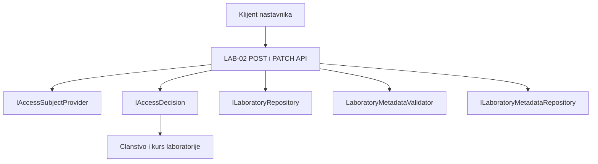

# LAB-02: API za nastavnika

## Obim i zavisnosti

Ovaj deo obuhvata unos i izmenu metapodataka, proveru prava preko
`Platform.Access.Contracts.IAccessDecision` i HTTP testove nastavnickog API-ja.
Zahtevi: LAB-02, ACC-05 i SEC-01.

API koristi postojecu laboratoriju i njen trajni LAB-01 ID. Ne kreira novu
laboratoriju niti menja njen naziv. Naziv se uredjuje postojecim LAB-01 API-jem.
Katalog, frontend, migracije, domenska pravila i implementacija Access modula
pripadaju drugim delovima projekta.

| Zavisnost | Uloga i trenutno stanje |
| --- | --- |
| `ILaboratoryRepository` | Provera da laboratorija postoji |
| `ILaboratoryMetadataRepository` | Upis metapodataka; sa `ConnectionStrings:Authoring` koristi `PersistentMetadataRepository`, inace samo u Development-u memorijski stub |
| `ILaboratoryMetadataStore` | Citanje kataloga: PostgreSQL store sa istom tabelom kao metadata adapter, ili `MetadataCatalogStore` most ka istom razvojnom repozitorijumu |
| `LaboratoryMetadataValidator` | Postojeca validacija; API vraca njene greske po poljima |
| `IAccessSubjectProvider` | Identitet pozivaoca |
| `IAccessDecision` | Serverska odluka za `lab.draft.manage` nad resursom `laboratory` i konkretnim ID-em |

Repozitorijum u memoriji je KT1 stub: podaci nestaju posle restarta. Sa podesenom
`ConnectionStrings:Authoring` koristi se postojeca tabela laboratorija preko
LAB-02 adaptera; ovaj deo ne menja migracije niti pravi drugi model baze.
Za uspesan pristup potrebni su i podaci o clanstvu
nastavnika i vezi laboratorije sa kursom, koje koristi Access modul.

Metadata rute se mapiraju samo kada je `ILaboratoryMetadataRepository`
registrovan u DI-ju. Bez podesene baze u Production i Testing, POST i PATCH
nisu dostupni i vracaju `404`, umesto greske `500` zbog nerazresenog servisa.
Sa podesenom bazom, i u Production/Testing se registruju adapter i obe rute.
`PersistentMetadataRepository` koristi isti `ILaboratoryMetadataStore` kao
katalog za citanje i PATCH, a atomski uslovni SQL UPDATE za POST. Uslov koristi
istu definiciju nedostajucih metapodataka kao store. Jedan upis pobedjuje i pri
konkurentnim zahtevima iz razlicitih procesa; drugi vraca `409`.
Development stub koristi `ConcurrentDictionary.TryAdd`, a katalog pristupa
tom istom stubu preko mosta koji nema zasebno stanje.

HTTP test `PostThenCatalogThenPatchThenCatalog_ReturnsSavedValuesAcrossRequests`
proverava POST -> GET `/api/catalog/{id}` -> PATCH -> ponovni GET, ukljucujuci
cilj, tezinu, tip i oznake. Ne zamenjuje katalog ni metadata skladiste u DI-ju.
Vidljivost, clanstvo, nalog i sesija su kontrolisani testni podaci.
`ConfiguredPersistentStorage_RegistersAdapterAndBothRoutes` proverava stvarni
Production/Testing DI i mapiranje sa konfigurisanom bazom bez kontakta sa bazom.
To nije zamena za izvrsavanje PostgreSQL testa.

Za izolovan PostgreSQL HTTP test u Development, Production i Testing okruzenju:

```powershell
.\scripts\test-metadata-postgres.ps1
```

Skripta koristi zaseban privremeni kontejner, nasumicnu lozinku i test baze sa
prefiksom `lab02_test_`. Proverava upis, konflikt, katalog i PATCH i uklanja svoj
kontejner. Podaci iz stvarnih baza se ne koriste. `EnsureCreated` u testu ne
predstavlja proveru migracija; produkcija koristi postojece migracije tima.

## Rute i zahtevi

Obe rute primaju `Content-Type: application/json`. `{id}` je GUID postojece
laboratorije. Ove metadata rute nemaju `/api/labs` alias.

| Metod i ruta | Namena | Uspeh |
| --- | --- | --- |
| `POST /api/laboratories/{id}/metadata` | Prvi unos metapodataka postojece laboratorije | `201 Created`, JSON i `Location` zaglavlje |
| `PATCH /api/laboratories/{id}/metadata` | Izmena postojecih metapodataka | `200 OK` i JSON |

Primer POST zahteva:

```http
POST /api/laboratories/cccccccc-cccc-cccc-cccc-cccccccccccc/metadata
Content-Type: application/json

{
  "objective": "Nauciti osnove kontrole pristupa",
  "difficulty": 0,
  "type": 0,
  "tags": ["bezbednost", "osnove"]
}
```

Primer PATCH zahteva koristi istu rutu i celo telo metapodataka:

```json
{
  "objective": "Primena kontrole pristupa u okviru kursa",
  "difficulty": 1,
  "type": 0,
  "tags": ["bezbednost", "autorizacija"]
}
```

PATCH trenutno zamenjuje sva cetiri metapolja; ne implementira JSON Patch niti
delimicno spajanje samo prosledjenih polja.

| Polje | Trenutna pravila |
| --- | --- |
| `objective` | Neprazan tekst, najvise 2000 znakova nakon uklanjanja okolnih razmaka |
| `difficulty` | Broj: `0` Easy, `1` Medium, `2` Hard |
| `type` | Broj: `0` AccessControl, `1` LogAnalysis, `2` SecurityConfiguration, `3` ThreatModeling, `4` MfaAndSessions, `5` ContextualAuthorization, `6` IncidentResponse, `7` IsolatedService |
| `tags` | Niz koji nije `null`, najvise 20 stavki, najvise 64 znaka po stavci; prazna lista je dozvoljena |

Slati numericke vrednosti enum polja. Trenutni ugovor koristi nenullabilne enum
vrednosti: izostavljeni `difficulty` ili `type` dobijaju podrazumevanu vrednost
`0`, pa se njihovo izostavljanje trenutno ne odbija kao obavezno polje.
Strozu proveru prisustva treba usaglasiti sa Osobom 3.

Domenski model uklanja okolne razmake cilja, a oznake pretvara u mala slova,
uklanja prazne oznake, okolne razmake i duplikate.
Broj i duzina oznaka proveravaju se pre normalizacije, pa se broje i duplikati.
POST i PATCH prihvataju najvise 32 KiB tela zahteva. Ogranicenje se proverava
pre deserijalizacije i kada `Content-Length` nije poslat.

## Odgovori i greske

Primer odgovora na uspesan POST (`201`):

```http
Location: /api/laboratories/cccccccc-cccc-cccc-cccccccccccc/metadata
Content-Type: application/json

{
  "laboratoryId": "cccccccc-cccc-cccc-cccc-cccccccccccc",
  "objective": "Nauciti osnove kontrole pristupa",
  "difficulty": 0,
  "type": 0,
  "tags": ["bezbednost", "osnove"]
}
```

PATCH vraca isti oblik JSON-a sa sacuvanim novim vrednostima, bez kreiranja
novog ID-a laboratorije.

| Status | Uslov |
| --- | --- |
| `400 Bad Request` | Neispravan JSON, `null` telo ili neuspesna validacija |
| `401 Unauthorized` | `IAccessSubjectProvider` nije pronasao subjekta |
| `403 Forbidden` | Odluka Access modula nije `Allow` |
| `404 Not Found` | Laboratorija ne postoji; za PATCH i kada metapodaci ne postoje |
| `409 Conflict` | POST kada metapodaci vec postoje |
| `413 Payload Too Large` | Telo zahteva prelazi 32 KiB |
| `415 Unsupported Media Type` | Telo nije poslato kao JSON |

Pristup se proverava pre citanja zahteva i metapodataka. Postojeci middleware
moze odbiti zahtev pre handlera; prikazani odgovori nisu zamena za integraciju
sa stvarnim identitetom i sesijom.

Validaciona greska je `application/problem+json`; primer relevantnih polja:

```json
{
  "title": "One or more validation errors occurred.",
  "status": 400,
  "errors": {
    "objective": ["Laboratory objective is required."]
  }
}
```

Ostala polja Problem Details odgovora moze dodati ASP.NET Core.
Primeri poruka koje sam handler vraca:

```json
{"error": "Invalid JSON request."}
```

```json
{"error": "Request body is required."}
```

```json
{"error": "Laboratory metadata already exists."}
```

```json
{"error": "Laboratory metadata was not found."}
```

Centralni Access middleware oblikuje odgovore `401` i `403`. Handler za
nepostojecu laboratoriju vraca `404` bez tela. Klijent ne treba da svaki odgovor
bezuslovno deserijalizuje kao JSON. Neispravan GUID u putanji ne odgovara ruti.

## Provera prava i dijagram arhitekture

API ne odlucuje prema ulozi koju posalje klijent. Centralni middleware poziva `IAccessDecision` sa
serverom dobijenim subjektom, akcijom `lab.draft.manage`, konkretnim resursom i
`HttpContext.TraceIdentifier`. Svaki ishod razlicit od `Allow` se odbija.
Podrazumevano odbijanje nepoznate akcije obezbedjuje postojeci Access modul.

Uskladjivanje 26. 11. 2026: obe metadata rute koriste
`RequireAccess(AccessActions.LabDraftManage.Id, "laboratory", "id")`.
Centralni Access middleware proverava istu radnju i konkretni resurs pre
handlera; handleri ne ponavljaju poziv `IAccessDecision`. Stari marker delegirane
autorizacije i spisak odobrenih ruta vise se ne koriste u aktuelnom `main`-u.

Tok metadata zahteva:



Na zajednickom sastanku objasniti ulazni JSON, proveru identiteta i prava,
validaciju, upis i povratni HTTP odgovor. Ovaj dokument sam po sebi ne dokazuje
ucesce na sastanku ili pregled zajednickog PR-a za dijagrame.

## Testovi i KT1 demonstracija

Iz korena repozitorijuma:

```powershell
dotnet test backend/Laboratories.Tests/Laboratories.Tests.csproj --configuration Release --filter FullyQualifiedName~LaboratoryMetadata
```

| Test | Dokaz |
| --- | --- |
| `CourseTeacher_CanCreateLaboratoryMetadata` | POST vraca `201` i cilj je sacuvan |
| `CourseTeacher_CanUpdateLaboratoryMetadata` | PATCH vraca `200` i cilj je izmenjen |
| `Student_CannotUpdateLaboratoryMetadata` | PATCH vraca `403` |
| `TeacherOfAnotherCourse_CannotUpdateLaboratoryMetadata` | PATCH vraca `403` |
| `WithoutStorage_MetadataRoutesAreNotExposed` | Production/Testing, POST/PATCH: stvarni host pokrece DI validaciju, ruta nije mapirana i zahtev vraca `404` (4 slucaja) |
| `ConcurrentPosts_CreateExactlyOneRecord_AndReturnConflictForTheOther` | Dva zahteva se susrecu pre upisa; jedan dobija `201`, drugi `409`, sacuvan je odgovor pobednika |
| `PostThenCatalogThenPatchThenCatalog_ReturnsSavedValuesAcrossRequests` | Stvarne HTTP rute, zajednicki razvojni repozitorijum i provera svih metapolja u katalogu posle POST/PATCH; validna sesija bez CSRF tokena dobija `403 csrf_invalid` bez upisa |
| `ConfiguredPersistentStorage_RegistersAdapterAndBothRoutes` | Production/Testing: DI bira PostgreSQL adapter i mapira obe metadata rute |
| `PostgreSql_PostCatalogPatchCatalog_UsesOnePersistentStore` | Tri okruzenja sa pravim PostgreSQL-om; upis, konkurentni konflikt, GET kataloga, izmena i novi GET |
| `WithoutCatalogStore_HostStartsAndCatalogIsNotMapped` | Nedostatak skladista ne rusi host niti izlaze nefunkcionalne rute kataloga |
| `Post_WithoutPermission_DoesNotCreateMetadata` | Student i nastavnik drugog kursa: `403`; anonimni zahtev: `401`, bez upisa |
| `Post_MissingLaboratory_DoesNotCreateMetadata` | Dozvoljen kurs, nepostojeca laboratorija: `404`, bez upisa |
| `InvalidMetadata_IsRejectedWithoutChangingStorage` | POST/PATCH: nepoznati difficulty/type, previse oznaka i preduga oznaka daju `400` sa greskom polja, bez promene podataka |
| `OversizedBody_IsRejectedWithAndWithoutContentLength` | POST/PATCH: telo iznad 32 KiB daje `413`, sa i bez poznate duzine, bez promene podataka |
| `BoundaryValues_AreAccepted_WithOneCentralAccessDecision` | POST/PATCH prihvataju granicne vrednosti i koriste tacno jednu centralnu odluku pristupa |

Testni klijent toka katalog/metapodaci koristi zajednicki
`Platform.Identity.Testing.CreateCsrfClient`: pribavlja token sa `/api/auth/csrf`
i salje cookie/token par za istu sesiju. CSRF middleware ostaje ukljucen,
ukljucujuci PostgreSQL provere u sva tri okruzenja.
Provera posle uskladjivanja sa `main` (`1ea6a41`): 375 proslih laboratorijskih
testova, 0 neuspesnih; 3 PostgreSQL slucaja izvrsena zasebno u proveri sa svih
7 uspesnih testova. Dokazi: `TestResults/lab02-csrf/laboratories.trx` i
`TestResults/metadata-768d023d173b44dba361b75be5734e39/metadata.trx`.

Dopuna review-a 26. 11. 2026: 18 novih HTTP slucajeva u
`LaboratoryMetadataRequestTests`. Ceo `Laboratories.Tests`: 375 proslih,
0 neuspesnih i 3 uslovno preskocena PostgreSQL slucaja. Svih 7 PostgreSQL
HTTP testova proslo je zasebno, bez preskakanja. `Platform.Tests`: 436 proslih;
`Platform.LabMetadata.Tests`: 21 prosao. Izvestaji:
`TestResults/lab02-request-review/` i
`TestResults/metadata-96683bffba62461bb5c45fa22d4c6eb1/metadata.trx`.

Lokalna provera 18. 11. 2026, nakon uskladjivanja sa `main` (`b43cdd0`):
svih 9 LAB-02 testova prolazi. Ceo `Laboratories.Tests` paket: 343 prosla,
0 neuspesnih, 0 preskocenih; `ApiEndpointCoverageTests`: 2 prosla.
Ovo nisu rezultati novog GitHub CI-ja; on se proverava nakon slanja izmena.

Provera PostgreSQL integracije 26. 11. 2026: sedam testova izvrseno i proslo,
bez preskakanja. TRX: `TestResults/metadata-ea864bdfb3744739849fb122c5f6fb1d/metadata.trx`.
Zavrsni ceo `Laboratories.Tests` paket istog datuma: 357 proslih, 0 neuspesnih,
3 uslovno preskocena PostgreSQL slucaja (sva tri izvrsena i prosla u zasebnoj
proveri iznad). Paket se zavrsio, bez hang dump-a. Izvestaj:
`TestResults/lab02-review-final/laboratories.trx`.
Obe Access provere prolaze; izvestaj:
`TestResults/lab02-review-final/access-routes.trx`.
Skripta sada radi i u Windows PowerShell-u bez instalacije `pwsh`.
CI korak `Test LAB-02 metadata and catalog with isolated PostgreSQL` pokrece
istu skriptu; ne prihvata zelenu proveru sa preskocenim PostgreSQL slucajevima.

Redosled demonstracije:

1. Pokazati POST i PATCH handler i njihov poziv `IAccessDecision`.
2. Pokrenuti navedenu komandu i pokazati cetiri uspesna testa.
3. U testu kreiranja pokazati poslati JSON, status `201` i sacuvani cilj.
4. U testu izmene pokazati status `200` i novu vrednost cilja.
5. U negativnim testovima pokazati studenta i nastavnika drugog kursa, oba sa `403`.
6. Objasniti stub skladista i preostalu integraciju sa Osobom 2 i Access/Identity modulima.

Testovi koriste `WebApplicationFactory`, posebno testno zaglavlje
`X-LAB02-Test-User` i testne podatke o clanstvima i kursu laboratorije.
To zaglavlje radi samo u ovom testnom hostu. Nije mehanizam prijave za zasebno
pokrenut API. Obican Development host koristi drugi provider i nema ove
testne podatke; ne treba tvrditi da isti rucni pozivi vec rade u Postman-u.
Za rucni demo prvo treba dogovoriti razvojni identitet, clanstva i vezu resursa
sa kursom sa vlasnicima odgovarajucih modula.
