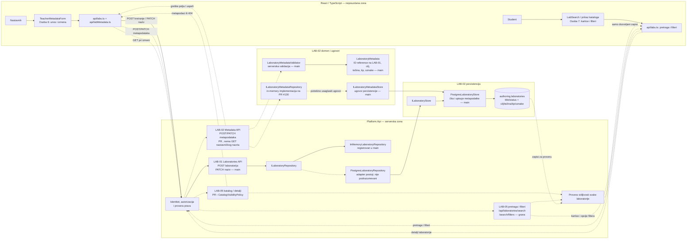
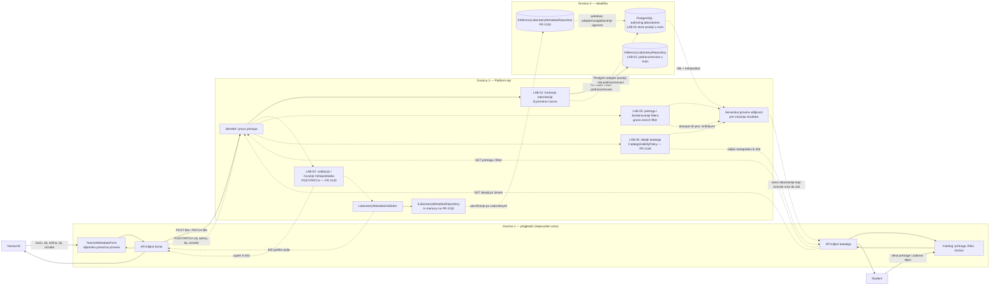

# LAB-02 — timski dijagrami (Tim 20)

Ovaj fajl prikazuje ceo tok LAB-02: model i validaciju metapodataka, perzistenciju, nastavničku formu, API metapodataka, katalog i njegov korisnički interfejs. Ne zamenjuje lični opis Osobe 6 u [LAB-02-frontend.md](LAB-02-frontend.md) i ne obuhvata LAB-06, koji ima zaseban dokument.

**Osnova za status:** lokalno pregledan `main` (`e744fab`). Puna linija označava kod prisutan u `main`; isprekidana linija označava rad na grani/PR-u ili integraciju koja još nije potvrđena u tom `main`.

## Dijagram arhitekture

**Napomena o ugovorima:** `LaboratoryMetadata` ne poseduje naziv niti novi ID. Naziv i identitet laboratorije pripadaju LAB-01; LAB-02 metapodaci koriste postojeći `LaboratoryId`. LAB-01 API u `main` trenutno koristi `InMemoryLaboratoryRepository`; PostgreSQL adapter postoji, ali nije podrazumevano registrovan. PR #130 koristi `ILaboratoryMetadataRepository`, dok je u `main` perzistencioni ugovor `ILaboratoryMetadataStore`; adapter/usaglašavanje između njih je integraciona zavisnost.

## Dijagram toka podataka (DFD)

Puna linija prikazuje tok koji postoji u `main`; isprekidani tokovi pripadaju granama/PR-ovima ili integraciji koja još nije potvrđena. LAB-01 trenutno čuva kroz memorijski repozitorijum; PostgreSQL store i adapter postoje, ali nisu podrazumevani u API-ju. Server odlučuje o pravima, validaciji i vidljivosti; pregledač samo šalje unos i prikazuje odgovor. Katalog ne treba koristiti kao potvrđen način za učitavanje nastavnikovog skrivenog nacrta: `/api/catalog/{id}` može vratiti 404, a PR #130 nema GET za nastavnički nacrt.

## Stanje i preostalo usaglašavanje

- **U `main`:** LAB-02 model, validator, `ILaboratoryMetadataStore`, PostgreSQL store i LAB-01 identitet/naziv laboratorije. LAB-01 modul podrazumevano registruje memorijski repozitorijum.
- **Na granama/PR-ovima:** nastavnički metadata API (PR #130), forma Osobe 6 (PR #145), katalog API (PR #139) i LAB-05 pretraga/filteri i interfejs (grana `feature/search-filter`).
- **Pre integracionog prikaza:** usaglasiti API metadata repozitorijum sa PostgreSQL store ugovorom; potvrditi endpoint za učitavanje sopstvenog nacrta; uskladiti enum vrednosti API-ja sa formom; potvrditi da pretraga i katalog koriste isti serverski odgovor o vidljivosti.