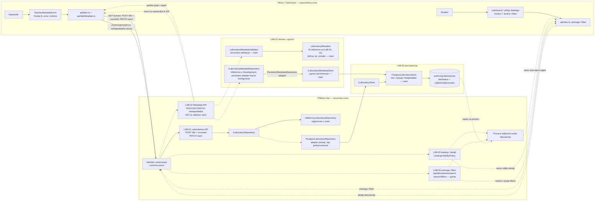
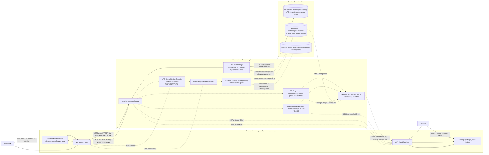

# LAB-02 — timski dijagrami (Tim 20)

Ovaj fajl prikazuje ceo tok LAB-02: model i validaciju metapodataka, perzistenciju, nastavničku formu, API metapodataka, katalog i njegov korisnički interfejs. Ne zamenjuje lični opis Osobe 6 u [LAB-02-frontend.md](LAB-02-frontend.md) i ne obuhvata LAB-06, koji ima zaseban dokument.

**Osnova za status:** `main` u trenutku pregleda (`13dae720`). Puna linija označava kod prisutan u `main`; isprekidana linija označava rad na grani/PR-u ili integraciju koja još nije potvrđena u tom `main`.

## Dijagram arhitekture

**Napomena o ugovorima:** `LaboratoryMetadata` ne poseduje naziv niti novi ID. Naziv i identitet laboratorije pripadaju LAB-01; LAB-02 metapodaci koriste postojeći `LaboratoryId`. `PersistentMetadataRepository` povezuje API ugovor `ILaboratoryMetadataRepository` sa perzistencionim ugovorom `ILaboratoryMetadataStore`; `MetadataCatalogStore` izlaže metapodatke katalogu. U lokalnom Development režimu koristi se memorijsko skladište, a PostgreSQL putanja zavisi od konfiguracije konekcije.

## Dijagram toka podataka (DFD)

Puna linija prikazuje tokove potvrđene u implementaciji. LAB-01 čuva laboratoriju, a LAB-02 zapisuje metapodatke. Nastavnički edit čita nacrt kroz zaštićeni `GET /api/laboratories/{id}/metadata`, jer javni katalog može vratiti 404 za nacrt bez javnog sadržaja. Server proverava prava i validaciju; pregledač šalje `courseId` i metapodatke i prikazuje odgovor.

## Stanje i preostalo usaglašavanje

- **U `main`:** LAB-02 model, validator, metadata API, `ILaboratoryMetadataStore`, PostgreSQL store i LAB-01 identitet/naziv laboratorije. API sloj koristi adapter `PersistentMetadataRepository` kada je PostgreSQL konfigurisan, a razvojno memorijsko skladište lokalno.
- **LAB-02 tok u ovoj grani:** nastavnik bira aktivni kurs; server proverava članstvo; forma kreira laboratoriju, čuva metapodatke i koristi zaštićeni metadata GET za učitavanje nacrta.
- **Tok kataloga:** student koristi zasebni javni katalog i politiku vidljivosti; katalog nije izvor podataka za nastavničku izmenu.
- **Perzistencija:** lokalni razvoj koristi memorijska skladišta; trajno čuvanje koristi adaptere ka PostgreSQL skladištu kada su konekcije konfigurisane.
