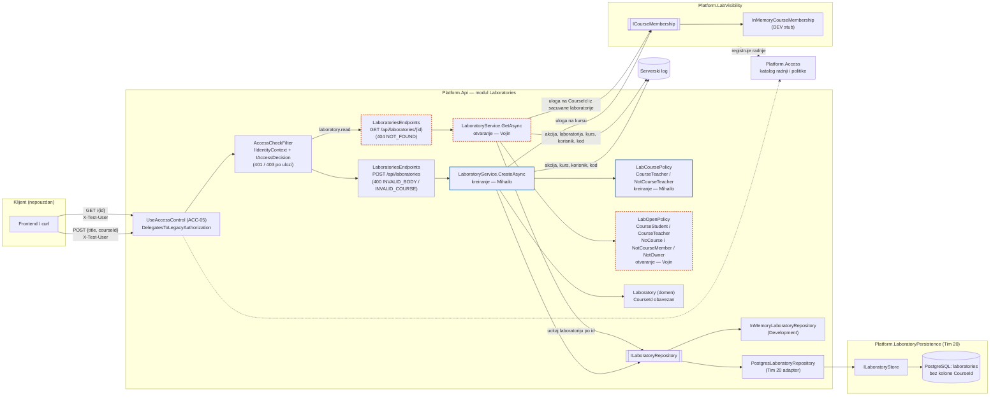
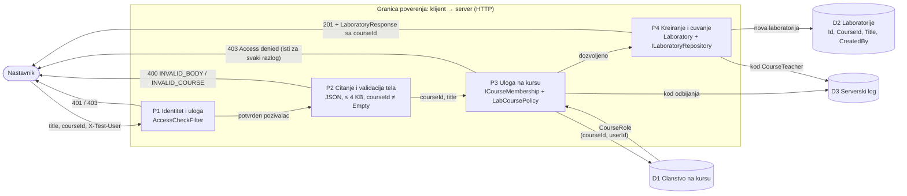
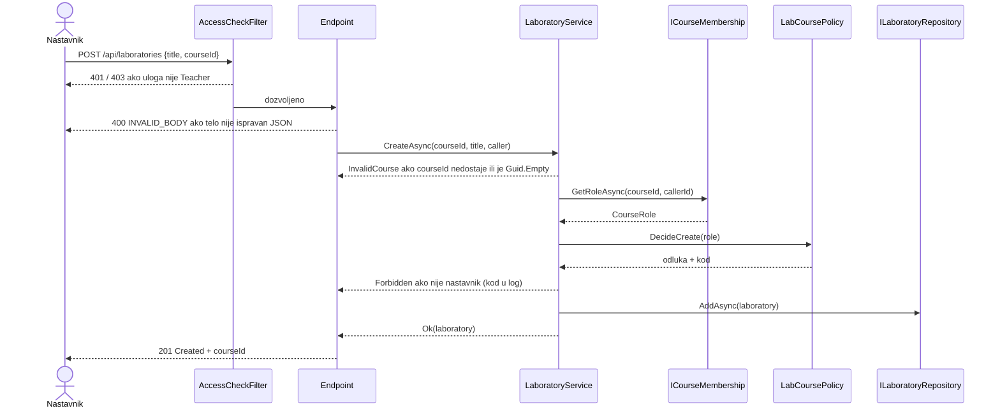
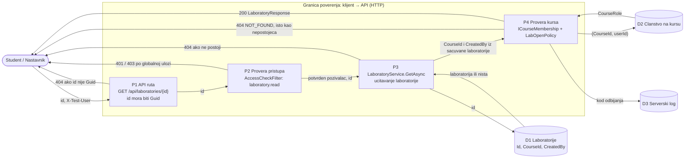
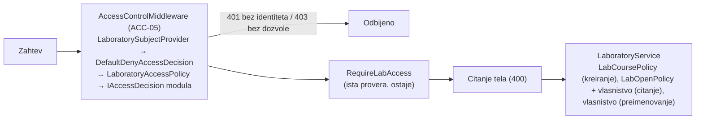

# Komponenta projekta: LAB-03 model veze laboratorija–kurs

**Tim:** Tim 13

**Student:** Mihailo Vojinović / PR84-2021

**Zahtevi iz specifikacije:** LAB-03 (Ј) — vezivanje laboratorije za kurs; kriterijum: nije moguce otvoriti laboratoriju van dozvoljenog konteksta. Zajednicki zahtevi koje ovaj deo pokriva: SEC-01 (serverska autorizacija, IDOR), SEC-05 (validacija ulaza), ACC-04 (autorizacija nad konkretnim resursom), ACC-05 (podrazumevano odbijanje), OPS-07 (poruke o gresci bez tajni).

**Grana:** `feature/LAB-03-model-kursa`

## Odgovornosti i granice

- **Procesi i scenariji:** nastavnik pravi laboratoriju na kursu na kome predaje (`POST /api/laboratories` sa `courseId`). Laboratorija ne moze da nastane bez kursa, a kurs se posle kreiranja ne menja.
- **Sta ovaj deo radi:**
  - `Laboratory.CourseId` (`Guid`, nepromenljiv; `Guid.Empty` se odbija u konstruktoru i u `Rehydrate`).
  - `LabCoursePolicy.DecideCreate(CourseRole)` — samo `Teacher` na tom kursu sme da kreira; svaki ishod ima stabilan kod (`CourseTeacher`, `NotCourseTeacher`).
  - `LaboratoryService.CreateAsync` pita `ICourseMembership` za ulogu pozivaoca bas na trazenom kursu.
  - `InMemoryLaboratoryRepository` cuva `CourseId`; `LaboratoryResponse` ga vraca.
  - Development podaci: dva demo kursa u `Program.cs`.
- **Sta ovaj deo NE radi:** ne proverava kontekst pri otvaranju laboratorije, ne menja PostgreSQL skladiste (Tim 20), ne menja frontend (vidi Otvorene stavke), ne upisuje dogadjaj u `Platform.Audit`.
- **Ugovori sa drugim delovima:**
  - `ICourseMembership` iz `Platform.LabVisibility.Contracts` (dogovoreno; privremeni ugovor dok ACC ne objavi clanstvo).
  - `ILaboratoryRepository` (LAB-01) — ugovor se ne menja, samo `Laboratory` nosi `CourseId`.
  - `IIdentityContext` / `IAccessDecision` (LAB-01) — prva provera po platformskoj ulozi ostaje u `AccessCheckFilter`.
- **Stanje implementacije:** kreiranje sa kursom je implementirano i pokriveno jedinicnim i HTTP testovima. PostgreSQL jos ne cuva `CourseId` (vidi Zahtev za Tim 20).

## Dijagram arhitekture



Oznake: puni plavi okvir je kreiranje (Mihailo), isprekidani narandzasti okvir je otvaranje (Vojin). Ostali cvorovi su zajednicki ili pripadaju drugim timovima.

- `LaboratoryService` zavisi samo od ugovora (`ICourseMembership`, `ILaboratoryRepository`), ne od tehnickih adaptera.
- `LabCoursePolicy` nema zavisnosti: ulaz je uloga, izlaz je odluka sa kodom. Zato se testira bez HTTP-a i bez skladista.
- Kada ACC objavi pravi ugovor za clanstvo, menja se samo registracija `ICourseMembership`; servis i politika ostaju isti.

## DFD: kreiranje laboratorije na kursu



Pretpostavke na granici (koje mogu biti pogresne):

- `courseId` dolazi od klijenta i nije pouzdan: server ga ne prihvata dok ne proveri ulogu bas na tom kursu (P3).
- Identitet u Development rezimu dolazi iz `X-Test-User` zaglavlja (fake). Van Development rezima niko nije prepoznat (`AnonymousIdentityContext`), pa se zahtev odbija pre P2.
- D1 je u Development rezimu stub u memoriji; tacnost clanstva zavisi od ACC modula.

### Sekvenca POST zahteva



## Provera konteksta pri otvaranju (Vojin)

**Student:** Vojin Jovanović / PR 156/2021

**Grana:** `feature/LAB-03-provera-konteksta`

### Odgovornost

- `LaboratoryService.GetAsync` posle ucitavanja laboratorije pita `ICourseMembership` za ulogu pozivaoca na `laboratory.CourseId` i odluku prepusta `LabOpenPolicy.DecideOpen`.
- Odbijanje vraca isti `404 NOT_FOUND` kao nepostojeca laboratorija. Razlog se pise samo u serverski log: `action`, `laboratoryId`, `courseId`, `callerId`, `reason`.
- Nije menjano: `RenameAsync`, lista laboratorija, `FakeAccessDecision`, `Platform.Access` i Mihailov deo (kreiranje).

Pravila `LabOpenPolicy.DecideOpen(courseId, roleOnCourse, isCreator)`, redom; podrazumevano odbijanje:

| Uslov | Odluka | Kod |
| --- | --- | --- |
| laboratorija nema kurs (`Guid.Empty`) | odbij | `NoCourse` |
| student na kursu | dozvoli | `CourseStudent` |
| nastavnik na kursu i autor laboratorije | dozvoli | `CourseTeacher` |
| nastavnik na kursu, ali nije autor | odbij | `NotOwner` (pravilo vlasnistva iz LAB-01) |
| nije clan kursa / nepoznata uloga | odbij | `NotCourseMember` |

Vlasnistvo iz LAB-01 (nastavnik vidi samo svoje laboratorije) vazi samo za nastavnike na kursu; studenti nikad nisu autori, pa za njih odlucuje upis na kurs. Autor koji vise nije clan kursa gubi pristup svojoj laboratoriji.

### DFD: otvaranje laboratorije



Pretpostavke na granici: jedini ulaz od klijenta je `id` iz putanje (i identitet iz `X-Test-User` u Development rezimu). Kurs i autor nikad ne dolaze iz zahteva, vec iz D1. D2 je u Development rezimu stub u memoriji.

### Zasto 404, a ne 403

403 bi potvrdio da laboratorija sa tim ID-em postoji, pa bi korisnik van kursa mogao da proverava (nabraja) tudje ID-eve. Zato odbijanje vraca isti status i isto telo kao nepostojeca laboratorija (isti `LabResult.NotFound`), a pravi razlog vidi samo server u logu. Isto pravilo LAB-01 vec koristi za tudju laboratoriju.

### Zasto se kurs uzima iz sacuvane laboratorije

Kurs iz zahteva bi kontrolisao klijent: korisnik bi poslao kurs na kome jeste clan i tako otvorio laboratoriju sa drugog kursa (IDOR). GET ruta zato i nema `courseId`; provera uvek koristi `laboratory.CourseId` iz skladista.

### Prazan `CourseId`

Laboratorija ucitana kroz privremeni `Rehydrate` bez kursa (PostgreSQL pre migracije Tima 20) ima `CourseId = Guid.Empty`. Takvu laboratoriju ne otvara niko, ni autor (`NoCourse`), a clanstvo se za nju uopste ne pita. Posledica: dok Tim 20 ne doda kolonu, u PostgreSQL rezimu se ne otvara nijedna laboratorija (fail-closed).

### Globalna provera i studenti

`FakeAccessDecision` dozvoljava `laboratory.read` samo platformskoj ulozi `Teacher`. Student zato preko HTTP-a dobija `403` u `AccessCheckFilter`, pre `GetAsync` — za svaki ID, pa ni tako ne saznaje da li laboratorija postoji. Studentski slucajevi su pokriveni servisnim testovima (servis se poziva direktno); preko HTTP-a se LAB-03 provera dokazuje na nastavniku drugog kursa, koji globalnu proveru prolazi. `FakeAccessDecision` i `Platform.Access` nisu menjani.

### Test scenariji (format iz specifikacije 8.1)

| Requirement ID | Preduslov | Akcija | Ocekivano | Dokaz (test) |
| --- | --- | --- | --- | --- |
| LAB-03 | ana je studentkinja na kursu laboratorije | `GetAsync` | Ok, ista laboratorija | `Open_WhenStudentEnrolledOnCourse_ReturnsLaboratory` |
| LAB-03 | marko je nastavnik kursa i autor | `GetAsync` / `GET /{id}` | Ok / 200 sa `courseId` | `Open_WhenCourseTeacherIsCreator_ReturnsLaboratory`, `GetLabById_WhenCourseTeacherOpens_Returns200WithCourse` |
| LAB-03, SEC-01 | mila nije ni na jednom kursu, zna ID | `GetAsync` | NotFound, bez laboratorije | `Open_WhenStudentIsNotOnAnyCourse_ReturnsNotFoundEvenWithKnownId` |
| LAB-03, SEC-01 | luka je student na drugom kursu | `GetAsync` | NotFound | `Open_WhenStudentEnrolledOnOtherCourse_ReturnsNotFound` |
| LAB-03 | neprijavljen korisnik | `GetAsync` / `GET /{id}` | Unauthenticated / 401 | `Open_WhenCallerIsAnonymous_ReturnsUnauthenticated`, `GetLabById_WhenAnonymous_Returns401` (LAB-01) |
| LAB-03, SEC-01 | jelena je nastavnica drugog kursa | `GET /{id}` tudje i nepostojece laboratorije | isti 404, isto telo, bez naslova, ID-a i kursa | `GetLabById_WhenTeacherOfOtherCourseOpens_Returns404SameAsMissing`, `Open_ForeignAndMissingLaboratory_GiveSameResult` |
| LAB-03 | laboratorija bez kursa (`Rehydrate` bez kursa) | `GetAsync` od strane autora | NotFound | `Open_WhenLaboratoryHasNoCourse_ReturnsNotFoundEvenToCreator` |
| LAB-03 | — | `DecideOpen` za svaki ishod | kodovi `CourseStudent`, `CourseTeacher`, `NotOwner`, `NotCourseMember`, `NoCourse`; nepoznata uloga odbijena | `LabOpenPolicyTests` |

Rezultat: `Laboratories.Tests` 150/150 prolazi (2026-11-06, grana `feature/LAB-03-provera-konteksta`). Kontrolna provera: sa starim `GetAsync` (samo vlasnistvo) padaju `Open_WhenStudentEnrolledOnCourse_ReturnsLaboratory` i `Open_WhenLaboratoryHasNoCourse_ReturnsNotFoundEvenToCreator`; negativni testovi prolaze i sa starim pravilom jer je ono strozije, pa cuvaju granicu od buduceg popustanja.

### Demonstracija

Tok preko HTTP-a demonstrira se na nastavniku koji nije nastavnik kursa laboratorije: prolazi globalnu proveru (`Teacher`), a LAB-03 provera ga odbija sa 404. Studentski slucajevi se demonstriraju kroz servisne testove.

```powershell
# 1) nastavnik 1111 pravi laboratoriju na kursu aaaa -> 201, zapamtiti "id"
curl.exe -i -X POST http://localhost:5080/api/laboratories `
  -H "Content-Type: application/json" `
  -H "X-Test-User: 11111111-1111-1111-1111-111111111111:Teacher" `
  -d '{\"title\":\"Kontrola pristupa\",\"courseId\":\"aaaaaaaa-aaaa-aaaa-aaaa-aaaaaaaaaaaa\"}'

# 2) isti nastavnik otvara -> 200
curl.exe -i http://localhost:5080/api/laboratories/<ID> `
  -H "X-Test-User: 11111111-1111-1111-1111-111111111111:Teacher"

# 3) korisnik 3333 sa ulogom Teacher (nije clan kursa aaaa) -> 404
curl.exe -i http://localhost:5080/api/laboratories/<ID> `
  -H "X-Test-User: 33333333-3333-3333-3333-333333333333:Teacher"

# 4) isti korisnik, nepostojeci ID -> isti 404 i isto telo kao u koraku 3
curl.exe -i http://localhost:5080/api/laboratories/00000000-0000-0000-0000-000000000001 `
  -H "X-Test-User: 33333333-3333-3333-3333-333333333333:Teacher"

# 5) studentski slucajevi i politika kroz testove
dotnet test backend/Laboratories.Tests --filter "FullyQualifiedName~LaboratoryServiceTests.Open_|FullyQualifiedName~LabOpenPolicyTests"
```

U Development podacima nema nastavnika drugog kursa, pa se u koracima 3 i 4 koristi korisnik 3333 sa platformskom ulogom `Teacher` (na kursu `bbbb` je student, na `aaaa` nije clan). Tacan scenario "nastavnik drugog kursa" pokriva HTTP test `GetLabById_WhenTeacherOfOtherCourseOpens_Returns404SameAsMissing`.

### Sta ostaje za KT2

- **ACC: `laboratory.read` za studente.** Dok ACC (sada `FakeAccessDecision`) ne dozvoli citanje studentima, student preko HTTP-a dobija 403 pre LAB-03 provere. Tada dodati HTTP testove za studentske slucajeve.
- **Rizik LAB-04 / LAB-09 (nije reseno u LAB-03):** sve laboratorije su sada `Draft`, jer objava jos ne postoji. Kad student dobije citanje, student na kursu bi otvorio nacrt i video pun `LaboratoryResponse` (ukljucujuci `CreatedBy`). LAB-04 trazi da student ne vidi nacrt, a LAB-09 da studentski prikaz sadrzi samo dozvoljene metapodatke.
- **`RenameAsync`:** i dalje proverava samo vlasnistvo. Treba ista provera (nastavnik na kursu i autor): sada autor koji vise nije na kursu i dalje moze da preimenuje svoju laboratoriju, ukljucujuci laboratoriju bez kursa.
- **Lista (`GET /`):** sada vraca praznu listu. Kad se implementira, mora da filtrira po istoj politici (LAB-05: rezultati postuju prava pristupa korisnika).
- **PostgreSQL:** dok Tim 20 ne doda kolonu `CourseId`, sve laboratorije iz baze su bez kursa i ne otvaraju se nikome (vidi Prazan `CourseId`).
- **Audit:** kodovi odbijanja idu u serverski log; za `Platform.Audit` vazi isti predlog kao za kreiranje (Otvorene stavke).
- **Status upisa i stanje kursa:** `ICourseMembership` vraca samo ulogu; ispisan student (ACC-15) ili arhiviran kurs (ACC-02) zavise od ACC ugovora.
- **Preostali rizik:** clanstvo se pita samo za postojecu laboratoriju, pa se odgovori za postojecu i nepostojecu mogu neznatno razlikovati po vremenu. Za stub u memoriji to je zanemarljivo; proveriti kad clanstvo bude u bazi.

### Fajlovi (otvaranje)

- `backend/Platform.Api/Modules/Laboratories/Application/LabOpenPolicy.cs` (nov)
- `backend/Platform.Api/Modules/Laboratories/Application/LaboratoryService.cs` (samo `GetAsync`)
- `backend/Laboratories.Tests/LabOpenPolicyTests.cs` (nov)
- `backend/Laboratories.Tests/LaboratoryServiceTests.cs`, `LaboratoriesHttpTests.cs` (nove sekcije, postojeci testovi nisu menjani)

## Rute i centralni ACC-05 middleware (issue #185)

Svaka ruta modula ima tacno jedan `RequireAccess` (ACC-05) i, kao i ranije, `RequireLabAccess` sa istom radnjom. `DelegatesToLegacyAuthorization()` je uklonjen sa grupe ruta (to je bila oznaka, ne provera; ACC-05 je odbija). `Platform.Access` nije menjan.

| Ruta (i alias `/api/labs`) | Radnja | Scope / resurs | Politika |
| --- | --- | --- | --- |
| `GET /api/laboratories/` | `laboratory.list` | Authenticated / — | `LaboratoryAccessPolicy` |
| `POST /api/laboratories/` | `laboratory.create` | Authenticated / — | `LaboratoryAccessPolicy` |
| `GET /api/laboratories/{id}` | `laboratory.read` | Authenticated / — | `LaboratoryAccessPolicy` |
| `PATCH /api/laboratories/{id}/title` | `laboratory.rename` | Authenticated / — | `LaboratoryAccessPolicy` |

- `LaboratoryAccessPolicy` ponavlja postojecu LAB proveru: pita isti `IAccessDecision` koji koristi `RequireLabAccess` (`FakeAccessDecision` u Development-u, `DenyAllAccessDecision` van njega). Centralna odluka zato ne olabavljuje pravila: student i dalje ne kreira, ne cita i ne preimenuje laboratorije preko HTTP-a.
- `LaboratorySubjectProvider` daje centralnom middleware-u subjekat iz istog identiteta modula (`IIdentityContext`: `X-Test-User` u Development-u, niko van njega). Vazi samo za rute ciji je `RequireAccess` jedna od cetiri `laboratory.*` radnje (po metapodatku rute, ne po putanji); ostale rute, i LabVisibility rute pod `/api/labs`, idu originalnom provajderu.
- Radnje, politika i dekorator se registruju u `AddLaboratories()`, bez izmena `Program.cs`. Na grani ACC-05 `AddLaboratories()` se poziva pre `AddAccessControl()`.

Redosled provera za jedan zahtev:



Ishodi su isti kao pre: bez identiteta 401, student na create/read/rename 403, student na listu 200, van Development-a 401. Telo 401/403 sada pise ACC-05 middleware (`ProblemDetails` sa `correlationId`), bez podataka o laboratoriji. Testovi: `LaboratoriesAccessTests` (metapodaci svake rute, 401/403 kroz centralni middleware, politika i dekorator); svi postojeci `Laboratories.Tests` prolaze bez izmene ocekivanih ishoda.

## Bezbednosni zahtevi

- **Provere na serveru:** dve provere, redom:
  1. `AccessCheckFilter`: platformska uloga `Teacher` za `laboratory.create`.
  2. `LaboratoryService`: uloga na trazenom kursu kroz `ICourseMembership` i `LabCoursePolicy`.
  Provera kursa je pre provere naslova, pa ko nije nastavnik ne dobija ni gresku validacije naslova.
- **Validacija ulaza:** `courseId` je obavezan; nedostaje ili `Guid.Empty` daje `400 INVALID_COURSE`. Neispravan Guid u JSON-u daje `400 INVALID_BODY` (postojece citanje tela iz LAB-01). Domen dodatno odbija `Guid.Empty` (`ArgumentException`), pa laboratorija bez kursa ne moze nastati ni zaobilazenjem servisa.
- **Mass assignment:** `RenameLaboratoryRequest` nema `CourseId`, a `UpdateAsync` ne menja kurs; laboratorija se ne moze premestiti na drugi kurs.
- **Osetljivi podaci:** odbijanje vraca isti `403 Access denied` za nepostojeci kurs, kurs na kome korisnik nije clan i kurs na kome je student. Odgovor ne sadrzi ID kursa ni ulogu. Razlog (`NotCourseTeacher`) se pise samo u serverski log, uz radnju, kurs i korisnika; bez tajni.
- **Negativni scenariji:** vidi tabele ispod.

### Pretnja → kontrola → test → dokaz

| Pretnja | Kontrola | Test |
| --- | --- | --- |
| Nastavnik menja `courseId` u telu i pravi laboratoriju na tudjem kursu (IDOR) | Uloga se proverava bas na trazenom kursu | `PostLabs_WhenTeacherSwapsCourseId_Returns403AndStoresNothing`, `Create_WhenTeacherUsesCourseNotTaught_ReturnsForbiddenAndStoresNothing` |
| Nastavnik koji nije clan kursa pravi laboratoriju | Podrazumevano odbijanje u `LabCoursePolicy` | `PostLabs_WhenTeacherIsNotMemberOfCourse_Returns403AndStoresNothing`, `DecideCreate_WhenNotTeacherOnCourse_Denies` |
| Oslanjanje samo na globalnu ulogu (nastavnik na platformi, student na kursu) | Odlucuje uloga na kursu | `Create_WhenCallerIsStudentOnCourse_ReturnsForbiddenEvenWithTeacherPlatformRole` |
| Student pravi laboratoriju | Filter po ulozi + politika kursa | `PostLabs_WhenStudentCreates_Returns403AndStoresNothing` |
| Nabrajanje kurseva preko razlicitih odgovora | Isti 403 za svaki razlog | `PostLabs_DenialIsSameForExistingAndUnknownCourse` |
| Laboratorija van kursa (van dozvoljenog konteksta) | `courseId` obavezan u API-ju i domenu | `PostLabs_WithoutCourse_Returns400AndStoresNothing`, `Create_WithEmptyCourse_Throws`, `Rehydrate_WithEmptyCourse_Throws` |
| Premestanje laboratorije na drugi kurs kroz PATCH | Ugovor bez `CourseId`, kurs nepromenljiv | `PatchLabTitle_CannotChangeIdCreatorOrCourseThroughBody`, `Rename_KeepsCourse` |
| Nepoznata uloga daje pristup | Podrazumevano odbijanje | `DecideCreate_WithUnknownRole_DeniesByDefault` |

Preostali rizik: dok Tim 20 ne doda kolonu, PostgreSQL ne cuva `CourseId` (vidi ispod); clanstvo je DEV stub; nema dogadjaja u `Platform.Audit`.

### Test scenariji (format iz specifikacije 8.1)

| Requirement ID | Preduslov | Akcija | Ocekivano | Dokaz (test) |
| --- | --- | --- | --- | --- |
| LAB-03 | marko je nastavnik na kursu C | POST sa `courseId = C` | 201, `courseId = C` u odgovoru i skladistu | `PostLabs_WhenTeacherCreatesOnOwnCourse_Returns201WithCourse`, `Create_WhenCallerTeachesCourse_StoresCourse` |
| LAB-03 | nastavnik | POST bez `courseId` / sa `Guid.Empty` | 400 `INVALID_COURSE`, nista sacuvano | `PostLabs_WithoutCourse_Returns400AndStoresNothing`, `Create_WithoutCourse_ReturnsInvalidCourseAndStoresNothing` |
| LAB-03 | jelena (Teacher) nije clan kursa C | POST sa `courseId = C` | 403, nista sacuvano | `PostLabs_WhenTeacherIsNotMemberOfCourse_Returns403AndStoresNothing` |
| LAB-03 | ana je studentkinja na kursu C | POST sa `courseId = C` | 403, nista sacuvano | `PostLabs_WhenStudentCreates_Returns403AndStoresNothing` |
| LAB-03, SEC-01 | marko nije clan kursa D | POST sa `courseId = D` | 403, nista sacuvano | `PostLabs_WhenTeacherSwapsCourseId_Returns403AndStoresNothing` |

Rezultat: `dotnet test backend/SecurityLab.slnx` — `Laboratories.Tests` 134/134 prolazi (2026-11-05, grana `feature/LAB-03-model-kursa`).

## Zahtev za Tim 20 (Platform.LaboratoryPersistence)

Ovaj deo **ne menja** `Platform.LaboratoryPersistence`. Da bi PostgreSQL cuvao kurs, potrebno je:

1. `StoredLaboratory` (`Application/StorageContracts.cs`): dodati `Guid CourseId`.
2. `LaboratoryRecord`: dodati `public Guid CourseId { get; set; }`.
3. `LaboratoryConfiguration`: `builder.Property(x => x.CourseId).IsRequired();` i `builder.HasIndex(x => x.CourseId);` (pretraga laboratorija po kursu).
4. `PostgresLaboratoryStore`: upisati `CourseId` u `AddAsync` i procitati ga u `ToStored`. `UpdateAsync` **ne sme** da menja `CourseId` (isto kao `CreatedBy`).
5. Migracija `AddLaboratoryCourseId` nad tabelom `laboratories`, kolona `CourseId uuid`:
   - postojeci redovi nemaju kurs: kolonu prvo dodati kao nullable, popuniti stvarnim kursom (ili ukloniti razvojne redove), pa tek onda postaviti `NOT NULL`;
   - **ne** koristiti `Guid.Empty` kao podrazumevanu vrednost (to bi bila laboratorija van kursa);
   - spoljni kljuc ka tabeli kurseva dodati kada ACC objavi svoju tabelu.
6. Posle toga u `PostgresLaboratoryRepository` (Platform.Api): proslediti `laboratory.CourseId` u `StoredLaboratory` i citati preko `Laboratory.Rehydrate(id, courseId, ...)`. Tada se brise privremeni `Rehydrate` bez kursa iz `Laboratory.cs`.

Do tada: `PostgresLaboratoryRepository` nije menjan. Ucitava laboratorije kroz privremeni `Rehydrate` bez kursa (`CourseId = Guid.Empty`), a pri upisu se `CourseId` ne cuva. Takva laboratorija nema kurs, pa je provera pri otvaranju odbija.

Jedina izmena u kodu Tima 20 je jedna linija u testu (`Platform.LaboratoryPersistence.Tests/LaboratoryPersistenceIntegrationTests.cs`, `NewLab`), jer konstruktor `Laboratory` sada trazi kurs; bez nje se resenje ne kompajlira.

## Otvorene stavke

- **Frontend (`frontend/src/api/labs.ts`, `createLab`) — nije menjan.** Salje samo `{ title }`, pa posle ove izmene kreiranje sa frontenda dobija `400 INVALID_COURSE`. `createLab` koristi i tim za LAB-07. Plan migracije (OPS-08: ne ukidati javni ugovor bez plana):
  1. dogovor sa LAB-07 timom oko izvora `courseId` (izbor kursa u formi ili kurs iz konteksta stranice);
  2. `createLab(title, courseId, user)` salje `{ title, courseId }`;
  3. poruka za `INVALID_COURSE` u mapi gresaka;
  4. frontend testovi za 400 i 403.
  Do tada backend i frontend nisu uskladjeni; spajanje u main treba uskladiti sa tim izmenama.
- **Audit:** `Platform.Audit` ima `access.denied`, ali `denialReason` dozvoljava samo `unauthenticated`, `account_not_active`, `unknown_action`, `no_policy`, `policy_error`. Predlog Audit timu: dodati razlog npr. `course_role_insufficient`. Do tada se odluka pise u serverski log.
- **Globalna uloga:** `FakeAccessDecision` i dalje trazi platformsku ulogu `Teacher` za `laboratory.create`. Specifikacija (poglavlje 2) razlikuje ulogu po kursu od globalnog statusa; konacnu odluku po kursu donosi ACC.
- **Status upisa i stanje kursa:** `ICourseMembership` vraca samo ulogu. Aktivan upis (ACC-21) i arhiviran kurs (ACC-02) se ne proveravaju; to zavisi od ACC ugovora.

## Dokaz rada

- **Fajlovi:**
  - `backend/Platform.Api/Modules/Laboratories/Domain/Laboratory.cs`
  - `backend/Platform.Api/Modules/Laboratories/Application/LabCoursePolicy.cs` (nov)
  - `backend/Platform.Api/Modules/Laboratories/Application/LaboratoryService.cs`
  - `backend/Platform.Api/Modules/Laboratories/Api/LaboratoryContracts.cs`, `LaboratoriesEndpoints.cs`
  - `backend/Platform.Api/Modules/Laboratories/Infrastructure/InMemoryLaboratoryRepository.cs`
  - `backend/Platform.Api/Program.cs` (samo Development podaci)
  - `backend/Laboratories.Tests/*` (`LabCoursePolicyTests.cs` nov)
- **Pokretanje testova** (iz korena repozitorijuma, .NET SDK 10):

  ```powershell
  dotnet build backend/SecurityLab.slnx
  dotnet test backend/SecurityLab.slnx
  ```

- **Rucna demonstracija** (Development):

  ```powershell
  # nastavnik 1111 na prvom demo kursu -> 201 sa courseId
  curl.exe -i -X POST http://localhost:5080/api/laboratories `
    -H "Content-Type: application/json" `
    -H "X-Test-User: 11111111-1111-1111-1111-111111111111:Teacher" `
    -d '{\"title\":\"Kontrola pristupa\",\"courseId\":\"aaaaaaaa-aaaa-aaaa-aaaa-aaaaaaaaaaaa\"}'

  # isti nastavnik na drugom kursu (nije nastavnik) -> 403
  curl.exe -i -X POST http://localhost:5080/api/laboratories `
    -H "Content-Type: application/json" `
    -H "X-Test-User: 11111111-1111-1111-1111-111111111111:Teacher" `
    -d '{\"title\":\"Kontrola pristupa\",\"courseId\":\"bbbbbbbb-bbbb-bbbb-bbbb-bbbbbbbbbbbb\"}'

  # bez kursa -> 400 INVALID_COURSE
  curl.exe -i -X POST http://localhost:5080/api/laboratories `
    -H "Content-Type: application/json" `
    -H "X-Test-User: 11111111-1111-1111-1111-111111111111:Teacher" `
    -d '{\"title\":\"Kontrola pristupa\"}'
  ```

  Demo podaci: kurs `aaaa…` (1111 nastavnik, 2222 student), kurs `bbbb…` (3333 student).
- **Sledeci koraci:** Tim 20 kolona i migracija; frontend `createLab` sa LAB-07 timom; audit razlog sa Audit timom; zamena `InMemoryCourseMembership` pravim ACC ugovorom.
